# The Great IHC Leap Forward: technical guide

How a slide becomes numbers, and the code that does it.

This guide has two parts. **Part 1** is for scientists. It follows one slide from the scanner's file to the
spreadsheet, says what each stage does to the pixels and the numbers, and explains every library the
pipeline leans on: what we call, with which settings, and how the algorithm inside works. **Part 2** is the
technical specification, for programmers: the architecture, every script, the curators, the app, every file
format and the tests.

The other guides cover the rest, and this one links to them rather than repeating them:

- [User guide](user-guide.md): how to use the app, screen by screen.
- [Pipeline guide](pipeline-guide.md): every stage in depth, with the reasoning and the history behind it.
- [Methods](pipeline-methods.md): the methods section of a paper, with the measured numbers and references.

Names in `code` are the code's own: a script, a function, a setting in the study file or a column in a
table. Every one of them can be found with a search of the repository.

# Part 1: How a slide becomes numbers

## 1. The data

### What a CZI file holds

Every slide is one **CZI** file, Zeiss's format for a whole-slide scan. On the LS study there are 222 files,
about 393 GB, holding 2,572 brain sections. The file has four layers that matter here.

- **Scenes.** When the slide was scanned, someone drew a box around each brain section and told the scanner
  to image it. Each box is a **scene**, and in practice one scene is one section. A slide holds about ten.
  The scenes' rectangles can overlap one another on the glass. On the LS study 219 of the 222 files have at
  least one overlapping pair, so a read that does not name its scene picks up a neighbour's tissue (see
  `docs/czi-reading-audit.md`, finding 1). The pipeline never reads without naming the scene.
- **Tiles.** The camera sees one small field at a time, so a scene is a mosaic of **tiles**: 2040 × 2040
  pixels each, laid on a grid with a pitch of 1836 pixels, so neighbouring tiles overlap by about 10 %.
  The tiles were not blended when the scan was made, and the camera's field is not evenly lit, so a faint
  grid of brighter tile centres and darker tile edges runs across every section. Part of the pipeline
  exists to measure that pattern (section 3.2).
- **Channels.** Each scan records two colours: the counterstain **DAPI**, which stains every nucleus, and
  one **marker**. On the LS study the pERK pass used Alexa Fluor 568 (AF568, red) and the PCNA pass
  Alexa Fluor 488 (AF488, green). The file names the dye, never the antibody, so the study says which
  marker each dye carries (`marker_identity`).
- **Pyramid levels.** Besides the full-resolution tiles, the scanner stored smaller copies of every scene
  at 1/2, 1/4, 1/8 … of the size, for quick viewing. They are averages, so a clipped pixel in a small copy
  is diluted by its neighbours. The pipeline reads a pyramid level only to draw pictures, never to measure.

### Pixels and their values

- **Pixel size: 0.65 µm** at the 10× objective (numerical aperture 0.45), read from the file headers. A
  nucleus is about 7 µm across, so about 11 pixels.
- **16-bit samples.** Every pixel holds a whole number from 0 to 65,535. The camera (a Hamamatsu
  ORCA-Flash4.0) fills all 16 bits: `ComponentBitCount` is 16 for every channel of every file, which
  `00d` checks.
- **Clipping.** A pixel that reached 65,535 has lost its true value: the light could have been anything
  brighter. Such a pixel is **clipped** (or saturated). It is never treated as a measurement of its
  brightness (section 3.4).
- **Compression.** Tiles are stored compressed with **JPEG-XR**, a format that is usually lossy. The loss
  happened when the scanner wrote the file and cannot be undone; the pipeline decodes exactly what was
  stored and adds no loss of its own.

### Why the file is read the way it is

The pipeline reads every pixel that reaches a number with **pylibCZIrw**, Zeiss's own reader, at native
resolution, one named scene and one named channel at a time (section 4.1). Two other readers survive for
narrow jobs: **czifile** reads single raw tiles to measure the camera's uneven lighting, and **Bio-Formats**
(through Fiji) exports one sample for that same measurement. Neither touches a result.

## 2. The journey

```mermaid
flowchart LR
    A[CZI files<br/>scenes, tiles, 2 channels] --> B[Ingest and QC<br/>headers, overviews, pairing]
    B --> C[Normalise<br/>mask artifacts, censor clipping,<br/>standard 256 × 256 frame]
    C --> D{{ROI curator<br/>plate, landmarks, regions}}
    D --> E[Geometry<br/>regions back onto<br/>0.65 µm pixels]
    E --> F[Detection<br/>StarDist nuclei,<br/>marker in each]
    F --> G[Per-region numbers<br/>positivity cut, Abercrombie]
    G -. blinding ends here .-> H[Unblind<br/>join treatment groups]
    H --> I[Workbooks<br/>per sample, per slide]
```

A slide goes in at the left as a CZI file. At the right comes `results/roi_dataset.xlsx`: one row per brain
region per animal, with how many nuclei were counted, how many were positive for the marker, and how many
there are per mm² of tissue. The hexagon is the one place a person decides: matching each section to its
atlas plate and outlining the regions. The instrument characterisation and the atlas building, which are done
once, sit to the side and feed into the overviews and the curator.

### Three rules the pipeline never breaks

1. **The program proposes, a person decides.** Sections with no usable tissue are proposed for exclusion
   and every proposal can be reversed. Atlas matching is done by a person: automatic matching was measured
   twice on this data and found no relationship between section order and the best-matching plate (the
   numbers are in `04l_roi_curator.py`'s docstring and in REFERENCES.md).
2. **Nothing is deleted.** A section set aside keeps a flag saying so and why, in a table, so it can be
   brought back without re-reading any scans.
3. **Blind until the end.** No stage before `06b` reads which treatment group an animal is in
   (`config.blinding` in the code says so). Two deliberate exceptions touch no measurement: `05c` reads the
   group key only to choose the *order* in which sections are measured (`--order balanced`), and the ROI
   curator's Shotgun deck shows favourites side by side by treatment.

### Measuring never loses detail

Every number comes from the scan's own pixels at 0.65 µm. Small pictures (the 5.2 µm overviews, the
256-pixel curation frame, the 2.6 µm scene pictures) are for finding, deciding and looking; when a
decision made on a small picture has to be measured, its geometry is carried back to the full-resolution
pixels and they are read again (section 3.6). A crop that is too big to process at once is cut into a
window, never shrunk.

## 3. Stage by stage

The stages run in the order below. Each heading names the stages by number; the [pipeline guide](pipeline-guide.md)
has an entry for every one.

### 3.1 Ingest and QC (00, 00b, 00d, 01, 01d, 01l, 02, 00c)

**What goes in:** the folder of CZI files. **What comes out:** two tables that every later stage reads, one
small picture of every section, and a record of which scan of which section belongs to which.

- **00 Read slide headers** reads the XML header at the start of each file, without decoding a pixel, and
  writes `manifest/manifest_files.csv` (one row per file) and `manifest/manifest_scenes.csv` (one row per
  section). Nothing in the file says in which order the sections were laid on the glass, so 00 rebuilds
  the slide's grid from the scenes' positions and draws one picture per candidate mounting order for a
  person to confirm once. The order matters because consecutive sections along the brain are 14 µm apart,
  so a section's place in the series is its position along the brain.
- **00b Verify extraction** checks each copied file against the size, and optionally the checksum,
  recorded in the transfer zip.
- **00d CZI self-test** checks the four things every reading stage assumes about the files: the scene
  frame is the same with and without the pyramid, the bit depth is stated and agrees per channel, every
  file opens, and there are files at all. It stops the run (exit code 2) if any file breaks one. It also
  reports, without stopping, how much the scenes overlap and how high the pixel values reach.
- **01 Export section overviews** reads every section at **5.20 µm per pixel** and saves a small picture
  of each channel. It reads continuously, not the nearest stored pyramid level, so every overview has
  exactly that pixel size and tissue areas compare between sections. The brightness of the pictures is set
  once for the whole dataset from tissue pixels and then frozen in `qc/display_ranges.json`, so a brighter
  overview means more signal, not a different stretch. Where the tile correction has been built (section 3.2)
  it is applied here. 01 also writes the quality table `qc/focus.csv` (a focus score, tissue area, the
  fraction of clipped pixels) and the mask of clipped pixels on the raw plane, before any correction,
  which censoring uses later.
- **01d Contact sheets** lays each animal's overviews out in brain order on a few pages, so a gradient
  along the brain reads as a gradient across the page.
- **01l Pictures of every scene** draws each scene at 2.6 µm per pixel (or finer) for looking at, by
  averaging blocks of native pixels; nothing reads these pictures.
- **02 Pair the two marker passes** (paired studies only). The slides were scanned twice, once per marker,
  and the scan boxes were redrawn each time, so scene 3 of one pass is not scene 3 of the other. Reloading
  the slide shifts it by a small amount. 02 finds that shift by letting every possible pairing vote for the
  shift it implies, takes the shift with the most votes, and then pairs the sections under that shift with
  the **Hungarian algorithm** (section 4.2), which finds the pairing with the smallest total distance. It
  writes the `section_uid` that joins the two scans of one physical section.
- **00c Infer marker identity** measures how clustered each marker's signal is and how close it sits to the
  edge of the tissue, and proposes which dye carries which marker (PCNA sits along the ventricles; pERK is
  spread through the tissue). A person confirms the call.

### 3.2 Instrument characterisation (01e, 01b, 01f, 01c, 01h, 01k, 01g)

Done once per microscope. These stages measure the scanner, not the tissue, and are already done for the LS
scanner.

- **Uneven lighting.** Each tile is brighter in the middle than at the edges. 01e reads the exact tile grid
  from the file's directory (an estimate from the image would drift by a whole tile across a section). 01b
  picks a sample of sections from every animal and both markers, 01b's Fiji script exports them, and 01f
  folds every section onto one tile-sized cell and takes the **median** across thousands of cells: tissue
  falls at random places relative to the grid, so it averages out and the lighting pattern is left. The
  result is a gain for every position in a tile (`tilefield_c0.npy`, `tilefield_c1.npy`). 01c measures how
  strong the pattern is before and after, from the frequency spectrum of the tissue brightness. 01h measures
  the same pattern directly from raw tiles with czifile, as a check.
- **Clipping.** 01k measures how much of each section is clipped on the **raw** 16-bit plane, before the
  tile correction (dividing by a gain above 1 lifts a clipped pixel off the ceiling but cannot give it back
  its value), and 01g maps where in the tissue the clipping falls. On the LS study 35 % of AF568 sections
  have more than 2 % of their pixels clipped, and some animals far more than others.

None of these numbers reaches a result directly. The tile correction changes how the overviews look; the
clipping masks decide which pixels are censored.

### 3.3 The atlas (04a, 04a2, 04a3, 04a3b, 04a4, 04w, 04x)

The regions are named and outlined from an atlas. Two come with the app, ready-made:

- **The salmon atlas** (by Marco A. Vindas) is a PDF in which every region is marked by a coloured dot and
  each page has a legend of colours to names. 04a reads the plate images, the dots and the legends straight
  from the PDF with **PyMuPDF** (section 4.5). 04a2 merges plates that the PDF stores as several image
  strips, 04a3 and 04a3b split figures holding more than one section into one plate each (a person checks
  the boxes), and 04a4 renders the final plates from the PDF at full resolution, carrying each dot across
  exactly.
- **The Wullimann zebrafish atlas** (1996) draws each region as a closed outline. 04w arranges its plates
  and 04x turns each enclosed area into a numbered polygon, reading the label inside it with **Tesseract**
  OCR (section 4.5). A label is used only when it matches the plate's own legend closely; anything else is
  left for a person to name.

These stages run only when the plates are rebuilt; a study using a bundled atlas skips them. A lab can also
add its own atlas drawn as ROIs in Fiji (`docs/adding-your-own-atlas.md`).

### 3.4 Normalisation, masking and censoring (04g, 04a, 04f, 04j, 04i, 04m, 04n, 04o, 04p)

**What goes in:** the overviews. **What comes out:** every section in one standard frame, the list of
sections that can be measured, and a colour picture of each for the curator.

- **04g Mask artifacts.** Bubbles, antibody clumps and fibres inside good tissue are found on the DAPI
  overview by their brightness and shape, after the bright rim of the section is trimmed away (eroded by
  6 pixels, 31 µm) so that real anatomy at the edge is not masked. The masked area is small (median 0.13 %
  of the tissue), but those are the brightest pixels in a section, so they are removed before any
  brightness statistic is taken.
- **04a Reformat.** Each section becomes a **256 × 256 picture** in a standard frame, so that a position
  means the same thing on every section. The tissue is found, specks are dropped, the section is turned so
  its long axis lies horizontal (from the principal axis of the tissue mask), centred, cropped, padded to a
  square and resized. The 180° ambiguity of an axis is settled by putting the heavier half on the same
  side. Brightness is stretched on each section's own median and spread. Every step is recorded so that it
  can be undone exactly (section 3.6).
- **04f Propose unmeasurable sections.** Two rules, both deliberately cautious, because a section wrongly
  excluded vanishes with its evidence: **no tissue** (the largest piece of tissue is under 2.5 mm²) and
  **out of focus** (focus score below 0.070, meaning no nuclear detail is visible). Proposals are applied by
  04a and can be reversed in the curator's Review.
- **04j Censor clipped pixels.** Two separate decisions. A section with 1 % or more of its *tissue* pixels
  clipped is set aside from the analysis set (recorded, not deleted). In the sections that stay, a clipped
  pixel is **censored**: its true value is unknown but at least the ceiling. That is different from an
  artifact. A censored pixel is left out of every brightness statistic (it would drag them), but a nucleus
  on clipped pixels still counts, and counts as positive, because a pixel at the ceiling is unambiguously
  bright. Dropping it would undercount positives in exactly the brightest animals.
- **04i Carry the curation onto the second scan** (paired studies). Exclusions transfer directly, because
  it is one physical section imaged twice. Rotations are re-derived by turning the second scan's tissue
  mask until it best overlaps the first's, over the full 360°. Artifacts are not carried, because they
  belong to each scan's own field; 04g runs on each scan.
- **04m, 04p** keep one row per section with what happened to it (measured, set aside for clipping,
  excluded), so the rejected sections stay in the data and can be checked against treatment at unblinding.
- **04n Order the ROI queue** so that any part of the queue is a usable dataset: every animal advances at
  the same rate through its own series, and within an animal the first sections taken span the brain.
- **04o Colour composites** paint the marker over the counterstain in the same 256-pixel frame, by carrying
  the marker through exactly the same rotation, crop and resize as the DAPI it rides with, so a landmark
  placed on the colour picture is placed on the right pixel.

### 3.5 Curation (04l, 04q)

The **ROI curator** (04l) is a web page the app shows. For each section a person:

1. scrubs through the atlas plates until one matches the section;
2. clicks matching points, once on the section and once on the plate. Three pairs fix an **affine**
   transform (a turn, a stretch, a shear and a shift) by least squares; from six pairs the curator switches
   to a **thin-plate spline**, which can follow the local warping that cutting and mounting put into a
   section;
3. sees the atlas regions carried onto the section through that transform, and draws or adjusts each
   region's outline, plus **background discs** on tissue with no real signal.

Exporting writes three tables: `roi_plates.csv` (the plate and flags per section), `roi_landmarks.csv`
(every point pair) and `roi_regions.csv` (every region and disc, in the 256-pixel frame). 04q reads such an
export back, so work done in a browser can come back into the study.

### 3.6 Geometry: back to the slide's own pixels (05a)

A region drawn on the 256-pixel picture spans about 25 µm per pixel; a nucleus is 7 µm. So every region has
to go back onto the scan. 04a built the 256 frame from six steps (resize the overview to a 400 square,
rotate, flip, crop, pad, resize to 256). Each is affine, so together they are one affine map, a 2 × 3
matrix per section. 05a finds it by pushing three points through the same steps and reading the matrix
off them, then inverts it to carry each region's outline from the 256 frame to the overview and from the
overview to the CZI's own pixels. It writes, per marker, `reformatted/roi_geometry_<marker>.csv` (the
matrix per section) and `reformatted/roi_boxes_<marker>.csv` (each region's bounding box in CZI pixels).

`05a --verify` checks the matrix against the real steps over every pixel of the frame: they agree to
0.04–0.15 pixel, and that residual is Pillow's own resizing. A circle on the 256 frame is an ellipse on the
slide, because the first step squeezes a rectangular scan box into a square; that is why membership is
decided by mapping each pixel back, not by a radius.

### 3.7 Detection and measurement (05b, 05c)

**05b Check signal quality and tune detection.** For each marker, a sample of regions spread evenly over the
animals (the group key is never read) is read at full resolution, on the plane detection will use. 05b
measures the background, the foreground, the noise, their ratio and the share of clipped pixels, and
gives a verdict: good, marginal or poor. It then runs StarDist at a range of probability cuts (0.30 to 0.80
in steps of 0.05, plus the model's own 0.479) and keeps the cut where the number of nuclei changes least,
so the count reflects the nuclei rather than where the cut was put. One cut per marker for the whole
study, never per section: a per-section cut would follow brightness, and brightness can follow treatment.
A *poor* verdict stops Run all remaining before detection.

**05c Detect and measure nuclei.** For every region and background disc:

1. **Read** the region's box from the CZI at 0.65 µm, both channels, naming the scene.
2. **Stretch** the detection plane to the range StarDist was trained on: each box to its own 1st and 99.8th
   percentiles. For a marker counted on its own channel (PCNA on the LS study, whose DAPI plane is noise),
   every box of a section shares one range instead, so a bright zone cannot hide dim nuclei and a
   background disc's noise does not look like signal; that range is kept in `results/roi_normalisation.csv`.
3. **Find nuclei** with **StarDist** (section 4.3) on DAPI, or on the marker itself where the study says
   so (`acquisition.marker_segmentation`). Nuclei are found on the counterstain, not on the marker, so
   that finding a cell and calling it positive are two separate decisions.
4. **Keep** a nucleus only if its centre falls inside the drawn outline, not merely inside the box.
5. **Measure** each nucleus with scikit-image's `regionprops` (section 4.2): its area, its equivalent
   diameter, its mean DAPI, and the mean, median and 90th percentile of the marker inside it. Flag it
   `censored` if it covers clipped pixels, `artifact` if it sits on 04g's mask, and `off_tissue` if it
   lies outside the section's tissue.
6. **Write** one row per nucleus to `results/roi_nuclei.csv`, the outlines to `detection_outlines/`, and
   draw the region's detection overlay picture.

Detection takes hours; finished sections are kept, so a stopped run resumes.

### 3.8 Per-region numbers (06a)

06a turns nuclei into numbers per region, still keyed by animal only.

- **The positivity cut** is set per section from that section's background discs, from the marker median
  of each disc nucleus that is not censored, on an artifact or off the tissue:

  > cut = median + 3 × 1.4826 × MAD

  The MAD (median absolute deviation) times 1.4826 is a robust stand-in for the standard deviation; robust
  because a few bright objects in a disc would inflate a standard deviation and raise the very cut meant to
  find them. A nucleus is **positive** if its marker median is above the cut, or if it is censored. A
  section with fewer than 5 usable background nuclei gets no cut, and its positives are left blank rather
  than guessed.
- **The false-positive rate.** How many background-disc nuclei land above the cut is then a measurement,
  not a choice, and is reported in `results/detector_specificity.csv`. It is not a negative control: the
  antibody is on that tissue too.
- **The Abercrombie correction.** A 14 µm section imaged in one plane shows nuclear profiles, and a nucleus
  cut across two consecutive sections appears in both. Counts are corrected by N = n × T / (T + h), with
  T the section thickness and h the mean nucleus diameter measured per marker and region.
- **Densities** are per mm² of region on the slide. For a marker counted on its own channel there is no
  count of all cells, so the fraction positive and the total density are left blank with
  `denominator_withheld_reason` saying why; positive density is reported.

### 3.9 Results and statistics (06b, 06c, 06d, 06e, 06i, R)

- **06b Join the experiment** is the unblinding step: it reads the sampling workbook, matches each animal
  to its treatment group by the columns chosen in Set up, and checks the cohort against the workbook's own
  record of which animals were sliced.
- **06c and 06d** write the workbooks with **openpyxl** (section 4.6): one row per region per animal
  (`roi_dataset.xlsx`, the one to test on, because the animal is the unit) and one per region per slide
  (`roi_dataset_by_slide.xlsx`, to show the spread within an animal). 06e rebuilds both in one pass, and
  hourly while detection runs.
- **06i** draws every detected nucleus over its marker picture, coloured by whether it was called
  positive, for checking by eye.
- **R statistics and figures** (`analysis/`, switched off in the app for now and run by hand). With one row
  per animal the model is ordinary least squares, `lm(value ~ group)`; given a table with several rows per
  animal it fits a mixed model with a random intercept per animal instead (`lmerTest::lmer`), so sections
  are never counted as independent fish. Group means and their pairwise differences come from **emmeans**
  with Tukey's adjustment, and **multcomp** turns them into compact letters on the figures.

## 4. Libraries and how they work

Each library below gets the same four things: which stages use it, what we call with which settings, how
the algorithm inside works, and its version and citation. Versions are those in
`docs/software_versions.md`, the environment the installer ships; `requirements*.txt` give the minimum
each source install needs.

### 4.1 Reading images

#### pylibCZIrw

- **Used by:** every stage that reads CZI pixels for a result or a picture: 01, 01l, 04o, 05b, 05c, 06i,
  and the header reads in 00d. All reads go through `scripts/czi_read.py`.
- **What we call:** `pyczi.open_czi(path)`, then `doc.read(roi=(x, y, w, h), plane={"C": channel},
  scene=scene, zoom=zoom)`. `scene` is required in `czi_read.read_plane`, with no default. Measuring stages
  use `zoom=1.0`; 01 uses a continuous zoom to land on exactly 5.20 µm per pixel. Large scenes are read in
  bands of rows, with libCZI's tile cache on, so a tile crossed by several bands is decoded once.
- **How it works:** a CZI is a sequence of segments: a header that points to a directory, the directory
  listing every stored tile (its channel, scene, pyramid level and position on the mosaic), and the
  compressed tiles. To read a rectangle, libCZI looks up the tiles that cover it in the directory, decodes
  only those (JPEG-XR here), and places them on the output by their mosaic coordinates; where tiles overlap,
  the one stored last wins. With `zoom` below 1 it picks the stored pyramid level nearest above the request
  and scales it, which is why measuring stages never read below full resolution.
- **Version and citation:** pylibCZIrw 6.1.0. Carl Zeiss Microscopy GmbH, *pylibCZIrw*,
  <https://pypi.org/project/pylibCZIrw/>.

#### czifile and imagecodecs

- **Used by:** 01h only (instrument characterisation), which needs single raw tiles that pylibCZIrw
  deliberately hides.
- **What we call:** `czifile.CziFile(path, memmap=True)`, walking the directory entries and decoding
  individual tiles; imagecodecs supplies the JPEG-XR decoder czifile needs.
- **How it works:** czifile parses the same directory as libCZI but hands each tile back as it is stored,
  with its position, instead of composing a mosaic. 01h reproduces the composing rule itself (within a
  scene, the tile with the highest index wins) to map a raw-tile field onto the stitched image.
- **Version and citation:** czifile 2026.8.16 and imagecodecs 2026.8.16. Gohlke C, *czifile*,
  <https://pypi.org/project/czifile/>; Gohlke C, *imagecodecs*, <https://pypi.org/project/imagecodecs/>.

#### tifffile

- **Used by:** 01f and 01c, to read the 2.6 µm sample Fiji exported and to write the tile-correction field;
  01h writes its field the same way.
- **What we call:** `tifffile.imread(path)` and `tifffile.imwrite(path, array)`, keeping 16-bit and 32-bit
  float data as they are.
- **How it works:** TIFF stores an image as strips or tiles with a directory of tags (size, bit depth,
  compression); tifffile maps them straight to NumPy arrays without converting the sample type.
- **Version and citation:** tifffile 2026.8.23. Gohlke C, *tifffile*, <https://pypi.org/project/tifffile/>.

#### Fiji and Bio-Formats

- **Used by:** `scripts/01b_export_section.groovy`, which exports the sample for the tile-correction
  field at 2.6 µm per pixel. Two older Groovy scripts (`01_overviews.groovy`, `01a_flatfield.groovy`) are
  kept for reference; 01 now reads with pylibCZIrw.
- **What we call:** Bio-Formats' `ZeissCZIReader` behind a `Memoizer`, from a Groovy script run in Fiji.
- **How it works:** Bio-Formats translates dozens of microscope formats into one model of planes and
  metadata. It was retired from the data path because its `Memoizer` caches a reader's state keyed on the
  file path alone: a reader saved in tile mode by one script came back in tile mode in another, and 238
  sections were exported as single tiles instead of whole sections (`01_overviews.py`'s docstring). It is
  also about 200 times slower to open a file here (56 s against 0.25 s).
- **Version and citation:** whichever Fiji the user has installed; not pinned. Schindelin J et al. (2012),
  Fiji: an open-source platform for biological-image analysis, *Nature Methods* 9:676–682; Linkert M et al.
  (2010), Metadata matters: access to image data in the real world, *Journal of Cell Biology*
  189(5):777–782.

### 4.2 Image maths

#### NumPy

- **Used by:** every stage. Images are NumPy arrays; tables of numbers become arrays for statistics.
- **What we call:** array arithmetic, `np.percentile`, `np.median`, masks and indexing; the affine algebra
  of 05a (`np.linalg`); and the hand-written **Otsu** threshold in 01, 01c, 01f, 01g, 04a and `ls_tune`.
- **How Otsu works:** take the histogram of brightness; for every possible cut, split the pixels into a
  dark class and a bright class and compute how far apart their means are, weighted by their sizes (the
  between-class variance). The cut that makes it largest is the threshold. It needs no setting, which is
  why the pipeline uses it to separate tissue from glass and nuclei from background. Otsu N (1979), *IEEE
  Transactions on Systems, Man, and Cybernetics* 9(1):62–66.
- **Version and citation:** NumPy 2.5.2. Harris CR et al. (2020), Array programming with NumPy, *Nature*
  585:357–362.

#### SciPy

- **Used by:** most stages that handle masks and geometry, and 02.
- **What we call:** from `scipy.ndimage`, `rotate` (turning masks and sections in 04a and 04i), `label` and
  `sum` (connected pieces of tissue and their areas), `binary_fill_holes`, `binary_opening`,
  `binary_closing`, `distance_transform_edt` (distance to the tissue edge in 00c and 01g),
  `gaussian_filter`, `map_coordinates` and `affine_transform`; and `scipy.optimize.linear_sum_assignment`
  in 02.
- **How they work:**
  - *Connected-component labelling* walks the mask and gives every group of touching pixels its own number,
    so each piece of tissue or each speck can be measured and kept or dropped on its own.
  - *Morphology* (opening, closing, erosion) slides a small shape over a mask: erosion keeps a pixel only if
    the whole shape fits inside the mask, dilation grows the mask by the shape, opening (erode then dilate)
    removes specks smaller than the shape, and closing (dilate then erode) fills gaps smaller than it.
  - *The Euclidean distance transform* gives every pixel inside a mask its distance to the nearest pixel
    outside it.
  - *Rotation and resampling* compute, for every output pixel, where it came from in the input and
    interpolate there (`order` sets nearest, bilinear or cubic).
  - *The Hungarian algorithm* (`linear_sum_assignment`) solves the assignment problem: given a table of
    costs between every section of one pass and every section of the other, it finds the one-to-one
    pairing with the smallest total cost. It is exact, not greedy, so one bad pair cannot push others out
    of place. Kuhn HW (1955), *Naval Research Logistics Quarterly* 2:83–97; Crouse DF (2016), *IEEE
    Transactions on Aerospace and Electronic Systems* 52(4):1679–1696.
- **Version and citation:** SciPy 1.18.1. Virtanen P et al. (2020), SciPy 1.0: fundamental algorithms for
  scientific computing in Python, *Nature Methods* 17:261–272.

#### scikit-image

- **Used by:** 05c (and `ls_coloc` in multiplex studies) to measure each nucleus; `ls_segment`'s threshold
  backend for connected components.
- **What we call:** `skimage.measure.regionprops(labels, intensity_image=...)` once with the marker plane
  and once with DAPI, and `skimage.measure.label` in the threshold backend.
- **How it works:** StarDist returns a label image, where every pixel of nucleus 17 holds the value 17.
  `regionprops` gathers each label's pixels and computes its area, centroid and equivalent diameter (the
  diameter of a circle with the same area), and, given an intensity image, the brightness values under it,
  from which 05c takes the mean, median and 90th percentile.
- **Version and citation:** scikit-image 0.26.0. van der Walt S et al. (2014), scikit-image: image
  processing in Python, *PeerJ* 2:e453.

#### OpenCV

- **Used by:** 04x (the Wullimann polygons).
- **What we call:** `cv2.connectedComponentsWithStats` to find the enclosed areas of a plate drawing,
  `cv2.dilate` and `cv2.erode` to thicken the outlines so a gap in a dashed line does not merge two
  regions, `cv2.findContours` and `cv2.approxPolyDP` to turn each area into a polygon with few corners.
- **How it works:** contour finding traces the boundary of each connected area pixel by pixel; the
  polygon approximation (Douglas–Peucker) then drops every corner whose removal moves the outline by less
  than a tolerance, keeping the shape with far fewer points.
- **Version and citation:** OpenCV 5.0.0.93 (`opencv-python-headless`). Bradski G (2000), The OpenCV
  Library, *Dr. Dobb's Journal of Software Tools*.

#### Pillow

- **Used by:** almost every stage that reads or writes a PNG, and the resizing in 04a and its inverse.
- **What we call:** `Image.open`, `Image.fromarray(...).save(..., format="PNG")`, and `resize` with
  `Image.BILINEAR` for brightness and `Image.NEAREST` for masks, so a mask stays 0 or 1.
- **How it works:** bilinear resizing gives each output pixel a weighted average of the input pixels it
  covers; nearest takes the one closest input pixel. PNG is lossless, so a picture saved and read back has
  the same values.
- **Version and citation:** Pillow 12.3.0. Clark A et al., *Pillow*, <https://python-pillow.org>.

### 4.3 Nucleus detection: StarDist on TensorFlow

- **Used by:** 05b (tuning) and 05c (detection); 06i re-runs it once for sections measured before outlines
  were saved.
- **What we call:** `StarDist2D.from_pretrained("2D_versatile_fluo")`, the published model for fluorescent
  nuclei, used without retraining. Each box is stretched to 0–1 by csbdeep's `normalize(a, 1, 99.8)` (or a
  shared range for a marker counted on its own channel), then
  `model.predict_instances(x, n_tiles=..., prob_thresh=..., nms_thresh=...)`. `n_tiles` cuts a large box
  into tiles of about 300,000 pixels, at least 2 × 2, so memory stays bounded without shrinking the image
  (`ls_segment.tiles_for`). `prob_thresh` is the cut 05b chose, unless the study sets one;
  `nms_thresh` is the model's own.
- **How it works:**
  - *Star-convex polygons.* StarDist describes a nucleus as a star-convex shape: from a point inside it,
    every ray in 32 directions meets the edge once. For every pixel, a neural network (a U-Net) predicts two
    things: the probability that the pixel is near the centre of a nucleus, and the 32 distances from that
    pixel to the nucleus's edge along each ray. Every pixel above the probability cut therefore proposes a
    whole polygon.
  - *Non-maximum suppression.* Many neighbouring pixels propose nearly the same polygon. Taking them from
    the most probable down, any proposal that overlaps an already-kept polygon by more than the overlap
    threshold (`nms_thresh`) is dropped. What is left is one polygon per nucleus.
  - *Why it suits this data.* Because each nucleus is predicted as a shape from its own centre, two touching
    nuclei come out as two objects. Threshold-and-watershed tends to merge touching nuclei, and the regions
    where nuclei touch most (Vv, Vd and the preoptic area along the ventricles) would then be undercounted
    more than others: a counting bias that would look like an anatomical difference.
  - *The stretch.* The model was trained on images stretched from their 1st to their 99.8th percentile, so
    the same stretch is applied here. A box with no range of its own (both percentiles equal, a few pixels
    off them) is refused rather than stretched to absurd values (`ls_segment.stardist_labels`).
- **Versions and citations:** StarDist 0.9.2, csbdeep 0.8.2, TensorFlow 2.21.0, Keras 3.15.1. Schmidt U,
  Weigert M, Broaddus C, Myers G (2018), Cell detection with star-convex polygons, *MICCAI 2018*, LNCS
  11071:265–273; Weigert M et al. (2018), Content-aware image restoration, *Nature Methods* 15:1090–1097
  (csbdeep); Abadi M et al. (2016), TensorFlow, arXiv:1603.04467.

### 4.4 Registration: itk-elastix

- **Used by:** `04e_register_elastix.py`, an optional automatic refinement that was assessed on this data
  and is kept for checking. It is not a stage, and no count passes through it: the curator's landmark
  transform (section 3.5) is what places regions.
- **What we call:** a parameter ladder of three maps, each with `AdvancedMattesMutualInformation` as the
  metric and at most 512 iterations: `rigid`, then `affine`, then `bspline` with a
  `TransformBendingEnergyPenalty` and a coarse final grid spacing. The atlas plate is the **fixed** image
  and the section the **moving** one, because elastix's transform maps fixed coordinates into moving ones,
  which is the direction the plate's region points must travel.
- **How it works:**
  - *Mutual information* measures how well one image's brightness predicts the other's, without assuming
    they are related by a straight line. That suits a fluorescent section against a Nissl-stained plate,
    whose brightnesses have no simple relationship but share structure (Mattes et al. 2003).
  - *The ladder:* rigid (turn and shift) removes the pose; affine adds scale and shear; a **B-spline
    free-form deformation** then moves a coarse grid of control points, and the image between them follows
    smooth cubic curves, so local distortion is corrected without folding the tissue (Rueckert et al. 1999).
    The bending-energy penalty discourages sharp bends.
  - The optimiser samples pixels at random each iteration and climbs the mutual information by stochastic
    gradient steps.
- **Version and citations:** itk-elastix 0.25.4. Klein S et al. (2010), elastix: a toolbox for
  intensity-based medical image registration, *IEEE Transactions on Medical Imaging* 29(1):196–205;
  Ntatsis K et al. (2023), itk-elastix: medical image registration in Python, *Proceedings of the 22nd
  Python in Science Conference*, 101–105, doi:10.25080/gerudo-f2bc6f59-00d; Mattes D et al. (2003),
  PET-CT image registration in the chest using free-form deformations, *IEEE Transactions on Medical
  Imaging* 22(1):120–128; Rueckert D et al. (1999), Nonrigid registration using free-form deformations:
  application to breast MR images, *IEEE Transactions on Medical Imaging* 18(8):712–721.

The curator's own transform is simpler. Three or more landmark pairs give an affine by least squares; from
six pairs it is a **thin-plate spline**, the smoothest surface that passes exactly through every landmark
(Bookstein FL (1989), *IEEE Transactions on Pattern Analysis and Machine Intelligence* 11(6):567–585). It is
written in the curator's JavaScript and needs no library.

### 4.5 Atlas PDFs: PyMuPDF and Tesseract

#### PyMuPDF

- **Used by:** 04a, 04a2, 04a4 (salmon atlas) and 04v (Wullimann).
- **What we call:** `pymupdf.open(pdf)`, each page's image list and the image rectangles on it, the page's
  vector drawings (the coloured region dots), its text with positions (the legends), and
  `page.get_pixmap(matrix=pymupdf.Matrix(zoom, zoom), clip=rect)` to render a plate region at full
  resolution.
- **How it works:** a PDF page is a list of drawing instructions: place this image here, fill this path
  with this colour, draw this text at this point. PyMuPDF exposes those instructions with their
  coordinates, which is what makes the salmon atlas machine-readable: each dot is a filled path of a known
  size, and each legend swatch has its name written to its right. Rendering a page region draws the same
  instructions onto pixels at any resolution, so plates are rendered from the source rather than resampled
  from a small image.
- **Version and citation:** PyMuPDF 1.28.2. Artifex Software, *PyMuPDF*, <https://pymupdf.readthedocs.io/>.

#### Tesseract and pytesseract

- **Used by:** 04x, to read each Wullimann region's label inside its outline. Optional: without Tesseract
  every area is left for a person to name.
- **What we call:** `pytesseract.image_to_data(image, config="--psm 11", output_type=pytesseract.Output.DICT)`
  on a crop showing only that area's inside. `--psm 11` is Tesseract's "sparse text" mode, which looks for
  scattered words rather than lines of a page.
- **How it works:** Tesseract finds the dark blobs that make up characters, groups them into words, and
  classifies each character from its outline features; the words come back with positions and a
  confidence. 04x then accepts a word only if it matches one of the abbreviations in that plate's legend
  closely, because a wrong region name is worse than none.
- **Version and citation:** pytesseract 0.3.10 or later; the Tesseract program is installed on the system
  and not pinned. Smith R (2007), An overview of the Tesseract OCR engine, *Proceedings of the Ninth
  International Conference on Document Analysis and Recognition (ICDAR)*, 629–633.

### 4.6 Tables and output

#### Python's csv module, and pandas

Every table the pipeline writes and reads is a CSV handled with Python's own `csv` module
(`csv.DictReader`, `csv.DictWriter`), through the helpers in `ls_io.py`, which write each file to a
temporary name and rename it into place so a stopped run never leaves half a table. **pandas** is installed
with the app (it is in `requirements.txt` and in the installer's smoke test), but no stage imports it.

#### openpyxl

- **Used by:** 06c and 06d, which write `roi_dataset.xlsx` and `roi_dataset_by_slide.xlsx`.
- **How it works:** an .xlsx file is a zip of XML files, one per sheet plus shared strings and styles;
  openpyxl writes those directly, without Excel. Reading the sampling workbook (Set up and 06b) does not
  use it: `ls_sampling.read_sheet` opens the zip and parses the one sheet's XML itself.
- **Version and citation:** openpyxl 3.1.5. Gazoni E, Clark C, *openpyxl*, <https://openpyxl.readthedocs.io/>.

#### matplotlib

- **Used by:** the QC figures of 00c, 01c, 01f, 01g, 01h, 01i, 04a, 04f and 04g, and the workflow diagram
  of the methods document. No number comes from a figure.
- **Version and citation:** matplotlib 3.11.1. Hunter JD (2007), Matplotlib: a 2D graphics environment,
  *Computing in Science & Engineering* 9(3):90–95.

### 4.7 The app: PySide6

- **Used by:** everything in `app/`: the window, the screens, the stage runner, the tutorial, and the
  curators, which are web pages shown inside the app by `QWebEngineView` (Qt's built-in Chromium).
- **How it works:** Qt draws the window and dispatches every click and key to the code that handles it;
  PySide6 is the official binding of Qt for Python. Stages run inside the app's own Python, each on a
  worker thread (`app/runner.py`), because the installed app has no separate Python to start; a stage
  that stops with an error is logged as a failed stage rather than taking the window down.
- **Version and citation:** PySide6 6.11.2 on Windows (the Mac app holds it at 6.9). The Qt Company,
  *Qt for Python*, <https://doc.qt.io/qtforpython-6/>.

### 4.8 R: statistics and figures

The R step lives in `analysis/` and is switched off in the app for now; the scripts run by hand with
`Rscript`. R 4.6.0 (R Core Team 2026).

- **lme4 and lmerTest.** `lmerTest::lmer(value ~ group + (1 | sample))` fits a **linear mixed model**: the
  group effect is fixed, and each animal (`sample`) gets its own random intercept, which says that rows
  from one animal share something the others do not. This is what keeps sections or slides from being
  counted as independent animals. lmerTest adds degrees of freedom by Satterthwaite's method and so
  p-values. With one row per animal, which is what the per-sample table gives, there is nothing for the
  random intercept to separate and `roi_stats.R` fits `lm(value ~ group)`, ordinary least squares on the
  animal, which is the ANOVA the design asks for; the figure says which model ran. lme4 2.0.1, lmerTest
  3.2.1. Bates D et al. (2015), *Journal of Statistical Software* 67(1):1–48; Kuznetsova A et al. (2017),
  *Journal of Statistical Software* 82(13):1–26.
- **emmeans.** `emmeans(fit, ~ group4)` estimates each group's mean from the fitted model (the estimated
  marginal mean), and `pairs(em, adjust = "tukey")` compares every pair, with Tukey's adjustment for the
  number of comparisons. emmeans 2.0.3. Lenth RV, *emmeans: Estimated Marginal Means, aka Least-Squares
  Means*, R package, <https://CRAN.R-project.org/package=emmeans>.
- **multcomp.** `multcomp::cld(em, alpha = 0.05, Letters = letters, adjust = "tukey")` gives each group a
  letter so that groups sharing a letter do not differ significantly; those letters are printed on the
  figures. multcomp 1.4.30. Hothorn T, Bretz F, Westfall P (2008), *Biometrical Journal* 50(3):346–363.
- **ggplot2 and ggtext.** ggplot2 draws the figures from a description of which column goes on which
  axis; ggtext's `element_markdown()` lets captions carry italics and line breaks. ggplot2 4.0.3, ggtext
  0.1.2. Wickham H (2016), *ggplot2: Elegant Graphics for Data Analysis*, Springer; Wilke CO, *ggtext*,
  R package, <https://CRAN.R-project.org/package=ggtext>.
- **officer.** `read_pptx()` and `ph_with()` write the figures into a PowerPoint deck. officer 0.7.4.
  Gohel D, *officer*, R package, <https://CRAN.R-project.org/package=officer>.
- **readxl.** Reads the workbooks back into R. readxl 1.4.5. Wickham H, Bryan J, *readxl*, R package,
  <https://CRAN.R-project.org/package=readxl>.

# Part 2: Technical specification

Part 2 is for programmers. It is written in a later update; the chapters it will hold are listed here so
links to them stay stable.

## 5. Architecture

## 6. Every script

## 7. The browser curators

## 8. The app

## 9. File formats

## 10. Tests
