# The Great IHC Leap Forward: technical guide

How a slide becomes numbers, and the code that does it.

This guide has two parts. **Part 1** is for scientists. It follows one slide from the scanner's file to the
spreadsheet, says what each stage does to the pixels and the numbers, and explains every library the
pipeline leans on: what we call, with which settings, and how the algorithm inside works. **Part 2** is the
technical specification, for programmers: the architecture, every script, the curators, the app, every file
format and the tests.

The other guides cover the rest, and this one links to them rather than repeating them:

- [User guide](user-guide.md): how to use the app, screen by screen.
- [Pipeline guide](pipeline-guide.md): every stage in depth, with the reasoning and the history behind it.
- [Methods](pipeline-methods.md): the methods section of a paper, with the measured numbers and references.

Names in `code` are the code's own: a script, a function, a setting in the study file or a column in a
table. Every one of them can be found with a search of the repository.

# Part 1: How a slide becomes numbers

## 1. The data

### What a CZI file holds

Every slide is one **CZI** file, Zeiss's format for a whole-slide scan. On the LS study there are 222 files,
about 393 GB, holding 2,572 brain sections. The file has four layers that matter here.

- **Scenes.** When the slide was scanned, someone drew a box around each brain section and told the scanner
  to image it. Each box is a **scene**, and in practice one scene is one section. A slide holds about ten.
  The scenes' rectangles can overlap one another on the glass. On the LS study 219 of the 222 files have at
  least one overlapping pair, so a read that does not name its scene picks up a neighbour's tissue (see
  `docs/czi-reading-audit.md`, finding 1). The pipeline never reads without naming the scene.
- **Tiles.** The camera sees one small field at a time, so a scene is a mosaic of **tiles**: 2040 × 2040
  pixels each, laid on a grid with a pitch of 1836 pixels, so neighbouring tiles overlap by about 10 %.
  The tiles were not blended when the scan was made, and the camera's field is not evenly lit, so a faint
  grid of brighter tile centres and darker tile edges runs across every section. Part of the pipeline
  exists to measure that pattern (section 3.2).
- **Channels.** Each scan records two colours: the counterstain **DAPI**, which stains every nucleus, and
  one **marker**. On the LS study the pERK pass used Alexa Fluor 568 (AF568, red) and the PCNA pass
  Alexa Fluor 488 (AF488, green). The file names the dye, never the antibody, so the study says which
  marker each dye carries (`marker_identity`).
- **Pyramid levels.** Besides the full-resolution tiles, the scanner stored smaller copies of every scene
  at 1/2, 1/4, 1/8 … of the size, for quick viewing. They are averages, so a clipped pixel in a small copy
  is diluted by its neighbours. The pipeline reads a pyramid level only to draw pictures, never to measure.

### Pixels and their values

- **Pixel size: 0.65 µm** at the 10× objective (numerical aperture 0.45), read from the file headers. A
  nucleus is about 7 µm across, so about 11 pixels.
- **16-bit samples.** Every pixel holds a whole number from 0 to 65,535. The camera (a Hamamatsu
  ORCA-Flash4.0) fills all 16 bits: `ComponentBitCount` is 16 for every channel of every file, which
  `00d` checks.
- **Clipping.** A pixel that reached 65,535 has lost its true value: the light could have been anything
  brighter. Such a pixel is **clipped** (or saturated). It is never treated as a measurement of its
  brightness (section 3.4).
- **Compression.** Tiles are stored compressed with **JPEG-XR**, a format that is usually lossy. The loss
  happened when the scanner wrote the file and cannot be undone; the pipeline decodes exactly what was
  stored and adds no loss of its own.

### Why the file is read the way it is

The pipeline reads every pixel that reaches a number with **pylibCZIrw**, Zeiss's own reader, at native
resolution, one named scene and one named channel at a time (section 4.1). Two other readers survive for
narrow jobs: **czifile** reads single raw tiles to measure the camera's uneven lighting, and **Bio-Formats**
(through Fiji) exports one sample for that same measurement. Neither touches a result.

## 2. The journey

```mermaid
flowchart LR
    A[CZI files<br/>scenes, tiles, 2 channels] --> B[Ingest and QC<br/>headers, overviews, pairing]
    B --> C[Normalise<br/>mask artifacts, censor clipping,<br/>standard 256 × 256 frame]
    C --> D{{ROI curator<br/>plate, landmarks, regions}}
    D --> E[Geometry<br/>regions back onto<br/>0.65 µm pixels]
    E --> F[Detection<br/>StarDist nuclei,<br/>marker in each]
    F --> G[Per-region numbers<br/>positivity cut, Abercrombie]
    G -. blinding ends here .-> H[Unblind<br/>join treatment groups]
    H --> I[Workbooks<br/>per sample, per slide]
```



A slide goes in at the left as a CZI file. At the right comes `results/roi_dataset.xlsx`: one row per brain
region per animal, with how many nuclei were counted, how many were positive for the marker, and how many
there are per mm² of tissue. The hexagon is the one place a person decides: matching each section to its
atlas plate and outlining the regions. The instrument characterisation and the atlas building, which are done
once, sit to the side and feed into the overviews and the curator.

### Three rules the pipeline never breaks

1. **The program proposes, a person decides.** Sections with no usable tissue are proposed for exclusion
   and every proposal can be reversed. Atlas matching is done by a person: automatic matching was measured
   twice on this data and found no relationship between section order and the best-matching plate (the
   numbers are in `04l_roi_curator.py`'s docstring and in REFERENCES.md).
2. **Nothing is deleted.** A section set aside keeps a flag saying so and why, in a table, so it can be
   brought back without re-reading any scans.
3. **Blind until the end.** No stage before `06b` reads which treatment group an animal is in
   (`config.blinding` in the code says so). Two deliberate exceptions touch no measurement: `05c` reads the
   group key only to choose the *order* in which sections are measured (`--order balanced`), and the ROI
   curator's Shotgun deck shows favourites side by side by treatment.

### Measuring never loses detail

Every number comes from the scan's own pixels at 0.65 µm. Small pictures (the 5.2 µm overviews, the
256-pixel curation frame, the 2.6 µm scene pictures) are for finding, deciding and looking; when a
decision made on a small picture has to be measured, its geometry is carried back to the full-resolution
pixels and they are read again (section 3.6). A crop that is too big to process at once is cut into a
window, never shrunk.

## 3. Stage by stage

The stages run in the order below. Each heading names the stages by number; the [pipeline guide](pipeline-guide.md)
has an entry for every one.

### 3.1 Ingest and QC (00, 00b, 00d, 01, 01d, 01l, 02, 00c)

**What goes in:** the folder of CZI files. **What comes out:** two tables that every later stage reads, one
small picture of every section, and a record of which scan of which section belongs to which.

- **00 Read slide headers** reads the XML header at the start of each file, without decoding a pixel, and
  writes `manifest/manifest_files.csv` (one row per file) and `manifest/manifest_scenes.csv` (one row per
  section). Nothing in the file says in which order the sections were laid on the glass, so 00 rebuilds
  the slide's grid from the scenes' positions and draws one picture per candidate mounting order for a
  person to confirm once. The order matters because consecutive sections along the brain are 14 µm apart,
  so a section's place in the series is its position along the brain.
- **00b Verify extraction** checks each copied file against the size, and optionally the checksum,
  recorded in the transfer zip.
- **00d CZI self-test** checks the four things every reading stage assumes about the files: the scene
  frame is the same with and without the pyramid, the bit depth is stated and agrees per channel, every
  file opens, and there are files at all. It stops the run (exit code 2) if any file breaks one. It also
  reports, without stopping, how much the scenes overlap and how high the pixel values reach.
- **01 Export section overviews** reads every section at **5.20 µm per pixel** and saves a small picture
  of each channel. It reads continuously, not the nearest stored pyramid level, so every overview has
  exactly that pixel size and tissue areas compare between sections. The brightness of the pictures is set
  once for the whole dataset from tissue pixels and then frozen in `qc/display_ranges.json`, so a brighter
  overview means more signal, not a different stretch. Where the tile correction has been built (section 3.2)
  it is applied here. 01 also writes the quality table `qc/focus.csv` (a focus score, tissue area, the
  fraction of clipped pixels) and the mask of clipped pixels on the raw plane, before any correction,
  which censoring uses later.
- **01d Contact sheets** lays each animal's overviews out in brain order on a few pages, so a gradient
  along the brain reads as a gradient across the page.
- **01l Pictures of every scene** draws each scene at 2.6 µm per pixel (or finer) for looking at, by
  averaging blocks of native pixels; nothing reads these pictures.
- **02 Pair the two marker passes** (paired studies only). The slides were scanned twice, once per marker,
  and the scan boxes were redrawn each time, so scene 3 of one pass is not scene 3 of the other. Reloading
  the slide shifts it by a small amount. 02 finds that shift by letting every possible pairing vote for the
  shift it implies, takes the shift with the most votes, and then pairs the sections under that shift with
  the **Hungarian algorithm** (section 4.2), which finds the pairing with the smallest total distance. It
  writes the `section_uid` that joins the two scans of one physical section.
- **00c Infer marker identity** measures how clustered each marker's signal is and how close it sits to the
  edge of the tissue, and proposes which dye carries which marker (PCNA sits along the ventricles; pERK is
  spread through the tissue). A person confirms the call.

### 3.2 Instrument characterisation (01e, 01b, 01f, 01c, 01h, 01k, 01g)

Done once per microscope. These stages measure the scanner, not the tissue, and are already done for the LS
scanner.

- **Uneven lighting.** Each tile is brighter in the middle than at the edges. 01e reads the exact tile grid
  from the file's directory (an estimate from the image would drift by a whole tile across a section). 01b
  picks a sample of sections from every animal and both markers, 01b's Fiji script exports them, and 01f
  folds every section onto one tile-sized cell and takes the **median** across thousands of cells: tissue
  falls at random places relative to the grid, so it averages out and the lighting pattern is left. The
  result is a gain for every position in a tile (`tilefield_c0.npy`, `tilefield_c1.npy`). 01c measures how
  strong the pattern is before and after, from the frequency spectrum of the tissue brightness. 01h measures
  the same pattern directly from raw tiles with czifile, as a check.
- **Clipping.** 01k measures how much of each section is clipped on the **raw** 16-bit plane, before the
  tile correction (dividing by a gain above 1 lifts a clipped pixel off the ceiling but cannot give it back
  its value), and 01g maps where in the tissue the clipping falls. On the LS study 35 % of AF568 sections
  have more than 2 % of their pixels clipped, and some animals far more than others.

None of these numbers reaches a result directly. The tile correction changes how the overviews look; the
clipping masks decide which pixels are censored.

### 3.3 The atlas (04a, 04a2, 04a3, 04a3b, 04a4, 04w, 04x)

The regions are named and outlined from an atlas. Two come with the app, ready-made:

- **The salmon atlas** (by Marco A. Vindas) is a PDF in which every region is marked by a coloured dot and
  each page has a legend of colours to names. 04a reads the plate images, the dots and the legends straight
  from the PDF with **PyMuPDF** (section 4.5). 04a2 merges plates that the PDF stores as several image
  strips, 04a3 and 04a3b split figures holding more than one section into one plate each (a person checks
  the boxes), and 04a4 renders the final plates from the PDF at full resolution, carrying each dot across
  exactly.
- **The Wullimann zebrafish atlas** (1996) draws each region as a closed outline. 04w arranges its plates
  and 04x turns each enclosed area into a numbered polygon, reading the label inside it with **Tesseract**
  OCR (section 4.5). A label is used only when it matches the plate's own legend closely; anything else is
  left for a person to name.

These stages run only when the plates are rebuilt; a study using a bundled atlas skips them. A lab can also
add its own atlas drawn as ROIs in Fiji (`docs/adding-your-own-atlas.md`).

### 3.4 Normalisation, masking and censoring (04g, 04a, 04f, 04j, 04i, 04m, 04n, 04o, 04p)

**What goes in:** the overviews. **What comes out:** every section in one standard frame, the list of
sections that can be measured, and a colour picture of each for the curator.

- **04g Mask artifacts.** Bubbles, antibody clumps and fibres inside good tissue are found on the DAPI
  overview by their brightness and shape, after the bright rim of the section is trimmed away (eroded by
  6 pixels, 31 µm) so that real anatomy at the edge is not masked. The masked area is small (median 0.13 %
  of the tissue), but those are the brightest pixels in a section, so they are removed before any
  brightness statistic is taken.
- **04a Reformat.** Each section becomes a **256 × 256 picture** in a standard frame, so that a position
  means the same thing on every section. The tissue is found, specks are dropped, the section is turned so
  its long axis lies horizontal (from the principal axis of the tissue mask), centred, cropped, padded to a
  square and resized. The 180° ambiguity of an axis is settled by putting the heavier half on the same
  side. Brightness is stretched on each section's own median and spread. Every step is recorded so that it
  can be undone exactly (section 3.6).
- **04f Propose unmeasurable sections.** Two rules, both deliberately cautious, because a section wrongly
  excluded vanishes with its evidence: **no tissue** (the largest piece of tissue is under 2.5 mm²) and
  **out of focus** (focus score below 0.070, meaning no nuclear detail is visible). Proposals are applied by
  04a and can be reversed in the curator's Review.
- **04j Censor clipped pixels.** Two separate decisions. A section with 1 % or more of its *tissue* pixels
  clipped is set aside from the analysis set (recorded, not deleted). In the sections that stay, a clipped
  pixel is **censored**: its true value is unknown but at least the ceiling. That is different from an
  artifact. A censored pixel is left out of every brightness statistic (it would drag them), but a nucleus
  on clipped pixels still counts, and counts as positive, because a pixel at the ceiling is unambiguously
  bright. Dropping it would undercount positives in exactly the brightest animals.
- **04i Carry the curation onto the second scan** (paired studies). Exclusions transfer directly, because
  it is one physical section imaged twice. Rotations are re-derived by turning the second scan's tissue
  mask until it best overlaps the first's, over the full 360°. Artifacts are not carried, because they
  belong to each scan's own field; 04g runs on each scan.
- **04m, 04p** keep one row per section with what happened to it (measured, set aside for clipping,
  excluded), so the rejected sections stay in the data and can be checked against treatment at unblinding.
- **04n Order the ROI queue** so that any part of the queue is a usable dataset: every animal advances at
  the same rate through its own series, and within an animal the first sections taken span the brain.
- **04o Colour composites** paint the marker over the counterstain in the same 256-pixel frame, by carrying
  the marker through exactly the same rotation, crop and resize as the DAPI it rides with, so a landmark
  placed on the colour picture is placed on the right pixel.

### 3.5 Curation (04l, 04q)

The **ROI curator** (04l) is a web page the app shows. For each section a person:

1. scrubs through the atlas plates until one matches the section;
2. clicks matching points, once on the section and once on the plate. Three pairs fix an **affine**
   transform (a turn, a stretch, a shear and a shift) by least squares; from six pairs the curator switches
   to a **thin-plate spline**, which can follow the local warping that cutting and mounting put into a
   section;
3. sees the atlas regions carried onto the section through that transform, and draws or adjusts each
   region's outline, plus **background discs** on tissue with no real signal.

Exporting writes three tables: `roi_plates.csv` (the plate and flags per section), `roi_landmarks.csv`
(every point pair) and `roi_regions.csv` (every region and disc, in the 256-pixel frame). 04q reads such an
export back, so work done in a browser can come back into the study.

### 3.6 Geometry: back to the slide's own pixels (05a)

A region drawn on the 256-pixel picture spans about 25 µm per pixel; a nucleus is 7 µm. So every region has
to go back onto the scan. 04a built the 256 frame from six steps (resize the overview to a 400 square,
rotate, flip, crop, pad, resize to 256). Each is affine, so together they are one affine map, a 2 × 3
matrix per section. 05a finds it by pushing three points through the same steps and reading the matrix
off them, then inverts it to carry each region's outline from the 256 frame to the overview and from the
overview to the CZI's own pixels. It writes, per marker, `reformatted/roi_geometry_<marker>.csv` (the
matrix per section) and `reformatted/roi_boxes_<marker>.csv` (each region's bounding box in CZI pixels).

`05a --verify` checks the matrix against the real steps over every pixel of the frame: they agree to
0.04–0.15 pixel, and that residual is Pillow's own resizing. A circle on the 256 frame is an ellipse on the
slide, because the first step squeezes a rectangular scan box into a square; that is why membership is
decided by mapping each pixel back, not by a radius.

### 3.7 Detection and measurement (05b, 05c)

**05b Check signal quality and tune detection.** For each marker, a sample of regions spread evenly over the
animals (the group key is never read) is read at full resolution, on the plane detection will use. 05b
measures the background, the foreground, the noise, their ratio and the share of clipped pixels, and
gives a verdict: good, marginal or poor. It then runs StarDist at a range of probability cuts (0.30 to 0.80
in steps of 0.05, plus the model's own 0.479) and keeps the cut where the number of nuclei changes least,
so the count reflects the nuclei rather than where the cut was put. One cut per marker for the whole
study, never per section: a per-section cut would follow brightness, and brightness can follow treatment.
A *poor* verdict stops Run all remaining before detection.

**05c Detect and measure nuclei.** For every region and background disc:

1. **Read** the region's box from the CZI at 0.65 µm, both channels, naming the scene.
2. **Stretch** the detection plane to the range StarDist was trained on: each box to its own 1st and 99.8th
   percentiles. For a marker counted on its own channel (PCNA on the LS study, whose DAPI plane is noise),
   every box of a section shares one range instead, so a bright zone cannot hide dim nuclei and a
   background disc's noise does not look like signal; that range is kept in `results/roi_normalisation.csv`.
3. **Find nuclei** with **StarDist** (section 4.3) on DAPI, or on the marker itself where the study says
   so (`acquisition.marker_segmentation`). Nuclei are found on the counterstain, not on the marker, so
   that finding a cell and calling it positive are two separate decisions.
4. **Keep** a nucleus only if its centre falls inside the drawn outline, not merely inside the box.
5. **Measure** each nucleus with scikit-image's `regionprops` (section 4.2): its area, its equivalent
   diameter, its mean DAPI, and the mean, median and 90th percentile of the marker inside it. Flag it
   `censored` if it covers clipped pixels, `artifact` if it sits on 04g's mask, and `off_tissue` if it
   lies outside the section's tissue.
6. **Write** one row per nucleus to `results/roi_nuclei.csv`, the outlines to `detection_outlines/`, and
   draw the region's detection overlay picture.

Detection takes hours; finished sections are kept, so a stopped run resumes.

### 3.8 Per-region numbers (06a)

06a turns nuclei into numbers per region, still keyed by animal only.

- **The positivity cut** is set per section from that section's background discs, from the marker median
  of each disc nucleus that is not censored, on an artifact or off the tissue:

  > cut = median + 3 × 1.4826 × MAD

  The MAD (median absolute deviation) times 1.4826 is a robust stand-in for the standard deviation; robust
  because a few bright objects in a disc would inflate a standard deviation and raise the very cut meant to
  find them. A nucleus is **positive** if its marker median is above the cut, or if it is censored. A
  section with fewer than 5 usable background nuclei gets no cut, and its positives are left blank rather
  than guessed.
- **The false-positive rate.** How many background-disc nuclei land above the cut is then a measurement,
  not a choice, and is reported in `results/detector_specificity.csv`. It is not a negative control: the
  antibody is on that tissue too.
- **The Abercrombie correction.** A 14 µm section imaged in one plane shows nuclear profiles, and a nucleus
  cut across two consecutive sections appears in both. Counts are corrected by N = n × T / (T + h), with
  T the section thickness and h the mean nucleus diameter measured per marker and region.
- **Densities** are per mm² of region on the slide. For a marker counted on its own channel there is no
  count of all cells, so the fraction positive and the total density are left blank with
  `denominator_withheld_reason` saying why; positive density is reported.

### 3.9 Results and statistics (06b, 06c, 06d, 06e, 06i, R)

- **06b Join the experiment** is the unblinding step: it reads the sampling workbook, matches each animal
  to its treatment group by the columns chosen in Set up, and checks the cohort against the workbook's own
  record of which animals were sliced.
- **06c and 06d** write the workbooks with **openpyxl** (section 4.6): one row per region per animal
  (`roi_dataset.xlsx`, the one to test on, because the animal is the unit) and one per region per slide
  (`roi_dataset_by_slide.xlsx`, to show the spread within an animal). 06e rebuilds both in one pass, and
  hourly while detection runs.
- **06i** draws every detected nucleus over its marker picture, coloured by whether it was called
  positive, for checking by eye.
- **R statistics and figures** (`analysis/`, switched off in the app for now and run by hand). With one row
  per animal the model is ordinary least squares, `lm(value ~ group)`; given a table with several rows per
  animal it fits a mixed model with a random intercept per animal instead (`lmerTest::lmer`), so sections
  are never counted as independent fish. Group means and their pairwise differences come from **emmeans**
  with Tukey's adjustment, and **multcomp** turns them into compact letters on the figures.

## 4. Libraries and how they work

Each library below gets the same four things: which stages use it, what we call with which settings, how
the algorithm inside works, and its version and citation. Versions are those in
`docs/software_versions.md`, the environment the installer ships; `requirements*.txt` give the minimum
each source install needs.

### 4.1 Reading images

#### pylibCZIrw

- **Used by:** every stage that reads CZI pixels for a result or a picture: 01, 01l, 04o, 05b, 05c, 06i,
  and the header reads in 00d. All reads go through `scripts/czi_read.py`.
- **What we call:** `pyczi.open_czi(path)`, then `doc.read(roi=(x, y, w, h), plane={"C": channel},
  scene=scene, zoom=zoom)`. `scene` is required in `czi_read.read_plane`, with no default. Measuring stages
  use `zoom=1.0`; 01 uses a continuous zoom to land on exactly 5.20 µm per pixel. Large scenes are read in
  bands of rows, with libCZI's tile cache on, so a tile crossed by several bands is decoded once.
- **How it works:** a CZI is a sequence of segments: a header that points to a directory, the directory
  listing every stored tile (its channel, scene, pyramid level and position on the mosaic), and the
  compressed tiles. To read a rectangle, libCZI looks up the tiles that cover it in the directory, decodes
  only those (JPEG-XR here), and places them on the output by their mosaic coordinates; where tiles overlap,
  the one stored last wins. With `zoom` below 1 it picks the stored pyramid level nearest above the request
  and scales it, which is why measuring stages never read below full resolution.
- **Version and citation:** pylibCZIrw 6.1.0. Carl Zeiss Microscopy GmbH, *pylibCZIrw*,
  <https://pypi.org/project/pylibCZIrw/>.

#### czifile and imagecodecs

- **Used by:** 01h only (instrument characterisation), which needs single raw tiles that pylibCZIrw
  deliberately hides.
- **What we call:** `czifile.CziFile(path, memmap=True)`, walking the directory entries and decoding
  individual tiles; imagecodecs supplies the JPEG-XR decoder czifile needs.
- **How it works:** czifile parses the same directory as libCZI but hands each tile back as it is stored,
  with its position, instead of composing a mosaic. 01h reproduces the composing rule itself (within a
  scene, the tile with the highest index wins) to map a raw-tile field onto the stitched image.
- **Version and citation:** czifile 2026.8.16 and imagecodecs 2026.8.16. Gohlke C, *czifile*,
  <https://pypi.org/project/czifile/>; Gohlke C, *imagecodecs*, <https://pypi.org/project/imagecodecs/>.

#### tifffile

- **Used by:** 01f and 01c, to read the 2.6 µm sample Fiji exported and to write the tile-correction field;
  01h writes its field the same way.
- **What we call:** `tifffile.imread(path)` and `tifffile.imwrite(path, array)`, keeping 16-bit and 32-bit
  float data as they are.
- **How it works:** TIFF stores an image as strips or tiles with a directory of tags (size, bit depth,
  compression); tifffile maps them straight to NumPy arrays without converting the sample type.
- **Version and citation:** tifffile 2026.8.23. Gohlke C, *tifffile*, <https://pypi.org/project/tifffile/>.

#### Fiji and Bio-Formats

- **Used by:** `scripts/01b_export_section.groovy`, which exports the sample for the tile-correction
  field at 2.6 µm per pixel. Two older Groovy scripts (`01_overviews.groovy`, `01a_flatfield.groovy`) are
  kept for reference; 01 now reads with pylibCZIrw.
- **What we call:** Bio-Formats' `ZeissCZIReader` behind a `Memoizer`, from a Groovy script run in Fiji.
- **How it works:** Bio-Formats translates dozens of microscope formats into one model of planes and
  metadata. It was retired from the data path because its `Memoizer` caches a reader's state keyed on the
  file path alone: a reader saved in tile mode by one script came back in tile mode in another, and 238
  sections were exported as single tiles instead of whole sections (`01_overviews.py`'s docstring). It is
  also about 200 times slower to open a file here (56 s against 0.25 s).
- **Version and citation:** whichever Fiji the user has installed; not pinned. Schindelin J et al. (2012),
  Fiji: an open-source platform for biological-image analysis, *Nature Methods* 9:676–682; Linkert M et al.
  (2010), Metadata matters: access to image data in the real world, *Journal of Cell Biology*
  189(5):777–782.

### 4.2 Image maths

#### NumPy

- **Used by:** every stage. Images are NumPy arrays; tables of numbers become arrays for statistics.
- **What we call:** array arithmetic, `np.percentile`, `np.median`, masks and indexing; the affine algebra
  of 05a (`np.linalg`); and the hand-written **Otsu** threshold in 01, 01c, 01f, 01g, 04a and `ls_tune`.
- **How Otsu works:** take the histogram of brightness; for every possible cut, split the pixels into a
  dark class and a bright class and compute how far apart their means are, weighted by their sizes (the
  between-class variance). The cut that makes it largest is the threshold. It needs no setting, which is
  why the pipeline uses it to separate tissue from glass and nuclei from background. Otsu N (1979), *IEEE
  Transactions on Systems, Man, and Cybernetics* 9(1):62–66.
- **Version and citation:** NumPy 2.5.2. Harris CR et al. (2020), Array programming with NumPy, *Nature*
  585:357–362.

#### SciPy

- **Used by:** most stages that handle masks and geometry, and 02.
- **What we call:** from `scipy.ndimage`, `rotate` (turning masks and sections in 04a and 04i), `label` and
  `sum` (connected pieces of tissue and their areas), `binary_fill_holes`, `binary_opening`,
  `binary_closing`, `distance_transform_edt` (distance to the tissue edge in 00c and 01g),
  `gaussian_filter`, `map_coordinates` and `affine_transform`; and `scipy.optimize.linear_sum_assignment`
  in 02.
- **How they work:**
  - *Connected-component labelling* walks the mask and gives every group of touching pixels its own number,
    so each piece of tissue or each speck can be measured and kept or dropped on its own.
  - *Morphology* (opening, closing, erosion) slides a small shape over a mask: erosion keeps a pixel only if
    the whole shape fits inside the mask, dilation grows the mask by the shape, opening (erode then dilate)
    removes specks smaller than the shape, and closing (dilate then erode) fills gaps smaller than it.
  - *The Euclidean distance transform* gives every pixel inside a mask its distance to the nearest pixel
    outside it.
  - *Rotation and resampling* compute, for every output pixel, where it came from in the input and
    interpolate there (`order` sets nearest, bilinear or cubic).
  - *The Hungarian algorithm* (`linear_sum_assignment`) solves the assignment problem: given a table of
    costs between every section of one pass and every section of the other, it finds the one-to-one
    pairing with the smallest total cost. It is exact, not greedy, so one bad pair cannot push others out
    of place. Kuhn HW (1955), *Naval Research Logistics Quarterly* 2:83–97; Crouse DF (2016), *IEEE
    Transactions on Aerospace and Electronic Systems* 52(4):1679–1696.
- **Version and citation:** SciPy 1.18.1. Virtanen P et al. (2020), SciPy 1.0: fundamental algorithms for
  scientific computing in Python, *Nature Methods* 17:261–272.

#### scikit-image

- **Used by:** 05c (and `ls_coloc` in multiplex studies) to measure each nucleus; `ls_segment`'s threshold
  backend for connected components.
- **What we call:** `skimage.measure.regionprops(labels, intensity_image=...)` once with the marker plane
  and once with DAPI, and `skimage.measure.label` in the threshold backend.
- **How it works:** StarDist returns a label image, where every pixel of nucleus 17 holds the value 17.
  `regionprops` gathers each label's pixels and computes its area, centroid and equivalent diameter (the
  diameter of a circle with the same area), and, given an intensity image, the brightness values under it,
  from which 05c takes the mean, median and 90th percentile.
- **Version and citation:** scikit-image 0.26.0. van der Walt S et al. (2014), scikit-image: image
  processing in Python, *PeerJ* 2:e453.

#### OpenCV

- **Used by:** 04x (the Wullimann polygons).
- **What we call:** `cv2.connectedComponentsWithStats` to find the enclosed areas of a plate drawing,
  `cv2.dilate` and `cv2.erode` to thicken the outlines so a gap in a dashed line does not merge two
  regions, `cv2.findContours` and `cv2.approxPolyDP` to turn each area into a polygon with few corners.
- **How it works:** contour finding traces the boundary of each connected area pixel by pixel; the
  polygon approximation (Douglas–Peucker) then drops every corner whose removal moves the outline by less
  than a tolerance, keeping the shape with far fewer points.
- **Version and citation:** OpenCV 5.0.0.93 (`opencv-python-headless`). Bradski G (2000), The OpenCV
  Library, *Dr. Dobb's Journal of Software Tools*.

#### Pillow

- **Used by:** almost every stage that reads or writes a PNG, and the resizing in 04a and its inverse.
- **What we call:** `Image.open`, `Image.fromarray(...).save(..., format="PNG")`, and `resize` with
  `Image.BILINEAR` for brightness and `Image.NEAREST` for masks, so a mask stays 0 or 1.
- **How it works:** bilinear resizing gives each output pixel a weighted average of the input pixels it
  covers; nearest takes the one closest input pixel. PNG is lossless, so a picture saved and read back has
  the same values.
- **Version and citation:** Pillow 12.3.0. Clark A et al., *Pillow*, <https://python-pillow.org>.

### 4.3 Nucleus detection: StarDist on TensorFlow

- **Used by:** 05b (tuning) and 05c (detection); 06i re-runs it once for sections measured before outlines
  were saved.
- **What we call:** `StarDist2D.from_pretrained("2D_versatile_fluo")`, the published model for fluorescent
  nuclei, used without retraining. Each box is stretched to 0–1 by csbdeep's `normalize(a, 1, 99.8)` (or a
  shared range for a marker counted on its own channel), then
  `model.predict_instances(x, n_tiles=..., prob_thresh=..., nms_thresh=...)`. `n_tiles` cuts a large box
  into tiles of about 300,000 pixels, at least 2 × 2, so memory stays bounded without shrinking the image
  (`ls_segment.tiles_for`). `prob_thresh` is the cut 05b chose, unless the study sets one;
  `nms_thresh` is the model's own.
- **How it works:**
  - *Star-convex polygons.* StarDist describes a nucleus as a star-convex shape: from a point inside it,
    every ray in 32 directions meets the edge once. For every pixel, a neural network (a U-Net) predicts two
    things: the probability that the pixel is near the centre of a nucleus, and the 32 distances from that
    pixel to the nucleus's edge along each ray. Every pixel above the probability cut therefore proposes a
    whole polygon.
  - *Non-maximum suppression.* Many neighbouring pixels propose nearly the same polygon. Taking them from
    the most probable down, any proposal that overlaps an already-kept polygon by more than the overlap
    threshold (`nms_thresh`) is dropped. What is left is one polygon per nucleus.
  - *Why it suits this data.* Because each nucleus is predicted as a shape from its own centre, two touching
    nuclei come out as two objects. Threshold-and-watershed tends to merge touching nuclei, and the regions
    where nuclei touch most (Vv, Vd and the preoptic area along the ventricles) would then be undercounted
    more than others: a counting bias that would look like an anatomical difference.
  - *The stretch.* The model was trained on images stretched from their 1st to their 99.8th percentile, so
    the same stretch is applied here. A box with no range of its own (both percentiles equal, a few pixels
    off them) is refused rather than stretched to absurd values (`ls_segment.stardist_labels`).
- **Versions and citations:** StarDist 0.9.2, csbdeep 0.8.2, TensorFlow 2.21.0, Keras 3.15.1. Schmidt U,
  Weigert M, Broaddus C, Myers G (2018), Cell detection with star-convex polygons, *MICCAI 2018*, LNCS
  11071:265–273; Weigert M et al. (2018), Content-aware image restoration, *Nature Methods* 15:1090–1097
  (csbdeep); Abadi M et al. (2016), TensorFlow, arXiv:1603.04467.

### 4.4 Registration: itk-elastix

- **Used by:** `04e_register_elastix.py`, an optional automatic refinement that was assessed on this data
  and is kept for checking. It is not a stage, and no count passes through it: the curator's landmark
  transform (section 3.5) is what places regions.
- **What we call:** a parameter ladder of three maps, each with `AdvancedMattesMutualInformation` as the
  metric and at most 512 iterations: `rigid`, then `affine`, then `bspline` with a
  `TransformBendingEnergyPenalty` and a coarse final grid spacing. The atlas plate is the **fixed** image
  and the section the **moving** one, because elastix's transform maps fixed coordinates into moving ones,
  which is the direction the plate's region points must travel.
- **How it works:**
  - *Mutual information* measures how well one image's brightness predicts the other's, without assuming
    they are related by a straight line. That suits a fluorescent section against a Nissl-stained plate,
    whose brightnesses have no simple relationship but share structure (Mattes et al. 2003).
  - *The ladder:* rigid (turn and shift) removes the pose; affine adds scale and shear; a **B-spline
    free-form deformation** then moves a coarse grid of control points, and the image between them follows
    smooth cubic curves, so local distortion is corrected without folding the tissue (Rueckert et al. 1999).
    The bending-energy penalty discourages sharp bends.
  - The optimiser samples pixels at random each iteration and climbs the mutual information by stochastic
    gradient steps.
- **Version and citations:** itk-elastix 0.25.4. Klein S et al. (2010), elastix: a toolbox for
  intensity-based medical image registration, *IEEE Transactions on Medical Imaging* 29(1):196–205;
  Ntatsis K et al. (2023), itk-elastix: medical image registration in Python, *Proceedings of the 22nd
  Python in Science Conference*, 101–105, doi:10.25080/gerudo-f2bc6f59-00d; Mattes D et al. (2003),
  PET-CT image registration in the chest using free-form deformations, *IEEE Transactions on Medical
  Imaging* 22(1):120–128; Rueckert D et al. (1999), Nonrigid registration using free-form deformations:
  application to breast MR images, *IEEE Transactions on Medical Imaging* 18(8):712–721.

The curator's own transform is simpler. Three or more landmark pairs give an affine by least squares; from
six pairs it is a **thin-plate spline**, the smoothest surface that passes exactly through every landmark
(Bookstein FL (1989), *IEEE Transactions on Pattern Analysis and Machine Intelligence* 11(6):567–585). It is
written in the curator's JavaScript and needs no library.

### 4.5 Atlas PDFs: PyMuPDF and Tesseract

#### PyMuPDF

- **Used by:** 04a, 04a2, 04a4 (salmon atlas) and 04v (Wullimann).
- **What we call:** `pymupdf.open(pdf)`, each page's image list and the image rectangles on it, the page's
  vector drawings (the coloured region dots), its text with positions (the legends), and
  `page.get_pixmap(matrix=pymupdf.Matrix(zoom, zoom), clip=rect)` to render a plate region at full
  resolution.
- **How it works:** a PDF page is a list of drawing instructions: place this image here, fill this path
  with this colour, draw this text at this point. PyMuPDF exposes those instructions with their
  coordinates, which is what makes the salmon atlas machine-readable: each dot is a filled path of a known
  size, and each legend swatch has its name written to its right. Rendering a page region draws the same
  instructions onto pixels at any resolution, so plates are rendered from the source rather than resampled
  from a small image.
- **Version and citation:** PyMuPDF 1.28.2. Artifex Software, *PyMuPDF*, <https://pymupdf.readthedocs.io/>.

#### Tesseract and pytesseract

- **Used by:** 04x, to read each Wullimann region's label inside its outline. Optional: without Tesseract
  every area is left for a person to name.
- **What we call:** `pytesseract.image_to_data(image, config="--psm 11", output_type=pytesseract.Output.DICT)`
  on a crop showing only that area's inside. `--psm 11` is Tesseract's "sparse text" mode, which looks for
  scattered words rather than lines of a page.
- **How it works:** Tesseract finds the dark blobs that make up characters, groups them into words, and
  classifies each character from its outline features; the words come back with positions and a
  confidence. 04x then accepts a word only if it matches one of the abbreviations in that plate's legend
  closely, because a wrong region name is worse than none.
- **Version and citation:** pytesseract 0.3.10 or later; the Tesseract program is installed on the system
  and not pinned. Smith R (2007), An overview of the Tesseract OCR engine, *Proceedings of the Ninth
  International Conference on Document Analysis and Recognition (ICDAR)*, 629–633.

### 4.6 Tables and output

#### Python's csv module, and pandas

Every table the pipeline writes and reads is a CSV handled with Python's own `csv` module
(`csv.DictReader`, `csv.DictWriter`), through the helpers in `ls_io.py`, which write each file to a
temporary name and rename it into place so a stopped run never leaves half a table. **pandas** is installed
with the app (it is in `requirements.txt` and in the installer's smoke test), but no stage imports it.

#### openpyxl

- **Used by:** 06c and 06d, which write `roi_dataset.xlsx` and `roi_dataset_by_slide.xlsx`.
- **How it works:** an .xlsx file is a zip of XML files, one per sheet plus shared strings and styles;
  openpyxl writes those directly, without Excel. Reading the sampling workbook (Set up and 06b) does not
  use it: `ls_sampling.read_sheet` opens the zip and parses the one sheet's XML itself.
- **Version and citation:** openpyxl 3.1.5. Gazoni E, Clark C, *openpyxl*, <https://openpyxl.readthedocs.io/>.

#### matplotlib

- **Used by:** the QC figures of 00c, 01c, 01f, 01g, 01h, 01i, 04a, 04f and 04g, and the workflow diagram
  of the methods document. No number comes from a figure.
- **Version and citation:** matplotlib 3.11.1. Hunter JD (2007), Matplotlib: a 2D graphics environment,
  *Computing in Science & Engineering* 9(3):90–95.

### 4.7 The app: PySide6

- **Used by:** everything in `app/`: the window, the screens, the stage runner, the tutorial, and the
  curators, which are web pages shown inside the app by `QWebEngineView` (Qt's built-in Chromium).
- **How it works:** Qt draws the window and dispatches every click and key to the code that handles it;
  PySide6 is the official binding of Qt for Python. Stages run inside the app's own Python, each on a
  worker thread (`app/runner.py`), because the installed app has no separate Python to start; a stage
  that stops with an error is logged as a failed stage rather than taking the window down.
- **Version and citation:** PySide6 6.11.2 on Windows (the Mac app holds it at 6.9). The Qt Company,
  *Qt for Python*, <https://doc.qt.io/qtforpython-6/>.

### 4.8 R: statistics and figures

The R step lives in `analysis/` and is switched off in the app for now; the scripts run by hand with
`Rscript`. R 4.6.0 (R Core Team 2026).

- **lme4 and lmerTest.** `lmerTest::lmer(value ~ group + (1 | sample))` fits a **linear mixed model**: the
  group effect is fixed, and each animal (`sample`) gets its own random intercept, which says that rows
  from one animal share something the others do not. This is what keeps sections or slides from being
  counted as independent animals. lmerTest adds degrees of freedom by Satterthwaite's method and so
  p-values. With one row per animal, which is what the per-sample table gives, there is nothing for the
  random intercept to separate and `roi_stats.R` fits `lm(value ~ group)`, ordinary least squares on the
  animal, which is the ANOVA the design asks for; the figure says which model ran. lme4 2.0.1, lmerTest
  3.2.1. Bates D et al. (2015), *Journal of Statistical Software* 67(1):1–48; Kuznetsova A et al. (2017),
  *Journal of Statistical Software* 82(13):1–26.
- **emmeans.** `emmeans(fit, ~ group4)` estimates each group's mean from the fitted model (the estimated
  marginal mean), and `pairs(em, adjust = "tukey")` compares every pair, with Tukey's adjustment for the
  number of comparisons. emmeans 2.0.3. Lenth RV, *emmeans: Estimated Marginal Means, aka Least-Squares
  Means*, R package, <https://CRAN.R-project.org/package=emmeans>.
- **multcomp.** `multcomp::cld(em, alpha = 0.05, Letters = letters, adjust = "tukey")` gives each group a
  letter so that groups sharing a letter do not differ significantly; those letters are printed on the
  figures. multcomp 1.4.30. Hothorn T, Bretz F, Westfall P (2008), *Biometrical Journal* 50(3):346–363.
- **ggplot2 and ggtext.** ggplot2 draws the figures from a description of which column goes on which
  axis; ggtext's `element_markdown()` lets captions carry italics and line breaks. ggplot2 4.0.3, ggtext
  0.1.2. Wickham H (2016), *ggplot2: Elegant Graphics for Data Analysis*, Springer; Wilke CO, *ggtext*,
  R package, <https://CRAN.R-project.org/package=ggtext>.
- **officer.** `read_pptx()` and `ph_with()` write the figures into a PowerPoint deck. officer 0.7.4.
  Gohel D, *officer*, R package, <https://CRAN.R-project.org/package=officer>.
- **readxl.** Reads the workbooks back into R. readxl 1.4.5. Wickham H, Bryan J, *readxl*, R package,
  <https://CRAN.R-project.org/package=readxl>.

# Part 2: Technical specification

Part 2 is for programmers: someone who has to change a stage, add one, or find out why a number is what
it is. It says how the code is put together (chapter 5), what every file in `scripts/` does (chapter 6),
how the two browser curators work (chapter 7), how the app wraps all of it (chapter 8), what every file
the pipeline writes holds, column by column (chapter 9), and how the tests keep all of this true
(chapter 10).

Three tables in this part are generated from the code by `docs/make_technical_tables.py`: the stage
table, the option table and the file formats. They sit between `<!-- tables:... -->` comments; do not
edit inside those comments by hand, because the next run of the generator replaces them and
`tests/test_technical_guide.py` fails until it has run. Everything else is written by hand.

## 5. Architecture

### 5.1 Two halves: `scripts/` and `app/`

The repository holds two programs that share one set of files on disk.

- **`scripts/`** is the pipeline. Every numbered file (`00_manifest.py` to `06i_detection_overlays.py`)
  is a stage: a command-line program that reads the study file and earlier stages' outputs and writes its
  own. The unnumbered `ls_*.py`, `czi_*.py` and `atlas_*.py` files are shared modules the stages import.
  Nothing in `scripts/` imports Qt, so every stage runs on a machine with no display.
- **`app/`** is the desktop app (PySide6). It never reimplements a stage. It imports each stage's file and
  calls its `main()` (section 5.3), hosts the HTML curators the stages generate (chapter 7), and keeps a
  record of what was run in the study file.

The shared `ls_*`, `czi_*` and `atlas_*` modules are imported by name (`from ls_config import CONFIG`,
`import ls_channels as CH`), with `scripts/` on the path. A stage that uses another stage imports it
**by file path**, because a name such as `04a_reformat` starts with a digit and is not a legal Python
identifier; so do some older imports of `ls_io`. Those imports look like this:

```python
_spec = importlib.util.spec_from_file_location(
    "_lsio", os.path.join(os.path.dirname(os.path.abspath(__file__)), "ls_io.py"))
IO = importlib.util.module_from_spec(_spec)
_spec.loader.exec_module(IO)
```

The direction of dependency is fixed: stages import the `ls_*` modules, never the reverse, and a few
stages borrow a function from an earlier one (05c uses 05a's frame mapping; 04o uses 04a's
`reformat`). `ls_paths.py`, `ls_layouts.py` and `ls_channels.py` deliberately import no stage, so a test,
the app and `ls_paths.py --migrate` can read them without NumPy or a study.

### 5.2 Run order: `app/stages.py`

`app/stages.py` is the pipeline written down as data: one `Stage` per step, in the order and the bands of
Figure 1 in the [methods](pipeline-methods.md). Its fields are:

| Field | Meaning |
|---|---|
| `sid` | Stable id, used in the run history and in `needs`. |
| `title`, `group`, `blurb` | What the app shows. `group` is one of `GROUPS`. |
| `script`, `argv` | What to run. `{out_root}`, `{repo}`, `{scripts}` and `{marker0}`, `{marker1}` are filled in when it runs. |
| `outputs` | What it leaves behind. A plain path, or an `Art`: a name `ls_paths` resolves per study, so a renamed file and its legacy name are both recognised. |
| `needs` | Stage ids that must be done first. |
| `operator` | True where a person decides (red outline in Figure 1). |
| `curator` | The HTML page this stage builds, relative to `out_root`. |
| `reader` | Which library decodes pixels: `pylibCZIrw`, `czifile`, `fiji` or `none`. |
| `unblinds` | True only for 06b. |
| `layouts` | Which acquisition layouts (`paired`, `multiplex`) the stage applies to; `None` means both. Read from `ls_layouts.py`. |
| `cli_only` | A reason the app does not run it, or a callable that decides (05c asks whether StarDist imports). |
| `made_from`, `settings` | What the stage reads, for the staleness check (section 5.6). |

`GROUPS` are Ingest and QC, Instrument characterisation, Atlas, Normalisation and curation,
Quantification, Beyond blinding, and Repair older outputs. `NOT_LISTED` names the numbered scripts that
are deliberately not stages, each with its reason: `01_overviews.groovy` and `01a_flatfield.groovy`
(retired), `04b` and `04c` (automatic level matching, measured to fail), `04e` (registration, QC only),
`01i` and `01j` (hand-run multi-section review) and `04v` (a one-off cut of the Wullimann book).
`tests/test_stages.py` holds the file to that rule: every numbered script is a stage or is in
`NOT_LISTED`.

`R_FIGURES = False` records that 06e no longer draws the R figures; the screens say "figures" only while
it is true.

The full table, generated from the code:

<!-- tables:stages -->
| Id | Title | Group | Script | Needs | Leaves behind | Reader | Decides | In the app |
|------------|------------|---------|---------------|------------|---------------------|---------|------|------|
| `manifest` | 00 Read slide headers | Ingest and QC | `00_manifest.py` |  | `manifest/manifest_files.csv`, `manifest/manifest_scenes.csv` | none |  | yes |
| `verify` | 00b Verify extraction | Ingest and QC | `00b_verify_extraction.py` | manifest | `qc/extraction_status.csv` | none |  | yes |
| `czi_selftest` | 00d CZI self-test | Ingest and QC | `00d_czi_selftest.py` |  | `qc/czi_selftest.csv` | pylibCZIrw |  | yes |
| `overviews` | 01 Export section overviews | Ingest and QC | `01_overviews.py` | manifest | `overviews`, `qc/focus.csv` | pylibCZIrw |  | yes |
| `contactsheets` | 01d Contact sheets and gallery | Ingest and QC | `01d_contactsheets.py` | overviews | `contactsheets` | none |  | yes |
| `scene_renders` | 01l Pictures of every scene, for viewing | Ingest and QC | `01l_scene_renders.py` | manifest | `qc/scene_renders.csv` | pylibCZIrw |  | yes |
| `pair` | 02 Pair the two marker passes | Ingest and QC | `02_pair_passes.py` | overviews | `pairs.csv` | none |  | yes |
| `channel_identity` | 00c Infer marker identity | Ingest and QC | `00c_channel_identity.py` | overviews | `qc/channel_identity` | none |  | yes |
| `tile_geometry` | 01e Tile geometry from the CZI directory | Instrument characterisation | `01e_tile_geometry.py` | manifest | `qc/tile_geometry.csv` | none |  | yes |
| `pick_sections` | 01b Pick the tile-field sample | Instrument characterisation | `01b_pick_sections.py` | manifest | `qc/tilefield_sample.csv` | none |  | yes |
| `fiji_export` | 01b Export the sample at 2.6 um/px (Fiji) | Instrument characterisation | `01b_export_section.groovy` | pick_sections | `qc/test_sections` | fiji |  | no: needs Fiji, which the app does not drive. A one-time instrument characterisation; run scripts/run_all.sh steps 3-8 when starting a new dataset. |
| `tilefield_build` | 01f Build the tile-correction field | Instrument characterisation | `01f_tilefield.py` | fiji_export, tile_geometry | `qc/flatfield/tilefield_c0.npy`, `qc/flatfield/tilefield_c1.npy` | none |  | yes |
| `tilefield_verify` | 01f Apply the field to the sample | Instrument characterisation | `01f_tilefield.py` | tilefield_build | `qc/test_sections_corrected` | none |  | yes |
| `artifact_before` | 01c Measure the tile artifact before correction | Instrument characterisation | `01c_measure_tile_artifact.py` | fiji_export | `qc/tile_artifact/test_sections_summary.json` | none |  | yes |
| `artifact_after` | 01c Measure the tile artifact after correction | Instrument characterisation | `01c_measure_tile_artifact.py` | tilefield_verify | `qc/tile_artifact/test_sections_corrected_summary.json` | none |  | yes |
| `tilefield_raw` | 01h Illumination field from raw tiles | Instrument characterisation | `01h_tilefield_raw.py` | manifest | `qc/flatfield/tilefield_raw_DAPI.npy` | czifile |  | yes |
| `saturation_raw` | 01k Clipping on the raw plane | Instrument characterisation | `01k_saturation_raw.py` | overviews | `qc/saturation_raw.csv`, `qc/censor_raw` | pylibCZIrw |  | yes |
| `saturation_map` | 01g Where the clipping falls | Instrument characterisation | `01g_saturation_map.py` | saturation_raw | `qc/saturation/saturation_{marker0}.csv` | none |  | yes |
| `atlas_extract` | 04a Extract atlas plates and seeds | Atlas | `04a_atlas_extract.py` |  | `atlas/plates/plates.csv`, `atlas/plates/seeds.csv` | none |  | yes |
| `atlas_remerge` | 04a2 Merge image strips into whole figures | Atlas | `04a2_atlas_remerge.py` | atlas_extract | `atlas/plates_merged/plates.csv` | none |  | yes |
| `atlas_reframe` | 04a3 Reframe figures into plates | Atlas | `04a3_plate_reframe.py` | atlas_remerge | `atlas/plate_reframe.html` | none | person | yes |
| `atlas_enforce` | 04a3b Enforce the declared section counts | Atlas | `04a3b_enforce_sections.py` | atlas_reframe | `atlas/plate_boxes.prev.csv` | none |  | yes |
| `atlas_rebuild` | 04a4 Render the final plate set | Atlas | `04a4_plate_rebuild.py` | atlas_enforce | `atlas/plates_final/plates.csv`, `atlas/plates_final/seeds.csv` | none |  | yes |
| `atlas_wullimann_plates` | 04w Build the Wullimann plate set | Atlas | `04w_wullimann_plates.py` |  | `atlas/plates_wullimann/plates.csv` | none |  | yes |
| `atlas_wullimann_polygons` | 04x Region outlines to numbered polygons | Atlas | `04x_wullimann_polygons.py` | atlas_wullimann_plates | `atlas/plates_wullimann/polygons.csv` | none |  | yes |
| `artifact_pcna` | 04g Mask artifacts - PCNA | Normalisation and curation | `04g_artifact_mask.py` | overviews | `artifacts/artifact_summary.csv` | none |  | yes |
| `artifact_perk` | 04g Mask artifacts - pERK | Normalisation and curation | `04g_artifact_mask.py` | overviews | `artifact_summary {marker0}` | none |  | yes |
| `reformat_pcna` | 04a Reformat PCNA sections | Normalisation and curation | `04a_reformat.py` | overviews, atlas_extract | `reformatted/reformat_index.csv` | none |  | yes |
| `exclusion` | 04f Propose unmeasurable sections | Normalisation and curation | `04f_exclusion_candidates.py` | reformat_pcna | `reformatted/exclusion_candidates.csv` | none |  | yes |
| `censor_pcna` | 04j Censor clipped pixels - PCNA | Normalisation and curation | `04j_censor_clipped.py` | saturation_raw, exclusion | `analysis_set {marker1}` | none |  | yes |
| `reformat_pcna_final` | 04a Reformat PCNA - masked and censored | Normalisation and curation | `04a_reformat.py` | artifact_pcna, censor_pcna | `reformatted/sections` | none |  | yes |
| `propagate_perk` | 04i Carry the curation onto the pERK scans | Normalisation and curation | `04i_propagate_to_perk.py` | pair, reformat_pcna_final | `overrides {marker0}` | none |  | yes |
| `censor_perk` | 04j Censor clipped pixels - pERK | Normalisation and curation | `04j_censor_clipped.py` | saturation_raw, propagate_perk | `analysis_set {marker0}`, `censor` | none |  | yes |
| `reformat_perk_final` | 04a Reformat pERK - masked and censored | Normalisation and curation | `04a_reformat.py` | artifact_perk, censor_perk | `index {marker0}`, `sections {marker0}` | none |  | yes |
| `sections_dataset` | 04m Every pERK section and its fate | Normalisation and curation | `04m_sections_dataset.py` | reformat_perk_final | `sections_dataset {marker0}` | none |  | yes |
| `worklist` | 04n Order the ROI queue | Normalisation and curation | `04n_roi_worklist.py` | reformat_perk_final, sections_dataset | `reformatted/roi_worklist.csv` | none |  | yes |
| `rgb_perk` | 04o Colour composites - pERK | Normalisation and curation | `04o_section_rgb.py` | reformat_perk_final | `sections_rgb {marker0}`, `sections_rgb_thumb {marker0}` | none |  | yes |
| `rgb_pcna` | 04o Colour composites - PCNA | Normalisation and curation | `04o_section_rgb.py` | reformat_pcna_final | `sections_rgb {marker1}`, `sections_rgb_thumb {marker1}` | none |  | yes |
| `provenance` | 04p Trace every scanned section | Normalisation and curation | `04p_section_provenance.py` | reformat_pcna_final, reformat_perk_final | `reformatted/section_provenance.csv`, `tissue` | none |  | yes |
| `roi_curator` | 04l ROI curator | Normalisation and curation | `04l_roi_curator.py` | worklist, rgb_perk, rgb_pcna, atlas_rebuild | `reformatted/roi_curator.html` | none | person | yes |
| `import_curation` | 04q Import the curator's exports | Normalisation and curation | `04q_import_curation.py` | roi_curator | `curation/ls_roi_curator_v1.json` | none |  | yes |
| `level_curator` | 04k Level curator (superseded) | Normalisation and curation | `04k_level_curator.py` | reformat_pcna_final, atlas_extract | `reformatted/level_curator.html` | none | person | yes |
| `roi_geometry_verify` | 05a Verify the inverse transform | Quantification | `05a_roi_geometry.py` | reformat_perk_final | none | none |  | yes |
| `roi_geometry` | 05a Place the ROIs on the slide | Quantification | `05a_roi_geometry.py` | roi_curator | `roi_geometry {marker0}`, `roi_boxes {marker0}` | none |  | yes |
| `tune_detection` | 05b Check signal quality and tune detection | Quantification | `05b_tune_detection.py` | roi_geometry | `qc/detection_tuning.md` | pylibCZIrw |  | yes |
| `detect` | 05c Detect and measure nuclei | Quantification | `05c_detect_rois.py` | roi_geometry, tune_detection | `results/roi_nuclei.csv` | pylibCZIrw |  | from source only (needs StarDist) |
| `roi_dataset` | 06a Per-ROI dataset | Quantification | `06a_roi_dataset.py` | detect | `results/roi_measurements.csv`, `results/detector_specificity.csv` | none |  | yes |
| `join_sampling` | 06b Join the experiment | Beyond blinding | `06b_join_sampling.py` | roi_dataset | `results/roi_dataset.csv`, `results/animal_metadata.csv` | none |  | yes |
| `excel_sample` | 06c Spreadsheet - per sample | Beyond blinding | `06c_excel_dataset.py` | roi_dataset | `results/roi_dataset.xlsx` | none |  | yes |
| `excel_slide` | 06d Spreadsheet - per slide | Beyond blinding | `06d_excel_by_slide.py` | roi_dataset | `results/roi_dataset_by_slide.xlsx` | none |  | yes |
| `build_results` | 06e Build results: datasets, spreadsheets, figures | Beyond blinding | `06e_refresh_loop.py` | detect | `results/build_results_pass.json` | none |  | yes |
| `refresh_loop` | 06e Refresh datasets and figures hourly | Beyond blinding | `06e_refresh_loop.py` | roi_dataset | `results/ROI_plots` | none |  | no: a long-running loop, not a one-shot stage - it would hold the app's runner open for hours. Run: refresh_loop.bat |
| `detection_overlays` | 06i Detection overlays, for checking | Beyond blinding | `06i_detection_overlays.py` | roi_dataset | `detection_overlays/index.csv` | pylibCZIrw |  | yes |
| `recensor` | 06f Recompute the censored flag | Repair older outputs | `06f_recensor_nuclei.py` | detect, saturation_raw | `results/_pre_06f_backup` | none |  | yes |
| `off_tissue` | 06g Flag nuclei off the section | Repair older outputs | `06g_flag_off_tissue.py` | detect | `results/_pre_06g_backup` | none |  | yes |
| `seg_provenance` | 06h Backfill segmentation provenance | Repair older outputs | `06h_backfill_provenance.py` | detect | `results/_pre_06h_backup` | none |  | yes |
<!-- /tables:stages -->

`scripts/run_all.sh` is the same order for the command line, as fifteen numbered steps from the manifest to
05a. It asks `ls_layouts.applies()` whether each layout-restricted step applies rather than keeping a
second list, and `bash run_all.sh from 5` resumes at step 5.

### 5.3 The runner: stages in-process

`app/runner.py` runs a stage **inside the app's own Python process**, on a worker thread, not as a
subprocess. The installed app has no separate Python to start, so importing the stage and calling its
`main()` is what lets one bundled interpreter be the whole application.

`Runner.run(stage)`:

1. Refuses a `cli_only` stage or one with no script, with the reason.
2. Takes a lock, so two stages never write the same index files at once.
3. Loads the script by path as module `lsstage_<name>` (cached), sets `sys.argv` to the stage's
   expanded `argv`, changes into `scripts/`, and redirects stdout and stderr into a tee that feeds the
   log pane.
4. Calls `main()` and reads the outcome:
   - a return of a non-zero int, or a non-empty string, is a **failure** (most stages end
     `sys.exit(main())` and refuse work with `return 1`; in-process nothing calls `sys.exit`, so the
     return value is read the way `SystemExit` would be);
   - `SystemExit(0)` or `SystemExit(None)` is success (argparse `--help`); any other code, or a message,
     is a failure with that message;
   - any other exception is a failure with its traceback.
5. Restores `sys.argv` and the working directory.

Stages read the study file **at import** into module-level constants. The runner therefore hashes the
study file (without its `project` and `curation` blocks, which change on every run and every curation
decision and which no stage reads) before each run, and when the hash changes it drops every cached
stage module and `ls_config` itself, so the next run imports them fresh.

**Exit codes.** A stage exits 0 when it did its work or found nothing left to do, 1 when it refuses (a
missing input, a bad setting, an operator decision still needed), and 2 in a few places: `00d` when a file breaks a structural assumption, `06e` when detection has
stalled, `06i` when its inputs are missing or older than the nuclei (a refusal, but with its own code),
`make_demo_pack.py` on a check that did not pass, and `ls_config.py`'s command-line checks.

### 5.4 Headless runs

`python -m app --run prepare <study.json>` (or `measure`) runs what the screen's **Run all remaining**
button would run, without a window (`app/headless.py`). It builds the same plan (`workflow.run_plan`),
runs each stage with the options saved in the study, adds Redo when a stage is out of date, and records
each run in the study file. It stops at the first failure and at any hold the window would stop at (the
weak-signal check before detection). It exits 0 when every planned stage ran, 1 when one failed or a
hold stopped it, and 2 for an unknown screen or a missing study file. Unblinding is never on the plan.

### 5.5 The study file and settings

A study is one JSON file: `study.json` in the output folder for a study made by the app, or `config.json`
for an older one. `scripts/ls_config.py` owns it:

- **Which file.** `resolve_path()` takes `LS_CONFIG` when set; otherwise `LS_STUDY`, then the app's
  active study, then the repository's `config.json`. With `LS_CONFIG_STRICT=1` (set by `tests/run.sh`) the
  fallbacks are an error, so a test can never run against a person's real study.
- **One spec.** `SPEC` is a table of `Key` entries: dotted path, type, required or not, default, a short
  hint and a long note. Validation, `config.example.json`, `docs/config-reference.md` and the fields of
  the settings dialog are all generated from it. It holds 52 keys today, grouped under `acquisition`,
  `detection`, `display`, `scene_render`, `curation_render`, `slide_naming`, `sampling`, `groups`, the
  atlas keys and the top-level paths.
- **Loading.** `load()` validates, fills defaults and caches on the file's path, modification time and
  size. Stages use `from ls_config import CONFIG, OUT_ROOT, SOURCE_DIR`. An unknown key warns rather
  than fails, so a stale file does not abort a twelve-hour run.
- **Command line.** `python scripts/ls_config.py --check`, `--path`, `--print <key>`, `--studies`,
  `--migrate`, `--write-example` and `--docs`.

The app keeps its own block, `project`, in the same file (`ls_project.py`): when the study was made, what
was read from the slide headers (`detected`), every change made in the app (`decisions`), and every run
(`runs`: stage, start and end, ok, a hash of the study file, the code version, the options used and the fingerprint of its inputs).
No stage reads `project`, so nothing in it can change a result. The animal-to-treatment key lives in
`groups` and is never written into a decision by value.

### 5.6 Where files go, and how they are written

**Paths.** `scripts/ls_paths.py` is the one place that says where a marker's files live. Under the
`paired` layout each marker is its own scan and gets its own reformat index, section folder and
exclusion lists. The **second** declared marker owns the unsuffixed names (`reformat_index.csv`,
`sections/`), because it was the pass curated first; the other gets a suffix
(`reformat_index_AF568.csv`, `sections_AF568/`). Code that assumes "first declared is unsuffixed" is
inverted and still produces plausible names, which is why no stage builds these paths itself. Under
`multiplex` one scan carries every marker and all answer with the unsuffixed names. `ls_paths.LEGACY`
maps the files renamed out of the LS study's antibody names (`perk_overrides.csv`,
`perk_sections_dataset.csv`, `perk_analysis_set.csv`, `pcna_analysis_set.csv`, `roi_geometry.csv`,
`roi_boxes.csv`) to their new names, so an older drive is still read.

**Atomic writes.** Most keyed outputs (the manifest, display ranges, pairing, reformat indices, analysis
sets, overrides, ROI geometry, results tables and workbooks) are written to `<path>.tmp` beside the target
and swapped in with `os.replace`, which is atomic on Windows and POSIX when both are on one drive (`ls_io.py` for CSVs and
text, `ls_jsonio.py` for JSON). `ls_io` makes five attempts with about 15 seconds of waiting between them (1, 2, 4 and 8 s), because the
operator's USB drive has been seen to vanish for seconds at a time; after that the error is raised, not
swallowed. Some older writers still open their file directly: `00c`, `01b`, `01e`, `01g`, `04a3b`,
`04a_atlas_extract`, `04a_reformat`'s lost-sections list, `05b`, `04k`, `04l`, `04q` and `04x`; 05c appends
to its tables rather than replacing them.
`tests/test_atomic_stage_writes.py` checks that a failure at the swap leaves the previous manifest,
display ranges and pairing whole.

**Done.** `Stage.done()` is existence only: a stage is done when its outputs exist. Every stage re-checks
its own inputs when it runs, so this is a hint for the person, not a gate.

**Out of date.** A stage with `made_from` can be done and still stale. When a stage runs from the app,
the run record stores a fingerprint (`workflow.fingerprint`): a short SHA-256 of the content of each file
it reads from each stage in `made_from` (for a curator, the newest export), and of each study setting in
`settings`. Later, `workflow.outdated()` compares the fingerprint now with the one recorded. A changed
file or setting, a fix recorded in `FIXED_AT` that postdates the outputs, or a `made_from` stage that is
itself out of date marks the stage out of date, with the reason in words. Content is hashed rather than
dates compared, so saving the same export twice does not cost hours of detection. A trial run with
`--limit` records no fingerprint, so it cannot make a stage look current. Nothing is deleted: the stage
shows as out of date and Run all remaining includes it.

**Progress.** A long stage calls `ls_progress.report(i, n, "sections")`. On the command line this prints
nothing; when the app sets `LS_PROGRESS=1` it prints `@@progress 12/454 sections`, which
`app/progress.py` turns into the bar and keeps out of the log. Stages that already print `\r  12/454`
counters are read too.

### 5.7 Reading a CZI

Every pixel that reaches a result is read by `czi_read.py` through pylibCZIrw, and the call **always names
the scene**: 219 of the 222 LS files have overlapping scene rectangles, and a read without `scene=`
composites a neighbour's tissue into the array. `czi_meta.py` reads the metadata XML straight from the
file's segments without decoding pixels, from a plain file or a stored zip member. `ls_channels.py` turns
the study's declared channels into a plane index per file, by the CZI's own channel name first and the
declared index only as a fallback. Part 1, chapter 1 ("Why the file is read the way it is"), gives the
reasons.

## 6. Every script

One entry per file in `scripts/`, in name order: the numbered stages first, then the shared modules and
tools. Each says what the file is for, what it reads and writes, how it works, which settings it reads,
and what happens when it fails or is run again. The exact columns of every file named here are in
chapter 9, and every command-line option, with its default, is in the option table at the end of this
chapter.

Three rules hold for every stage and are not repeated in each entry. A stage reads the study file at
import through `ls_config`, and the folders `source_dir` (the slides) and `out_root` (everything it
writes). Most keyed outputs are written through `ls_io` or `ls_jsonio` (section 5.6, which names the exceptions),
so a crash leaves the previous copy whole. And a stage refuses work it cannot do with a message and exit status 1, rather
than writing a partial or a guessed result.

### `00_manifest.py`

Stage `manifest`. The first stage: reads every CZI header, loose files and members of stored zips
alike, without decoding a pixel, and builds the tables every later stage keys on.

- **Reads:** the slides folder (`source_dir`, or the list in `source_files`), and
  `manifest/layout_overrides.csv` where a person has fixed a slide's row count.
- **Writes:** `manifest/manifest_files.csv` (one row per CZI), `manifest/manifest_scenes.csv` (one row
  per scene, which is one brain section), `qc/slidemaps/<file>.png`, `qc/slide_layout_summary.csv` and
  `qc/slide_layout_review.csv`.
- **How:** the file name is parsed with the study's grammar (`ls_naming.parse_name`); a name that does
  not fit is reported, never skipped. Scene rectangles come from `czi_meta`; the scenes on a slide are
  clustered into a grid of rows and columns, and the serial order of each section is computed under every
  candidate mounting convention, drawn as one panel each in the slide map so a person can confirm one.
  The scene uid (`LS105_s10a_sc03`) is built here and is the key of every table after it.
- **Settings:** `slide_naming`, `pixel_size_um`, `section_order_convention`, `acquisition`.
- **Failure and re-run:** cheap (headers only) and rewrites every output on each run.
  `--accept-suggestions` writes the suggested row counts into `layout_overrides.csv`.

### `00b_verify_extraction.py`

Stage `verify`. Checks the extracted CZIs against the central directories of the transfer zips they
came from.

- **Reads:** the zips and the extracted files in `source_dir`.
- **Writes:** `qc/extraction_status.csv`, one row per zip member.
- **How:** the zips are stored, not compressed, so each member's size and CRC-32 are already in the
  central directory. The default compares sizes, which costs nothing. `--crc` reads every extracted file
  end to end and compares the CRC (about 420 GB on the LS study). `--watch` polls until extraction ends.
- **Failure and re-run:** a mismatch is a row with its status, not an exception; re-running rechecks
  everything.

### `00c_channel_identity.py`

Stage `channel_identity`. Measures which fluorophore carries a clustered marker and which a dispersed
one, so a person can name the channels from evidence.

- **Reads:** the marker overviews written by stage 01 and `qc/focus.csv`.
- **Writes:** `qc/channel_identity/channel_identity.csv` and `channel_identity.png` beside it;
  with `--accept`, the call into the study's `marker_identity` block.
- **How:** bright objects are found as thresholded connected regions inside the tissue, then two
  scale-free ratios are computed per section and channel. The **clustering index** is the mean
  nearest-neighbour distance between objects over the value expected for the same number of objects at
  random over the same tissue area (below 1 is clustered). The **edge affinity** is the median distance
  from an object to the tissue boundary over the tissue's half-width (low for periventricular signal).
  Neither depends on section size or brightness. No marker name is in the code; the names come from the
  study's `marker_identity`.
- **Settings:** `marker_identity`.
- **Failure and re-run:** writes nothing to the study until `--accept`, after a person has looked at the
  figures.

### `00d_czi_selftest.py`

Stage `czi_selftest`. Tests the assumptions every pixel-reading stage makes about the files, and is a
gate over the structural ones.

- **Reads:** every CZI's metadata, and with `--pixels` a native-resolution strip of each file.
- **Writes:** `qc/czi_selftest.csv`.
- **How:** **gated** checks (exit 2 if any file fails): the scene frame with and without the pyramid
  layers has the same origin and the same scenes; `ComponentBitCount` is present at the image level and
  agrees with each channel's own; the file opens; the folder is not empty. **Reported** checks (never
  fail the run): overlapping scene rectangles, stored pyramid levels, the maxima of a top strip of the
  largest scene against the nominal ceiling, and `BitCountRange` in the display settings as a second
  statement of sensor depth.
- **Failure and re-run:** exit 2 means a file breaks an assumption and later stages would quietly be
  wrong on it. `--limit` checks only the first N files.

### `01_overviews.groovy`

Retired (in `NOT_LISTED`). The original Fiji version of stage 01, reading through Bio-Formats. Replaced in
2026-08 by `01_overviews.py`, which is about 25 times faster and immune to the Bio-Formats Memoizer bug
that exported 238 sections as single tiles. Kept for the record; it reads `LS_CONFIG` and the `OV_SAMPLE`,
`OV_LIMIT` and `OV_FORCE` environment variables and runs with
`ImageJ-win64.exe --ij2 --headless --console --run 01_overviews.groovy`.

### `01_overviews.py`

Stage `overviews`. A browsable overview of every section at 5.20 µm per pixel, plus per-section QC and
the raw clipping measurement.

- **Reads:** every scene of every CZI in the manifest, through `czi_read` (pylibCZIrw), at
  `zoom = pixel_size_um / overview_target_um_per_px`; the tile-correction field from 01f where it exists.
- **Writes:** `overviews/<animal>/<marker>/<scene_uid>_{DAPI,MARK,RGB}.png`,
  `qc/display_ranges.json`, `qc/focus.csv`, `qc/saturation_raw.csv`, `qc/censor_raw/<scene_uid>_clipped.png`
  and `qc/overview_failures.csv`.
- **How:** display ranges are computed once from **tissue** pixels of a random sample of sections and
  then frozen for the whole study, so brightness differences between sections are real. Clipping is
  measured on the raw 16-bit plane **before** the tile field is applied (section 3.2 of Part 1 says why).
  The focus score is the mean absolute difference between neighbouring pixels inside tissue, divided by
  the tissue's mean brightness, so a dim section is not mistaken for a blurred one.
- **Settings:** `pixel_size_um`, `overview_target_um_per_px`, `acquisition`, `display`.
- **Failure and re-run:** resumable: a section whose PNGs exist is skipped unless `--force`. A section
  that cannot be read is a row in `overview_failures.csv`, not a stop. Needs a Python with pylibCZIrw.

### `01a_flatfield.groovy`

Retired (in `NOT_LISTED`). A Fiji estimate of the illumination field as the per-pixel median of random raw
tiles. Superseded by `01f_tilefield.py` and `01h_tilefield_raw.py`.

### `01b_export_section.groovy`

Stage `fiji_export` (command line only: the app does not drive Fiji). Exports whole sections as 16-bit
TIFF at a chosen resolution, for measuring the tile artifact.

- **Reads:** the CZIs named in `EX_FILES` and `EX_SCENES`, or in a `file,scene` CSV named by `EX_LIST`.
- **Writes:** `qc/test_sections/*.tif` (or `EX_OUT`), at `EX_UMPX` µm per pixel (default 2.6).
- **How:** Bio-Formats through Fiji, headless. Instrument characterisation only: no pixel it exports
  reaches a result.
- **Failure and re-run:** needs `LS_CONFIG` set; `run_all.sh` steps 3 to 8 run it in order.

### `01b_pick_sections.py`

Stage `pick_sections`. Chooses a spread of sections for building the tile-correction field.

- **Reads:** `manifest/manifest_scenes.csv`.
- **Writes:** `qc/tilefield_sample.csv` (about 72 sections by default; `--n` changes it).
- **How:** groups sections by animal and marker, and within each group takes sections spread evenly
  along the series (with seeded jitter) from up to `--scenes-per-file` scenes per file, so no one piece of
  anatomy is baked into the field. Seeded, so the same study gives the same pick.

### `01c_measure_tile_artifact.py`

Stages `artifact_before` and `artifact_after`. Measures the periodic tile-grid artifact in an exported
section, before and after correction.

- **Reads:** the 16-bit TIFFs from `01b_export_section.groovy`.
- **Writes:** `qc/tile_artifact/<sections folder>_summary.json` and `<file>_tileartifact.png` per
  section.
- **How:** detrends the tissue-mean profile along each axis (anatomy varies far more slowly than the
  1.2 mm tile pitch), finds the peak at the tile pitch in its spectrum, and folds the profile at that
  pitch. The reported amplitude is the peak-to-trough of the folded profile as a percentage of the mean:
  how much more signal a detection near a tile centre sees than one near an edge.
- **Settings:** `pixel_size_um`.

### `01d_contactsheets.py`

Stage `contactsheets`. One contact sheet per animal and a browsable gallery.

- **Reads:** the overviews and `qc/focus.csv`.
- **Writes:** `contactsheets/` (one PNG per animal and channel) and an HTML gallery.
- **How:** sections in rostro-caudal order across the page, so a gradient along the brain reads as a
  gradient on the page. Sections flagged by QC are marked, not dropped. `--kind`, `--cols` and `--thumb`
  choose the channel and the layout.

### `01e_tile_geometry.py`

Stage `tile_geometry`. Reads the exact tile origins from the CZI subblock directory.

- **Reads:** the subblock directory segment of each CZI (no pixel data), about a second per file.
- **Writes:** `qc/tile_geometry.csv`, one row per scene with the tile size and pitch.
- **How:** parses `DirectoryEntryDV` records (32 bytes each) and their dimension entries (20 bytes each)
  with `struct`, and takes the mosaic coordinates of each tile. The LS slides are 2040 px tiles on an
  1836 px pitch in every scene checked. A pitch estimated from the spectrum would drift a whole tile
  across a section, which is why the exact value is read.

### `01f_tilefield.py`

Stages `tilefield_build` and `tilefield_verify`. Builds the tile-correction field in the stitched domain
and checks it.

- **Reads:** the exported sections and `qc/tile_geometry.csv`.
- **Writes:** `qc/flatfield/tilefield_c<channel>.npy`, with a `.tif` and a `.png` beside it (`build`);
  corrected copies in `qc/test_sections_corrected/` (`verify`), which 01c then re-measures.
- **How:** cuts each section into pitch-by-pitch cells starting at the mosaic origin, divides out the
  anatomy, and takes the per-pixel median across thousands of cells. Tissue falls at random positions
  relative to the grid, so the median keeps only illumination. Normalised to mean 1 and smoothed.
- **Settings:** `pixel_size_um`.

### `01g_saturation_map.py`

Stage `saturation_map`. Locates the clipping in a marker channel and decides how much of the biology it
costs.

- **Reads:** the 8-bit overviews (for tissue masks and display intensities) and the raw clipping masks
  `qc/censor_raw/<uid>_clipped.png`.
- **Writes:** `qc/saturation/saturation_<marker>.csv` and figures (`--figures N`).
- **How:** four numbers per section: the fraction of clipping inside tissue, its edge affinity, the size
  of the largest clipped blob (at 5.2 µm per pixel any large blob cannot be nuclei), and the fraction of
  tissue clipped. `--proxy` reproduces the old 8-bit proxy for comparison only.
- **Failure and re-run:** refuses when the raw masks are missing; run 01 (or 01k) first.

### `01h_tilefield_raw.py`

Stage `tilefield_raw`. Measures the illumination field directly from raw tiles, then maps it into the
stitched domain.

- **Reads:** raw per-tile pixels through czifile (instrument characterisation only).
- **Writes:** `qc/flatfield/tilefield_raw_<name>.npy` and figures.
- **How:** the per-pixel median over thousands of raw 2040 px tiles is the illumination profile. Because
  the stitched image repeats every 1836 px, it reads each tile's rectangle and M index and applies the
  documented rule (within a scene, the subblock with the highest M index wins) to derive exactly which
  part of each tile survives stitching. `--files` and `--tiles` set the sample.

### `01i_multisection_review.py`

Not a stage (`NOT_LISTED`). Finds scenes that may hold more than one brain section and renders them for a
person.

- **Reads:** the DAPI overviews.
- **Writes:** `qc/multisection/multisection_review.csv` with an empty `n_sections` column, and
  pictures. With `--fit`, reads `curated_sections.csv` and reports which feature separates one section
  from two.
- **How:** counts large tissue blobs and measures their layout. Blob count alone cannot decide, because a
  rostral telencephalic section is naturally two lobes; the script proposes and a person decides.

### `01j_build_curator.py`

Not a stage (`NOT_LISTED`). Builds `qc/multisection/curator.html`, a self-contained page that shows each
candidate from 01i and asks how many sections it holds. Data is embedded in the page, verdicts are kept in
`localStorage` and exported as `curated_sections.csv`, which `01i --fit` reads.

### `01k_saturation_raw.py`

Stage `saturation_raw`. Measures clipping on the raw plane for sections exported before stage 01 did it
itself, and measures how much downsampling dilutes it.

- **Reads:** the CZIs (pylibCZIrw, through 01's own reader) and `qc/focus.csv`.
- **Writes:** `qc/saturation_raw.csv`, `qc/censor_raw/<uid>_clipped.png`, and `qc/saturation_raw_native.csv`
  (`--native-sample` sections, 30 by default; 0 skips it).
- **How:** reads the marker plane before the tile field and counts pixels at the clip ceiling. The
  native sample compares clipping at 0.65 and 5.2 µm per pixel: median dilution 1.09 times where clipping
  is above 0.1 % of the frame.
- **Failure and re-run:** a backfill: a section that already has its raw row is skipped unless `--force`.
  Writes go through `ls_io`, which retries over a vanished drive.

### `01l_scene_renders.py`

Stage `scene_renders`. A picture of every scene on every slide, straight from the CZI, for looking at.
Nothing reads them.

- **Reads:** every scene in the manifest, through `czi_read`, in bands of rows.
- **Writes:** under `scene_render.out_dir` (default `<out_root>/scene_renders`), per marker,
  `stain+<counterstain>/<scene_uid>.png` and `stain_only/<scene_uid>.png`; one row per picture in
  `qc/scene_renders.csv`, and failures in `qc/scene_render_failures.csv`.
- **How:** reads native 0.65 µm pixels in bands and block-averages each band before fetching the next
  (04o's `read_region`), so memory is one band plus the picture and nothing aliases. `--um-px` is
  rounded to a whole number of native pixels (2.6 is 4 by 4). The tile field is applied except on clipped
  pixels, which stay at the top of the range. Composites use the same colours and MAX rule as 04o.
- **Settings:** `scene_render.*`, `display`, `acquisition`, `pixel_size_um`.
- **Failure and re-run:** resumable per picture; `--force` redraws. Before each scene it checks free
  memory (RAM plus page file) and skips a scene that will not fit, with a reason, rather than crashing. `--workers` runs scenes in
  parallel; `--limit` counts scenes tried.

### `02_pair_passes.py`

Stage `pair` (paired layout only). Pairs the two marker passes onto the same physical sections.

- **Reads:** `manifest/manifest_scenes.csv`.
- **Writes:** `pairs.csv`, `qc/pairing_offsets.csv`, `manifest/variant_choices.csv`.
- **How:** the scan regions were redrawn for each pass, so scene indices do not correspond and matching
  goes through stage coordinates. A reload shifts the slide by a small rigid translation; every possible
  pairing votes for the translation it implies and the one with most inliers wins. The assignment under
  that offset is solved optimally (Hungarian algorithm, `scipy.optimize.linear_sum_assignment`), so one bad
  section cannot cascade. Produces the canonical `section_uid`. Unmatched sections are listed, not
  dropped.
- **Failure and re-run:** refuses when the study does not declare exactly two markers, and says to set
  the layout to `multiplex` if each scan carries every marker. Under `multiplex` the app and `run_all.sh`
  skip it (`ls_layouts`).

### `04a2_atlas_remerge.py`

Stage `atlas_remerge`. Renders each atlas figure whole and carries the region seeds across.

- **Reads:** the atlas PDF (`atlas_pdf`) and `atlas/plates/`.
- **Writes:** `atlas/plates_merged/` with `plates.csv`, `seeds.csv` and the rendered figures.
- **How:** groups image XObjects that are strips of one picture (same x range within 2 pt, abutting in
  y), renders the page region at `--dpi`, and re-expresses each seed as a fraction of the merged plate
  through PDF page coordinates, exactly. Which images are plates is decided in `atlas_pdf.py`, shared with
  04a so the two cannot disagree. On the 2026-09 atlas no figure is in strips, so the merge is a no-op
  and the render is what the stage is for.
- **Failure and re-run:** writes beside the originals, never over them. `--dry-run` reports only.

### `04a3_plate_reframe.py`

Stage `atlas_reframe`. A page where a person draws one box per atlas section on each merged figure.

- **Reads:** `atlas/plates_merged/`.
- **Writes:** `atlas/plate_reframe.html`; its Export gives `atlas/plate_boxes.csv`.
- **How:** proposes boxes from the tissue bands in each figure; a person moves, resizes, adds or deletes
  them (drag, `n`/`p` to step figures, `r` to restore the proposals). Boxes are fractions of the figure.

### `04a3b_enforce_sections.py`

Stage `atlas_enforce`. Forces the plate boxes to agree with how many sections each figure holds.

- **Reads:** `atlas/plate_boxes.csv` and `atlas_figure_sections` from the study.
- **Writes:** with `--apply`, a new `atlas/plate_boxes.csv`, keeping the old one as
  `plate_boxes.prev.csv`.
- **How:** the declared count is the authority. Too many boxes: merge the pair with the smallest gap,
  repeatedly. Too few: split with overlapping boxes, the way the neighbouring figures are drawn, and flag
  them `review=1`. Figures with no declared count are copied through untouched.

### `04a4_plate_rebuild.py`

Stage `atlas_rebuild`. Renders the final atlas plates from the reframed boxes.

- **Reads:** `atlas/plate_boxes.csv`, `atlas/plates_merged/` and the PDF.
- **Writes:** `atlas/plates_final/` (`plates.csv`, `seeds.csv` and one image per plate).
- **How:** each box maps to an exact rectangle on the PDF page, which is rendered at `--dpi` rather than
  cut from an existing raster. A seed falls inside exactly one box and becomes a fraction of it; a seed in
  no box is reported, not dropped.

### `04a_atlas_extract.py`

Stage `atlas_extract`. Pulls the labelled plates and their colour-coded region seeds out of the salmon
atlas PDF.

- **Reads:** the PDF named by `atlas_pdf` (the bundled atlas by default), through PyMuPDF.
- **Writes:** `atlas/plates/` with `plates.csv`, `seeds.csv`, `text_labels.csv`, `legend_by_page.csv`,
  `gaps.csv` and each plate image, re-extracted losslessly.
- **How:** reads each page's vector drawings. Region markers are found **by size** (a uniform 22.7 pt)
  rather than colour, and stacked paths are merged **by overlap** (centres closer than half the larger
  one's size). The legend (swatch and label) is read per page, from the left margin or the band above the
  top plate, and each marker gets the region whose swatch colour it matches as rendered. Markers that
  PowerPoint flattened into an overlay inset are recovered from the render by colour
  (`recover_raster_seeds`).
- **Settings:** `atlas_pdf`.

### `04a_reformat.py`

Stages `reformat_pcna`, `reformat_pcna_final` and `reformat_perk_final`. Normalises every section (and
every atlas plate) into one 256 by 256 frame: debris removed, long axis horizontal, centred, cropped,
padded square and resized.

- **Reads:** the DAPI overviews; the operator's overrides (`rotation_overrides*.csv`, exclusions); with
  `--censor` the raw clipping masks, with `--mask-artifacts` the artifact masks.
- **Writes:** per marker (names from `ls_paths`) `reformatted/reformat_index[_<marker>].csv`,
  `reformatted/sections[_<marker>]/<uid>.png` and `<uid>_mask.npy`, `excluded_sections[_<marker>].csv`
  and `lost_sections[_<marker>].csv`.
- **How:** tissue mask from the DAPI overview (Otsu's threshold on log intensity, then closing, hole
  filling and opening, and components below a fraction of the largest dropped); rotation from the principal axis of the mask, with the 180° ambiguity resolved by putting the
  heavier half on a consistent side; crop to the bounding box, pad square, resize to 256. Mirroring is not
  decided here. `reformat(report=...)` records every parameter it used, which 05a later inverts exactly.
  Masks ride through the same transform as companions, so they stay registered to the picture.
- **Settings:** `acquisition` (which marker, which channel is the counterstain).
- **Failure and re-run:** `--apply-overrides` re-applies the operator's decisions; `--render-excluded`
  also draws the excluded sections so Review mode can show them; `--only` limits the run to named uids.
  A changed angle moves every ROI placed on that section, so 05a refuses a section whose recorded angle no
  longer matches.

### `04b_atlas_match.py`

Not a stage (`NOT_LISTED`): the first automatic plate matcher, kept as evidence that automatic level
assignment does not work on this data.

- **Reads:** the DAPI overviews and the atlas plates.
- **Writes:** `qc/atlasmatch/atlas_proposals.csv` and `qc/atlasmatch/atlas_curator.html`, whose Export gives
  `curated_atlas_levels.csv`.
- **How:** reduces sections and plates to centred, scaled tissue masks and compares them by
  intersection over union (shape only, because Nissl plates and DAPI sections have opposite polarity).
  A monotonic dynamic programme over each animal's series keeps assignments from running backwards.

### `04c_atlas_match.py`

Not a stage (`NOT_LISTED`): the second automatic matcher, on reformatted sections, with a per-section
flip hypothesis and a bank of warped plate variants (`--variants`). Measured not to work: the
correlation between a section's serial order and its best plate is −0.05, 0.00, 0.17 and −0.04 across four
animals, and adjacent sections differ in silhouette almost as little as sections thirty apart. Writes
`qc/atlasmatch/atlas_proposals_v2.csv`. The docstring keeps the full measurement.

### `04e_register_elastix.py`

Not a stage (`NOT_LISTED`): registers atlas plates to sections with elastix (affine, then B-spline) and
carries the region seeds across with transformix, as a quality check. Nothing downstream reads it.

- **Reads:** reformatted sections, the plates, and the matches in `atlas_proposals_v2.csv` (or, with
  `--from-landmarks`, the ROI curator's landmarks).
- **Writes:** `registered/registration_quality.csv` and `registered/roi_regions_refined.csv`.
- **How:** the plate is the **fixed** image and the section the **moving** one, because elastix's
  transform maps fixed coordinates into moving ones and the seeds have to go from plate to section.
  `--spacing` sets the B-spline grid; `--landmark-weight` adds the curator's point pairs as a penalty.
- **Failure and re-run:** needs `itk-elastix`; refuses without it.

### `04f_exclusion_candidates.py`

Stage `exclusion`. Proposes the sections that cannot be measured, conservatively.

- **Reads:** the DAPI overviews and `qc/focus.csv`.
- **Writes:** `reformatted/exclusion_candidates.csv`; with `--survey`, `qc/exclusion/survey.csv`; and a montage of the proposed sections in `qc/exclusion/`
(`--montage` sets how many, 32 by default).
- **How:** two separate reasons. `no_tissue`: the largest connected tissue component is below 2.5 mm² on
  the 5.20 µm overview. `out_of_focus`: `focus_score` below 0.070, placed by looking at sections in
  0.01-wide focus bands. Solidity was tried and rejected: it proposed excluding good telencephalon,
  because a section there is two lobes. Every proposal carries the number that produced it, is applied by
  `04a --apply-overrides`, and can be reinstated in the ROI curator's Review mode.

### `04g_artifact_mask.py`

Stages `artifact_pcna` and `artifact_perk`. Finds bright artifacts (bubbles, aggregates, fibres) inside
otherwise good tissue and masks them.

- **Reads:** the DAPI overviews and `qc/focus.csv`.
- **Writes:** `artifacts/<scene_uid>_artifact.png` and `artifacts/artifact_summary[_<marker>].csv`;
  previews in `qc/artifacts/`.
- **How:** at 5.20 µm per pixel, on DAPI (artifacts that affect every channel equally). The tissue rim is
  eroded by 6 px (31 µm) first, because the pial and ventricular surfaces are genuinely bright. Bright
  objects inside are classed by shape as compact (air bubble, antibody aggregate) or elongated
  (fibre, hair, external debris). The masked area is small (median 0.13 % of
  tissue) but it is the brightest signal, so `04a --mask-artifacts` applies it before anything is
  normalised. `--include-excluded` also masks the excluded sections, for Review mode.

### `04i_propagate_to_perk.py`

Stage `propagate_perk` (paired layout only). Carries the curation from the geometry-source pass to the
other pass of the same physical sections.

- **Reads:** `pairs.csv`, both passes' reformatted masks, and the curated pass's overrides.
- **Writes:** `reformatted/rotation_overrides[_<marker>].csv` for the other pass, with the alignment
  score of each section.
- **How:** exclusions are copied straight through `pairs.csv` (it is one section imaged twice). Rotations
  are **re-derived**, not copied: the other pass is reformatted, and the rotation that best aligns its
  tissue mask with the curated pass's mask is searched over the full 360°, with a flip scored alongside as
  a check (a flip should never win). The overlap of the two 256 px masks is reported as `final_iou_256`.
  Artifacts are not propagated: 04g runs on each pass's own overviews.
- **Failure and re-run:** `--limit N` writes a `.trialN` file instead of the real one.

### `04j_censor_clipped.py`

Stages `censor_pcna` and `censor_perk`. Decides which sections are too clipped to measure, and which
pixels are censored.

- **Reads:** the raw clipping masks `qc/censor_raw/<uid>_clipped.png`, the tissue masks and the reformat
  index.
- **Writes:** `reformatted/<marker>_analysis_set.csv` (name from `ls_paths`) and the censor masks.
- **How:** **section level:** a section with 1 % or more of its tissue pixels at the ceiling
  (`--tolerance`) gets `in_analysis_set = 0`, recorded, not deleted, with `gate` saying whether the tissue
  or the frame fraction decided. **Pixel level:** clipped pixels are right-censored: kept for detection
  and counted positive, left out of every intensity statistic.
- **Failure and re-run:** refuses to replace a complete analysis set with one that has unmeasured
  sections (raw masks missing), unless `--allow-partial`. Censor masks are written as
  `censor/<uid>_censor.png`.

### `04k_level_curator.py`

Stage `level_curator`. Builds the page where a person assigns atlas levels by anchoring a few sections and
interpolating the rest.

- **Reads:** `reformatted/reformat_index.csv`, the reformatted sections and the plate set.
- **Writes:** `reformatted/level_curator.html`; its Export gives `atlas_levels.csv`.
- **How:** sections were cut serially at uniform thickness, so level is nearly linear in section number.
  A person sets anchors with a plate slider; sections between anchors are interpolated live and those
  outside are extrapolated and marked. Anchors are forced monotonic. Chapter 7 describes the page.
- **Failure and re-run:** rebuilding the page never loses work: state lives in `localStorage` and in the
  app's curation files (chapter 7).

### `04l_roi_curator.py`

Stage `roi_curator`. Builds the ROI curator, the page where a person picks the plate for each section,
places landmark pairs, and the atlas regions are warped onto the section. The largest file in the
repository (about 6,500 lines, most of it the page's JavaScript). Chapter 7 describes the page.

- **Reads:** the reformat index and section pictures (the 768 px colour composite from 04o where it
  exists, else the 256 px greyscale), the plate set, `polygons.csv` for an outlined atlas,
  `reformatted/roi_worklist.csv`, `reformatted/section_provenance.csv`, and the saved curation
  `curation/ls_roi_curator_v1.json`.
- **Writes:** `reformatted/roi_curator.html`. Its exports are `roi_plates.csv`, `roi_landmarks.csv` and
  `roi_regions.csv`, each with a timestamp added to its name, and Review mode exports
  `section_review.csv`.
- **How:** Python collects the data and fills twenty placeholders (`__DATA__`, `__PLATES__`, `__SEED__` and the rest) in one HTML template with `ls_io.fill`, which escapes the JSON for a `<script>` block.
- **Settings:** `acquisition`, `atlas_source`, `atlas_scope` (`existing_regions`, `regions_to_add`),
  `atlas_polygon_mirror`, `export_dir`, `display`, and `groups` (only to build the blinded Shotgun deck
  order, never shown).
- **Failure and re-run:** `--no-seed` builds a page with no saved curation (the tests use it);
  `--analysis-set`, `--worklist` and `--tier` choose which sections load.

### `04m_sections_dataset.py`

Stage `sections_dataset` (paired layout only). One row per section of the measured pass, with what
happened to it.

- **Reads:** `manifest/manifest_scenes.csv`, both reformat indices, the overrides, `pairs.csv`,
  `exclusion_candidates.csv` and the analysis set.
- **Writes:** `reformatted/sections_dataset[_<marker>].csv`.
- **How:** a join, not a measurement. `status` is `analysis_set`, `censored_out`, `excluded` or
  `unmeasured`. For an excluded section the measured value is parsed back out of its rejection reason
  (`classify()`), and `qc_source` says which source a row's numbers came from. The partner's hand-entered
  rotation and this pass's derived rotation are kept in separate columns because they are different
  numbers.

### `04n_roi_worklist.py`

Stage `worklist`. Orders the ROI curation queue so that stopping early still leaves a usable dataset.

- **Reads:** the analysis set, `pairs.csv` and `manifest/manifest_scenes.csv`.
- **Writes:** `reformatted/roi_worklist.csv`.
- **How:** sections are split into tiers (`core`, `unpaired_unchecked`, `animal_underpowered`, with
  `--min-sections` deciding the last). Within the core tier, animals advance in proportion to their
  number of sections, and within an animal the order is farthest-point over `section_order` (both ends
  first, then whichever section is furthest from those taken). Any prefix of the list spreads evenly over
  animals and over the brain. Nothing is deleted; the other tiers keep their reason.

### `04o_section_rgb.py`

Stages `rgb_perk` and `rgb_pcna`. Colour composites of the curation sections, in exactly the reformatted
frame.

- **Reads:** the CZIs (pylibCZIrw, in bands), the reformat index and its recorded parameters, the tile
  field, `roi_worklist.csv` and `qc/focus.csv`.
- **Writes:** `reformatted/sections[_<marker>]_rgb/<uid>.png` (768 px by default) and
  `reformatted/<composite folder>_render.csv`; with `--thumbs`, small copies.
- **How:** the marker rides through 04a's `reformat(companion=...)` on the counterstain's own rotation,
  flip, crop, pad and resize, so the frame is identical and the blue channel equals the greyscale the
  curator used before; `--verify` checks that. Counterstain in `display.nuclear_colour`, one marker in its
  `display.colours` entry. Reads native pixels in bands and block-averages them (`--um-px`), and will
  not render finer than 1.3 µm per pixel: below that one section is a PNG over 10,000 px a side, several
  GB to render and more than a browser holds comfortably. Measurement never depends on it.
- **Settings:** `curation_render.*`, `display`, `acquisition`, `channels`.
- **Failure and re-run:** resumable; `--force` redraws. `--all` builds the whole index and
  `--include-excluded` every scanned section, unmasked, for Review mode.

### `04p_section_provenance.py`

Stage `provenance`. Every scanned section, both markers, and what each stage decided about it.

- **Reads:** the manifest, `focus.csv`, the exclusion candidates, the overrides, the artifact summaries,
  the analysis sets, the reformat indices and the results.
- **Writes:** `reformatted/section_provenance.csv`; with `--tissue-masks`, tissue masks in the overview
  frame under `tissue/`.
- **How:** a join over all 2,572 scenes on the LS study, reusing 04m's `classify()`. It is what makes the
  1,066 excluded sections reviewable in the ROI curator, which otherwise loads only the survivors.

### `04q_import_curation.py`

Stage `import_curation`. Turns the ROI curator's exported CSVs back into its saved state.

- **Reads:** `roi_plates.csv`, `roi_landmarks.csv` and `roi_regions.csv` (the newest export by default, or
  the files named by `--plates`, `--landmarks` and `--regions`).
- **Writes:** with `--write`, `curation/ls_roi_curator_v1.json`, keeping the previous one as
  `.backup`; without it, a report only.
- **How:** the exports are in the canonical 256 px frame; the page divides by `K`, the width of the
  picture it showed over 256, which is 3 for a colour composite and 1 for greyscale. `K` is resolved per
  section from the picture the page would load, never once globally. Plate coordinates are not scaled.
  Drawn polygons, which exist only in `roi_regions.csv`, are restored too.

### `04v_wullimann_extract.py`

Not a stage (`NOT_LISTED`): a one-off cut of the Wullimann, Rupp and Reichert (1996) zebrafish atlas out of
the book's PDF, whose results ship in `atlas/wullimann1996/`.

- **Reads:** the book PDF named on the command line (PyMuPDF, `requirements-wullimann.txt`).
- **Writes:** `pNN_cross_<level>.png` per cross section, `legends.csv`, `index.csv` and a picture of
  where each section was cut.
- **How:** the embedded images are pulled out at their own resolution, named from the "Cross Section NN"
  heading above them. Legends come from the PDF's OCR text layer, with a lower-case `l` read as `L` in
  abbreviations and disagreements between sections settled by majority.

### `04w_wullimann_plates.py`

Stage `atlas_wullimann_plates`. Arranges the Wullimann cross sections into the plate-set layout the
curators read.

- **Reads:** `atlas/wullimann1996/` (`--src`).
- **Writes:** `<out_root>/atlas/plates_wullimann/` with `plates.csv`, an empty `seeds.csv`,
  `wplate_NNN.png` and a micrograph half for inspection.
- **How:** plate ids are zero-padded section numbers so they sort rostral to caudal; `section_level`
  keeps the real number because the spacing is uneven. `midline_frac` is where the drawing half meets the
  micrograph half.

### `04x_wullimann_polygons.py`

Stage `atlas_wullimann_polygons`. Turns the outlined regions on the Wullimann plates into numbered
polygons.

- **Reads:** `plates_wullimann/`, the legends, and optionally a reviewed file (`--import-review`).
- **Writes:** `atlas/plates_wullimann/polygons.csv`; `--review` builds `polygon_review.html`; `--qc` draws
  checks.
- **How:** the drawing half (left of `midline_frac`) is thresholded; white is region interior and every
  dark pixel is wall, thickened by one pixel so a dashed gap does not merge two regions. Enclosed cells
  are labelled, each cell's own label is read by Tesseract on a crop of that cell only and accepted only
  when it matches one of the plate's legend abbreviations closely (`difflib`), and cells are simplified
  to polygons (OpenCV) and numbered. A wrong name is worse than none, so anything unsure stays
  `unassigned`.
- **Failure and re-run:** without Tesseract (`--no-ocr`) every cell is left for hand naming.
  `--keep-reviewed` keeps names a person has already confirmed.

### `05a_roi_geometry.py`

Stages `roi_geometry` and `roi_geometry_verify`. Maps every ROI placed on the 256 px curation frame back to
real slide pixels.

- **Reads:** a `roi_regions.csv` export (the newest by default), `roi_plates.csv` for exclusions, the
  reformat index, the manifest and `focus.csv`.
- **Writes:** per marker, `reformatted/roi_geometry_<marker>.csv` (one row per section: the six reformat
  parameters, the scene rectangle and the composed matrix), `reformatted/roi_boxes_<marker>.csv` (one row
  per ROI with its bounding box in CZI pixels) and `reformatted/roi_regions_used_<marker>.csv` (the export
  used).
- **How:** 04a's six operations (overview to square grid, rotate, flip, crop, pad, resize) are all
  affine, so their composition is one 2 by 3 matrix per section. It is found by pushing three points
  through the composition and reading off the columns. The parameters come from 04a's own report of the
  run that made the picture; a section whose angle no longer matches the index is refused. `--verify`
  pushes two coordinate planes through the real transform and compares every pixel with the matrix
  (agreement 0.04 to 0.15 px, which is PIL's own resampling). A circle on the frame is an ellipse on the
  slide, so 05a writes a box and 05c decides membership per pixel by mapping back.
- **Settings:** `pixel_size_um`, `acquisition`.

### `05b_tune_detection.py`

Stage `tune_detection`. Checks each marker's signal quality and picks StarDist's probability cut, once for
the whole study.

- **Reads:** a blind, study-wide sample of ROI crops (`--sections`, `--rois`) at native pixels, from the
  plane 05c will segment, stretched exactly as 05c stretches it.
- **Writes:** `qc/detection_tuning.csv`, `qc/detection_tuning.md`, and the chosen cut into the study's
  `detection.auto.<marker>` (not with `--dry-run`).
- **How:** `ls_tune.quality` measures background, foreground, noise, signal-to-noise, contrast, coverage
  and saturation per crop and gives a verdict in words. For a StarDist marker the model runs once per
  crop, objects are counted at each cut in `ls_tune.PROB_GRID`, and `pick_prob_thresh` takes the cut
  where the count changes least. The group key is never read, and there is never a per-section cut.
- **Failure and re-run:** `--no-model` measures quality only, without StarDist.

### `05c_detect_rois.py`

Stage `detect`. Counts nuclei in every placed ROI at native resolution and measures the marker in each.
The longest-running stage (hours).

- **Reads:** the CZIs (pylibCZIrw, `czi_read`, always naming the scene), `roi_boxes_<marker>.csv` and
  `roi_geometry_<marker>.csv`, the artifact masks, the raw clipping ceilings, and `detection.*`.
- **Writes:** `results/roi_nuclei.csv` (one row per nucleus), `results/roi_nuclei_sections_done.csv` (the
  done log), `results/detection_settings.json`, `results/roi_normalisation.csv`,
  `results/roi_measured_geometry.csv`, `results/roi_colocalisation.csv` (multiplex only),
  `qc/roi_background_assumption.csv`, `qc/roi_no_artifact_mask.csv`, outlines in
  `detection_outlines/<marker>/<scene_uid>.npz` and overview crops (unless `--no-overlays`).
- **How:** for each ROI box it reads the counterstain and the marker, segments nuclei on the
  counterstain with StarDist (`2D_versatile_fluo`, 1 to 99.8 percentile stretch, the cut from 05b), keeps
  objects whose centroid maps inside the drawn shape, and measures the marker inside each nuclear mask.
  A marker declared `segment: own` (PCNA on the LS slides) is segmented on its own channel instead, with
  one intensity range per section. A nucleus is `censored` when any of its native pixels is at the clip
  ceiling, and `off_tissue` when it falls outside the tissue mask. Each row records `segmented_on`,
  `backend` and `nucleus_shaped`. The `ls_segment` threshold backend serves markers that are not
  nucleus-shaped.
- **Settings:** `detection.*` (backend, StarDist settings, `use_auto`), `acquisition`, `channels`,
  `pixel_size_um`, and `groups` only to order the run: by default sections alternate between groups
  (`--order`), round-robin over animals within a group, so a partial run measures both arms to the same
  depth. This is the one read of the group key before 06b, and it decides only the order; no number in the
  output depends on it.
- **Failure and re-run:** resumable: the done log says which sections are finished, and a resume drops the
  rows of any section it is about to measure again, so nothing is counted twice. A section whose boxes
  changed since it was measured is measured again. `--force` starts over; `--limit` measures a trial
  number. In the app it runs only where StarDist imports (`cli_only` is a callable).

### `06a_roi_dataset.py`

Stage `roi_dataset`. Turns the per-nucleus rows into per-ROI numbers. Still blind.

- **Reads:** `results/roi_nuclei.csv`, the done log, the ROI boxes and geometry.
- **Writes:** `results/roi_measurements.csv`, `results/positivity_cuts.csv`,
  `results/detector_specificity.csv` and `results/roi_geometry_changed.csv`.
- **How:** **positivity cut** per section and marker from that section's background discs:
  median + 3 × 1.4826 × MAD, needing at least 5 background nuclei (else no cut, and positives are blank,
  not zero). **Specificity:** the fraction of background nuclei above the cut, a measured false-positive
  rate. **Abercrombie:** N = n × T / (T + h), with T from `section_thickness_um` and h the mean diameter of the
  segmented nuclei, measured per region and marker; withheld, with the reason in the row, for objects that are not
  nucleus-shaped. Censored nuclei count as positive; artifact and off-tissue nuclei are not counted. Disc
  areas come from 05a's measured semi-axes. A marker segmented on its own channel has no denominator:
  fraction positive and total density are withheld and positive density is reported.
- **Settings:** `section_thickness_um`, `pixel_size_um`, `detection`.

### `06b_join_sampling.py`

Stage `join_sampling`. The unblinding step: joins the per-ROI numbers to the experiment.

- **Reads:** `results/roi_measurements.csv` and the sampling workbook (`--xlsx`, or the one beside the
  slides), through `ls_sampling`.
- **Writes:** `results/animal_metadata.csv` and `results/roi_dataset.csv`.
- **How:** the study's `sampling` block says which column is the animal and which hold the treatment; two
  treatment columns make one group. Without a block, a sheet with the LS headers gets the LS mapping
  (Fish ID by number, `treatment`, and the tank fill rule). Each row carries `treatment_source`
  (`sheet`, `rule` or `unresolved`). Every other sheet column not marked Ignore is carried through.
- **Settings:** `sampling`.
- **Failure and re-run:** refuses a sheet it cannot map, and says to choose the columns in Set up.

### `06c_excel_dataset.py`

Stage `excel_sample`. The analysis table as a workbook, one row per ROI per animal.

- **Reads:** `results/roi_measurements.csv` from 06a (it re-derives nothing) and the sampling sheet
  through 06b's reader.
- **Writes:** `results/roi_dataset.xlsx` (`--out` to change), with sheets `by_roi`, `by_disc`,
  `by_section` and `coverage`, written with openpyxl (bold header, frozen first row, sized columns).
- **How:** groups 06a's rows. Withheld values (no cut, no denominator, Abercrombie not applied) are blank,
  with the reason carried from 06a.
- **Failure and re-run:** refuses when `roi_nuclei.csv` or `roi_measurements.csv` is missing. It does not
  compare their dates, so run 06a first (06e always does). Buildable at any point during detection.

### `06d_excel_by_slide.py`

Stage `excel_slide`. The same dataset one level finer: `results/roi_dataset_by_slide.xlsx` with sheets
`by_slide` and `by_section`, so the spread within an animal is visible. A slide is one CZI file
(`LS22_s01a`). Only ROIs placed on a slide appear; there are no zero rows for regions nobody marked.
Formatted by 06c's `write_workbook`.

### `06e_refresh_loop.py`

Stages `build_results` (one pass, `--once`) and `refresh_loop`. Rebuilds the results on a timer while
detection runs.

- **Reads:** the done log and the box files, to know how far detection has got.
- **Writes:** what 06a, 06c and 06d write, and `results/build_results_pass.json` after each completed pass.
- **How:** each pass runs 06a, then 06c and 06d, loaded by path into this process. The R figures are switched off
  (`R_FIGURES = False`); `--rscript` would point at R if they come back. Stops when every section is
  measured.
- **Failure and re-run:** exit 2 when the measured count has not moved for `--stall-cycles` readings
  (three by default), because detection has died; exit 1 on a failed pass.

### `06f_recensor_nuclei.py`

Stage `recensor` (Repair older outputs). Recomputes the `censored` flag on a `roi_nuclei.csv` written by an
older 05c, from the raw clipping masks.

- **Reads:** `results/roi_nuclei.csv` and `qc/censor_raw/`.
- **Writes:** `roi_nuclei.csv` in place, after a backup (not with `--no-backup`); `--dry-run` reports
  only and `--verify` checks a rewritten file.
- **How:** maps each nucleus's CZI position into the 5.20 µm overview frame (`(czi_x − rect_x) × zoom`)
  and reads the raw mask there. Do not run it on a file from the current 05c, which decides the flag from
  each nucleus's own native pixels, more finely than this can.

### `06g_flag_off_tissue.py`

Stage `off_tissue` (Repair older outputs). Backfills the `off_tissue` column onto a `roi_nuclei.csv`
written before 05c recorded it, using the same DAPI tissue mask (`<uid>_mask.npy`) as the curator showed.
Same `--dry-run`, `--no-backup` and `--verify` as 06f. On the LS data it found 2,576 of 895,548 nuclei
(0.29 %) off the tissue, 429 of them in one background disc placed off the scan.

### `06h_backfill_provenance.py`

Stage `seg_provenance` (Repair older outputs). Adds `segmented_on`, `backend` and `nucleus_shaped` to a
`roi_nuclei.csv` from before those columns existed. Every such row was nuclear, StarDist and
nucleus-shaped, because there was no other route then. It refuses any header but exactly the 21 old
columns in order, and rewrites every row or none. The column list and fill values are imported from 05c.
Run 06g first on a 20-column file. A 05c resume onto an old file does the same backfill itself.

### `06i_detection_overlays.py`

Stage `detection_overlays`. Pictures of every nucleus found, positives filled in, for checking the
counts by eye.

- **Reads:** the CZIs, the outlines 05c saved, `roi_nuclei.csv`, `roi_measurements.csv` and
  `positivity_cuts.csv`.
- **Writes:** under `detection_overlays/<marker>/<animal>/`, a whole-scene picture, one crop per ROI and
  one per background disc; `detection_overlays/index.csv` and `failures.csv`.
- **How:** native pixels, nothing resampled. Each crop is the box 05c segmented, with a strip stacked
  above it for the identity, counts, legend and scale bar. Colours and the positivity rule come from
  `ls_overlay`, which 06a counts by: magenta fill for positive, white outline for censored, cyan for
  negative, yellow outside the ROI, orange artifact, blue off tissue. The scene picture is read and
  written in bands.
- **Failure and re-run:** resumable per picture; `--force` redraws. Exit 2 before drawing anything when
  `roi_measurements.csv` or `positivity_cuts.csv` is missing or older than `roi_nuclei.csv`: a picture
  that disagrees with the numbers is worse than none, so 06a must run first.

### `atlas_pdf.py`

Shared module. Decides which image XObjects on a salmon atlas page are plates. Since the 2026-09
PowerPoint re-export a page also carries **overlay insets** (a crop of a plate pasted back inside its own
box) and **marker stamps** (22.7 pt region dots stored as bitmaps, some in the margin); both are rejected.
On `Salmon Atlas full.pdf` that leaves 47 plates out of 77 images. 04a and 04a2 pair their plates by
position on the page, so both must use this one rule. Used by `04a_atlas_extract.py`,
`04a2_atlas_remerge.py` and `ls_config.py`.

### `atlas_polygons.py`

Shared module: the contract for `polygons.csv`, the region outlines of an atlas drawn as closed contours
(Wullimann, or an atlas from Fiji). One row per polygon: `plate_id`, `roi_number`, `region`, `status`
(`auto`, `reviewed` or `unassigned`), `label_conf` and `vertices` as `"x y;x y;..."` fractions of the plate.
It reads, writes, numbers and colours polygons, so the extractor, the review page and the curator cannot
disagree. The curator skips `unassigned` polygons. Used by `04e`, `04l`, `04x` and `ls_atlas_imagej.py`.

### `atlas_registry.py`

Shared module (standard library only). Which atlases exist and what each needs from the stages:
`set_dir` (the plate-set folder), `reformatted_dir`, `region_kind` (`seeds` or `polygons`),
`micrograph_half` (registration reads only the drawing half) and `mirror_allowed`. Two atlases are built
in (salmon and Wullimann); a study can declare more under `atlases`. A bad declaration raises rather than
falling back to the salmon atlas. Used by `ls_atlas.py`, `ls_atlas_import.py`, `ls_config.py` and the app's
Set up.

### `czi_meta.py`

Shared module. Reads a CZI's metadata XML without decoding pixels, from a plain file or a stored zip
member: the file header segment gives the metadata position (offset 92), and the metadata segment is a
32-byte header, a 256-byte data block and the XML. `channel_info` extracts each channel's name, dye and
wavelengths. Used by `00_manifest.py`, `ls_channel_edit.py`, `make_demo_pack.py` and the app's autodetect.

### `czi_probe.py`

A timing probe kept from the pylibCZIrw evaluation in 2026-08, with a hard-coded path to one LS file. It
opens the file, prints the bounding boxes and pixel types, and times reads at two zoom levels. No stage
uses it, and it has no options.

### `czi_read.py`

Shared module: the one place pixels are read from a CZI. `scene` is a required argument, because a read
without it composites overlapping neighbours (Part 1, chapter 1). The result is checked to be a
two-dimensional plane, and the error names the scene and channel when it is not (an RGB pixel type would
otherwise squeeze to three dimensions). `open_czi` keeps decoded tiles cached across bands. Which plane a
channel is comes from `ls_channels`. Used by every stage whose pixels reach a result: 01, 01l, 04o, 05a, 05b,
05c and 06i, and by `make_demo_pack.py`.

### `czi_report.py`

Shared module, no Qt. `flatten()` turns a CZI's metadata tree into path and value pairs, and `combine()`
says per path what the study's files hold (the same everywhere, or differing). The app's "What the slides
say" window shows the result.

### `ls_atlas.py`

Shared module: which plate set a study uses, and whether a plate is still the same picture. The set comes
from `atlas_plate_set.dir` or the atlas registry, never a hard-coded folder. Identity is the plate image's
bytes: `atlas/<set>/fingerprints.csv` records a SHA-256 per plate, and `plate_status()` returns one of six
named outcomes (`ok`, `resized`, `changed`, `gone`, `unchecked`, `by_index`), because a re-render can be
rescaled and a re-crop cannot. `verified(outcome)` is the one place to ask whether that is fine.
`python scripts/ls_atlas.py --rehash` rebuilds the fingerprints. Used by 04a, 04e, 04k, 04l, 04q, 04w, 04x,
`ls_atlas_import.py` and the app.

### `ls_atlas_imagej.py`

Tool. Turns a folder of plate images, each with its regions drawn in Fiji's ROI Manager and saved as a
`.zip` of the same name, into a plate set, and with `--name` imports it into the active study. Each ROI's
name is its region. Polygon, freehand, traced, rectangle and oval ROIs are read by parsing ImageJ's binary
ROI format; lines, points, composite shapes and ROIs still carrying an automatic name are refused with the
plate and ROI named. Outlines are written `reviewed`. Plates are taken in file-name order. The app's
Set up > Atlas > Add atlas from Fiji calls it.

### `ls_atlas_import.py`

Tool. Checks a plate-set folder made elsewhere (`plates.csv` plus `polygons.csv` or `seeds.csv`) against
the contract and says what is wrong in words (`--check`); otherwise copies it into
`<out_root>/atlas/plates_<name>/` and registers it under `atlases` in the study, so `atlas_source` can name
it. Nothing is overwritten: an existing name or folder is refused. See `docs/adding-your-own-atlas.md`.

### `ls_bundle.py`

Tool and module, standard library only. A shareable copy of a project: `copy` writes the study file with
paths blanked and, unless `--unblinded`, the treatment key (`groups`) removed; `export` puts that copy in a
zip with a `manifest.json` (format, version, sizes and SHA-256 of every member) and, optionally, the
operator's CSVs and the study's own atlases. `inspect` and `import` verify the manifest, every hash and
every member path (no path may leave the target folder). Importing into an existing output folder first
copies each file it would replace into `curation/_backup_<stamp>/`. `shotgun_manifest*.csv` and
`roi_curator.html` are never included, because they carry or embed the key.

### `ls_channel_edit.py`

Shared module, no Qt. The rules behind the app's channel table: `load_rows`, `edits` (the study keys the
rows write), `apply`, `check` (the pipeline's own validators), `renames` and `czi_channels`. A renamed marker
is followed through `display.colours` and `display.composite` so its colour is kept.

### `ls_channel_guess.py`

Shared module. Suggests what a channel is from what the CZI records: the dye's colour band
(`band`), whether it looks like the nuclear counterstain, and the markers typical for that band (the list
in `docs/channel-markers.md`). It suggests and a person chooses; every suggested name satisfies
`ls_channels.NAME_RE`.

### `ls_channels.py`

Shared module: what the study's channels are and which plane each one is in a given file. A channel is
declared once in the study and resolved per file by the CZI's own channel name first, the declared index
only as a fallback, because a file acquired in a different order would otherwise be read plane for plane
into a plausible wrong number. Also holds the channel roles, the segmentation routes and backends, the acquisition layouts, the name
rule for markers (`NAME_RE`) and the display colours. Opens no file. Used by most stages and by the app.

### `ls_coloc.py`

Shared module. Co-localisation between two markers' objects: A is co-localised with B when A's centroid
falls inside B's mask. Both directions are computed and recorded, because containment is asymmetric, and
label ids are kept as `roi_nuclei.csv`'s `nucleus_id` so a row joins back. Used only by 05c, and only under
the `multiplex` layout; no study uses it yet (`tests/test_colocalisation.py`).

### `ls_config.py`

Shared module and tool: the study file's one spec, loader and validator. Section 5.5 describes it. Every
stage imports `CONFIG`, `OUT_ROOT` and `SOURCE_DIR` from it. Its command line is
`python scripts/ls_config.py --check | --path | --print <key> | --studies | --migrate | --write-example | --docs`;
the last two regenerate `config.example.json` and `docs/config-reference.md` from `SPEC`.

### `ls_curation.py`

Shared module: curation filed per study inside one `localStorage` key. Every page served from one origin
shares one storage, and two studies can share scene uids, so the value of each key is
`{"_studies": {<study>: <its value>}, "_legacy": <an old flat value>}`. A study that moved drive is
recognised by its mark, `<out_root>/curation/study_id.txt` (a random id made once, moving with the folder),
and its entry is carried over, never taken from another study. Used by 04k, 04l, 04q and the app's import.

### `ls_io.py`

Shared module: `atomic_write_csv`, `atomic_save` (a context manager for any file), a retry for a vanishing drive (five attempts, about 15 seconds of waiting), `pick_column` (a column by any of its accepted names),
and `embed`/`fill`, which put JSON into an HTML template safely for a `<script>` block in one pass. Section
5.6.

### `ls_jsonio.py`

Shared module, standard library only: `write_json_atomic`, the one copy of "write `<path>.tmp`, then
`os.replace`" for JSON. The temporary file sits beside the target because a replace across drives is a
copy, which is the half-written file again. Imported by `ls_config`, so by every stage.

### `ls_layouts.py`

Shared module. Which stages apply to which acquisition layout. Three stages apply only to the `paired` layout (each marker a separate scan): `02_pair_passes.py`,
`04i_propagate_to_perk.py` and `04m_sections_dataset.py`, whose table is a two-pass join. `applies(script, layout)` answers for `app/stages.py` and for `run_all.sh`, so the
two cannot disagree.

### `ls_naming.py`

Shared module: reads a slide file name with the study's grammar (`slide_naming`) and builds the scene uid.
A name that does not match is reported, never skipped. The uid's shape is fixed and only its values come
from the grammar: subject, slide and replicate give `LS105_s10a_sc03`; subject and slide give
`LS105_s10_sc03`; subject alone gives `LS105_sc03`. The uid is the key of every table and of the saved
curation, so making its shape configurable would let an edit orphan every result.

### `ls_overlay.py`

Shared module, pure NumPy (Pillow is imported only when a file is written). The positivity rule and the
per-section cut (`section_cut`), what colour each nucleus is drawn, a crop's pixels (`crop_image`) and its
caption (`crop_lines`). One home, so 06a's counts and 05c's and 06i's pictures cannot disagree. Native
pixels only; nothing is resampled. Reads no study file.

### `ls_paths.py`

Shared module: where each marker's files live, and the legacy names (section 5.6). Imports no stage.
`python scripts/ls_paths.py --migrate` lists legacy files and moves none; `--table` prints every artifact path, per marker, for the active study.

### `ls_progress.py`

Shared module: `report(i, n, what)`, which prints `@@progress i/n what` only when `LS_PROGRESS=1` (set by the
app). Silent on the command line.

### `ls_project.py`

Shared module, no Qt: a project is the study file plus its `project` block. `Project.new`, `Project.open`
(upgrades an older block, and opens read-only one written by a newer app), `set` and `apply_edits` (each
change recorded as a decision; a change to `groups` is recorded by name, never by value), `note_detected`,
`save` and `save_as` (atomic, with a few backups), `revert`, and `record_run`, which appends to `runs` on disk
without saving any other unsaved edit. The window layer is `app/project_session.py`.

### `ls_sampling.py`

Shared module: reads the sampling workbook (an `.xlsx`, parsed from its zip and XML with the standard
library) and joins the study's animals to it. `sheet_names`, `table`, `mapping_for` (the saved choice, else
the LS mapping, else none), `guess`, `join` (what 06b decides per animal), `check` (that join as a report,
never raising) and `group_key`. Set up's "Match the sheet" and "Check workbook" use the same functions as
06b, so the check cannot disagree with the real join. Reads no study file at import.

### `ls_segment.py`

Shared module: how a channel becomes objects. `stardist` for anything nucleus-shaped (it separates
touching nuclei). `threshold` for everything else (fibres, processes, plaques): pixels above
median + k × 1.4826 × MAD of the frame, as connected regions. The median is background only while most of
the frame is, so `background_check` reports the fraction of the frame below the cut; past about half
signal the cut lands inside the objects and nothing clears it. Used by 05b and 05c.

### `ls_settings_io.py`

Shared module, no Qt. Export a study's settings to a JSON file and import them into another. Always left
out: the `project` block, `curation`, stage-written values (`detection.auto`), notes and app lists. Left
out by default: folder and file paths, and `groups`. Import is a merge, checked by the same validator the
stages run, after copying the study file aside. The windows are in `app/settings_transfer.py`.

### `ls_tune.py`

Shared module, no study file and no CZI: measures a crop's signal and decides detection settings, so every
rule can be tested on synthetic frames. Per crop: background and foreground (medians either side of an
Otsu cut found on a 3 by 3 mean), noise (the robust spread of neighbouring-pixel differences over √2),
signal-to-noise, contrast, coverage and saturated fraction. Per marker, once for the study: StarDist's
`prob_thresh` where the object count is least sensitive to it (`pick_prob_thresh`), and a verdict in
words. `nms_thresh` and the normalisation percentiles are not tuned; the model was trained with them.
Used by 05b.

### `make_demo_pack.py`

Tool (lab only). Makes the tutorial's demo pack from a few whole sections of a real slide, in steps:
`cut` writes a CZI holding only the chosen scenes at native pixels, losslessly compressed, with the slide's
own metadata and a renumbered scene list, plus blanked study settings and a workbook with made-up groups;
`check` compares the trial run's reformatted pictures with the source study's (tissue overlap at least 0.9
IoU) and only then writes the answer key; `calibrate` carries display ranges, tile fields and hand
rotations into the pack; `align` sets each section's rotation to match the source after a trial run.
Exits 2 on a check that does not pass. The pack holds real tissue and its answer key is the lab's own
curation: neither is ever committed or published.

### `run_all.sh`

The batch pipeline for the command line: fifteen numbered steps from the manifest to 05a, each logged to
`logs/`, resumable (`bash run_all.sh from 5`). It reads `out_root` and the layout from the study named by
`LS_CONFIG` (default the repository's `config.json`), asks `ls_layouts` whether each restricted step
applies, runs the Fiji steps through `FIJI`, and runs the pylibCZIrw stages with the interpreter in `CZIPY`.

### `serve_curators.py`

Tool. Serves `out_root` on a loopback port so a browser opens the curator pages over http, as the app
does. Everything in the curators works from `file://` except the Shotgun deck, which must read the plate
and section pictures back; over http it works too. `--page` chooses the page, `--port` the port,
`--no-open` stops it opening a browser. No Qt.

### Every option

Every command-line option of every script, read from its `argparse` calls (and the few flags read
straight from `sys.argv`) without running it. A script with no options says "(none)".

<!-- tables:options -->
| Script | Option | Default | What it does |
|------------|------------|---------|---------------------------|
| `00_manifest.py` | `--accept-suggestions` | off | read straight off the command line |
| `00b_verify_extraction.py` | `--crc` | off | read straight off the command line |
| `00b_verify_extraction.py` | `--watch` | off | read straight off the command line |
| `00c_channel_identity.py` | `--accept` | off |  |
| `00d_czi_selftest.py` | `--limit` | `0` |  |
| `00d_czi_selftest.py` | `--pixels` | `0` | also read N files, spread across the dataset, to compare observed maxima against the ceiling |
| `01_overviews.groovy` | (none) |  |  |
| `01_overviews.py` | `--limit` | `0` |  |
| `01_overviews.py` | `--force` | off |  |
| `01a_flatfield.groovy` | (none) |  |  |
| `01b_export_section.groovy` | (none) |  |  |
| `01b_pick_sections.py` | `--n` | `72` |  |
| `01b_pick_sections.py` | `--scenes-per-file` | `4` |  |
| `01c_measure_tile_artifact.py` | (none) |  |  |
| `01d_contactsheets.py` | `--kind` | `RGB` | Choices: ['RGB', 'MARK', 'DAPI']. |
| `01d_contactsheets.py` | `--cols` | `8` |  |
| `01d_contactsheets.py` | `--thumb` | `200` |  |
| `01e_tile_geometry.py` | `--all` | off | read straight off the command line |
| `01f_tilefield.py` | `mode` |  | Choices: ['build', 'verify']. |
| `01f_tilefield.py` | `paths` |  |  |
| `01g_saturation_map.py` | `--figures` | `8` |  |
| `01g_saturation_map.py` | `--marker` | `_default` | which marker's sections to measure (default <_default>) Choices: MARKERS. |
| `01g_saturation_map.py` | `--proxy` | off | measure clipping with the OLD 8-bit >=254 proxy instead of the raw masks, writing saturation_<marker>_proxy.csv. For reproducing the pre-fix census with current code. |
| `01h_tilefield_raw.py` | `--files` | `16` |  |
| `01h_tilefield_raw.py` | `--tiles` | `60` |  |
| `01i_multisection_review.py` | `--fit` | off |  |
| `01i_multisection_review.py` | `--max-render` | `48` |  |
| `01j_build_curator.py` | `--max` | `400` |  |
| `01k_saturation_raw.py` | `--limit` | `0` |  |
| `01k_saturation_raw.py` | `--force` | off |  |
| `01k_saturation_raw.py` | `--native-sample` | `30` | sections to also read at zoom=1.0; 0 to skip |
| `01k_saturation_raw.py` | `--no-merge` | off |  |
| `01l_scene_renders.py` | `--um-px` | `DEFAULT_UM_PX` | picture resolution in um per pixel (default from config scene_render.um_per_px: <DEFAULT_UM_PX>; finest <MIN_UM_PX>). Rounded to whole native <NATIVE_UM> um pixels |
| `01l_scene_renders.py` | `--range` | `DEFAULT_RANGE` | dataset: 01's frozen brightness range, so pictures compare. section: each scene stretched to its own tissue (default from config scene_render.range: <DEFAULT_RANGE>) Choices: ['dataset', 'section']. |
| `01l_scene_renders.py` | `--out-dir` | `None` | where the pictures go (default from config scene_render.out_dir: <OUT_DIR>) |
| `01l_scene_renders.py` | `--source` | `DEFAULT_SOURCE` | scan: average the scan's own pixels (exact, the default). zeiss_preview: Zeiss's stored smaller copy, much faster, values differ slightly. Pictures only; nothing measured reads them (default from config scene_render.source: <DEFAULT_SOURCE>) Choices: ('scan', 'zeiss_preview'). |
| `01l_scene_renders.py` | `--marker` | `None` | only the scans of this marker (default: every marker) Choices: MARKERS or None. |
| `01l_scene_renders.py` | `--keep-background` | off | draw the whole scene rectangle, glass and pen ring included (default blanks everything outside the section, as the curator does) |
| `01l_scene_renders.py` | `--force` | off | redraw pictures that already exist (default skips them) |
| `01l_scene_renders.py` | `--workers` | `DEFAULT_WORKERS` | CZIs drawn at once, while free RAM allows (default half the cores, at most 4: <DEFAULT_WORKERS> here) |
| `01l_scene_renders.py` | `--limit` | `0` | stop after trying N scenes, drawn or not (0 = all) |
| `02_pair_passes.py` | (none) |  |  |
| `04a2_atlas_remerge.py` | `--dpi` | `300` |  |
| `04a2_atlas_remerge.py` | `--dry-run` | off |  |
| `04a3_plate_reframe.py` | (none) |  |  |
| `04a3b_enforce_sections.py` | `--apply` | off | rewrite plate_boxes.csv |
| `04a4_plate_rebuild.py` | `--dpi` | `300` |  |
| `04a_atlas_extract.py` | (none) |  |  |
| `04a_reformat.py` | `--preview` | `8` |  |
| `04a_reformat.py` | `--marker` | `_default` | which marker to process (default <_default>) Choices: MARKERS. |
| `04a_reformat.py` | `--censor` | off | carry 04j clipped-pixel censor masks through the geometry |
| `04a_reformat.py` | `--mask-artifacts` | off | blank 04g artifact pixels in the reformatted output |
| `04a_reformat.py` | `--apply-overrides` | off | apply the curation: rotation_overrides.csv when it exists, else 04f's proposals, then section_review.csv |
| `04a_reformat.py` | `--render-excluded` | off | also render excluded sections, so they can be LOOKED at in the ROI curator's Review mode. They are never added to the index, so nothing downstream can pick them up. |
| `04a_reformat.py` | `--only` |  | re-render just these scene_uids (comma-separated, or @file for one per line) and write NO index. Every uid must be an excluded one: a partial run cannot produce a complete index, and re-rendering an INDEXED section without rewriting the index would leave the analysis pointing at an image that no longer matches its row. Repairs the look-at-only PNGs, nothing else |
| `04b_atlas_match.py` | `--animal` | `None` | restrict to one animal |
| `04b_atlas_match.py` | `--marker` | `_default` | channel whose DAPI is used (default <_default>) Choices: MARKERS. |
| `04c_atlas_match.py` | `--animal` | `None` |  |
| `04c_atlas_match.py` | `--variants` | `10` |  |
| `04e_register_elastix.py` | `--limit` | `0` |  |
| `04e_register_elastix.py` | `--spacing` | `32.0` |  |
| `04e_register_elastix.py` | `--from-landmarks` | off | seed elastix with 04l's clicked landmark pairs and refine |
| `04e_register_elastix.py` | `--landmark-weight` | `1.0` | weight of the corresponding-points metric against image MI |
| `04e_register_elastix.py` | `--whole-plate` | off | Wullimann only: register the whole plate, drawing included, instead of the micrograph half (for comparison) |
| `04e_register_elastix.py` | `--use` | `proposed` | which plate assignment to register against Choices: ['proposed', 'confirmed']. |
| `04f_exclusion_candidates.py` | `--survey` | off | measure and plot, propose nothing |
| `04f_exclusion_candidates.py` | `--montage` | `32` |  |
| `04g_artifact_mask.py` | `--preview` | `0` | render N overlays and stop |
| `04g_artifact_mask.py` | `--limit` | `0` |  |
| `04g_artifact_mask.py` | `--marker` | `_default` | which marker to process (default <_default>) Choices: MARKERS. |
| `04g_artifact_mask.py` | `--include-excluded` | off | mask every scanned section of the marker, from focus.csv, excluded ones included, so they can be reviewed with a mask like every other section. Needs no reformat first. Excluded ones are marked excluded=1 in the summary. |
| `04i_propagate_to_perk.py` | `--limit` | `0` |  |
| `04j_censor_clipped.py` | `--tolerance` | `0.01` | section is set aside at or above this clipped fraction |
| `04j_censor_clipped.py` | `--allow-partial` | off | write the analysis set even if it has unmeasured sections and the file on disk is complete |
| `04j_censor_clipped.py` | `--marker` | `_default` | which marker to process (default <_default>) Choices: MARKERS. |
| `04k_level_curator.py` | `--animal` | `None` |  |
| `04k_level_curator.py` | `--out` | `CURATOR_HTML` | where to write the page (default: the live curator under out_root). tests/run.sh points this at tests/build/ so a test run never rewrites the page being curated in |
| `04l_roi_curator.py` | `--animal` | `None` |  |
| `04l_roi_curator.py` | `--marker` | `_default` | which channel the page OPENS on. Both are always loaded - the selector next to the sample selector switches - so this chooses the starting view, not what is in the page. Opens on <_default>. Choices: MARKERS. |
| `04l_roi_curator.py` | `--analysis-set` | off | narrow the <_first> side to <_aset>. Clipped-pixel censoring is measured on that marker's own scans, so it defines a subset for it alone; <_rest> |
| `04l_roi_curator.py` | `--worklist` | `None` | order the <_first> side by 04n_roi_worklist.py, so stopping part way still leaves every animal and every level covered. Keyed on <_first> uids, so <_rest> |
| `04l_roi_curator.py` | `--tier` | `None` | with --worklist: only this tier (e.g. core) |
| `04l_roi_curator.py` | `--no-seed` | off | do not carry the app's curation into the page. The page normally embeds whatever is in out_root/curation so a browser copy opens with the same work; this leaves it empty instead |
| `04l_roi_curator.py` | `--rgb` | off | show the two-colour composites from 04o_section_rgb.py (DAPI blue + marker) instead of the greyscale DAPI the geometry was computed on. Same frame either way. |
| `04l_roi_curator.py` | `--export-dir` | `EXPORT_DIR` | where exports are filed, one dated DD.MM.YYYY_HH.MM folder per export. Shown in the page; honoured by the app. A browser writes here only once the operator has picked the folder with the page's own Folder... button, because a web page cannot be handed a path |
| `04l_roi_curator.py` | `--use-auto-polygons` | off | Wullimann plate set only: also show polygons the program named but nobody has reviewed. Off by default - the name is a guess and it becomes a measurement key. |
| `04l_roi_curator.py` | `--out` | `CURATOR_HTML` | where to write the page (default: the live curator under out_root). tests/run.sh points this at tests/build/ so a test run never rewrites the page being curated in |
| `04m_sections_dataset.py` | (none) |  |  |
| `04n_roi_worklist.py` | `--tier` | `None` | only write this tier (core / unpaired_unchecked / animal_underpowered) |
| `04n_roi_worklist.py` | `--min-sections` | `10` | animals with fewer than N measurable sections are held out of core (default 10). Pass 0 to keep every animal, which puts its sections in the main queue interleaved rather than appended at the end |
| `04o_section_rgb.py` | `--marker` | `_default` | which marker to process (default <_default>) Choices: MARKERS. |
| `04o_section_rgb.py` | `--tier` | `None` | only this worklist tier |
| `04o_section_rgb.py` | `--scale` | `3` | render at N x the canonical 256 grid (default 3 = 768). Sampling only - the mask, angle and frame are decided at WORK_SIZE and do not change, so a landmark still means the same thing once divided by N |
| `04o_section_rgb.py` | `--all` | off | build every section in this marker's own reformat index instead of the pERK worklist. The worklist is keyed on pERK and reaches PCNA only through the pairing, so it cannot define the PCNA job - this can |
| `04o_section_rgb.py` | `--include-excluded` | off | build every SCANNED section for this marker, not just the ones that survived. The excluded ones already have a greyscale image from 04a --render-excluded and are shown in Review mode; without this they are the only grey cells in a colour grid. Adds no index row, so nothing downstream picks them up |
| `04o_section_rgb.py` | `--force` | off | rebuild composites that already exist (default is to skip them, so topping a set up costs only the missing ones) |
| `04o_section_rgb.py` | `--source` | `RENDER_SOURCE` | where the pixels come from (default from config curation_render.source: <RENDER_SOURCE>). czi renders from the scan's own 16-bit planes in one resampling; overview is the old 8-bit 5.2 um/px route Choices: ['czi', 'overview']. |
| `04o_section_rgb.py` | `--um-px` | `RENDER_UM_PX` | resolution of a czi render (default from config curation_render.um_per_px: <RENDER_UM_PX>); at least 1.3 |
| `04o_section_rgb.py` | `--verify` | off | check the blue plane still equals the existing greyscale section |
| `04o_section_rgb.py` | `--thumbs` | off | also write the <RF.GRID>px review-grid thumbnails. With --all, --include-excluded or --tier it builds the composites first and then thumbnails them, so one run does both; on its own it only shrinks the composites already built |
| `04o_section_rgb.py` | `--thumb-size` | `RF.GRID` | thumbnail edge in pixels (default <RF.GRID>) |
| `04p_section_provenance.py` | `--tissue-masks` | off | build a tissue mask per section in the OVERVIEW frame (tissue/<uid>_tissue.png). Slow - it opens every DAPI overview - and only needed once. |
| `04p_section_provenance.py` | `--force` | off | rebuild tissue masks that already exist |
| `04q_import_curation.py` | `--plates` |  | roi_plates.csv |
| `04q_import_curation.py` | `--landmarks` |  | roi_landmarks.csv |
| `04q_import_curation.py` | `--regions` |  | roi_regions.csv |
| `04q_import_curation.py` | `--out` | `SEED_JSON` | "default " + SEED_JSON |
| `04q_import_curation.py` | `--reformat-dir` | `REFORMAT_DIR` |  |
| `04q_import_curation.py` | `--no-rgb` | off | the page was built without --rgb, so K is 1 everywhere |
| `04q_import_curation.py` | `--write` | off | write --out; without this the run only reports |
| `04v_wullimann_extract.py` | `pdf` |  | the Wullimann 1996 atlas PDF |
| `04v_wullimann_extract.py` | `--out` |  | output folder (default: <repo>/atlas/wullimann1996) |
| `04w_wullimann_plates.py` | `--src` |  | folder holding the extracted plates (default: <repo>/atlas/wullimann1996) |
| `04w_wullimann_plates.py` | `--out` |  | output plate-set folder (default: <out_root>/atlas/plates_wullimann) |
| `04x_wullimann_polygons.py` | `--plate-dir` |  | plate set (default: <out_root>/atlas/plates_wullimann) |
| `04x_wullimann_polygons.py` | `--plate` |  | only this plate id (repeatable) |
| `04x_wullimann_polygons.py` | `--no-ocr` | off | leave every cell unassigned |
| `04x_wullimann_polygons.py` | `--qc` | off | write qc/<plate>_polygons.png |
| `04x_wullimann_polygons.py` | `--keep-reviewed` | off | do not overwrite polygons a person has already reviewed |
| `04x_wullimann_polygons.py` | `--review` | off | write the review page (polygon_review.html) into the plate set |
| `04x_wullimann_polygons.py` | `--legends` |  | legends.csv for the review page (default: <repo>/atlas/wullimann1996/legends.csv) |
| `04x_wullimann_polygons.py` | `--import-review` |  | merge an exported polygons_review.csv into polygons.csv |
| `05a_roi_geometry.py` | `regions` |  | roi_regions.csv from the curator |
| `05a_roi_geometry.py` | `--plates` |  | roi_plates.csv, for the excluded flag (default: the sibling of the regions file) |
| `05a_roi_geometry.py` | `--all-sections` | off | skip the analysis-set rule and take every section with an ROI, background disc or not |
| `05a_roi_geometry.py` | `--verify` | off | check the composed map against the real reformat |
| `05a_roi_geometry.py` | `--limit` |  | only the first N sections |
| `05a_roi_geometry.py` | `--marker` | `None` | which marker this export is for; inferred from the export's own marker column when omitted Choices: MARKERS. |
| `05b_tune_detection.py` | `--marker` |  | one marker (default: every marker) Choices: G5.MARKERS. |
| `05b_tune_detection.py` | `--sections` | `12` | sections to sample per marker (default 12) |
| `05b_tune_detection.py` | `--rois` | `3` | ROIs to sample per section (default 3) |
| `05b_tune_detection.py` | `--window` | `1024` | largest crop side in native pixels (default 1024); a larger box is cut to its centre, never resampled |
| `05b_tune_detection.py` | `--no-model` | off | measure the signal only; do not run StarDist |
| `05b_tune_detection.py` | `--dry-run` | off | write the report but leave the study config alone |
| `05c_detect_rois.py` | `--limit` |  | only the first N sections |
| `05c_detect_rois.py` | `--order` | `balanced` | balanced alternates treatment and control, one section at a time, so a partial run is still a comparison; uid is plain scene_uid order Choices: ('balanced', 'uid'). |
| `05c_detect_rois.py` | `--qc` | off | write one overlay PNG per ROI to qc/roi_detections: DAPI with nucleus boundaries, green counted, red found but outside the disc |
| `05c_detect_rois.py` | `--marker` | `_default` | which marker's boxes to measure (default <_default>). Appends to the same roi_nuclei.csv - the markers have disjoint sections. Choices: G5.MARKERS. |
| `05c_detect_rois.py` | `--force` | off | redo finished sections |
| `05c_detect_rois.py` | `--no-overlays` | off | do not draw the ROI and background-disc crops into detection_overlays/ as sections are measured (06i can draw them later) |
| `06a_roi_dataset.py` | (none) |  |  |
| `06b_join_sampling.py` | `--xlsx` | `DEFAULT_XLSX` |  |
| `06c_excel_dataset.py` | `--out` | `XLSX` |  |
| `06d_excel_by_slide.py` | `--out` | `XLSX` |  |
| `06e_refresh_loop.py` | `--interval` | `3600` | seconds (default 3600) |
| `06e_refresh_loop.py` | `--once` | off | one pass, then stop |
| `06e_refresh_loop.py` | `--rscript` |  | path to Rscript.exe |
| `06e_refresh_loop.py` | `--stall-cycles` | `3` | give up after this many cycles with no new sections |
| `06f_recensor_nuclei.py` | `--dry-run` | off | report what would change and write nothing |
| `06f_recensor_nuclei.py` | `--no-backup` | off |  |
| `06f_recensor_nuclei.py` | `--verify` | off | re-read the output and check its shape |
| `06g_flag_off_tissue.py` | `--dry-run` | off |  |
| `06g_flag_off_tissue.py` | `--no-backup` | off |  |
| `06g_flag_off_tissue.py` | `--verify` | off |  |
| `06h_backfill_provenance.py` | `--dry-run` | off |  |
| `06h_backfill_provenance.py` | `--no-backup` | off |  |
| `06h_backfill_provenance.py` | `--verify` | off |  |
| `06h_backfill_provenance.py` | `--path` | `NUCLEI_CSV` | the file to migrate (default: this study's) |
| `06i_detection_overlays.py` | `--marker` |  | draw only this marker (default: every marker that has measured sections, in the study's order) Choices: G5.MARKERS. |
| `06i_detection_overlays.py` | `--animal` |  | only these fish |
| `06i_detection_overlays.py` | `--no-scenes` | off | skip the whole-scene pictures |
| `06i_detection_overlays.py` | `--no-crops` | off | skip the ROI and background-disc crops |
| `06i_detection_overlays.py` | `--limit` |  | only the first N sections of each marker |
| `06i_detection_overlays.py` | `--force` | off | redraw sections whose inputs have not changed (and the crops 05c drew) |
| `06i_detection_overlays.py` | `--workers` | `0` | whole-scene pictures drawn at once, each only when there is memory for it (default 0: half the cores, at most 4 - <DEFAULT_WORKERS> here) |
| `atlas_pdf.py` | (none) |  |  |
| `atlas_polygons.py` | (none) |  |  |
| `atlas_registry.py` | (none) |  |  |
| `czi_meta.py` | (none) |  |  |
| `czi_probe.py` | (none) |  |  |
| `czi_read.py` | (none) |  |  |
| `czi_report.py` | (none) |  |  |
| `ls_atlas.py` | `--rehash` | off | delete the fingerprint cache first, so every plate is re-hashed from bytes rather than answered from the cache. |
| `ls_atlas_imagej.py` | `src` |  | folder of plate images, each with its ROI Manager .zip beside it |
| `ls_atlas_imagej.py` | `--name` |  | import it into the active study under this name (lower-case letters, digits, _) |
| `ls_atlas_imagej.py` | `--label` |  | a readable name for menus |
| `ls_atlas_imagej.py` | `--mirror` | off | the regions cover one hemisphere and may be mirrored about the midline |
| `ls_atlas_imagej.py` | `--out` |  | where to write the plate set (default: <src>/plate_set) |
| `ls_atlas_imagej.py` | `--config` |  | the study's config file (default: the active study) |
| `ls_atlas_import.py` | `src_dir` |  | folder with plates.csv, the plate images and polygons.csv or seeds.csv |
| `ls_atlas_import.py` | `--kind` |  | how its regions are marked Choices: REG.KINDS. |
| `ls_atlas_import.py` | `--name` |  | short name to register it under (lower-case letters, digits, _) |
| `ls_atlas_import.py` | `--label` |  | a readable name for menus |
| `ls_atlas_import.py` | `--micrograph-half` | off | each plate draws the atlas beside a micrograph (needs midline_frac) |
| `ls_atlas_import.py` | `--mirror` | off | polygons cover one hemisphere and may be mirrored |
| `ls_atlas_import.py` | `--no-select` | off | register it but keep the study's current atlas |
| `ls_atlas_import.py` | `--check` | off | only judge the folder; change nothing |
| `ls_atlas_import.py` | `--config` |  | the study's config file (default: the active study) |
| `ls_bundle.py` | `project` |  |  |
| `ls_bundle.py` | `dest` |  |  |
| `ls_bundle.py` | `--unblinded` | off |  |
| `ls_bundle.py` | `project` |  |  |
| `ls_bundle.py` | `dest` |  |  |
| `ls_bundle.py` | `--unblinded` | off | keep the treatment key in project.json |
| `ls_bundle.py` | `--no-atlases` | off |  |
| `ls_bundle.py` | `--no-operator` | off |  |
| `ls_bundle.py` | `bundle` |  |  |
| `ls_bundle.py` | `bundle` |  |  |
| `ls_bundle.py` | `out_root` |  |  |
| `ls_bundle.py` | `--replace-all` | off |  |
| `ls_bundle.py` | `--keep-existing` | off |  |
| `ls_channel_edit.py` | (none) |  |  |
| `ls_channel_guess.py` | (none) |  |  |
| `ls_channels.py` | (none) |  |  |
| `ls_coloc.py` | (none) |  |  |
| `ls_config.py` | (none) |  |  |
| `ls_curation.py` | (none) |  |  |
| `ls_io.py` | (none) |  |  |
| `ls_jsonio.py` | (none) |  |  |
| `ls_layouts.py` | (none) |  |  |
| `ls_naming.py` | (none) |  |  |
| `ls_overlay.py` | (none) |  |  |
| `ls_paths.py` | `--migrate` | off | list the legacy files on the drive. Moves nothing. |
| `ls_paths.py` | `--table` | off | print every artifact path, per marker. |
| `ls_progress.py` | (none) |  |  |
| `ls_project.py` | (none) |  |  |
| `ls_sampling.py` | (none) |  |  |
| `ls_segment.py` | (none) |  |  |
| `ls_settings_io.py` | (none) |  |  |
| `ls_tune.py` | (none) |  |  |
| `make_demo_pack.py` | `--czi` |  |  |
| `make_demo_pack.py` | `--scenes` |  | scene indices to keep, e.g. 3,4,6 |
| `make_demo_pack.py` | `--study` |  | the source study's study.json |
| `make_demo_pack.py` | `--practice` |  | section ids to practise on |
| `make_demo_pack.py` | `--out` |  |  |
| `make_demo_pack.py` | `--workbook-groups` | `Group A,Group B` |  |
| `make_demo_pack.py` | `--credits` |  |  |
| `make_demo_pack.py` | `--pack` |  |  |
| `make_demo_pack.py` | `--source-out` |  |  |
| `make_demo_pack.py` | `--trial-out` |  |  |
| `make_demo_pack.py` | `--source-curation` |  |  |
| `make_demo_pack.py` | `--regions` |  | an export's roi_regions_*.csv |
| `make_demo_pack.py` | `--plates` |  | the roi_plates_*.csv beside it |
| `make_demo_pack.py` | `--pack` |  |  |
| `make_demo_pack.py` | `--trial-out` |  |  |
| `make_demo_pack.py` | `--pack` |  |  |
| `make_demo_pack.py` | `--source-out` |  |  |
| `make_demo_pack.py` | `--overrides` |  | the source study's rotation override file for the cut pass |
| `make_demo_pack.py` | `--channel` |  | the slide channel that holds the marker |
| `make_demo_pack.py` | `--pack` |  |  |
| `make_demo_pack.py` | `--source-out` |  |  |
| `make_demo_pack.py` | `--trial-out` |  |  |
| `make_demo_pack.py` | `--pack` |  |  |
| `make_demo_pack.py` | `--channel` |  | the slide channel that holds the marker |
| `make_demo_pack.py` | `--nuclear` | `DAPI` |  |
| `run_all.sh` | (none) |  |  |
| `serve_curators.py` | `--page` | `roi` | "a curator name (%s) or a path relative to out_root" % ", ".join(CURATORS) |
| `serve_curators.py` | `--port` | `0` | 0 (default) lets the OS pick, so two copies never collide |
| `serve_curators.py` | `--no-open` | off | print the URL instead of opening a browser |
<!-- /tables:options -->

## 7. The browser curators

Two stages build a page where a person decides: `04l_roi_curator.py` (the ROI curator) and
`04k_level_curator.py` (the level curator). `04a3_plate_reframe.py`, `04b_atlas_match.py`,
`01j_build_curator.py` and `04x_wullimann_polygons.py --review` build smaller pages on the same pattern.

### 7.1 How a page is built

Each page is one self-contained HTML file. The Python stage collects everything the page needs (the
sections, the plates, the saved curation, the settings), JSON-encodes it, and fills placeholders such as
`__DATA__` in one template with `ls_io.fill`, which escapes the JSON for a `<script>` block in a single
pass. Pictures are not embedded: the page refers to them by path relative to itself
(`sections_AF568_rgb/<uid>.png`, `../atlas/<set>/<plate>.png`). The JavaScript is plain browser code with
no build step and no library.

Data is embedded rather than fetched because a page opened from `file://` cannot fetch a sibling JSON
file. Everything in the ROI curator works from `file://` except the Shotgun deck, which must read pictures
back into a canvas; the page checks `location.protocol` and disables that button with a reason. In the app,
and with `serve_curators.py`, the page is served over http from `out_root` and everything works.

### 7.2 State, saving and exports

A page keeps its working state in the browser's `localStorage`, under a fixed key:
`ls_roi_curator_v1` (with `_backup`, `_size`, `_rois` and `_custom` beside it) and `ls_level_curator_v1`.
`localStorage` is per origin, and every page from one origin shares it, so the value under each key is
filed per study (`ls_curation.py`): `{"_studies": {<study>: <state>}, "_legacy": <old value>}`. A page reads
and writes only its own study's entry and carries the others through untouched.

The ROI curator saves on every change, writes a snapshot under `ls_roi_curator_v1_backup` every 60
seconds, and keeps the last 80 actions for undo. Restoring the snapshot is deliberately not a button
(`roiRestoreBackup()` in the browser console), because it replaces the live state wholesale.

The page is regenerated freely: when it opens, the saved curation embedded by the stage (`__SEED__`, read
from `curation/ls_roi_curator_v1.json`) is merged with what `localStorage` holds, so rebuilding the page
loses nothing.

The **exports** are the durable record. The ROI curator writes three CSVs, each with a timestamp in its
name: `roi_plates.csv` (one row per section touched: the plate and its fingerprint, the landmark count, the
transform used, flags and the view rotation),
`roi_landmarks.csv` (every landmark pair) and `roi_regions.csv` (every placed region and background disc,
with the drawn polygons). Section coordinates are divided by `K`, the width of the picture shown over 256,
so every export is in the canonical 256 px frame whatever picture the page showed. Plate coordinates are
in the plate's own pixels. Where the browser allows it, the page remembers a chosen export folder
(IndexedDB `ls_curator_export`); otherwise the file goes to Downloads. `04q_import_curation.py` reads the
three CSVs back into the saved state. Chapter 9 lists every column.

### 7.3 The ROI curator's parts

The page's JavaScript (about 4,500 lines inside `04l_roi_curator.py`) falls into these parts, each a set of
top-level functions:

- **Storage:** `openStudy`, `saveStudy`, `openMine` and `initState` (state per study, merged with the seed),
  `autosave`, the undo stack (`undoMark`, `undoLast`).
- **Plates:** `verifyPlate` and `resolvePlate` check each saved plate against the set's fingerprints
  (`ls_atlas`), so a plate that was re-rendered or removed is reported in `plateNotice` rather than used
  silently.
- **Transform:** `affine` (least squares from three or more landmark pairs) and `tps` (a thin-plate spline,
  used from six pairs up, `TPS_MIN`); `transform(s)` picks one per section, and `apply` maps plate points
  onto the section. Below six pairs a spline would fit the points exactly and invent deformation between
  them.
- **Drawing:** `drawSec` and `drawPl` paint the section and plate canvases; channel toggles are done by
  compositing, never by reading pixels back (`getImageData`), so the page works from disk. Zoom and pan
  are per section.
- **Placing ROIs:** guided mode (`toggleGuided`, `gAdvance`) walks the chosen regions in order; the region
  selection (`selOpen`, `selConfirm`) is kept under `ls_roi_curator_v1_rois`; background discs
  (`toggleBgMode`); polygons (`addVertex`, `commitPoly`, `inPoly`, `polyArea`); added regions not in the
  atlas (`addRoi`, kept under `_custom`).
- **Rotation:** `toggleRotMode` and `restoreTilt`. Rotation is a viewing aid only: every stored coordinate
  stays in the unrotated reformatted frame, and the angle is exported as `view_rotation_deg` for the
  record.
- **Review mode:** `toggleReview`, `revRender` and the `rev*` functions show every section, including
  excluded ones, with its provenance (`__PROV__`, from `section_provenance.csv`), its artifact and
  censor overlays, and lets a person reinstate an excluded section; `exportReview` writes
  `section_review.csv`.
- **Shotgun deck:** `shotgun` builds a PowerPoint file in the browser, with no library: it writes the
  slide XML itself and packs it with a stored zip (`zipStore`, `crc32`). Slides are ordered blind.
- **Export:** `exportCsv`, `saveExport` and `dl`.

### 7.4 The level curator

`04k_level_curator.py` builds `reformatted/level_curator.html`: the sections of each animal in serial
order, and a plate slider. A person clicks a section, scrubs the slider until the plate drawn behind it
in red matches, and releases to set an anchor. Sections between anchors are interpolated live; those
before the first and after the last are extrapolated and marked. Anchors are forced monotonic. State is
kept under `ls_level_curator_v1` (filed per study, as above) and exported as `atlas_levels.csv`.

### 7.5 Testing the pages

The pages' JavaScript is tested under Node (`tests/*.test.js`), against a stub DOM in `tests/harness.js`.
`tests/run.sh` regenerates each page into `tests/build/` with `--out` (and `--no-seed` for the ROI
curator, so a suite never starts with a person's curation), lifts out its largest `<script>` block, and
runs the suites against it. The stub absorbs canvas calls, so the suites cover state, ordering and what
reaches the exports; anything only visible as pixels is checked in a real browser. The page suites need a
real study's worklist and are skipped in the GitHub workflow.

## 8. The app

### 8.1 Start-up and the window

`python -m app` (or `run_app.bat`, or the installed program) starts `app/__main__.py`. It finds the
repository (the folder above `app/` from source; inside the bundle when frozen), puts `app/` and `scripts/`
on the path, installs a crash handler, and opens `MainWindow` (`app/main_window.py`). `--run` starts a
headless run instead (section 5.4).

The window is a step bar on the left and one screen at a time. The screens are defined in
`app/workflow.py` and drawn by `app/screens.py`: **Project**, **Set up**, **Prepare**, **Curate**,
**Measure** and **Results**, plus **Instrument characterisation** (the one-time work on the microscope) and **All stages**.
`workflow.py` lays the stages of `stages.py` out by job, says in plain words what each does, defines
the options each stage row offers (`Opt`, `options_for`, `build_argv`), and decides each stage's state
(`state`: `todo`, `done`, `outdated`, `running`, `queued`, `failed`, `notused` for a stage this study's
layout skips, and `manual` for one the app cannot run here) and the plan for **Run all remaining**
(`run_plan`). A stage row's buttons run that stage through the runner (section 5.3) on a worker thread;
`app/progress.py` reads the progress lines. Nothing in `screens.py` starts a thread or writes a file.

### 8.2 Studies

`app/new_study.py` makes a study from two folders, the section thickness and the atlas. The slides
folder is read straight away (headers only, on a worker thread in `slide_read.py`), and
`app/autodetect.py` fills in what the files already say: pixel size, the naming pattern, the channels,
which one is the nuclear counterstain, and whether each scan carries every marker (`multiplex`) or one
(`paired`). The study file is written as `study.json` in the output folder. `study_picker.py` chooses an
existing one; `project_session.py` holds the open project and its New, Open, Save and unsaved-changes
flows over `ls_project.Project`. `config_dialog.py` offers every setting from `ls_config.SPEC`;
`channel_editor.py`, `naming_guide.py`, `sheet_match.py` and `workbook_check.py` are the Set up windows
over `ls_channel_edit`, `ls_naming` and `ls_sampling`. `settings_transfer.py` and `bundle_dialog.py` export
and import settings and shareable copies (`ls_settings_io`, `ls_bundle`).

### 8.3 Curators inside the app

`app/curator_view.py` hosts the HTML curators in a QtWebEngine view. It serves `out_root` over http on a
loopback port, so the page can reach `../atlas/` and read its own pictures back, and it catches the page's
downloads, which QtWebEngine would otherwise discard, so Export saves where the person chose.

`app/state.py` keeps curation in files instead of the view's private browser profile. It wraps
`Storage.prototype.setItem` when the page is created, so every `localStorage.setItem` the page makes is
written into the study file's `curation` block, with a plain copy in `<out_root>/curation/<key>.json`
that the stages and the page's seed read (with no study open, only the files); before the page's
own script runs, it seeds `localStorage` from those files. The pages are not modified for this, and in a
plain browser nothing is injected. `collect_state.py` is a one-time migration that lifts curation out of a
browser's `localStorage` into those files; `import_exports.py` rebuilds state from exported CSVs.

### 8.4 The tutorial

The tutorial walks a learner through a small demo study. `tutorial_steps.py` is the one file to edit: each
step names its screen, the side-panel text, the control the pointer points at (by object name) and what
counts as done. `tutorial.py` is the controller: it listens to the window (a stage finished, a study
opened, a click on the target), moves to each step's screen, and saves progress beside the tutorial study
so leaving and coming back resumes. `tutorial_bubble.py` draws the pointer outline over the window.
`tutorial_pack.py` opens a demo pack (a folder or a zip with `pack.json`, `slides/` and `study/`) and makes
the tutorial study from it. `tutorial_check.py` compares the learner's region outlines with the expert's
answer key per ROI: both are brought to the 256 px frame, polygons are compared by intersection over union,
and 0.5 or more is "good"; missing and extra ROIs are named. `tutorial_curator.js` is injected into the curator page with `runJavaScript` only while the tutorial runs,
to point at controls and draw the expert's outlines dashed; the page itself is not changed. The demo pack itself is lab-only (`make_demo_pack.py`).

### 8.5 Installers and updates

`build_app.bat` only sets up `work\appenv`, the Python 3.13 environment `run_app.bat` runs the app from
source in; it no longer freezes the app. The installer is in `packaging/windows/`:
`build.ps1` assembles a bundled Python, every library in `requirements-bundle.txt` (pinned in
`bundle-lock.txt`, including StarDist and TensorFlow), StarDist's model and R, runs `smoke_test.py`
against the result, and `installer.iss` (Inno Setup) makes a per-user installer that needs no administrator
rights. `packaging/macos/build.sh` makes an Apple Silicon `.dmg` (macOS 14 or newer, signed ad hoc, not
notarized, no R, PySide6 held at 6.9). Both are built by GitHub workflows (`windows-package.yml`,
`mac-package.yml`).

An installed copy carries `VERSION.json`. `app/updates.py` compares it with the latest GitHub release's
`update-<v>.json`: a **code** update (app, stage scripts, analysis, and the atlas only when it changed) is
downloaded into `<install>/updates/new-<v>/`; an **installer** update (libraries, Python or R changed) can
only come from the new Setup program. `update_apply.py`, copied out of `app/` because it replaces it, swaps
the new code in after the app closes, checks that it imports, and puts the old version back if anything
fails; it also does **Help > Undo last update**. `update_ui.py` is the window side.
`packaging/make_update.py` writes the update package at build time.

### 8.6 The crash log

`app/crash_log.py` decides where the crash log goes, `lsapp-crash.log` in a per-user folder:
`<base>/The Great IHC Leap Forward/logs`, where the base is `%LOCALAPPDATA%` on Windows and
`XDG_STATE_HOME` or `~/.local/state` elsewhere, falling back to the temporary folder when that cannot be
written. `__main__.py`'s exception hook
writes it, and **Help > Open the log folder** opens the same folder.

## 9. File formats

Every file the pipeline writes for another stage, or for a person, is listed here: where it is, which
script writes it, which scripts read it, its format, and every column with its type, units and meaning.
Paths are relative to the study's output folder (`out_root`) unless they say otherwise.

How to read the entries:

- `[_<marker>]` in a path is a suffix only some markers get (section 5.6: under the `paired` layout the
  second declared marker owns the unsuffixed name). `<marker>` alone is always there.
- **Read by** is found by searching the scripts for the file's name, so it lists every script that names
  it; "a person" means no script reads it back.
- Types are `text`, `int`, `float`, `0/1` (a flag) and `bool` (`True` or `False`). A blank cell means "not
  measured" or "withheld", never zero; where a value is withheld the row says why in its own column.
- Coordinates in the 256 px frame are the reformatted curation frame (04a). CZI coordinates are the slide's
  own stage pixels at 0.65 µm.

The entries come from `docs/guides/file_formats.json`, the registry `tests/test_technical_guide.py` checks
against the code. To add or change a file, edit the registry and run `python docs/make_technical_tables.py`.

<!-- tables:files -->
#### `manifest/manifest_files.csv`

One row per CZI file: what the header says about the scan. Read by every stage that needs a file's channels, pixel size or clip ceiling.

- **Written by:** 00_manifest.py
- **Read by:** 01_overviews.py, 01a_flatfield.groovy, 01h_tilefield_raw.py, 01l_scene_renders.py, 05c_detect_rois.py

| Column | Type | Units | Meaning |
|------------|------|------|---------------------------|
| `file` | text |  | The CZI file name. |
| `source` | path |  | Where the file was found: the source folder or a zip. |
| `container` | text |  | The zip that holds it, or empty for a loose file. |
| `animal` | text |  | The animal id parsed from the file name. |
| `slide` | text |  | The slide id parsed from the file name. |
| `variant` | text |  | Which scan of the slide, when it was scanned more than once (`a`, `b`, ...); empty for one scan. |
| `name_suffix` | text |  | Anything after the recognised parts of the file name. |
| `marker_channel` | text |  | The marker's dye as the file names it (for example AF568). |
| `marker_exposure_ms` | float | ms | Exposure of the marker channel. |
| `dapi_exposure_ms` | float | ms | Exposure of the first (counterstain) channel. |
| `acquired` | text |  | Acquisition date and time from the header. |
| `size_x` | int | px | Width of the whole mosaic. |
| `size_y` | int | px | Height of the whole mosaic. |
| `size_c` | int |  | Number of channels. |
| `size_s` | int |  | Number of scenes the header declares. |
| `n_tiles_m` | int |  | Number of tiles (the M dimension). |
| `n_scenes` | int |  | Number of scenes found in the metadata. |
| `pixel_type` | text |  | The container type, for example Gray16. |
| `component_bit_count` | int |  | Bits the sensor fills, from ComponentBitCount (16 on the LS study). |
| `clip_ceiling` | int |  | The highest value a pixel can hold, 2^bits - 1; every clipping test reads this. |
| `channel_pixel_types` | text |  | Each channel's pixel type, joined with `\|`. |
| `channel_bit_counts` | text |  | Each channel's ComponentBitCount, joined with `\|`. |
| `px_um` | float | µm | Pixel size at full resolution. |
| `objective_mag` | float |  | Objective magnification. |
| `objective_na` | float |  | Objective numerical aperture. |
| `camera` | text |  | Camera model from the header. |
| `shading_reference_mode` | text |  | The scanner's own shading correction setting. |
| `online_stitching` | text |  | Whether the scanner stitched tiles while scanning. |
| `is_redundant_copy` | 0/1 |  | 1 for a second copy of a file already seen (same name in another zip). |

#### `manifest/manifest_scenes.csv`

One row per scene, which is one section: where it sits on the slide and its place along the brain.

- **Written by:** 00_manifest.py
- **Read by:** 01_overviews.groovy, 01_overviews.py, 01b_pick_sections.py, 01l_scene_renders.py, 02_pair_passes.py, 04m_sections_dataset.py, 04n_roi_worklist.py, 04o_section_rgb.py, 04p_section_provenance.py, 05a_roi_geometry.py, 05c_detect_rois.py

| Column | Type | Units | Meaning |
|------------|------|------|---------------------------|
| `scene_uid` | text |  | One section: `<subject>_s<NN><replicate>_sc<NN>` (e.g. `LS105_s10a_sc03`), from `ls_naming.scene_uid`. |
| `file` | text |  | The CZI file name. |
| `animal` | text |  | The animal id parsed from the file name. |
| `slide` | text |  | The slide id parsed from the file name. |
| `variant` | text |  | Which scan of the slide, when it was scanned more than once (`a`, `b`, ...); empty for one scan. |
| `marker_channel` | text |  | The marker's dye as the file names it (for example AF568). |
| `scene_index` | int |  | The scene's index inside the CZI, counted from 0. |
| `scene_name` | text |  | The scene's name in the header. |
| `center_x_um` | float | µm | Scene centre on the stage, x. |
| `center_y_um` | float | µm | Scene centre on the stage, y. |
| `width_um` | float | µm | Scene box width. |
| `height_um` | float | µm | Scene box height. |
| `slide_row` | int |  | Row of the slide grid the scene was placed in, from 0. |
| `slide_col` | int |  | Column of the slide grid, from 0. |
| `serial_<convention>` | int |  | The scene's position on its slide under each mounting convention (S_scan_order, A_rows_LR, B_cols_TB, C_rows_serpentine, D_cols_serpentine). |
| `slide_serial` | int |  | The position under the study's chosen convention (`section_order_convention`). |
| `section_order` | int |  | Position of the section along the animal's brain, 1..N within one marker's series. |

#### `qc/slide_layout_summary.csv`

One row per file: the grid of sections 00 rebuilt from the scene positions, and whether it needs a person's look.

- **Written by:** 00_manifest.py
- **Read by:** a person

| Column | Type | Units | Meaning |
|------------|------|------|---------------------------|
| `file` | text |  | The CZI file name. |
| `animal` | text |  | The animal id parsed from the file name. |
| `slide` | text |  | The slide id parsed from the file name. |
| `variant` | text |  | Which scan of the slide, when it was scanned more than once (`a`, `b`, ...); empty for one scan. |
| `n_scenes` | int |  | Scenes on the slide. |
| `n_rows` | int |  | Rows in the rebuilt grid. |
| `n_cols` | int |  | Columns in the rebuilt grid. |
| `row_counts` | text |  | Scenes per row, joined with `\|`. |
| `row_spread_ratio` | float |  | How spread out the scenes of one row are vertically, relative to the row spacing; high means rows were guessed wrongly. |
| `rows_forced` | int |  | Row count set by hand in layout_overrides.csv, if any. |
| `suggested_rows` | int |  | A row count 00 proposes when the spread is high. |
| `needs_review` | 0/1 |  | 1 when a suggestion is waiting for a person. |

#### `manifest/layout_overrides.csv`

Row counts set by hand for slides whose grid 00 cannot rebuild alone.

- **Written by:** 00_manifest.py (`--accept-suggestions`) or a person
- **Read by:** ls_bundle.py

| Column | Type | Units | Meaning |
|------------|------|------|---------------------------|
| `file` | text |  | The CZI file name. |
| `n_rows` | int |  | The number of rows of sections on that slide. |

#### `qc/slide_layout_review.csv`

The rows of slide_layout_summary.csv whose `needs_review` is 1, worst spread first, for a person to check.

- **Written by:** 00_manifest.py
- **Read by:** a person

| Column | Type | Units | Meaning |
|------------|------|------|---------------------------|
| `file` | text |  | The CZI file name. |
| `animal` | text |  | The animal id parsed from the file name. |
| `slide` | text |  | The slide id parsed from the file name. |
| `variant` | text |  | Which scan of the slide, when it was scanned more than once (`a`, `b`, ...); empty for one scan. |
| `n_scenes` | int |  | Scenes on the slide. |
| `n_rows` | int |  | Rows in the rebuilt grid. |
| `n_cols` | int |  | Columns. |
| `row_counts` | text |  | Scenes per row. |
| `row_spread_ratio` | float |  | As in the summary. |
| `rows_forced` | int |  | As in the summary. |
| `suggested_rows` | int |  | The proposed row count. |
| `needs_review` | 0/1 |  | Always 1 here. |

#### `qc/extraction_status.csv`

One row per file in the transfer zips: did it arrive whole.

- **Written by:** 00b_verify_extraction.py
- **Read by:** a person

| Column | Type | Units | Meaning |
|------------|------|------|---------------------------|
| `file` | text |  | The CZI file name. |
| `zip` | text |  | The zip the file came from. |
| `expected_bytes` | int | bytes | Size recorded in the zip's directory. |
| `actual_bytes` | int | bytes | Size on disk. |
| `status` | text |  | `ok`, `missing`, `in_progress`, `size_mismatch` or `crc_mismatch`. |
| `crc_ok` | 0/1 |  | 1 when the content checksum matched (only with `--crc`). |

#### `qc/channel_identity/channel_identity.csv`

One row per section: how the marker signal is laid out, which tells the markers apart.

- **Written by:** 00c_channel_identity.py
- **Read by:** a person

| Column | Type | Units | Meaning |
|------------|------|------|---------------------------|
| `scene_uid` | text |  | One section: `<subject>_s<NN><replicate>_sc<NN>` (e.g. `LS105_s10a_sc03`), from `ls_naming.scene_uid`. |
| `animal` | text |  | The animal id parsed from the file name. |
| `marker_channel` | text |  | The marker's dye as the file names it (for example AF568). |
| `n_objects` | int |  | Bright marker objects found on the overview. |
| `clustering_index` | float |  | Mean nearest-neighbour distance over the distance expected for a random scatter (Clark-Evans); below 1 = clustered. |
| `edge_affinity` | float |  | Median distance from an object to the tissue edge, over the tissue's half-width; low = near the edge (PCNA lines the ventricles). |

#### `qc/czi_selftest.csv`

One row per file: the four assumptions every reading stage makes, and the measured properties around them.

- **Written by:** 00d_czi_selftest.py
- **Read by:** a person

| Column | Type | Units | Meaning |
|------------|------|------|---------------------------|
| `file` | text |  | The CZI file name. |
| `error` | text |  | The exception, if the file could not be opened or read. |
| `violations` | text |  | Gated failures, joined with `;` (empty = passes). |
| `n_scenes` | int |  | Scenes in the file. |
| `overlapping_pairs` | int |  | Pairs of scene rectangles that overlap. |
| `scenes_in_overlap` | int |  | Scenes that overlap at least one other. |
| `max_overlap_frac` | float |  | Largest overlap as a fraction of the smaller scene. |
| `pyramid_levels` | text |  | The stored pyramid levels. |
| `frames_compared` | int |  | Scenes whose frame was compared with and without the pyramid. |
| `frame_key_mismatch` | 0/1 |  | 1 when the two frame reports list different scenes (gated). |
| `origin_drift` | int |  | Scenes whose origin differs between the two reports (gated). |
| `extent_drift` | int |  | Scenes whose size differs between the two reports. |
| `image_bit_count` | int |  | Image-level ComponentBitCount. |
| `channel_bit_counts` | text |  | Each channel's ComponentBitCount. |
| `channel_pixel_types` | text |  | Each channel's pixel type. |
| `bit_count_disagreement` | 0/1 |  | 1 when a channel disagrees with the image level (gated). |
| `nominal_ceiling` | int |  | 2^bits - 1. |
| `bitcount_ranges` | text |  | BitCountRange values from the display settings. |
| `bitcount_range_mismatch` | 0/1 |  | 1 when BitCountRange disagrees with ComponentBitCount (reported, not gated). |
| `shading` | text |  | The scanner's shading-correction setting. |
| `online_stitching` | text |  | Whether tiles were stitched during the scan. |
| `strip_rows` | int | px | Rows sampled at native resolution from the largest scene (`--pixels`). |
| `strip_frac_of_scene` | float |  | That strip as a fraction of the scene. |
| `strip_max_by_channel` | text |  | Highest value per channel in the strip. |
| `clipped_at_ceiling_by_channel` | text |  | Fraction of strip pixels at the ceiling, per channel. |
| `shallow_signature_by_channel` | text |  | Channels whose values look like a shallower sensor than declared. |

#### `qc/focus.csv`

One row per exported section: the quality numbers every later stage reads. Measured on the 5.20 µm overview after the tile correction.

- **Written by:** 01_overviews.py
- **Read by:** 00c_channel_identity.py, 01_overviews.groovy, 01d_contactsheets.py, 01g_saturation_map.py, 01i_multisection_review.py, 04a_reformat.py, 04b_atlas_match.py, 04f_exclusion_candidates.py, 04g_artifact_mask.py, 04i_propagate_to_perk.py, 04j_censor_clipped.py, 04o_section_rgb.py, 04p_section_provenance.py, 05a_roi_geometry.py

| Column | Type | Units | Meaning |
|------------|------|------|---------------------------|
| `scene_uid` | text |  | One section: `<subject>_s<NN><replicate>_sc<NN>` (e.g. `LS105_s10a_sc03`), from `ls_naming.scene_uid`. |
| `file` | text |  | The CZI file name. |
| `animal` | text |  | The animal id parsed from the file name. |
| `slide` | text |  | The slide id parsed from the file name. |
| `variant` | text |  | Which scan of the slide, when it was scanned more than once (`a`, `b`, ...); empty for one scan. |
| `marker_channel` | text |  | The marker's dye as the file names it (for example AF568). |
| `scene_index` | int |  | The scene's index inside the CZI, counted from 0. |
| `section_order` | int |  | Position of the section along the animal's brain, 1..N within one marker's series. |
| `width` | int | px | Overview width. |
| `height` | int | px | Overview height. |
| `um_px` | float | µm | Overview pixel size (5.20 on the LS study). |
| `tissue_threshold` | int | grey value | Otsu threshold on the DAPI overview that separates tissue from glass. |
| `tissue_fraction` | float |  | Share of the overview that is tissue. |
| `tissue_area_mm2` | float | mm² | Tissue area. |
| `tissue_mean` | float | grey value | Mean marker value inside tissue. |
| `background_mean` | float | grey value | Mean marker value on scanned glass. |
| `contrast` | float |  | tissue_mean / background_mean. |
| `focus_score` | float |  | Edge energy inside tissue divided by mean brightness; under 0.070 means out of focus. |
| `saturated_fraction` | float |  | Share of marker pixels at the ceiling after the tile correction (an undercount, kept for comparison). |
| `saturated_fraction_raw` | float |  | Share of marker pixels at the ceiling on the raw plane. |
| `saturated_fraction_dapi_raw` | float |  | The same for DAPI. |
| `tilefield_applied` | 0/1 |  | 1 when the tile correction from 01f was applied before measuring. |
| `reader` | text |  | Which library decoded the pixels (always `pylibCZIrw`). |

#### `qc/saturation_raw.csv`

One row per section: clipping on the raw plane, and where its mask is. 04j censors from these masks.

- **Written by:** 01_overviews.py (01k_saturation_raw.py backfills)
- **Read by:** 06f_recensor_nuclei.py

| Column | Type | Units | Meaning |
|------------|------|------|---------------------------|
| `scene_uid` | text |  | One section: `<subject>_s<NN><replicate>_sc<NN>` (e.g. `LS105_s10a_sc03`), from `ls_naming.scene_uid`. |
| `file` | text |  | The CZI file name. |
| `animal` | text |  | The animal id parsed from the file name. |
| `slide` | text |  | The slide id parsed from the file name. |
| `variant` | text |  | Which scan of the slide, when it was scanned more than once (`a`, `b`, ...); empty for one scan. |
| `marker_channel` | text |  | The marker's dye as the file names it (for example AF568). |
| `scene_index` | int |  | The scene's index inside the CZI, counted from 0. |
| `section_order` | int |  | Position of the section along the animal's brain, 1..N within one marker's series. |
| `width` | int | px | Mask width. |
| `height` | int | px | Mask height. |
| `um_px` | float | µm | Mask pixel size. |
| `zoom` | float |  | The pylibCZIrw zoom it was read at. |
| `rect_x` | int | px | Scene origin, x, in CZI stage pixels. |
| `rect_y` | int | px | Scene origin, y. |
| `rect_w` | int | px | Scene width at full resolution. |
| `rect_h` | int | px | Scene height at full resolution. |
| `saturated_fraction_raw` | float |  | Share of marker pixels at the ceiling, raw. |
| `saturated_fraction_dapi_raw` | float |  | The same for DAPI. |
| `saturated_fraction_corrected` | float |  | Share at the ceiling after the tile correction. |
| `raw_over_corrected` | float |  | How much the correction hid: raw / corrected. |
| `mask_path` | path |  | The clipped-pixel mask, `qc/censor_raw/<scene_uid>_clipped.png`, relative to the output folder. |
| `tilefield_applied` | 0/1 |  | 1 when the tile correction from 01f was applied before measuring. |
| `reader` | text |  | Which library decoded the pixels (always `pylibCZIrw`). |

#### `qc/overview_failures.csv`

Sections 01 could not export this run, and why; rewritten every run.

- **Written by:** 01_overviews.py
- **Read by:** a person

| Column | Type | Units | Meaning |
|------------|------|------|---------------------------|
| `scene_uid` | text |  | One section: `<subject>_s<NN><replicate>_sc<NN>` (e.g. `LS105_s10a_sc03`), from `ls_naming.scene_uid`. |
| `file` | text |  | The CZI file name. |
| `animal` | text |  | The animal id parsed from the file name. |
| `marker_channel` | text |  | The marker's dye as the file names it (for example AF568). |
| `scene_index` | int |  | The scene's index inside the CZI, counted from 0. |
| `reason` | text |  | Why, in words. |

#### `qc/display_ranges.json`

The brightness range of every overview picture, frozen once for the dataset from tissue pixels.

- **Written by:** 01_overviews.py
- **Read by:** 01_overviews.groovy, 01l_scene_renders.py, make_demo_pack.py
- **Format:** JSON: `{channel name: {"lo": int, "hi": int}}`, the 1st and 99.5th percentiles of sampled tissue pixels.

#### `qc/censor_raw/<scene_uid>_clipped.png`

The clipped pixels of each section's marker, on the raw plane at overview size.

- **Written by:** 01_overviews.py
- **Read by:** 04j_censor_clipped.py, 01g_saturation_map.py, 06f_recensor_nuclei.py
- **Format:** 8-bit PNG, 255 where the raw value reached the clip ceiling.

#### `qc/tilefield_sample.csv`

The sections the Fiji export reads to build the tile correction.

- **Written by:** 01b_pick_sections.py
- **Read by:** run_all.sh

| Column | Type | Units | Meaning |
|------------|------|------|---------------------------|
| `file` | text |  | The CZI file name. |
| `scene` | int |  | Scene index in the CZI. |
| `scene_uid` | text |  | One section: `<subject>_s<NN><replicate>_sc<NN>` (e.g. `LS105_s10a_sc03`), from `ls_naming.scene_uid`. |
| `animal` | text |  | The animal id parsed from the file name. |
| `marker_channel` | text |  | The marker's dye as the file names it (for example AF568). |

#### `qc/tile_geometry.csv`

Per scene: the exact tile grid read from the CZI's subblock directory.

- **Written by:** 01e_tile_geometry.py
- **Read by:** a person

| Column | Type | Units | Meaning |
|------------|------|------|---------------------------|
| `file` | text |  | The CZI file name. |
| `scene` | int |  | Scene index. |
| `n_tiles` | int |  | Tiles in the scene. |
| `tile_w` | int | px | Tile width. |
| `tile_h` | int | px | Tile height. |
| `n_cols` | int |  | Tile columns. |
| `n_rows` | int |  | Tile rows. |
| `pitch_x_px` | float | px | Distance between tile origins, x. |
| `pitch_y_px` | float | px | Distance between tile origins, y. |
| `pitch_x_um` | float | µm | The same in µm. |
| `pitch_y_um` | float | µm | The same in µm. |
| `overlap_x_pct` | float | % | Overlap between neighbouring tiles, x. |
| `overlap_y_pct` | float | % | Overlap, y. |
| `origin_x` | int | px | Leftmost tile origin. |
| `origin_y` | int | px | Topmost tile origin. |

#### `qc/saturation/saturation_<marker>.csv`

Per section: where the clipping falls relative to the tissue, and a verdict on whether it matters.

- **Written by:** 01g_saturation_map.py
- **Read by:** a person

| Column | Type | Units | Meaning |
|------------|------|------|---------------------------|
| `scene_uid` | text |  | One section: `<subject>_s<NN><replicate>_sc<NN>` (e.g. `LS105_s10a_sc03`), from `ls_naming.scene_uid`. |
| `animal` | text |  | The animal id parsed from the file name. |
| `slide` | text |  | The slide id parsed from the file name. |
| `marker_channel` | text |  | The marker's dye as the file names it (for example AF568). |
| `section_order` | int |  | Position of the section along the animal's brain, 1..N within one marker's series. |
| `sat_fraction_frame` | float |  | Share of the whole overview that is clipped. |
| `tissue_median` | float | grey value | Median marker value in tissue. |
| `background_median` | float | grey value | Median marker value on scanned glass. |
| `contrast` | float |  | tissue_median / background_median. |
| `inverted` | 0/1 |  | 1 when the glass is brighter than the tissue. |
| `in_tissue_fraction` | float |  | Share of clipped pixels that are inside tissue. |
| `tissue_coverage` | float |  | Share of tissue that is clipped. |
| `edge_affinity` | float |  | Median depth of clipped pixels inside the tissue, as a fraction of the tissue's half-width. |
| `tissue_edge_affinity` | float |  | The same for all tissue pixels, for comparison. |
| `n_blobs` | int |  | Separate clipped patches in tissue. |
| `median_blob_um2` | float | µm² | Median patch size. |
| `max_blob_um2` | float | µm² | Largest patch. |
| `frac_area_in_big_blobs` | float |  | Share of clipped area in patches far bigger than a nucleus. |
| `verdict` | text |  | `negligible`, `inverted contrast`, `no tissue mask`, or the cosmetic/costly call from `classify`. |

#### `qc/saturation_raw_native.csv`

A check of clipping at full resolution against the overview, on a sample of sections.

- **Written by:** 01k_saturation_raw.py (`--native-sample`, on by default; 0 turns it off)
- **Read by:** a person

| Column | Type | Units | Meaning |
|------------|------|------|---------------------------|
| `scene_uid` | text |  | One section: `<subject>_s<NN><replicate>_sc<NN>` (e.g. `LS105_s10a_sc03`), from `ls_naming.scene_uid`. |
| `file` | text |  | The CZI file name. |
| `frac_at_5_20um` | float |  | Clipped share on the 5.20 µm read. |
| `frac_at_0_65um` | float |  | Clipped share at full resolution. |
| `native_over_overview` | float |  | Their ratio. |

#### `qc/multisection/multisection_review.csv`

Scenes whose overview holds more than one piece of tissue large enough to be a section, for a person to judge.

- **Written by:** 01i_multisection_review.py
- **Read by:** 01j_build_curator.py

| Column | Type | Units | Meaning |
|------------|------|------|---------------------------|
| `scene_uid` | text |  | One section: `<subject>_s<NN><replicate>_sc<NN>` (e.g. `LS105_s10a_sc03`), from `ls_naming.scene_uid`. |
| `animal` | text |  | The animal id parsed from the file name. |
| `slide` | text |  | The slide id parsed from the file name. |
| `marker_channel` | text |  | The marker's dye as the file names it (for example AF568). |
| `n_blobs` | int |  | Large tissue pieces. |
| `blob_boxes` | JSON | px | Each piece's box `[x, y, w, h]` on the overview. |
| `separation_ratio` | float |  | Spread across the short axis over spread along the long axis: hemispheres sit side by side, stacked sections end to end. |
| `size_ratio` | float |  | Second-largest piece over the largest. |
| `blob_area_frac` | float |  | Share of the overview the pieces cover. |
| `tissue_area_mm2` | float | mm² | From focus.csv. |
| `n_sections` | int |  | Filled in by a person (in the curator built by 01j): how many sections it really is. |

#### `qc/scene_renders.csv`

One row per scene picture drawn, with the settings it was drawn under so a rerun redraws only what changed.

- **Written by:** 01l_scene_renders.py
- **Read by:** a person

| Column | Type | Units | Meaning |
|------------|------|------|---------------------------|
| `scene_uid` | text |  | One section: `<subject>_s<NN><replicate>_sc<NN>` (e.g. `LS105_s10a_sc03`), from `ls_naming.scene_uid`. |
| `file` | text |  | The CZI file name. |
| `animal` | text |  | The animal id parsed from the file name. |
| `slide` | text |  | The slide id parsed from the file name. |
| `variant` | text |  | Which scan of the slide, when it was scanned more than once (`a`, `b`, ...); empty for one scan. |
| `marker_channel` | text |  | The marker's dye as the file names it (for example AF568). |
| `scene_index` | int |  | The scene's index inside the CZI, counted from 0. |
| `section_order` | int |  | Position of the section along the animal's brain, 1..N within one marker's series. |
| `um_per_px` | float | µm | Picture pixel size (2.6 by default). |
| `block` | int |  | Native pixels averaged per picture pixel along each side. |
| `width` | int | px | Picture width. |
| `height` | int | px | Picture height. |
| `range` | text |  | `dataset` (the frozen display range) or `section` (stretched to this section). |
| `nuclear_lo` | int | grey value | Bottom of the counterstain stretch. |
| `nuclear_hi` | int | grey value | Top of the counterstain stretch. |
| `nuclear_range_from` | text |  | Where that range came from: `dataset` or `section`. |
| `marker_lo` | int | grey value | Bottom of the marker stretch. |
| `marker_hi` | int | grey value | Top of the marker stretch. |
| `marker_range_from` | text |  | `dataset` or `section`. |
| `clipped_fraction_marker` | float |  | Share of marker pixels at the ceiling. |
| `tilefield_applied` | 0/1 |  | 1 when the tile correction from 01f was applied before measuring. |
| `stain_counterstain_png` | path |  | The colour picture, marker over counterstain. |
| `stain_only_png` | path |  | The marker-only picture. |
| `reader` | text |  | Which library decoded the pixels (always `pylibCZIrw`). |
| `source` | text |  | `scan` (averaged from full resolution) or `zeiss_preview` (the stored pyramid copy). |
| `background` | text |  | `blanked` outside the tissue outline, `kept`, or `no silhouette` when the overview had none. |

#### `qc/scene_render_failures.csv`

Scenes 01l could not draw, and why.

- **Written by:** 01l_scene_renders.py
- **Read by:** a person

| Column | Type | Units | Meaning |
|------------|------|------|---------------------------|
| `scene_uid` | text |  | One section: `<subject>_s<NN><replicate>_sc<NN>` (e.g. `LS105_s10a_sc03`), from `ls_naming.scene_uid`. |
| `file` | text |  | The CZI file name. |
| `animal` | text |  | The animal id parsed from the file name. |
| `marker_channel` | text |  | The marker's dye as the file names it (for example AF568). |
| `scene_index` | int |  | The scene's index inside the CZI, counted from 0. |
| `reason` | text |  | Why, in words. |

#### `qc/flatfield/tilefield_c<channel>.npy`

The tile correction: one gain per position inside a tile, per channel.

- **Written by:** 01f_tilefield.py
- **Read by:** a person
- **Format:** NumPy float32 array the size of one tile cell; divide a pixel by the gain at its tile position.

#### `qc/flatfield/tilefield_raw_<name>.npy`

The same correction measured from raw tiles with czifile, as a check on 01f; `_tiledomain` is before mapping onto the stitched grid.

- **Written by:** 01h_tilefield_raw.py
- **Read by:** a person
- **Format:** NumPy float32 array.

#### `qc/tile_artifact/<sections folder>_summary.json`

How strong the tile pattern is before and after correction, from the spectral peak at the tile pitch.

- **Written by:** 01c_measure_tile_artifact.py
- **Read by:** a person
- **Format:** JSON summary of the per-section measurements.

#### `pairs.csv`

One row per physical section of a paired study: which scan of each marker shows it. The `section_uid` joins the two scans.

- **Written by:** 02_pair_passes.py
- **Read by:** 04i_propagate_to_perk.py

| Column | Type | Units | Meaning |
|------------|------|------|---------------------------|
| `section_uid` | text |  | `<animal>_secNNN`, numbered along the brain across the whole animal. |
| `animal` | text |  | The animal id parsed from the file name. |
| `slide` | text |  | The slide id parsed from the file name. |
| `slide_serial` | int |  | Position on the slide. |
| `status` | text |  | `matched`, `unmatched_<marker>`, `separate_slide_<marker>` or `no_centre_<marker>`. |
| `<marker>_file` | text |  | The CZI of each marker's scan (one set per marker, named by `ls_paths.slug`). |
| `<marker>_scene` | int |  | Its scene index. |
| `<marker>_scene_uid` | text |  | Its scene_uid. |
| `match_distance_um` | float | µm | Distance between the two scans' centres after removing the slide's shift. |
| `center_x_um` | float | µm | Section centre, x. |
| `center_y_um` | float | µm | Section centre, y. |

#### `qc/pairing_offsets.csv`

One row per slide: the shift between the two scans and how firmly the vote found it.

- **Written by:** 02_pair_passes.py
- **Read by:** a person

| Column | Type | Units | Meaning |
|------------|------|------|---------------------------|
| `animal` | text |  | The animal id parsed from the file name. |
| `slide` | text |  | The slide id parsed from the file name. |
| `n_<marker>` | int |  | Scenes of each marker on the slide. |
| `same_slide` | 0/1 |  | 1 when the two scans' layouts agree. |
| `tight_fraction` | float |  | Share of scenes that land close after the shift. |
| `median_residual_um` | float | µm | Median distance left after the shift. |
| `dx_um` | float | µm | Shift, x. |
| `dy_um` | float | µm | Shift, y. |
| `inlier_votes` | int |  | Pairings that voted for the winning shift. |
| `n_matched` | int |  | Sections paired. |
| `note` | text |  | Why a slide was treated as two. |

#### `manifest/variant_choices.csv`

Where a slide was scanned more than once: which scan was used.

- **Written by:** 02_pair_passes.py
- **Read by:** 01d_contactsheets.py

| Column | Type | Units | Meaning |
|------------|------|------|---------------------------|
| `animal` | text |  | The animal id parsed from the file name. |
| `slide` | text |  | The slide id parsed from the file name. |
| `marker_channel` | text |  | The marker's dye as the file names it (for example AF568). |
| `chosen_variant` | text |  | The scan used. |
| `candidates` | text |  | Every scan with its scene count, `a(9)\|b(10)`. |
| `source` | text |  | `override` (from chosen_variants.csv) or `most_scenes`. |

#### `manifest/chosen_variants.csv`

Optional: which scan of a re-scanned slide to use.

- **Written by:** a person
- **Read by:** 02_pair_passes.py

| Column | Type | Units | Meaning |
|------------|------|------|---------------------------|
| `animal` | text |  | The animal id parsed from the file name. |
| `slide` | text |  | The slide id parsed from the file name. |
| `marker_channel` | text |  | The marker's dye as the file names it (for example AF568). |
| `variant` | text |  | The scan to use. |

#### `atlas/plates/plates.csv`

The salmon atlas plates as the PDF stores them (one row per stored image). The bundled copy ships in the repository's `atlas/plates/`; a study gets it copied in on first use.

- **Written by:** 04a_atlas_extract.py
- **Read by:** 04a2_atlas_remerge.py, 04a3b_enforce_sections.py, 04a4_plate_rebuild.py, 04a_reformat.py, 04b_atlas_match.py, 04c_atlas_match.py, 04e_register_elastix.py, 04k_level_curator.py, 04l_roi_curator.py, 04w_wullimann_plates.py, 04x_wullimann_polygons.py, ls_atlas.py, ls_atlas_imagej.py, ls_atlas_import.py

| Column | Type | Units | Meaning |
|------------|------|------|---------------------------|
| `plate_id` | text |  | The plate's id, which sorts rostral to caudal. |
| `page` | int |  | PDF page, from 1. |
| `index_on_page` | int |  | The image's order on its page. |
| `image_file` | text |  | The plate picture's file name, beside the CSV. |
| `px_w` | int | px | Plate picture width. |
| `px_h` | int | px | Plate picture height. |
| `n_seeds` | int |  | Region dots on the plate. |
| `n_seeds_raster` | int |  | Of those, dots read from a flattened inset. |
| `n_text_labels` | int |  | Text labels found on the plate. |
| `regions` | text |  | Regions on the plate, joined with `\|`. |
| `overlay_written` | 0/1 |  | 1 when the check picture with the dots drawn on was written. |

#### `atlas/plates/seeds.csv`

One row per region dot. The same columns in every plate set; the Wullimann set's is header-only because its regions are polygons.

- **Written by:** 04a_atlas_extract.py (also 04a2, 04a4, 04w and the Fiji importer)
- **Read by:** 04a2_atlas_remerge.py, 04a4_plate_rebuild.py, 04a_reformat.py, 04e_register_elastix.py, 04l_roi_curator.py, 04w_wullimann_plates.py, ls_atlas_imagej.py, ls_atlas_import.py

| Column | Type | Units | Meaning |
|------------|------|------|---------------------------|
| `plate_id` | text |  | The plate's id, which sorts rostral to caudal. |
| `page` | int |  | PDF page, from 1. |
| `plate_seq` | int |  | The dot's number on its plate. |
| `region` | text |  | The region's canonical abbreviation, or `UNMAPPED` when the legend has no name for the colour. |
| `region_raw` | text |  | The name as the legend writes it. |
| `is_unknown` | 0/1 |  | 1 when the atlas itself marks the region as uncertain (`??`) or unnamed. |
| `colour_hex` | text |  | The dot's colour, `#rrggbb`. |
| `from_raster` | 0/1 |  | 1 when the dot was read from a flattened inset picture rather than the PDF's drawing list. |
| `x_px` | float | px | Dot position on the plate picture, x. |
| `y_px` | float | px | Dot position, y. |
| `x_frac` | float |  | The same as a fraction of the plate width. |
| `y_frac` | float |  | The same as a fraction of the plate height. |

#### `atlas/plates/text_labels.csv`

Every word printed on a plate, with its position, for checking the dots against.

- **Written by:** 04a_atlas_extract.py
- **Read by:** a person

| Column | Type | Units | Meaning |
|------------|------|------|---------------------------|
| `plate_id` | text |  | The plate's id, which sorts rostral to caudal. |
| `page` | int |  | PDF page, from 1. |
| `text` | text |  | The word. |
| `x_px` | float | px | Position, x. |
| `y_px` | float | px | Position, y. |

#### `atlas/plates/legend_by_page.csv`

Each page's colour legend: which colour names which region.

- **Written by:** 04a_atlas_extract.py
- **Read by:** a person

| Column | Type | Units | Meaning |
|------------|------|------|---------------------------|
| `page` | int |  | PDF page, from 1. |
| `colour_hex` | text |  | The swatch colour. |
| `region` | text |  | The name beside it. |

#### `atlas/plates/gaps.csv`

Plates with no region dots, so nothing can be outlined from them.

- **Written by:** 04a_atlas_extract.py
- **Read by:** a person

| Column | Type | Units | Meaning |
|------------|------|------|---------------------------|
| `plate_id` | text |  | The plate's id, which sorts rostral to caudal. |
| `page` | int |  | PDF page, from 1. |
| `image_file` | text |  | The plate picture's file name, beside the CSV. |
| `reason` | text |  | Why, in words. |

#### `atlas/plates_merged/plates.csv`

The PDF's image strips merged back into whole figures (101 strips became 47 figures). Seeds are carried across into `plates_merged/seeds.csv`.

- **Written by:** 04a2_atlas_remerge.py
- **Read by:** 04a3_plate_reframe.py, 04a3b_enforce_sections.py, 04a4_plate_rebuild.py

| Column | Type | Units | Meaning |
|------------|------|------|---------------------------|
| `plate_id` | text |  | The plate's id, which sorts rostral to caudal. |
| `page` | int |  | PDF page, from 1. |
| `index_on_page` | int |  | Figure order on the page. |
| `image_file` | text |  | The plate picture's file name, beside the CSV. |
| `px_w` | int | px | Plate picture width. |
| `px_h` | int | px | Plate picture height. |
| `n_strips` | int |  | Strips merged into the figure. |
| `x0` | float | pt | Figure box on the PDF page, left. |
| `y0` | float | pt | Top. |
| `x1` | float | pt | Right. |
| `y1` | float | pt | Bottom. |

#### `atlas/plate_boxes.csv`

One box per plate inside each merged figure, as fractions of the figure. 04a3b keeps the previous file as `plate_boxes.prev.csv`.

- **Written by:** 04a3_plate_reframe.py (the page's Export), rewritten by 04a3b_enforce_sections.py
- **Read by:** 04a3b_enforce_sections.py, 04a4_plate_rebuild.py

| Column | Type | Units | Meaning |
|------------|------|------|---------------------------|
| `figure_id` | text |  | The merged figure's plate_id. |
| `page` | int |  | PDF page, from 1. |
| `box` | int |  | The box's number inside the figure, from 1. |
| `x0_frac` | float |  | Left edge, as a fraction of the figure width. |
| `y0_frac` | float |  | Top edge. |
| `x1_frac` | float |  | Right edge. |
| `y1_frac` | float |  | Bottom edge. |
| `edited` | 0/1 |  | 1 when a person changed the proposed boxes. |
| `review` | 0/1 |  | Written by 04a3b: 1 when the declared section count forced a change worth a look. |

#### `atlas/plates_final/plates.csv`

The final salmon plates: each box rendered from the PDF at full resolution. This is the set the ROI curator shows.

- **Written by:** 04a4_plate_rebuild.py
- **Read by:** 04l_roi_curator.py, 04a_reformat.py, ls_atlas.py

| Column | Type | Units | Meaning |
|------------|------|------|---------------------------|
| `plate_id` | text |  | The plate's id, which sorts rostral to caudal. |
| `page` | int |  | PDF page, from 1. |
| `source_figure` | text |  | The merged figure it was cut from. |
| `box` | int |  | Which box of that figure. |
| `image_file` | text |  | The plate picture's file name, beside the CSV. |
| `px_w` | int | px | Plate picture width. |
| `px_h` | int | px | Plate picture height. |
| `x0` | float | pt | Plate box on the PDF page, left. |
| `y0` | float | pt | Top. |
| `x1` | float | pt | Right. |
| `y1` | float | pt | Bottom. |

#### `atlas/wullimann1996/index.csv`

The Wullimann (1996) cross-sections cut out of the book's PDF. Ships in the repository; a study never runs 04v.

- **Written by:** 04v_wullimann_extract.py
- **Read by:** 06i_detection_overlays.py

| Column | Type | Units | Meaning |
|------------|------|------|---------------------------|
| `file` | text |  | The CZI file name. |
| `pdf_page` | int |  | Page in the PDF. |
| `label` | text |  | The cross-section's printed label. |
| `px_w` | int | px | Plate picture width. |
| `px_h` | int | px | Plate picture height. |

#### `atlas/wullimann1996/legends.csv`

Each cross-section's legend of abbreviations.

- **Written by:** 04v_wullimann_extract.py
- **Read by:** 04w_wullimann_plates.py, 04x_wullimann_polygons.py

| Column | Type | Units | Meaning |
|------------|------|------|---------------------------|
| `cross_section` | text |  | Which cross-section. |
| `pdf_page` | int |  | Page in the PDF. |
| `abbreviation` | text |  | The region's abbreviation. |
| `definition` | text |  | Its full name. |

#### `atlas/plates_wullimann/plates.csv`

The Wullimann plates arranged for the curator.

- **Written by:** 04w_wullimann_plates.py
- **Read by:** 04x_wullimann_polygons.py, 04l_roi_curator.py, ls_atlas.py

| Column | Type | Units | Meaning |
|------------|------|------|---------------------------|
| `plate_id` | text |  | The plate's id, which sorts rostral to caudal. |
| `page` | int |  | PDF page, from 1. |
| `image_file` | text |  | The plate picture's file name, beside the CSV. |
| `px_w` | int | px | Plate picture width. |
| `px_h` | int | px | Plate picture height. |
| `n_seeds` | int |  | Always 0: regions come from polygons.csv. |
| `regions` | text |  | Regions in the plate's legend, joined with `\|`. |
| `section_level` | int |  | Wullimann's own section number; sections are 8 to 21 apart. |
| `midline_frac` | float |  | Where the outline drawing meets the micrograph, as a fraction of the width. |

#### `atlas/plates_wullimann/polygons.csv`

One row per enclosed area of a plate drawing: its outline and the region it names. The review page exports `polygons_review.csv`, which `04x --merge` folds back in.

- **Written by:** 04x_wullimann_polygons.py (and the Fiji importer for an own atlas)
- **Read by:** 04e_register_elastix.py, 04l_roi_curator.py, ls_atlas_imagej.py, ls_atlas_import.py

| Column | Type | Units | Meaning |
|------------|------|------|---------------------------|
| `plate_id` | text |  | The plate's id, which sorts rostral to caudal. |
| `roi_number` | int |  | The area's number, in reading order: down each column, columns left to right. |
| `region` | text |  | The region abbreviation, or empty. |
| `status` | text |  | `auto` (from OCR), `reviewed` (a person confirmed) or `unassigned`. |
| `label_conf` | float |  | OCR confidence for the label, 0 to 1. |
| `vertices` | text |  | The outline as `x y` pairs joined with `;`, as fractions of the plate. |

#### `atlas/<set>/fingerprints.csv`

A cache of each plate picture's hash, so the curator can tell a re-rendered plate from the one a curation was made on. Derived: delete it and it comes back.

- **Written by:** ls_atlas.py
- **Read by:** a person

| Column | Type | Units | Meaning |
|------------|------|------|---------------------------|
| `image_stem` | text |  | Picture file name without its extension. |
| `image_file` | text |  | The plate picture's file name, beside the CSV. |
| `bytes` | int | bytes | File size. |
| `mtime_ns` | int | ns | Modification time. |
| `digest` | text |  | The first 12 hex characters of the SHA-256 of the picture's bytes. |

#### `artifacts/artifact_summary[_<marker>].csv`

One row per section: how much of the tissue 04g masked as artifact, by kind. Under a paired study the geometry-source marker (the second declared) has the unsuffixed name and the other marker `_<marker>`; under multiplex there is one file (see `ls_paths`).

- **Written by:** 04g_artifact_mask.py
- **Read by:** a person

| Column | Type | Units | Meaning |
|------------|------|------|---------------------------|
| `scene_uid` | text |  | One section: `<subject>_s<NN><replicate>_sc<NN>` (e.g. `LS105_s10a_sc03`), from `ls_naming.scene_uid`. |
| `animal` | text |  | The animal id parsed from the file name. |
| `section_order` | int |  | Position of the section along the animal's brain, 1..N within one marker's series. |
| `excluded` | 0/1 |  | 1 when the section is excluded (its mask is still made, for the record). |
| `tissue_mm2` | float | mm² | Tissue area on the overview. |
| `n_compact` | int |  | Compact artifacts: bubbles, antibody clumps. |
| `n_elongated` | int |  | Elongated artifacts: fibres, hairs. |
| `compact_mm2` | float | mm² | Area of compact artifacts. |
| `elongated_mm2` | float | mm² | Area of elongated artifacts. |
| `artifact_mm2` | float | mm² | Total masked area. |
| `artifact_pct_of_tissue` | float | % | Masked area as a share of the tissue. |
| `measurable_mm2` | float | mm² | Tissue left after masking. |
| `saturated_fraction` | float |  | From focus.csv, for reference. |
| `saturated_fraction_raw` | float |  | From focus.csv, for reference. |

#### `artifacts/<scene_uid>_artifact.png`

The artifact mask of each section on the overview.

- **Written by:** 04g_artifact_mask.py
- **Read by:** 04a_reformat.py, 04p_section_provenance.py
- **Format:** 8-bit PNG labels: 0 clean, 1 compact artifact, 2 elongated artifact.

#### `reformatted/exclusion_candidates.csv`

One row per reformatted section: whether 04f proposes it for exclusion, and the measurements behind the call. `--survey` writes the same columns to `qc/exclusion/survey.csv` with no proposals.

- **Written by:** 04f_exclusion_candidates.py
- **Read by:** 04a_reformat.py, 04m_sections_dataset.py, 04p_section_provenance.py

| Column | Type | Units | Meaning |
|------------|------|------|---------------------------|
| `uid` | text |  | The section's scene_uid. |
| `animal` | text |  | The animal id parsed from the file name. |
| `section_order` | int |  | Position of the section along the animal's brain, 1..N within one marker's series. |
| `proposed` | 0/1 |  | 1 when proposed for exclusion. |
| `artifact_class` | text |  | `no_tissue`, `out_of_focus`, or both joined with `+`. |
| `reason` | text |  | Why, in words. |
| `largest_mm2` | float | mm² | Largest connected piece of tissue (rule: under 2.5 mm² proposes `no_tissue`). |
| `total_mm2` | float | mm² | All tissue pieces together. |
| `n_pieces` | int |  | Pieces above the minimum size. |
| `focus_score` | float |  | From focus.csv (rule: under 0.070 proposes `out_of_focus`). |
| `frame_mm2` | float | mm² | Area of the whole working frame. |

#### `reformatted/reformat_index[_<marker>].csv`

Every section and atlas plate in the standard 256 frame. A section in this file is in the analysis; an excluded one never is. Under a paired study the geometry-source marker (the second declared) has the unsuffixed name and the other marker `_<marker>`; under multiplex there is one file (see `ls_paths`).

- **Written by:** 04a_reformat.py
- **Read by:** 04c_atlas_match.py, 04f_exclusion_candidates.py, 04i_propagate_to_perk.py, 04k_level_curator.py

| Column | Type | Units | Meaning |
|------------|------|------|---------------------------|
| `kind` | text |  | `section` or `plate`. |
| `id` | text |  | The section's scene_uid or the plate's plate_id. |
| `angle` | float | degrees | Total rotation applied: automatic plus the person's correction. |
| `fill` | float |  | Share of the 256 frame the tissue covers. |
| `animal` | text |  | The animal id parsed from the file name. |
| `section_order` | int |  | Position of the section along the animal's brain, 1..N within one marker's series. |
| `regions` | text |  | For a plate: the regions on it. |
| `manual_rotation` | float | degrees | The person's correction on top of the automatic angle. |
| `manual_flip` | 0/1 |  | 1 when the section was mirrored. |

#### `reformatted/excluded_sections[_<marker>].csv`

The canonical exclusion list, one row per excluded section; header only when nothing is excluded. Under a paired study the geometry-source marker (the second declared) has the unsuffixed name and the other marker `_<marker>`; under multiplex there is one file (see `ls_paths`).

- **Written by:** 04a_reformat.py
- **Read by:** 04i_propagate_to_perk.py

| Column | Type | Units | Meaning |
|------------|------|------|---------------------------|
| `scene_uid` | text |  | One section: `<subject>_s<NN><replicate>_sc<NN>` (e.g. `LS105_s10a_sc03`), from `ls_naming.scene_uid`. |
| `decision` | text |  | `auto` (04f's proposal), `manual` (a person) or `restored`. |
| `reason` | text |  | Why, in words. |

#### `reformatted/lost_sections[_<marker>].csv`

Sections nobody excluded that still did not come through the reformat.

- **Written by:** 04a_reformat.py
- **Read by:** a person

| Column | Type | Units | Meaning |
|------------|------|------|---------------------------|
| `scene_uid` | text |  | One section: `<subject>_s<NN><replicate>_sc<NN>` (e.g. `LS105_s10a_sc03`), from `ls_naming.scene_uid`. |
| `reason` | text |  | Why, in words. |

#### `reformatted/rotation_overrides[_<marker>].csv`

Per section: the rotation and exclusion carried onto the second scan. The LS study keeps its old name, `perk_overrides.csv`, through `ls_paths.LEGACY`.

- **Written by:** 04i_propagate_to_perk.py (the second scan of a paired study); older studies carry the removed rotation curator's export
- **Read by:** ls_bundle.py

| Column | Type | Units | Meaning |
|------------|------|------|---------------------------|
| `perk_scene_uid` | text |  | The second scan's section (the column keeps its first study's name). |
| `pcna_scene_uid` | text |  | Its partner in the curated pass. |
| `animal` | text |  | The animal id parsed from the file name. |
| `extra_rotation` | int | degrees | Rotation on top of the automatic angle, re-derived by silhouette alignment. |
| `flip` | 0/1 |  | 1 to mirror. |
| `excluded` | 0/1 |  | 1 when excluded (carried from the partner). |
| `align_iou` | float |  | Overlap of the two tissue masks at the best rotation. |
| `final_iou_256` | float |  | Overlap of the two 256-pixel masks after reformatting. |
| `flip_margin` | float |  | How much better the chosen side is than the mirrored one. |
| `confidence` | text |  | `high`, or `low` when align_iou is under the threshold and the transfer is worth a look. |
| `reason` | text |  | Why, in words. |

#### `reformatted/section_review.csv`

Review decisions made in the ROI curator; 04a merges them over the exclusion list.

- **Written by:** 04l_roi_curator.py (the Review mode's export)
- **Read by:** 04a_reformat.py

| Column | Type | Units | Meaning |
|------------|------|------|---------------------------|
| `scene_uid` | text |  | One section: `<subject>_s<NN><replicate>_sc<NN>` (e.g. `LS105_s10a_sc03`), from `ls_naming.scene_uid`. |
| `marker` | text |  | The marker's dye name, as declared in the study. |
| `extra_rotation` | float | degrees | Blank: the review does not rotate. |
| `flip` | 0/1 |  | Blank. |
| `excluded` | 0/1 |  | 1 to drop the section. |
| `decision` | text |  | `restored`, `manual` or blank. |
| `mask_rejected` | 0/1 |  | 1 when the artifact mask was rejected and the section is measured unmasked. |
| `reason` | text |  | Why, in words. |
| `prior_status` | text |  | The section's status when the decision was made. |

#### `reformatted/sections[_<marker>]/`

Per section: `<uid>.png` (the 256 picture), `<uid>_mask.npy` (tissue in the 256 frame), `<uid>_artifact.npy` and `<uid>_censor.npy` (artifact and clipped pixels in that frame), `<uid>_tissue_overview.png` (tissue in the overview frame, for 05c's off-tissue test). Plates get `<plate_id>_mask.npy` beside the plate pictures.

- **Written by:** 04a_reformat.py
- **Read by:** 04o_section_rgb.py, 05c_detect_rois.py, 06g_flag_off_tissue.py, 04i_propagate_to_perk.py
- **Format:** PNG and NumPy boolean arrays; the .npy files exist only for sections in the analysis.

#### `reformatted/<marker>_analysis_set.csv`

Per section: its clipped share, and whether it stays in the analysis set (under 1 % of tissue pixels clipped). Named after each marker; the LS study keeps `pcna_`/`perk_` names.

- **Written by:** 04j_censor_clipped.py
- **Read by:** ls_paths.py

| Column | Type | Units | Meaning |
|------------|------|------|---------------------------|
| `scene_uid` | text |  | One section: `<subject>_s<NN><replicate>_sc<NN>` (e.g. `LS105_s10a_sc03`), from `ls_naming.scene_uid`. |
| `animal` | text |  | The animal id parsed from the file name. |
| `section_order` | int |  | Position of the section along the animal's brain, 1..N within one marker's series. |
| `censored_fraction` | float |  | Share of frame pixels clipped. |
| `censored_fraction_in_tissue` | float |  | Share of tissue pixels clipped; this decides. |
| `recorded_saturated_fraction` | float |  | focus.csv's after-correction number, for comparison. |
| `recorded_saturated_fraction_raw` | float |  | focus.csv's raw number. |
| `in_analysis_set` | 0/1 |  | 1 to keep, 0 set aside, blank when there is no raw mask yet. |
| `gate` | text |  | `tissue`, or `frame` when there was no tissue mask to decide on. |
| `reason` | text |  | Why, in words. |

#### `reformatted/sections_dataset[_<marker>].csv`

Paired studies: every section of the measured pass with its fate, joined to its partner. Kept so the rejection rate can be checked against treatment at unblinding.

- **Written by:** 04m_sections_dataset.py
- **Read by:** ls_paths.py

| Column | Type | Units | Meaning |
|------------|------|------|---------------------------|
| `scene_uid` | text |  | One section: `<subject>_s<NN><replicate>_sc<NN>` (e.g. `LS105_s10a_sc03`), from `ls_naming.scene_uid`. |
| `animal` | text |  | The animal id parsed from the file name. |
| `slide` | text |  | The slide id parsed from the file name. |
| `variant` | text |  | Which scan of the slide, when it was scanned more than once (`a`, `b`, ...); empty for one scan. |
| `scene_index` | int |  | The scene's index inside the CZI, counted from 0. |
| `section_order` | int |  | Position of the section along the animal's brain, 1..N within one marker's series. |
| `status` | text |  | `analysis_set`, `censored_out`, `excluded` or `unmeasured`. |
| `exclusion_class` | text |  | Why excluded, as a class (no_tissue, out_of_focus, manual, ...). |
| `disposition_reason` | text |  | The reason in words. |
| `partner_scene_uid` | text |  | The same section in the other pass. |
| `paired` | 0/1 |  | 1 when a partner exists. |
| `partner_kept` | 0/1 |  | 1 when the partner is in its own analysis. |
| `pair_align_iou` | float |  | From the overrides file. |
| `pair_flip_margin` | float |  | From the overrides file. |
| `pair_confidence` | text |  | From the overrides file. |
| `partner_manual_rotation_deg` | float | degrees | The rotation a person entered on the partner. |
| `partner_manual_flip` | 0/1 |  | The partner's flip. |
| `partner_final_angle_deg` | float | degrees | The partner's total angle. |
| `derived_rotation_deg` | float | degrees | This section's rotation, re-derived by 04i (not copied). |
| `manual_flip` | 0/1 |  | This section's flip. |
| `final_angle_deg` | float | degrees | This section's total angle. |
| `censored_fraction` | float |  | From 04j. |
| `censored_fraction_in_tissue` | float |  | From 04j. |
| `recorded_saturated_fraction` | float |  | From 04j. |
| `qc_source` | text |  | Where the partner's quality numbers came from: `exclusion_candidates` or `reason_string`. |
| `partner_focus_score` | float |  | The partner's focus score. |
| `partner_largest_piece_mm2` | float | mm² | The partner's largest tissue piece. |
| `partner_total_tissue_mm2` | float | mm² | The partner's tissue. |
| `partner_n_pieces` | int |  | The partner's piece count. |

#### `reformatted/roi_worklist.csv`

The ROI curation queue, in an order where any first part is a usable dataset.

- **Written by:** 04n_roi_worklist.py
- **Read by:** 04l_roi_curator.py, 04o_section_rgb.py

| Column | Type | Units | Meaning |
|------------|------|------|---------------------------|
| `rank` | int |  | Position in the queue. |
| `tier` | text |  | `core`, `unpaired_unchecked` or `animal_underpowered`. |
| `tier_reason` | text |  | Why that tier. |
| `scene_uid` | text |  | One section: `<subject>_s<NN><replicate>_sc<NN>` (e.g. `LS105_s10a_sc03`), from `ls_naming.scene_uid`. |
| `partner_scene_uid` | text |  | The partner section (blank in a multiplex study). |
| `animal` | text |  | The animal id parsed from the file name. |
| `section_order` | int |  | Position of the section along the animal's brain, 1..N within one marker's series. |
| `rotation_unchecked` | 0/1 |  | 1 when no partner checked the rotation. |
| `pair_confidence` | text |  | Carried for unblinding; not used to order. |
| `pair_align_iou` | float |  | Carried. |
| `partner_focus_score` | float |  | Carried. |
| `partner_n_pieces` | int |  | Carried. |
| `partner_largest_piece_mm2` | float | mm² | Carried. |

#### `reformatted/<composite folder>_render.csv`

Which colour composite was drawn from what, appended per run.

- **Written by:** 04o_section_rgb.py
- **Read by:** a person

| Column | Type | Units | Meaning |
|------------|------|------|---------------------------|
| `scene_uid` | text |  | One section: `<subject>_s<NN><replicate>_sc<NN>` (e.g. `LS105_s10a_sc03`), from `ls_naming.scene_uid`. |
| `source` | text |  | Always `czi`. |
| `um_per_px` | float | µm | Pixel size read at. |
| `side_px` | int | px | Side of the square picture. |
| `czi_file` | text |  | The CZI read. |
| `reader` | text |  | Which library decoded the pixels (always `pylibCZIrw`). |

#### `reformatted/section_provenance.csv`

Every scanned section, both markers, and what each stage decided about it. A join, not a measurement.

- **Written by:** 04p_section_provenance.py
- **Read by:** 04l_roi_curator.py

| Column | Type | Units | Meaning |
|------------|------|------|---------------------------|
| `scene_uid` | text |  | One section: `<subject>_s<NN><replicate>_sc<NN>` (e.g. `LS105_s10a_sc03`), from `ls_naming.scene_uid`. |
| `animal` | text |  | The animal id parsed from the file name. |
| `marker` | text |  | The marker's dye name, as declared in the study. |
| `slide` | text |  | The slide id parsed from the file name. |
| `variant` | text |  | Which scan of the slide, when it was scanned more than once (`a`, `b`, ...); empty for one scan. |
| `scene_index` | int |  | The scene's index inside the CZI, counted from 0. |
| `section_order` | int |  | Position of the section along the animal's brain, 1..N within one marker's series. |
| `czi_file` | text |  | The CZI it came from. |
| `status` | text |  | Where it ended up: `measured`, `curated`, `excluded`, `censored_out`, `reformatted` or `not_reformatted`. |
| `proposed_excluded` | 0/1 |  | 1 when 04f proposed it. |
| `decision` | text |  | What was decided: auto, manual, restored. |
| `exclusion_class` | text |  | Class of exclusion. |
| `decision_reason` | text |  | The reason in words. |
| `tissue_area_mm2` | float | mm² | From focus.csv. |
| `focus_score` | float |  | From focus.csv. |
| `contrast` | float |  | From focus.csv. |
| `saturated_fraction` | float |  | From focus.csv. |
| `largest_mm2` | float | mm² | From 04f (survivors). |
| `total_mm2` | float | mm² | From 04f. |
| `n_pieces` | int |  | From 04f. |
| `qc_source` | text |  | `exclusion_candidates` or `reason_string`. |
| `n_artifact_objects` | int |  | From 04g. |
| `artifact_pct_of_tissue` | float | % | From 04g. |
| `in_analysis_set` | 0/1 |  | From 04j. |
| `censored_fraction_in_tissue` | float |  | From 04j. |
| `censor_reason` | text |  | From 04j. |
| `reformatted` | 0/1 |  | 1 when 04a made its 256 picture. |
| `angle` | float | degrees | From the reformat index. |
| `manual_rotation` | float | degrees | From the reformat index. |
| `manual_flip` | 0/1 |  | From the reformat index. |
| `overview_img` | path |  | The overview picture, when there is one. |
| `section_img` | path |  | The 256 picture. |
| `section_rgb` | path |  | The colour composite. |
| `section_thumb` | path |  | Its thumbnail. |
| `mask_img` | path |  | The artifact mask. |
| `tissue_img` | path |  | The tissue mask (`--tissue-masks`). |
| `censor_img` | path |  | The clipped-pixel mask. |
| `n_rois` | int |  | Regions curated on it. |
| `n_nuclei` | int |  | Nuclei measured in it. |

#### `curation/ls_roi_curator_v1.json`

The ROI curator's working state, filed per study (`ls_curation`): per section the plate, landmark pairs, outlines, favourites, view rotation and exclusion. 04l seeds a fresh page from it. `_rois.json` holds which regions to draw and `_custom.json` the regions a person added.

- **Written by:** the app (app/state.py mirrors the curator page's storage), or 04q_import_curation.py `--write`
- **Read by:** 04l_roi_curator.py, 04q_import_curation.py
- **Format:** JSON: `{"_studies": {<out_root>: {<scene_uid>: {plate, plate_id, plate_fp, plate_px, verified, pairs, polys, assigned, noroi, fav, rot, excl}}}, "_tokens": ...}`

#### `roi_plates.csv (curator export)`

One row per section with any curation work: the plate it was matched to and how far it got. Saved by the app into the study (Import exports); 05a reads it.

- **Written by:** 04l_roi_curator.py (Export, in the browser)
- **Read by:** 05a_roi_geometry.py, 04q_import_curation.py, 04e_register_elastix.py

| Column | Type | Units | Meaning |
|------------|------|------|---------------------------|
| `scene_uid` | text |  | One section: `<subject>_s<NN><replicate>_sc<NN>` (e.g. `LS105_s10a_sc03`), from `ls_naming.scene_uid`. |
| `animal` | text |  | The animal id parsed from the file name. |
| `marker` | text |  | The marker's dye name, as declared in the study. |
| `subset` | text |  | Which queue the section was loaded from. |
| `section_order` | int |  | Position of the section along the animal's brain, 1..N within one marker's series. |
| `plate_set` | text |  | The atlas plate set (`plates_final`, `plates_wullimann`, or an own atlas). |
| `plate_id` | text |  | The plate's id, which sorts rostral to caudal. |
| `plate_index` | int |  | The plate's position in the set when it was chosen. |
| `plate_fp` | text |  | The plate picture's fingerprint when it was chosen. |
| `plate_px` | text |  | The plate picture's size then, `WxH`. |
| `plate_verified` | text |  | Whether the plate on disk is still the one chosen: `ok`, `resized`, `changed`, `gone`, `unchecked` or `by_index` (no id was recorded). |
| `plate_has_seeds` | 0/1 |  | 1 when the plate has region dots. |
| `n_landmarks` | int |  | Landmark pairs placed. |
| `n_background` | int |  | Background discs placed. |
| `transform` | text |  | `affine` (3 to 5 pairs) or `tps` (6 or more). |
| `status` | text |  | `registered`, `plate_only`, `favourite_only`, `no_roi` or `excluded`. |
| `favorite` | 0/1 |  | 1 when starred. |
| `view_rotation_deg` | float | degrees | How the section was turned for viewing; geometry is unaffected. |
| `excluded` | 0/1 |  | 1 when excluded in the curator. |

#### `roi_landmarks.csv (curator export)`

One row per landmark pair: a point on the section and the same point on the plate.

- **Written by:** 04l_roi_curator.py (Export)
- **Read by:** 05a_roi_geometry.py, 04q_import_curation.py, 04e_register_elastix.py

| Column | Type | Units | Meaning |
|------------|------|------|---------------------------|
| `scene_uid` | text |  | One section: `<subject>_s<NN><replicate>_sc<NN>` (e.g. `LS105_s10a_sc03`), from `ls_naming.scene_uid`. |
| `animal` | text |  | The animal id parsed from the file name. |
| `marker` | text |  | The marker's dye name, as declared in the study. |
| `section_order` | int |  | Position of the section along the animal's brain, 1..N within one marker's series. |
| `plate_set` | text |  | The plate set. |
| `plate_id` | text |  | The plate's id, which sorts rostral to caudal. |
| `pair` | int |  | The pair's number. |
| `sec_x` | float | px (256 frame) | Point on the section, x, in the 256 frame. |
| `sec_y` | float | px (256 frame) | Point on the section, y. |
| `sec_r` | float | px (256 frame) | The marker's radius. |
| `plate_x` | float | plate px | Point on the plate, x. |
| `plate_y` | float | plate px | Point on the plate, y. |
| `residual_px` | float | px | How far the fitted transform misses this pair. |
| `seed_n` | int |  | The atlas dot the pair was placed against, blank when free-clicked. |
| `seed_region` | text |  | That dot's region. |

#### `roi_regions.csv (curator export)`

One row per region outline or background disc, in the section's 256 frame. 05a carries these to the slide.

- **Written by:** 04l_roi_curator.py (Export)
- **Read by:** 05a_roi_geometry.py, 04q_import_curation.py, 04e_register_elastix.py

| Column | Type | Units | Meaning |
|------------|------|------|---------------------------|
| `scene_uid` | text |  | One section: `<subject>_s<NN><replicate>_sc<NN>` (e.g. `LS105_s10a_sc03`), from `ls_naming.scene_uid`. |
| `animal` | text |  | The animal id parsed from the file name. |
| `marker` | text |  | The marker's dye name, as declared in the study. |
| `plate_set` | text |  | The plate set. |
| `plate_id` | text |  | The plate's id, which sorts rostral to caudal. |
| `roi_kind` | text |  | `roi` (a region) or `background` (a disc on tissue with no real signal). |
| `region` | text |  | The region abbreviation; `__background__` for a disc. |
| `region_ambiguous` | 0/1 |  | 1 when the plate's dot could be one of several regions. |
| `ambiguity_group` | text |  | Which regions it could be. |
| `region_uncertain_in_atlas` | 0/1 |  | 1 when the atlas itself marks the region `??`. |
| `sec_x` | float | px (256 frame) | Centre (or centroid of an outline), x. |
| `sec_y` | float | px (256 frame) | Centre, y. |
| `sec_r` | float | px (256 frame) | Disc radius; blank for an outline. |
| `seed_n` | int |  | Which numbered atlas region it answers. |
| `n_landmarks` | int |  | The section's landmark pairs now. |
| `transform` | text |  | `affine` or `tps`. |
| `mean_residual_px` | float | px | Mean landmark residual. |
| `roi_shape` | text |  | `disc` or `polygon`. |
| `part` | int |  | Which part, for a region drawn in several pieces. |
| `sec_poly` | text | px (256 frame) | An outline's vertices, `x y` pairs joined with `;`. |
| `roi_n` | int |  | The region's number on the section. |
| `landmarks_at_draw` | int |  | Landmark pairs when the outline was closed; blank for discs. |

#### `reformatted/roi_geometry_<marker>.csv`

One row per curated section: the six reformat steps 04a took, and the one affine map they compose to. The LS study's AF568 file keeps its old name `roi_geometry.csv`.

- **Written by:** 05a_roi_geometry.py
- **Read by:** 06a_roi_dataset.py

| Column | Type | Units | Meaning |
|------------|------|------|---------------------------|
| `scene_uid` | text |  | One section: `<subject>_s<NN><replicate>_sc<NN>` (e.g. `LS105_s10a_sc03`), from `ls_naming.scene_uid`. |
| `animal` | text |  | The animal id parsed from the file name. |
| `marker` | text |  | The marker's dye name, as declared in the study. |
| `czi_file` | text |  | The CZI. |
| `scene_index` | int |  | The scene's index inside the CZI, counted from 0. |
| `scene_x` | int | CZI px | Scene origin, x. |
| `scene_y` | int | CZI px | Scene origin, y. |
| `scene_w` | int | CZI px | Scene width. |
| `scene_h` | int | CZI px | Scene height. |
| `overview_um_px` | float | µm | Overview pixel size. |
| `native_um_px` | float | µm | Full-resolution pixel size. |
| `src_w` | int | px | Overview width before the square resize. |
| `src_h` | int | px | Overview height. |
| `work_size` | int | px | Side of the square working grid (400). |
| `angle_deg` | float | degrees | Total rotation. |
| `flip` | 0/1 |  | 1 when mirrored. |
| `manual_rotation_deg` | float | degrees | The person's part of the rotation. |
| `rot_w` | int | px | Width after rotation. |
| `rot_h` | int | px | Height after rotation. |
| `crop_x0` | int | px | Crop origin, x. |
| `crop_y0` | int | px | Crop origin, y. |
| `crop_w` | int | px | Crop width. |
| `crop_h` | int | px | Crop height. |
| `pad_side` | int | px | Side of the padded square. |
| `pad_ox` | int | px | Where the crop sits in it, x. |
| `pad_oy` | int | px | Where the crop sits, y. |
| `grid` | int | px | Output side (256 × the supersampling factor). |
| `m00` | float |  | Row 1, column 1 of the 2 × 3 affine from the 256 frame (u, v) to absolute CZI pixels (x, y). |
| `m01` | float |  | Row 1, column 2 of the 2 × 3 affine from the 256 frame (u, v) to absolute CZI pixels (x, y). |
| `m02` | float |  | Row 1, translation of the 2 × 3 affine from the 256 frame (u, v) to absolute CZI pixels (x, y). |
| `m10` | float |  | Row 2, column 1 of the 2 × 3 affine from the 256 frame (u, v) to absolute CZI pixels (x, y). |
| `m11` | float |  | Row 2, column 2 of the 2 × 3 affine from the 256 frame (u, v) to absolute CZI pixels (x, y). |
| `m12` | float |  | Row 2, translation of the 2 × 3 affine from the 256 frame (u, v) to absolute CZI pixels (x, y). |
| `anisotropy` | float |  | Ratio of the map's two singular values; 1.0 would keep a circle a circle. |

#### `reformatted/roi_boxes_<marker>.csv`

One row per region or background disc: its outline carried onto the CZI, the box 05c reads, and its true area. 06a joins nuclei to this file by position.

- **Written by:** 05a_roi_geometry.py
- **Read by:** a person

| Column | Type | Units | Meaning |
|------------|------|------|---------------------------|
| `scene_uid` | text |  | One section: `<subject>_s<NN><replicate>_sc<NN>` (e.g. `LS105_s10a_sc03`), from `ls_naming.scene_uid`. |
| `animal` | text |  | The animal id parsed from the file name. |
| `marker` | text |  | The marker's dye name, as declared in the study. |
| `roi_kind` | text |  | `roi` or `background`. |
| `region` | text |  | The region abbreviation. |
| `seed_n` | int |  | Which atlas region it answers. |
| `sec_x` | float | px (256 frame) | As exported, in the 256 frame. |
| `sec_y` | float | px (256 frame) | As exported. |
| `sec_r` | float | px (256 frame) | As exported. |
| `czi_file` | text |  | The CZI. |
| `scene_index` | int |  | The scene's index inside the CZI, counted from 0. |
| `czi_cx` | float | CZI px | Centre on the CZI, x. |
| `czi_cy` | float | CZI px | Centre on the CZI, y. |
| `czi_x0` | int | CZI px | Box origin, x. |
| `czi_y0` | int | CZI px | Box origin, y. |
| `czi_w` | int | CZI px | Box width. |
| `czi_h` | int | CZI px | Box height. |
| `axis_a_um` | float | µm | A disc's longer semi-axis on the slide (a circle becomes an ellipse); blank for an outline. |
| `axis_b_um` | float | µm | The shorter semi-axis. |
| `area_um2` | float | µm² | The area on the slide: π·a·b for a disc, the shoelace formula over the mapped outline otherwise. |
| `roi_shape` | text |  | `disc` or `polygon`. |
| `sec_poly` | text | px (256 frame) | The outline as exported. |

#### `reformatted/roi_regions_used_<marker>.csv`

A copy of the curator export 05a read, kept beside its output so the boxes can always be traced to the outlines they came from. Same columns as roi_regions.csv.

- **Written by:** 05a_roi_geometry.py
- **Read by:** a person

#### `qc/detection_tuning.csv`

One row per sampled crop: the signal statistics 05b's verdict is made from (summary and chosen cut in `qc/detection_tuning.md`).

- **Written by:** 05b_tune_detection.py
- **Read by:** a person

| Column | Type | Units | Meaning |
|------------|------|------|---------------------------|
| `marker` | text |  | The marker's dye name, as declared in the study. |
| `scene_uid` | text |  | One section: `<subject>_s<NN><replicate>_sc<NN>` (e.g. `LS105_s10a_sc03`), from `ls_naming.scene_uid`. |
| `animal` | text |  | The animal id parsed from the file name. |
| `roi_index` | int |  | Which region of the section. |
| `segmented_on` | text |  | The plane detection will use. |
| `width` | int | px | Crop width. |
| `height` | int | px | Crop height. |
| `background` | float | grey value | Median of the pixels below the crop's Otsu cut. |
| `foreground` | float | grey value | Median of the pixels above it. |
| `noise` | float | grey value | Robust SD of neighbour differences / √2. |
| `snr` | float |  | (foreground - background) / noise. |
| `contrast` | float |  | (foreground - background) / (foreground + background). |
| `coverage` | float |  | Share of the crop above the Otsu cut. |
| `saturated` | float |  | Share of the crop at the clip ceiling. |

#### `results/roi_nuclei.csv`

One row per detected nucleus in every region and background disc. About 900,000 rows on the LS study; appended section by section so a stopped run resumes.

- **Written by:** 05c_detect_rois.py (06f, 06g and 06h repair it in place)
- **Read by:** 04p_section_provenance.py, 06a_roi_dataset.py, 06c_excel_dataset.py, 06f_recensor_nuclei.py, 06g_flag_off_tissue.py, 06h_backfill_provenance.py

| Column | Type | Units | Meaning |
|------------|------|------|---------------------------|
| `scene_uid` | text |  | One section: `<subject>_s<NN><replicate>_sc<NN>` (e.g. `LS105_s10a_sc03`), from `ls_naming.scene_uid`. |
| `animal` | text |  | The animal id parsed from the file name. |
| `marker` | text |  | The marker's dye name, as declared in the study. |
| `roi_kind` | text |  | `roi` or `background`. |
| `region` | text |  | The region. |
| `seed_n` | int |  | Atlas region number. |
| `roi_index` | int |  | The region's row in roi_boxes, from 1. |
| `nucleus_id` | int |  | The object's label inside its box. |
| `czi_x` | float | CZI px | Centroid on the CZI, x. |
| `czi_y` | float | CZI px | Centroid, y. |
| `sec_x` | float | px (256 frame) | Centroid in the 256 frame, x. |
| `sec_y` | float | px (256 frame) | Centroid in the 256 frame, y. |
| `area_um2` | float | µm² | Nucleus area. |
| `equiv_diam_um` | float | µm | Diameter of a circle of that area. |
| `dapi_mean` | float | grey value | Mean counterstain inside the nucleus. |
| `marker_mean` | float | grey value | Mean marker inside the nucleus, censored pixels left out. |
| `marker_median` | float | grey value | Median marker inside the nucleus; 06a's positivity reads this. |
| `marker_p90` | float | grey value | 90th percentile of the marker inside it. |
| `censored` | 0/1 |  | 1 when the nucleus covers clipped pixels; counted, and positive. |
| `artifact` | 0/1 |  | 1 when it sits on 04g's artifact mask; dropped by 06a. |
| `off_tissue` | 0/1 |  | 1 when its centroid is outside the tissue; dropped by 06a. |
| `segmented_on` | text |  | The plane it was found on (the counterstain's name, `nuclear`, or the marker). |
| `backend` | text |  | `stardist` or `threshold`. |
| `nucleus_shaped` | 0/1 |  | 1 when the objects are nuclei, so the Abercrombie correction applies. |

#### `results/roi_nuclei_sections_done.csv`

The sections whose rows were written whole. No header: `marker,*` starts a marker's log, then `marker,scene_uid[,box_fingerprint]` per finished section.

- **Written by:** 05c_detect_rois.py
- **Read by:** 06a_roi_dataset.py
- **Format:** Headerless CSV, 2 or 3 fields per line.

#### `results/detection_settings.json`

The StarDist thresholds each marker's rows were measured with; a resume refuses to mix two.

- **Written by:** 05c_detect_rois.py
- **Read by:** a person
- **Format:** JSON: `{marker: {"prob_thresh": float|null, "nms_thresh": float|null, "source": text}}`.

#### `results/roi_normalisation.csv`

For a marker counted on its own channel: the one intensity range every box of a section was stretched by.

- **Written by:** 05c_detect_rois.py
- **Read by:** a person

| Column | Type | Units | Meaning |
|------------|------|------|---------------------------|
| `scene_uid` | text |  | One section: `<subject>_s<NN><replicate>_sc<NN>` (e.g. `LS105_s10a_sc03`), from `ls_naming.scene_uid`. |
| `marker` | text |  | The marker's dye name, as declared in the study. |
| `segmented_on` | text |  | The plane. |
| `norm_lo` | float | grey value | Bottom of the stretch (the 1st percentile over the section's boxes). |
| `norm_hi` | float | grey value | Top (the 99.8th percentile). |
| `n_crops` | int |  | Boxes the range was taken over. |

#### `results/roi_measured_geometry.csv`

The shape each region was measured on, so 06a can tell when a region was moved after detection.

- **Written by:** 05c_detect_rois.py
- **Read by:** 06a_roi_dataset.py

| Column | Type | Units | Meaning |
|------------|------|------|---------------------------|
| `scene_uid` | text |  | One section: `<subject>_s<NN><replicate>_sc<NN>` (e.g. `LS105_s10a_sc03`), from `ls_naming.scene_uid`. |
| `marker` | text |  | The marker's dye name, as declared in the study. |
| `roi_index` | int |  | Row in roi_boxes. |
| `roi_kind` | text |  | As in roi_boxes. |
| `region` | text |  | As in roi_boxes. |
| `sec_x` | float | px (256 frame) | As in roi_boxes. |
| `sec_y` | float | px (256 frame) | As in roi_boxes. |
| `sec_r` | float | px (256 frame) | As in roi_boxes. |
| `sec_poly` | text |  | As in roi_boxes. |
| `area_um2` | float | µm² | As in roi_boxes. |

#### `results/roi_colocalisation.csv`

Multiplex studies only: which object of one marker overlaps which of another.

- **Written by:** 05c_detect_rois.py
- **Read by:** a person

| Column | Type | Units | Meaning |
|------------|------|------|---------------------------|
| `scene_uid` | text |  | One section: `<subject>_s<NN><replicate>_sc<NN>` (e.g. `LS105_s10a_sc03`), from `ls_naming.scene_uid`. |
| `roi_index` | int |  | The region. |
| `marker_a` | text |  | First marker. |
| `object_a` | int |  | Its object. |
| `marker_b` | text |  | Second marker. |
| `object_b` | int |  | Its object. |
| `a_centroid_in_b` | 0/1 |  | 1 when a's centre lies inside b. |
| `b_centroid_in_a` | 0/1 |  | 1 when b's centre lies inside a. |

#### `qc/roi_background_assumption.csv`

Threshold backend only, and only when it failed: regions whose frame broke the background assumption, so a zero there means the estimate failed.

- **Written by:** 05c_detect_rois.py
- **Read by:** a person

| Column | Type | Units | Meaning |
|------------|------|------|---------------------------|
| `scene_uid` | text |  | One section: `<subject>_s<NN><replicate>_sc<NN>` (e.g. `LS105_s10a_sc03`), from `ls_naming.scene_uid`. |
| `roi_index` | int |  | The region. |
| `marker` | text |  | The marker's dye name, as declared in the study. |
| `segmented_on` | text |  | The plane. |
| `backend` | text |  | `threshold`. |
| `n_objects` | int |  | Objects found. |
| `cut` | float | grey value | median + k·1.4826·MAD. |
| `above_cut` | float |  | Share of pixels above the cut. |
| `below_background` | float |  | Share of pixels below the background estimate. |

#### `qc/roi_no_artifact_mask.csv`

Sections measured with no artifact mask, so `artifact` is 0 there because nothing was checked. Header only when none.

- **Written by:** 05c_detect_rois.py
- **Read by:** a person

| Column | Type | Units | Meaning |
|------------|------|------|---------------------------|
| `scene_uid` | text |  | One section: `<subject>_s<NN><replicate>_sc<NN>` (e.g. `LS105_s10a_sc03`), from `ls_naming.scene_uid`. |
| `marker` | text |  | The marker's dye name, as declared in the study. |

#### `detection_outlines/<marker>/<scene_uid>.npz`

Every detected nucleus's outline, so 06i can draw them without detecting again.

- **Written by:** 05c_detect_rois.py
- **Read by:** 06i_detection_overlays.py
- **Format:** Compressed NumPy archive: `roiNN` (uint32 label image of box NN, 0 = background) and `roiNN_origin` (the box's CZI x, y).

#### `detection_overlays/index.csv`

One row per detection picture. 05c keeps its own list, `index_05c.csv`, with these columns plus `data_fingerprint` and `error`.

- **Written by:** 06i_detection_overlays.py
- **Read by:** 04v_wullimann_extract.py

| Column | Type | Units | Meaning |
|------------|------|------|---------------------------|
| `path` | path |  | The picture. |
| `marker` | text |  | The marker's dye name, as declared in the study. |
| `animal` | text |  | The animal id parsed from the file name. |
| `slide` | text |  | The slide id parsed from the file name. |
| `scene_uid` | text |  | One section: `<subject>_s<NN><replicate>_sc<NN>` (e.g. `LS105_s10a_sc03`), from `ls_naming.scene_uid`. |
| `picture` | text |  | `roi`, `background` or `scene` (a whole-section picture). |
| `roi_index` | int |  | The region. |
| `region` | text |  | The region. |
| `n_counted` | int |  | Nuclei counted. |
| `n_positive` | int |  | Of those, positive (blank with no cut). |
| `pct_positive` | float | % | n_positive / n_counted. |
| `cut` | float | grey value | The section's positivity cut. |
| `n_outside` | int |  | Detected but outside the outline. |
| `n_artifact` | int |  | On an artifact. |
| `n_off_tissue` | int |  | Off the tissue. |
| `n_censored` | int |  | On clipped pixels. |
| `um_per_px` | float | µm | Picture pixel size. |
| `outlines` | text |  | Where the outlines came from: saved by 05c, or detected again. |
| `drawn_at` | text |  | When drawn. |
| `fingerprint` | text |  | What it was drawn from, so a stale picture is redrawn. |

#### `detection_overlays/failures.csv`

Sections 06i could not draw, and why.

- **Written by:** 06i_detection_overlays.py
- **Read by:** a person

| Column | Type | Units | Meaning |
|------------|------|------|---------------------------|
| `marker` | text |  | The marker's dye name, as declared in the study. |
| `animal` | text |  | The animal id parsed from the file name. |
| `slide` | text |  | The slide id parsed from the file name. |
| `scene_uid` | text |  | One section: `<subject>_s<NN><replicate>_sc<NN>` (e.g. `LS105_s10a_sc03`), from `ls_naming.scene_uid`. |
| `reason` | text |  | Why, in words. |

#### `results/roi_measurements.csv`

One row per region and background disc per section: counts, positives and densities. Keyed by animal only; no group yet.

- **Written by:** 06a_roi_dataset.py
- **Read by:** 06b_join_sampling.py, 06c_excel_dataset.py, 06i_detection_overlays.py

| Column | Type | Units | Meaning |
|------------|------|------|---------------------------|
| `scene_uid` | text |  | One section: `<subject>_s<NN><replicate>_sc<NN>` (e.g. `LS105_s10a_sc03`), from `ls_naming.scene_uid`. |
| `animal` | text |  | The animal id parsed from the file name. |
| `marker` | text |  | The marker's dye name, as declared in the study. |
| `roi_kind` | text |  | `roi` or `background`. |
| `region` | text |  | The region. |
| `seed_n` | int |  | Atlas region number. |
| `roi_index` | int |  | Row in roi_boxes. |
| `plate_id` | text |  | Blank (kept for older readers). |
| `sec_x` | float | px (256 frame) | From roi_boxes. |
| `sec_y` | float | px (256 frame) | From roi_boxes. |
| `roi_area_um2` | float | µm² | Region area on the slide. |
| `roi_area_mm2` | float | mm² | The same. |
| `n_nuclei` | int |  | Nuclei kept (not on an artifact, not off tissue). |
| `n_positive` | int |  | Of those, positive: marker_median above the cut, or censored. Blank with no cut. |
| `frac_positive` | float |  | n_positive / n_nuclei; blank where withheld. |
| `profile_density_per_mm2` | float | per mm² | Nuclear profiles per mm², uncorrected. |
| `abercrombie_factor` | float |  | T / (T + h); 1.0 where withheld. |
| `abercrombie_withheld_reason` | text |  | Why the correction was not applied, blank where it was. |
| `mean_nucleus_diam_um` | float | µm | h: mean nucleus diameter for this marker and region. |
| `cell_density_per_mm2` | float | per mm² | Corrected cells per mm²; blank where the denominator is withheld. |
| `denominator_withheld_reason` | text |  | Why there is no count of all cells (a marker counted on its own channel). |
| `positive_density_per_mm2` | float | per mm² | Corrected positive cells per mm². |
| `marker_median_of_roi` | float | grey value | Median of the nuclei's marker medians. |
| `section_bg_level` | float | grey value | Median marker of the section's background nuclei. |
| `section_bg_spread` | float | grey value | Their MAD × 1.4826. |
| `section_bg_nuclei` | int |  | Background nuclei the cut was set from. |
| `section_positivity_cut` | float | grey value | level + 3 × spread. |
| `n_censored` | int |  | Nuclei on clipped pixels. |

#### `results/detector_specificity.csv`

Per section: how many background-disc nuclei land above the cut. A measurement of the detector, not a negative control.

- **Written by:** 06a_roi_dataset.py
- **Read by:** a person

| Column | Type | Units | Meaning |
|------------|------|------|---------------------------|
| `scene_uid` | text |  | One section: `<subject>_s<NN><replicate>_sc<NN>` (e.g. `LS105_s10a_sc03`), from `ls_naming.scene_uid`. |
| `animal` | text |  | The animal id parsed from the file name. |
| `marker` | text |  | The marker's dye name, as declared in the study. |
| `n_discs` | int |  | Background discs. |
| `bg_nuclei` | int |  | Nuclei in them. |
| `bg_area_mm2` | float | mm² | Their area. |
| `bg_nuclei_per_mm2` | float | per mm² | Density. |
| `bg_false_positives` | int |  | Background nuclei above the cut. |
| `false_positive_rate` | float |  | bg_false_positives / bg_nuclei; blank where the denominator is withheld. |
| `bg_false_positives_per_mm2` | float | per mm² | False positives per area. |
| `denominator_withheld_reason` | text |  | As in roi_measurements. |
| `bg_level` | float | grey value | Background median. |
| `bg_spread` | float | grey value | Background MAD × 1.4826. |
| `positivity_cut` | float | grey value | The cut. |
| `disc_density_spread` | float | per mm² | Largest minus smallest disc density on the section. |

#### `results/positivity_cuts.csv`

The exact cut per section, at full precision, so 06i draws the same calls 06a counted.

- **Written by:** 06a_roi_dataset.py
- **Read by:** 06i_detection_overlays.py

| Column | Type | Units | Meaning |
|------------|------|------|---------------------------|
| `scene_uid` | text |  | One section: `<subject>_s<NN><replicate>_sc<NN>` (e.g. `LS105_s10a_sc03`), from `ls_naming.scene_uid`. |
| `marker` | text |  | The marker's dye name, as declared in the study. |
| `cut` | float | grey value | The cut, as Python's repr of the float. |

#### `results/roi_geometry_changed.csv`

Sections whose regions changed after detection; 06a refuses them until 05c measures them again. Removed when there are none.

- **Written by:** 06a_roi_dataset.py
- **Read by:** a person

| Column | Type | Units | Meaning |
|------------|------|------|---------------------------|
| `scene_uid` | text |  | One section: `<subject>_s<NN><replicate>_sc<NN>` (e.g. `LS105_s10a_sc03`), from `ls_naming.scene_uid`. |
| `marker` | text |  | The marker's dye name, as declared in the study. |
| `reason` | text |  | Why, in words. |

#### `results/animal_metadata.csv`

One row per animal: its row of the sampling sheet and the group it joined to. Written only at unblinding.

- **Written by:** 06b_join_sampling.py
- **Read by:** a person

| Column | Type | Units | Meaning |
|------------|------|------|---------------------------|
| `animal` | text |  | The animal id parsed from the file name. |
| `sheet_id` | text |  | The animal's id as the sheet writes it. |
| `treatment` | text |  | The group: the chosen treatment columns joined with ` · `. |
| `treatment_source` | text |  | `sheet`, `rule` (a fill rule) or `unresolved`. |
| `<sheet column>` | text |  | Every other sheet column not marked Ignore, lower-cased with `_` for spaces. |

#### `results/roi_dataset.csv`

roi_measurements.csv with the animal's metadata columns added to every row.

- **Written by:** 06b_join_sampling.py
- **Read by:** 06c_excel_dataset.py

#### `results/roi_dataset.xlsx`

The analysis table: sheet `by_roi`, one row per region per animal (the animal is the unit for statistics). Also `by_disc` (every region placement), `by_section` (how much of each animal is measured) and `coverage` (what is still missing). The columns below are `by_roi`'s.

- **Written by:** 06c_excel_dataset.py
- **Read by:** a person

| Column | Type | Units | Meaning |
|------------|------|------|---------------------------|
| `n_nuclei` | int |  | Nuclei counted in that region for that animal. |
| `ROI` | text |  | The region. |
| `sample` | text |  | The animal. |
| `marker` | text |  | The marker's dye name, as declared in the study. |
| `treatment` | text |  | The group. |
| `environment` | text |  | From the sampling sheet (LS study). |
| `total_tissue_area_mm2` | float | mm² | Summed area of the regions those nuclei came from. |
| `n_positive` | int |  | Positive nuclei. |
| `frac_positive` | float |  | n_positive / n_nuclei. |
| `positive_cells_per_mm2` | float | per mm² | Corrected. |
| `n_discs` | int |  | Regions summed. |
| `n_sections` | int |  | Sections they came from. |
| `profiles_per_mm2` | float | per mm² | Uncorrected. |
| `mean_nucleus_diam_um` | float | µm | h. |
| `abercrombie_factor` | float |  | T / (T + h). |
| `cells_per_mm2` | float | per mm² | Corrected. |
| `abercrombie_withheld_reason` | text |  | Carried from 06a. |
| `denominator_withheld_reason` | text |  | Carried from 06a. |

#### `results/roi_dataset_by_slide.xlsx`

The same, one level finer: sheet `by_slide` has one row per region per slide (plus `slide` and without `abercrombie_withheld_reason`), with `by_section` and `coverage` sheets.

- **Written by:** 06d_excel_by_slide.py
- **Read by:** a person

#### `results/build_results_pass.json`

Proof that a results pass ran, for the app's tick.

- **Written by:** 06e_refresh_loop.py
- **Read by:** a person
- **Format:** JSON: `{"finished": "YYYY-MM-DD HH:MM:SS", "sections_measured": int, "sections_planned": int}`.

#### `<study>.json (the study file, also `config.json`)`

The study: where the slides and outputs are, the markers and channels, every setting a stage reads, the sampling-sheet mapping, and the app's own `project` block (detected facts, decisions, run history). Every key is documented in `docs/config-reference.md`; `ls_config` fills defaults and validates it once per process. A new study keeps it as `study.json` in its output folder.

- **Written by:** the app (Set up, `ls_project`); `config.example.json` is the template
- **Read by:** every stage, through ls_config.py
- **Format:** JSON. Stages read it at import time through `ls_config.CONFIG`.

#### `<app home>/settings.json`

App-level settings: recent studies, window choices. Never read by a stage.

- **Written by:** ls_config.py (`write_settings`)
- **Read by:** the app
- **Format:** JSON object, merged on write, never deleted from.

#### `slide_metadata.json`

What the slide headers said about every file, in full; the study file keeps only a summary.

- **Written by:** the app's Set up (`ls_project.note_slides`)
- **Read by:** the app
- **Format:** JSON report with a `fields` table.

#### `bundle .zip: manifest.json, project.json`

A shared copy of a study: `project.json` is the study file with paths blanked and (unless unblinded) the treatment key removed; `manifest.json` lists every member with its size and SHA-256, checked on import.

- **Written by:** ls_bundle.py `export`
- **Read by:** ls_bundle.py `import`
- **Format:** Zip of JSON plus optional operator CSVs and own atlases.

#### `Tutorial demo pack: pack.json, study/study.json, study/sampling.xlsx`

The tutorial's demo study, cut losslessly from real slides; `pack.json` records its source and every renamed id. Lab-only: the pack and its tissue are never committed or published.

- **Written by:** make_demo_pack.py
- **Read by:** app/tutorial_pack.py
- **Format:** JSON and a one-sheet workbook.

#### `qc/atlasmatch/atlas_proposals[_v2].csv`

The two automatic plate matchers' proposals, kept as evidence that automatic matching does not work on this data. 04b's page exports `curated_atlas_levels.csv` (scene_uid, confirmed_plate).

- **Written by:** 04b_atlas_match.py, 04c_atlas_match.py (tools, not stages)
- **Read by:** 04b_atlas_match.py

| Column | Type | Units | Meaning |
|------------|------|------|---------------------------|
| `scene_uid` | text |  | One section: `<subject>_s<NN><replicate>_sc<NN>` (e.g. `LS105_s10a_sc03`), from `ls_naming.scene_uid`. |
| `animal` | text |  | The animal id parsed from the file name. |
| `section_order` | int |  | Position of the section along the animal's brain, 1..N within one marker's series. |
| `proposed_plate` | text |  | The matched plate. |
| `proposed_score` | float |  | Its similarity. |
| `local_best` | text |  | The best plate for this section alone. |
| `confirmed_plate` | text |  | Blank until a person confirms. |

#### `atlas_levels.csv (level curator export)`

The level curator's plate per section, interpolated between the sections a person set.

- **Written by:** 04k_level_curator.py (Export, in the browser)
- **Read by:** a person

| Column | Type | Units | Meaning |
|------------|------|------|---------------------------|
| `scene_uid` | text |  | One section: `<subject>_s<NN><replicate>_sc<NN>` (e.g. `LS105_s10a_sc03`), from `ls_naming.scene_uid`. |
| `animal` | text |  | The animal id parsed from the file name. |
| `section_order` | int |  | Position of the section along the animal's brain, 1..N within one marker's series. |
| `plate_set` | text |  | The plate set. |
| `plate_id` | text |  | The plate's id, which sorts rostral to caudal. |
| `plate_index` | int |  | Its position in the set. |
| `source` | text |  | Set by a person, or interpolated. |
| `regions` | text |  | Regions on the plate. |

#### `registered/registration_quality.csv`

How well elastix registered each section to its plate. `roi_regions_refined.csv` beside it holds the region positions elastix would give; nothing downstream reads either.

- **Written by:** 04e_register_elastix.py (QC only)
- **Read by:** a person

| Column | Type | Units | Meaning |
|------------|------|------|---------------------------|
| `scene_uid` | text |  | One section: `<subject>_s<NN><replicate>_sc<NN>` (e.g. `LS105_s10a_sc03`), from `ls_naming.scene_uid`. |
| `plate_id` | text |  | The plate's id, which sorts rostral to caudal. |
| `animal` | text |  | The animal id parsed from the file name. |
| `section_order` | int |  | Position of the section along the animal's brain, 1..N within one marker's series. |
| `flipped` | 0/1 |  | 1 when the section was mirrored. |
| `match_score` | float |  | The matcher's score. |
| `post_reg_iou` | float |  | Overlap of section and plate after registration. |

#### `qc/multisection/curated_sections.csv`

A person's count of sections in each multi-blob scene; `01i --fit` reads it back.

- **Written by:** 01j_build_curator.py (the page's Export)
- **Read by:** 01i_multisection_review.py

| Column | Type | Units | Meaning |
|------------|------|------|---------------------------|
| `scene_uid` | text |  | One section: `<subject>_s<NN><replicate>_sc<NN>` (e.g. `LS105_s10a_sc03`), from `ls_naming.scene_uid`. |
| `n_sections` | int |  | How many sections the scene really holds. |
<!-- /tables:files -->

## 10. Tests

### 10.1 Running them

`bash tests/run.sh` runs everything: the curator page suites under Node (`tests/*.test.js`, section 7.5)
and then every Python suite (`tests/test_*.py`). Each Python suite is a plain script that also runs under
pytest; run one on its own with `python tests/test_<name>.py`. The script sets `LS_CONFIG_STRICT=1`, so a
suite that forgets to name its own study fails instead of reading a person's real one. A run that skipped
the page suites says so in its last line.

The GitHub workflow `.github/workflows/tests.yml` runs `tests/run.sh` on Python 3.13 on every pull request
and on `main`, with Qt offscreen. StarDist, TensorFlow and elastix are not installed there, so the suites
that need them skip those parts; the page suites need a real study's worklist and are skipped too.

### 10.2 What they cover

There are 119 Python suites and 21 page suites. By area:

- **Reading files:** `test_czi_meta`, `test_czi_read`, `test_czi_report`, `test_czi_selftest`,
  `test_czi_speed`, `test_czi_render`, `test_ceilings`, `test_ls_channels`, `test_slide_naming`,
  `test_manifest_*`, `test_marker_*`.
- **Paths, settings and writes:** `test_ls_config`, `test_config_example`, `test_config_resolver`,
  `test_ls_paths`, `test_ls_io`, `test_atomic_stage_writes`, `test_atomic_adoption`, `test_layouts`,
  `test_run_all_layouts`, `test_studies`, `test_settings_io`, `test_bundle`.
- **Atlas:** `test_ls_atlas`, `test_atlas_*`, `test_wullimann_atlas`, `test_wullimann_registration`.
- **Normalisation and curation:** `test_reformat_layout`, `test_propagate_frames`, `test_censor_gate`,
  `test_censor_membership`, `test_analysis_set`, `test_proposed_exclusions`, `test_section_provenance`,
  `test_sections_dataset`, `test_worklist_multiplex`, `test_rgb_per_marker`, `test_composite`,
  `test_import_curation`, `test_curator_offset`, `test_roi_curator_plates`, `test_shotgun_pptx`.
- **Geometry, detection and results:** `test_roi_geometry`, `test_detect_*`, `test_native_censor`,
  `test_ls_segment`, `test_ls_tune`, `test_tune_detection`, `test_colocalisation`, `test_roi_dataset`,
  `test_abercrombie_gate`, `test_marker_segmented_density`, `test_join_metadata`, `test_refresh_loop`,
  `test_backfill_provenance`, `test_detection_overlays`, `test_overlay_draw`, `test_ls_regression`.
- **The app:** `test_stages` (every numbered script is a stage or in `NOT_LISTED`), `test_workflow`,
  `test_stale_state`, `test_runner`, `test_failed_run`, `test_headless`, `test_project*`,
  `test_new_study`, `test_autodetect`, `test_slide_*`, `test_channel_*`, `test_naming_dialog`,
  `test_updates`, `test_crash_log`, `test_tutorial_*`.
- **Documentation:** `test_guides_folder` (the guides live in `docs/guides/` and the old paths point
  there), `test_wiki`, and `test_technical_guide` (below).

Most suites build a throwaway study with `tests/_fixture.py`'s `temp_study()`, which writes a config into a
temporary folder, names it through `LS_CONFIG`, and drops `ls_config` and every stage module from
`sys.modules` on the way in and out, so one suite cannot inherit another's study. `load_stage(name)` loads a
stage by path inside it.

### 10.3 The technical guide's own test

`tests/test_technical_guide.py` keeps this guide true to the code. It fails when:

1. **A generated table is out of date** (`test_tables_current`): the stage, option or file table differs
   from what `docs/make_technical_tables.py` makes now. A new stage, a new option or a changed registry
   entry fails here until the generator has run.
2. **A script has no entry** (`test_every_script_has_entry`): a file in `scripts/` with no
   ``### `name` `` heading in chapter 6.
3. **A CSV is not registered** (`test_every_written_csv_registered`): a script names a `.csv` file that is
   neither in `file_formats.json` nor in its `not_files` list (a file deliberately left out, with the reason: today only the Shotgun deck's `shotgun_manifest.csv`, which carries the group key).
4. **A column has changed** (`test_columns_match_code`): for an entry with `columns_from`, the registry's
   columns must equal the writer's own constant, in order. For any other entry with columns, each column's name (or its `literal`, where the code builds it, such as `f"{slug}_file"`) must still
   appear, whole and quoted, in the writer's code. That is weaker than an exact match: a name the code
   also uses elsewhere still passes after a rename in the header. The file table is built from the
   registry, never from the code, so the fix for a failure is to edit `file_formats.json`, then run the
   generator.

The option table is read from the scripts' `argparse` calls with Python's `ast` module, not by importing
them, because a stage reads the study file at import and the guide must build without one.

### 10.4 Adding a stage

1. **Write the script** in `scripts/`, named by its place in the run (`05d_new_thing.py`). Read settings
   through `from ls_config import CONFIG, OUT_ROOT, SOURCE_DIR`; build marker paths through `ls_paths`;
   read pixels only through `czi_read`, naming the scene; write every keyed output through `ls_io` or
   `ls_jsonio`. Give it a `main()` that returns 0 on success and 1 (with a message) when it refuses, and end
   with `sys.exit(main())`, so the app's runner can call it in-process. Report progress with
   `ls_progress.report` if it runs for minutes.
2. **Add a new setting** to `ls_config.SPEC`, with its default, hint and note, and the stage's number in
   `consumers`. Run `python scripts/ls_config.py --write-example` and `--docs`.
3. **Add the stage** to `app/stages.py` in its place in Figure 1, with `needs`, `outputs`, `reader`,
   `operator`, and `made_from` and `settings` if its results can go stale; or add it to `NOT_LISTED` with
   the reason. If it applies to one layout only, add it to `ls_layouts.RESTRICTED`.
4. **Show it** on a screen in `app/workflow.py` (the screen's `parts`), and add its options to `OPTIONS`.
   Add it to `run_all.sh` if it belongs to the batch part.
5. **Register its files** in `docs/guides/file_formats.json`, with every column.
6. **Document it:** an entry in chapter 6 of this guide and a section in the
   [pipeline guide](pipeline-guide.md); then run `python docs/make_technical_tables.py`.
7. **Test it:** a `tests/test_<name>.py` that builds a study with `temp_study()`. Run `bash tests/run.sh`.
