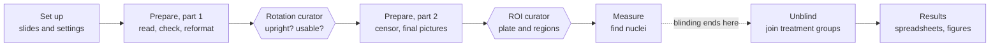
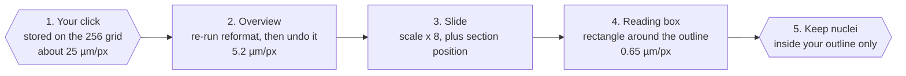

# LS IHC pipeline: user guide

14 October 2026. The editable version of this guide is the [Claude Doc](https://claude.ai/code/artifact/3935b5bd-45c5-4a2c-8b13-005fa0d0e0df); this file is a copy kept with the code.

This guide takes you from a folder of slide scans to a spreadsheet of per-region cell counts using the LS IHC desktop app. It is written for someone who has never used the app. Read sections 1 to 3 once, then use the rest as a reference while you work.

> Written against the new six-screen app, which is still being finished. Screenshots and example images will be added once the screens are final. Where a detail may still change, it says so.

## 1. Quick start

The app has six screens down the left, in the order you work. Do them top to bottom. On each one there is usually only one thing to do.

| # | Screen | What you do there | You are done when |
| --- | --- | --- | --- |
| ⌂ | **Project** | Open or create your study's project. Read the **Next up** card (if settings are missing, it names each Set up card and what it lacks) and press **Go**. | You know which screen to go to next. |
| 1 | **Set up** | Point the app at your slides, then fill in the cards in order: folders, file names, microscope and channels, atlas, nucleus detection. Press **Apply** on each card. | No red rows on the Slides tab, and every card says *Applied*. |
| 2 | **Prepare** | Press **Run all remaining**. It runs on its own and stops when it needs you. | It says it is waiting for a curator. |
| 3 | **Curate** | Work through each curator tab, press its **Export** button, then **Continue Prepare**. Last comes the ROI curator, where you draw the brain regions. | All curators exported; the ROI curator's Export has written its files. |
| 4 | **Measure** | Press **Run all remaining**. Nucleus detection takes hours and can be stopped and resumed. | Every section is measured. |
| 5 | **Results** | Confirm unblinding, then build the spreadsheets and figures. | `roi_dataset.xlsx` is in your results folder. |

Three habits will save you trouble:

- **Press (i) whenever you are unsure.** Every screen, stage and setting has one, with a plain explanation.
- **Always press Export in a curator.** Your work in a curator is saved as you go, but the next stages only see it after Export.
- **Re-running is safe.** Stages skip work that is already done, so running one again only fills the gaps.

## 2. What the pipeline does

The pipeline turns whole-slide fluorescence scans of brain sections into counts of marker-positive cells per brain region, per animal. In the LS study the markers are pERK (recent neural activity) and PCNA (proliferation), each counterstained with DAPI, which marks every nucleus.

There are far too many sections to measure by hand, so the program does the repetitive work and asks a person only where judgement is needed. The journey has five parts:

1. **Read and check the slides.** Every slide file is listed, checked, and every section on it saved as a small picture.
2. **Standardise every section.** Each section is cleaned, turned upright, centred and resized to the same square, so a position means the same thing on every section.
3. **Curate.** You check the rotations, accept or overrule proposed exclusions, match each section to an atlas plate, and draw the brain regions to measure.
4. **Measure.** Your regions are mapped back onto the original full-resolution scan. Every nucleus inside them is found (on DAPI, or for PCNA on its own channel) and the marker is measured in each.
5. **Unblind and report.** Only now are the animals joined to their treatment groups, and the spreadsheets and figures are written.



The two hexagons are where the run stops for you. The atlas plate boxes (salmon atlas only) are a third, short stop during Prepare, part 1.

### Three rules the pipeline never breaks

- **The program proposes, you decide.** Exclusions, rotations and atlas matching are proposed automatically where possible, but a person makes the final call. Automatic atlas matching was tried twice on this data and failed.
- **Nothing is deleted.** A section that is set aside keeps a flag saying so and why. You can reinstate it later without re-reading any scans.
- **Blind until the end.** No stage before *Unblind* on the Results screen reads which treatment group an animal is in. Two exceptions are deliberate and do not touch a measurement: the order detection measures sections in, and the ROI curator's Shotgun slide deck.

### Where you make decisions

There are four places where the pipeline waits for you. All four are tabs on the **Curate** screen.

| Curator | What you decide | Needed for |
| --- | --- | --- |
| Atlas plate boxes | One box per brain section on each atlas figure (salmon atlas only) | Building the atlas plates |
| Rotation and exclusion | Is each section upright, and is it usable at all? | The second half of Prepare |
| ROI curator | Which atlas plate each section matches, and the outline of each region | Measure |
| Import browser exports | Only if you curated in a web browser instead of the app | Measure |

## 3. Opening the app and finding your way around

### Starting the app

- **From the packaged build:** double-click `LS pipeline.exe`. Its settings file, `config.json`, sits beside the program, not inside it. On the very first start it asks for three folders and writes that file.
- **From the code:** double-click `run_app.bat`. The first time, run `build_app.bat` once; it sets up a Python 3.13 environment in `work/appenv`. Python 3.13 is needed because the library that reads Zeiss CZI files has no 3.14 version yet.
- **Checking a copy on another computer:** run `"LS pipeline.exe" --self-test`. It reports PASS or FAIL for each check in `lsapp-selftest.log`.

Nucleus detection needs StarDist, which only the `work/appenv` environment has. In the packaged .exe that stage is greyed out with the reason.

### The main window

- **Step bar (left).** The six screens, each with its progress read from the output folder. Progress is right even for work done outside the app.
- **Screen header.** A short sentence on what the screen is for, and an **(i)** button with more detail: what goes in and what comes out.
- **Stage rows.** Each stage shows a coloured dot, its name, its number (for example `04g`), one plain sentence on what it does, and its status. Its buttons are:
  - **Run** runs that stage on its own. On a curator stage the button says **Build page**.
  - **Open** shows a curator page or the stage's output.
  - **Options** lists the stage's switches. It says *Options (2 changed)* when you have changed any.
  - **(i)** explains what the stage needs first, what it leaves behind, when it last ran, and the technical detail underneath.
- **Run all remaining.** On Prepare, Measure and Results, runs every stage on that screen that has not finished, in order. It stops at the first failure and never runs past a curator you have not exported.
- **Status bar (bottom).** Shows what is running and its last log line. **Show log** opens the full log; **Stop after this stage** finishes the current stage cleanly and stops.

### Menus

| Menu | Item | What it does |
| --- | --- | --- |
| File | New, Open, Open Recent, Save, Save As, Revert | Work with the project file. Ctrl+N, Ctrl+O, Ctrl+S as usual. |
| File | Project history | Every stage that ran in this project, and when. |
| File | Export a copy | A copy of the project to share or archive. |
| View | One item per screen, All stages, Refresh status | Jump to a screen; see every stage in one list; re-read progress from disk. |
| Tools | Instrument characterisation | The once-per-microscope stages (section 9). |
| Tools | All settings | Every setting in one dialog. |
| Tools | Switch study | Move to another study's project. |
| Tools | Migrate browser curation | Bring in curation done earlier in a web browser (section 6). |

### Projects

A **project** is one study in one file: its settings, every decision you made in a curator, and a record of each stage run. **File > Save** writes it, and the app also saves automatically before any stage runs. Curator decisions are also written to `<output folder>/curation/` as you go, so closing the app loses nothing.

To hand a study to someone else, use **File > Export a copy**. The output folder holds the images and results and is not part of the project file.

## 4. Set up: telling the app about your study

Set up is where you describe the study once: where the slides are, how their files are named, how they were imaged, which atlas to use and how nuclei are counted. On a new study, do the tabs left to right: Slides, then seven cards of settings. Come back any time to change a setting; stages read the new value the next time they run.

Every field has a short hint, an **(i)** with the full reasoning and which stages read it, and a **↺** button that puts it back to its default. Changes are kept when you press **Apply** on that card, and saved automatically before any stage runs.

> **Starting a new study.** Use **File > New project**, give it a name, then come here. To continue an existing study, use **File > Open project** or **Tools > Switch study**.

### Slides tab

1. Press **Choose folder…** and pick the folder with your `.czi` files, or **Choose files…** to pick some of them.
2. Read the table. It shows what the app read from each file name: animal, slide and replicate.
3. **Fix every red row before you go on.** A red row is a file whose name does not fit the naming pattern, and every stage would silently ignore it. Fix the pattern on the *Slide file names* card, or rename the file.
4. Press **Use these slides**.

Once a folder is set, the top of the Slides tab says which folder the study reads and how many files the slide headers list, and the tab gets a ✓. For the LS study that is 444 files from `D:\SLIDES HE DEC 2025 LS`. Use the buttons only to change it.

Choosing a folder only records where the slides are; nothing is moved. Picking separate files from one folder records a list, which costs no space. If the files are spread over several folders, the app offers to link or copy them and always shows the size first.

### Study and folders

| Setting | What to put | Tip |
| --- | --- | --- |
| Study name | A short name, shown in the study picker |  |
| Slides folder | The folder holding the `.czi` files | Usually set for you by the Slides tab |
| Analysis output | Where every result is written | Needs plenty of space: the overviews alone take several GB. On the lab laptop this is `D:\LS-analysis`. |
| Curator exports | Where the ROI curator saves its exports | Leave empty to use `<output>/exports` |

### Slide file names

The app reads which animal and slide each file is from its name, and builds the section ID (`scene_uid`, for example `LS105_s10a_sc03`) that every later table joins on.

- **Filename pattern.** Press **Build…** rather than typing it. The dialog shows a real file name: select a run of characters and press **Mark as…** to say what it is (animal, slide, replicate). Everything you do not mark must match exactly. Underneath, every file found is checked against the pattern, misses first.
- **Example filename.** One real name, used for that preview.
- **Case-insensitive names.** On by default; leave it on.
- **Section order convention.** How the order of serial sections is worked out. There is one choice, scan order.

Animal is required; slide and replicate are optional. An animal ID cannot contain an underscore `_`.

In the LS study the pattern also accepts a suffix after a dash, so a name such as `LS53_2b-_A568.czi` is read like `LS53_2b.czi`.

### Microscope and channels

| Setting | What it means | LS study value |
| --- | --- | --- |
| Pixel size (µm) | Camera pixel size at the objective used | 0.65 |
| Section thickness (µm) | How thick the sections were cut. Used for the Abercrombie correction. | 14 |
| Overview resolution (µm per px) | Size of the small per-section pictures | 5.2 (default) |
| Acquisition layout | **multiplex**: one scan holds every marker. **paired**: one scan per marker, each with its own counterstain. | paired: pERK (AF568) and PCNA (AF488) were scanned separately, listed in that order under Markers |
| Counterstain colour | How DAPI is drawn in pictures | blue |
| DAPI index, Marker index | Which channel in the CZI file is which | 0 and 1 |

**Channels and markers…** opens a table of channels. **Detect from a CZI file…** reads each channel's dye and colour from a real slide and fills the table in. The file knows the dye, not the antibody, so you type or pick the marker name yourself. A marker's name becomes part of folder and file names, so the app asks before you rename one.

### Curation pictures

How sharp the colour pictures in the ROI curator are, and where their pixels come from. Measuring always reads the scan's own pixels, whatever you set here.

| Setting | What it means | Default |
| --- | --- | --- |
| Curation images from | **czi**: drawn from the original 16-bit scan in one step. **overview**: the old, softer 768 px pictures made from the 5.2 µm overview. | czi |
| Curation image resolution (µm per px) | How sharp the czi pictures are. 1.3 is the finest allowed; the full 0.65 µm scan is too large to show a whole section. | 2.6 |

A change here only affects pictures made afterwards. Existing pictures stay until stage 04o is run again with Redo switched on (section 5, Part 5).

### Scene pictures

Settings for the optional pictures of every scene (stage 01l, section 5 Part 1). They are for looking at only, so nothing here changes any measurement.

| Setting | What it means | Default |
| --- | --- | --- |
| Scene pictures folder | Where the pictures go. Pick any folder with the folder picker, even one outside the study. | Empty, which means `scene_renders` in your Analysis output folder (`D:\LS-analysis\scene_renders` on the lab laptop) |
| Scene picture resolution (µm per px) | How sharp the pictures are; larger numbers give smaller, softer pictures. Today 1.3 is the finest. Once PR #28 is in, 0.65 (the scan's own pixels) is allowed: a whole scene at 0.65 can need several GB of memory, so each scene is checked against free memory first and one that does not fit is skipped with a message. 1.3 needs a quarter of that memory, 2.6 a sixteenth. | 2.6 |
| Scene picture brightness | **Same for all**: every picture uses the dataset's brightness range, so a brighter picture means more signal. **Per scene**: each scene is stretched to its own tissue, so every picture is well exposed but brightness no longer compares. | Same for all |

Changing the resolution or brightness makes the next run redraw the pictures.

### Atlas

| Setting | What it means |
| --- | --- |
| Atlas | **salmon** (default), **wullimann1996** (zebrafish), or one you imported |
| Atlas PDF | The salmon atlas file the plates and regions are taken from |
| Mirror atlas polygons | For an atlas whose outlines cover only one side of the brain (Wullimann) |
| Atlas plate set | Which set of plates the ROI curator shows. Leave at `plates`. |
| Two-section figures | Salmon only: the figure numbers that show two sections each, for example `31-47` |

**Import atlas…** adds an atlas of your own: a folder of plate images plus a table of region outlines. The app checks the folder first, names every problem with its file and line, and copies nothing unless it passes.

### Nucleus detection

| Setting | Default | Change it when |
| --- | --- | --- |
| Nucleus diameter (µm) | 7 | Your species or cell type has clearly larger or smaller nuclei |
| Abercrombie correction | On | Leave on. It corrects for nuclei cut across two sections. |
| Threshold: MAD multiplier | 3 | Only for markers counted on their own channel (not nuclei); see (i) |
| Threshold: minimum object area (µm²) | 5 | As above |

**Markers counted on their own channel (paired studies).** A marker whose scan has no usable counterstain can be counted on its own channel instead of inside DAPI nuclei. The LS study needs this for PCNA (AF488), because its DAPI plane is noise at full resolution. This setting is not in Set up yet: add it to the study's `config.json` under `acquisition`:

```json
"marker_segmentation": {
  "AF488": {"segment": "own", "backend": "stardist", "nucleus_shaped": true}
}
```

Use it only for a marker whose signal is in the nucleus, as PCNA's is. Section 7 explains what it changes in the results.

**Other settings** collects anything not yet sorted into a card. You rarely need it.

## 5. Prepare: the automatic part

Prepare reads the slides, checks them, builds the atlas, and turns every section into a clean, upright, masked picture ready for curation. Press **Run all remaining** and let it go. It runs in two halves: the first stops at the rotation and exclusion curator, and after you export there, **Continue Prepare** on the Curate screen runs the second half.

**Goes in:** the slide files and your Set up settings. **Comes out:** one standard picture per section, the list of sections that can be measured, and the pages the curators show you. Everything is written under your Analysis output folder; the paths below are relative to it.

> In the LS study the first marker is pERK and the second is PCNA. Stage names in the app use your own marker names. All curation is done on the PCNA scans first and then copied onto the matching pERK scans.

> **Streamlined order.** This section follows the shorter stage order that is in review now. It reads each slide file two times instead of three and reformats sections in three passes instead of seven. What you do and what comes out stay the same.

### Common options

Many stages share these switches under **Options**:

- **Only the first N sections** (`--limit`): for a quick trial run. 0 means all. Use it on a new study to check the settings before the full run.
- **Redo … already done** (`--force`): normally finished work is skipped. Turn this on after changing a setting that affects that stage's output, then turn it off again.
- **Include excluded sections**: also makes pictures or masks of excluded sections, so the curator's Review can show them.

What you change is remembered in the project and used every time that stage runs. **Reset to defaults** in the Options panel undoes it.

### Part 1: Read and check the slides

| Stage | What it does | Makes | Options |
| --- | --- | --- | --- |
| 00 Read slide headers | Lists every section on every slide from the file headers, without loading images. Everything later starts from this list. | `manifest/manifest_scenes.csv` |  |
| 00b Verify extraction | Checks every slide file was copied or unzipped completely | `qc/extraction_status.csv` |  |
| 00d CZI self-test | Checks for faults that would make every measurement wrong, such as images shifted between zoom levels | `qc/czi_selftest.csv` | Also read N files' pixels; only the first N files |
| 01 Export section overviews | Saves a picture of every section at one fixed size and brightness, scores focus, and saves a mask of pixels where the camera hit its maximum | `overviews/`, `qc/focus.csv` | Redo; first N |
| 01d Contact sheets | Each animal's sections side by side in brain order, to browse quickly | `contactsheets/` | Which picture (RGB, marker only, DAPI only); sections per row; thumbnail size |
| 01l Pictures of every scene | Draws every scene of every slide straight from the scan, at 2.6 µm per pixel by default (down to the scan's own 0.65 µm once PR #28 is in; see Set up's Scene pictures card), so you can look at the raw tissue before anything is cropped or rotated. For viewing only: no later stage reads these pictures and nothing is measured from them. Rendering every scene takes a long time, so Run all remaining skips this stage and it does not count towards Prepare's progress: press its own Run button when you want the pictures. | \<scene pictures folder>/\<marker>/stain+DAPI/ (stain over the counterstain) and stain\_only/ (stain alone, in grey) | Redo; first N scenes. Folder, resolution and brightness are on Set up's Scene pictures card. |
| 02 Pair the two marker passes | Works out which pERK scan and which PCNA scan show the same physical section (paired studies only) | `pairs.csv` |  |
| 00c Infer marker identity | Suggests which dye carries which marker from how the signal looks. Reports only; changes nothing. | `qc/channel_identity/` |  |
| 01k Clipping on the raw plane | Now only fills in clipping masks for sections exported before 01 made them, and checks them at full resolution. Skips sections that already have one. | `qc/saturation_raw.csv`, `qc/censor_raw/` | Redo; full-resolution check on N sections (default 30); first N |
| 01g Where the clipping falls | Tells harmless saturation (edges, debris) apart from saturation inside tissue | `qc/saturation/` | Number of example figures |

**What good looks like.** The self-test reports no failures. The contact sheets show whole, in-focus sections in a sensible brain order for each animal. Every scan has a pair.

**Common problems.** Fewer sections than expected usually means file names that do not fit the pattern (go back to the Slides tab). A self-test failure means a slide file itself is faulty; do not go on until you understand it. Unpaired scans in a paired study usually mean a missing or misnamed file.

### Part 2: Build the atlas

Only the stages for the atlas you chose in Set up run; the others are greyed out.

| Stage | What it does | Makes | Options |
| --- | --- | --- | --- |
| 04a Extract atlas plates (salmon) | Pulls the plate pictures and region markers out of the atlas PDF | `atlas/plates/` |  |
| 04a2 Merge strips (salmon) | Joins figures the PDF stores as several strips into one picture | `atlas/plates_merged/` | Render resolution (300 dpi) |
| 04a3 Reframe figures (salmon) | A curator: one box per brain section on each figure (section 6) | `atlas/plate_reframe.html` |  |
| 04a3b Enforce section counts (salmon) | Fixes the box count where the automatic count was wrong, using *Two-section figures* in Set up | `atlas/plate_boxes.prev.csv` |  |
| 04a4 Render final plates (salmon) | The final plates at full resolution; this is what the ROI curator shows | `atlas/plates_final/` | Render resolution |
| 04w Wullimann plates | Builds the plates from the Wullimann 1996 zebrafish atlas | `atlas/plates_wullimann/` |  |
| 04x Wullimann polygons | Turns region outlines into numbered shapes and guesses their names for a person to review | `atlas/plates_wullimann/polygons.csv` | Save check pictures; keep reviewed names; do not guess names |

### Part 3: Before rotation curation

| Stage | What it does | Makes | Options |
| --- | --- | --- | --- |
| 04g Mask artifacts (PCNA, pERK) | Finds bubbles, clumps and fibres inside every scanned section and masks them out. Runs straight after the overviews, on excluded sections too, so Review can show them. | `artifacts/artifact_summary.csv` | Also mask excluded sections (on); first N |
| 04a Reformat (PCNA) | A first standard picture of each section: cleaned, turned so its long axis is level, centred, cropped and resized to a 256-pixel square | `reformatted/reformat_index.csv` |  |
| 04f Propose unmeasurable sections | Proposes sections with no usable tissue (largest piece under 2.5 mm²). Only clear-cut cases; you decide. | `reformatted/exclusion_candidates.csv` | Sections in the proposal sheet |
| 04h Propose rotations | Proposes a small extra rotation so each section's midline is vertical | `reformatted/symmetry_proposals.csv` | First N |

Prepare now stops and the Curate screen asks for the **rotation and exclusion curator**.

### Part 4: After rotation curation

| Stage | What it does | Makes | Options |
| --- | --- | --- | --- |
| 04j Censor clipped pixels (PCNA) | Takes your exclusions, sets aside sections with too much saturated tissue, and flags saturated pixels in the rest | The PCNA analysis set | Set-aside threshold (default 0.01 = 1%) |
| 04a Reformat final (PCNA) | Final pictures: your rotations and exclusions applied, artifacts masked, saturation flagged | `reformatted/sections/` |  |
| 04i Carry curation to pERK | Copies your PCNA decisions onto the matching pERK scans | pERK overrides | First N |
| 04j Censor clipped pixels (pERK) | The same set-aside and flagging for pERK; writes the list of measurable sections | The pERK analysis set | Set-aside threshold |
| 04a Reformat final (pERK) | Final pERK pictures, ready for measuring, plus pictures of excluded sections for Review | pERK pictures and index |  |
| 04m Every section and its fate | A table of every pERK section and what happened to it | sections dataset |  |

**About the 1% tolerance.** A section with at least 1% of its tissue saturated is set aside. Saturated pixels in sections that stay are flagged, not removed, and nuclei under them count as positive. Changing the tolerance changes which sections are analysed, so agree it before measuring.

### Part 5: Get ready for the ROI curator

| Stage | What it does | Makes | Options |
| --- | --- | --- | --- |
| 04n Order the ROI queue | Orders sections so stopping part way still covers every animal and brain level equally | `reformatted/roi_worklist.csv` | Hold out animals with fewer than N sections (10) |
| 04o Colour pictures and thumbnails (pERK, PCNA) | Colour pictures for the curator: nuclei blue, marker in colour. One run per marker also makes the 256 px thumbnails for the curator's Review grid. Drawn from the original scan, with no 8-bit loss, at 2.6 µm per pixel by default (setting `curation_render.um_per_px` in `config.json`). 1.3 µm is the finest allowed, because a whole section at full resolution is too large for the curator to hold; the scan is read in strips, so memory stays bounded. Measurement always reads the full 0.65 µm scan. | colour section pictures | Picture size (×256 px, default 3 = 768 px); include excluded; thumbnail size (256 px); redo |
| 04p Trace every section | Follows every scanned section through every decision, for Review | `reformatted/section_provenance.csv` | Build tissue outlines (slow, once); redo |

**What good looks like.** In the curator, every section is upright, centred and the same size, with debris gone and no pen marks around the tissue. The colour pictures look sharp when zoomed.

> **Going back to the old previews.** If the new pictures cause trouble, set *Curation images from* to **overview** on Set up's *Curation pictures* card (`curation_render.source` in `config.json`). The curator then shows the old 768 px pictures made from the 5.2 µm overview, which are softer (about 8 µm per screen pixel). Both kinds use the same frame, so landmarks and regions you already placed stay where they are, and measurement is unchanged. Pictures that already exist are kept until you rebuild them: run this stage with **Redo … already done** switched on, or from a command prompt run `python scripts/04o_section_rgb.py --marker AF568 --all --thumbs --force` and then the same with `--marker AF488`.

**Common problems.** A section rotated badly after curation means its rotation was not exported; check the rotation curator's Export. Many sections set aside for saturation in one animal is a property of that animal's scans, not a bug; note it for the analysis.

## 6. Curate: where you decide

The Curate screen has one tab per curator page. In each one you work through the sections, then press the page's **Export** button. Your work is saved into the project as you go, so closing the app loses nothing, but **only Export hands your decisions to the stages that come after.**

Above the tabs, the screen says what is waiting and offers the next button: **Continue Prepare** after the atlas or rotation curator, **Bring in browser exports** if you curated in a web browser, and **Go to Measure** once the ROI curator is exported.

In every curator, **a dashed amber border is a proposal the program made; a solid red border is a decision a person made.**

### Atlas plate boxes (salmon atlas only)

Some atlas figures show several brain sections side by side, but the ROI curator needs one section per plate. Here you draw one box around each section on each figure. Boxes are proposed from the bands of tissue, so usually only figures with several sections need a look.

**Export** writes `atlas/plate_boxes.csv`. Then press **Continue Prepare** to render the final plates.

### Rotation and exclusion

Every section is shown with the program's proposed rotation already applied. For each one you answer two questions: is it upright, and is it usable at all?

1. **Drag** any section that is not upright until its midline is vertical.
2. For each proposed exclusion (dashed amber), **accept** it or **overrule** it. The numbers that produced the proposal are shown beside it.
3. You may also exclude a section the program did not propose, for example a torn one.
4. Press **Export**, then **Continue Prepare**.

Export writes `reformatted/rotation_overrides.csv`. An excluded section drops out of everything downstream but is not deleted; you can reinstate it later.

| Option | What it does |
| --- | --- |
| Start without proposals | No rotation or exclusion pre-marked, so every section is judged from scratch |
| Picture size (px) | Bigger pictures give finer control when dragging (default 170) |

**Tip.** Judge exclusions generously in favour of keeping a section. A wrongly kept section adds a little noise that anyone can find later; a wrongly excluded one silently takes its evidence with it.

### ROI curator

This is the main curation job. For each section you choose the matching atlas plate and draw the brain regions to measure, plus background spots for comparison. The queue is ordered so that stopping part way still leaves every animal and brain level covered.

**The window.** Toolbar along the top (filters on the left, actions on the right), the section on the left, the atlas plate in the middle, a sidebar on the right, and a strip of every section along the bottom.

**The first time you open it**, a pop-up asks which regions you will draw. The choice applies to the whole study; press **o** or **ROIs…** to change it. Chosen regions are numbered 1, 2, 3 on the plate in the order you picked them; the rest are greyed out.

**For each section:**

1. **Find the plate.** Use ← and → (or the plate slider) until the plate matches the section, then press **a** (*Assign plate*). The plate stays put when you move to the next section with ↓, so neighbouring sections are quick.
2. **Draw each region.** With **Guided** on (**g**), the cursor walks through your chosen regions in order. Click the region's corners on the section; close the outline with **Enter**, a double-click, or a click on the first corner. The cursor then moves to the next region. Press **s** to skip a region that is not on this section. Clicking a region on the plate re-aims the cursor at it.
3. **Place background discs (d).** Put at least one disc on tissue with no real signal. Detection measures it the same way as a region and uses it to set the positivity cut for this section. **A section without a background disc cannot be used for positivity.**
4. **Optional: landmarks.** With Guided off, click a point on the section, then the matching point on the plate. Landmarks record how well the plate fits; the sidebar lists each with its error, so a mis-click shows up as a large number.
5. Mark the section if needed: **f** *Favourite* (a section you want in the quantified subset), **No ROI here** (the section is fine but has nothing to measure), or **x** *Exclude* (the section should not be used).

**Editing a finished region.** Drag a corner to move it, click an edge to add a corner, or press Delete over a corner to remove it. **z** undoes the last corner or region; **u** is the general undo; **Clear section** removes everything placed on the section.

**Zoom and pan.** Scroll to zoom about the cursor, drag with the middle or right button to pan, **+** and **−** zoom about the centre, **0** fits the whole section. Zooming shows the scan's real pixels, not a smoothed version.

**Rotate** tilts the view to make drawing easier. It is a viewing aid only and changes no coordinates. **r** restores the original tilt.

**Review** shows every scanned section and what happened to it, including those the pipeline excluded. Its keys: ↑ ↓ move between sections; **d** DAPI, **k** marker, **v** artifact mask, **c** censored pixels, **m** apply mask; **f** full screen. **Reinstate** puts an excluded section back into the pipeline; **Reject mask** discards an artifact mask that covered real tissue.

**Reading the strip.** Purple border: registered (three or more landmarks). Blue: plate assigned only. Gold inner edge: favourite. Red and greyed: excluded. Faded: no ROI.

**Export** writes three files to your exports folder, which Measure reads:

| File | One row per |
| --- | --- |
| `roi_plates.csv` | Section you made any decision about, with its plate and status |
| `roi_landmarks.csv` | Landmark pair, with its error |
| `roi_regions.csv` | Region or background disc you drew, with its outline |

**Shotgun** and **By region** build a PowerPoint deck of your favourites, split by treatment group, one slide per plate or per region. They are the only curator buttons that read the treatment groups, and are switched off unless the study's settings list the groups.

| Option | What it does |
| --- | --- |
| Use the ordered queue | On: the balanced order. Off: plain order. |
| Colour pictures | On: nuclei blue, marker in colour. Off: the grey DAPI picture. |
| Measurable sections only | Hides sections set aside for saturation |
| Show unreviewed atlas outlines | Wullimann only: also shows outlines whose names nobody has checked |

**Things worth knowing.** Vd, Vv and POA cannot be told apart without knowing a section's exact level, so the curator shows them as a group in gold and the export marks them `region_ambiguous`. In the salmon atlas, 31 of 64 plates carry regions; a section matched to any other plate has nothing to draw.

### Curation done in a web browser

The curator pages also work in an ordinary browser (run `serve_curators.bat`). Work done there lives in that browser only. To bring it into the app, either press **Bring in browser exports** to import its exported CSV files, or use **Tools > Migrate browser curation > Import curation state** to move the whole curation state.

## 7. Measure: counting nuclei in your regions

Measure puts your regions back onto the original slides, finds every nucleus inside them, and measures the marker in each. It is still blind: nothing here knows which animal is in which group. Press **Run all remaining**.

**Goes in:** the regions you drew in the ROI curator. **Comes out:** `results/roi_nuclei.csv`, one row per nucleus, and the per-region numbers built from it.

| Stage | What it does | Makes | Options |
| --- | --- | --- | --- |
| 05a Verify the inverse transform | Checks that regions map back onto the slides accurately before anything is measured | A pass or fail in the log |  |
| 05a Place the regions on the slides | Maps every region from the 256-pixel curation picture back onto the slide's own 0.65 µm pixels | Region geometry and boxes for each marker | Every section with a region (also those without a background disc); first N |
| 05c Detect and measure nuclei | Reads each region at full resolution, finds nuclei with StarDist (on DAPI; PCNA on its own channel, see below), measures the marker in each, and flags nuclei that sit on clipped pixels | `results/roi_nuclei.csv` | Order sections are measured in; save check pictures; redo; first N |
| 06a Per-region dataset | Turns nuclei into per-region numbers: how many cells, how many positive, per mm² | `results/roi_measurements.csv`, `results/detector_specificity.csv` |  |

### How your regions get from the curator to the slide

You draw regions on a small, standardised picture of the section, but nuclei can only be counted on the original scan. The picture in the curator is about 25 µm per pixel on the 256 grid; a nucleus is about 7 µm. So every region has to be carried back, point by point, onto the slide's own 0.65 µm pixels. This is the mapping step, and it happens in five moves.



1. **Your click is stored on the 256 grid.** The curator picture may be shown at any size, and you may be zoomed in. Neither matters: when you export, every point is converted to the same 256 × 256 grid, so `roi_regions.csv` always holds grid coordinates. Zoom is only a view and never changes what is saved.
2. **The grid is turned back into the overview.** Stage 05a rebuilds how this section was standardised by re-running the exact same steps as the reformat stage: find the tissue, rotate it, flip it, crop it, pad it to a square. It checks that the rotation it gets matches the one recorded when you curated (to within 0.06°), and skips the section if not. It then undoes those steps, landing on the 5.2 µm overview picture of the section.
3. **The overview is placed on the slide.** The overview is exactly 8 times coarser than the scan, and the section's position on the slide is known from the file header. 05a checks the overview size matches the section's rectangle in the file. All of this becomes one small transformation per section, saved in the region geometry file.
4. **Each outline gets a reading box.** Every corner of your outline goes through that transformation. The rectangle around the outline is the only part of the slide file that detection reads, at full 0.65 µm resolution.
5. **Nuclei are kept only if they are inside your outline.** 05c finds nuclei in the box, then sends each nucleus centre back through the transformation and keeps it only if it falls inside the shape you drew. So your outline decides what counts, not the box.

Two details worth knowing. A region is mapped corner by corner, so it keeps its true shape even where a section was stretched more one way than the other; a round background disc becomes an oval on the slide, and its area is measured as such. And 05a's first stage, *Verify the inverse transform*, checks the whole chain on every pixel before anything is measured.

> **Half-pixel correction.** The curator counts a pixel from its edge, while the measuring stages count from its centre. Left alone, every region and background disc would land half a grid pixel (about 16 µm) down and to the right of where you drew it, moving about 3% of region nuclei across an edge. 05a now subtracts that half pixel from every point you placed before mapping it, so regions land where you drew them. A results file measured before this fix keeps the old membership until *Detect and measure nuclei* is run again.

### Nucleus detection, in plain words

- **Nuclei are found on DAPI, not on the marker (PCNA is the one exception, below).** The marker is measured afterwards inside each nucleus, and "positive" is decided later still. So you can change the positivity rule without re-reading any scans.
- **StarDist** separates touching nuclei, which matters in densely packed regions. It is used as published, without tuning.
- **It takes hours.** You can stop it with **Stop after this stage** or close the app, and run it again later. Finished sections are not redone.
- **Measurement order.** *balanced* (default) alternates treatment and control, so a part-finished run is already a fair comparison; it reads the group key only to choose the order. *uid* keeps the run fully blind. The finished file is identical either way.
- **Check pictures** (`--qc`) save one picture per region with nuclei outlined: green counted, red found but outside the region. Turn this on for a first run on a new study.

### PCNA: counted on its own channel

In the PCNA (AF488) scans, the DAPI plane is just noise at full resolution, so there are no nuclei on it to find. PCNA itself sits in the nucleus, so for PCNA the pipeline finds the PCNA-stained nuclei directly on the green channel. pERK is not affected and still uses DAPI.

**What this changes in your results:**

- **You get positive density only.** With no counterstain there is no count of all cells, so *fraction positive* and *total cell density* are left blank for PCNA. The column `denominator_withheld_reason` says why. The PCNA readout is **positive cells per mm²**.
- **Positivity is still set per section from the background discs**, as for pERK. Instead of a false-positive rate, PCNA reports **false positives per mm² of background** (`bg_false_positives_per_mm2` in `detector_specificity.csv`). The figures are captioned with it.
- **Brightness is scaled once per section.** All of a section's regions and background discs share one intensity range before StarDist sees them, so a bright proliferative zone cannot hide dim nuclei. The range used is recorded in `results/roi_normalisation.csv`.
- **The Abercrombie correction uses the size of the positive nuclei**, the ones actually counted.

**Before the full PCNA run, do a pilot.** This route has been tested on synthetic data only.

1. Turn on the study setting (see *Nucleus detection* in section 4).
2. On Measure, open **Options** on *Detect and measure nuclei*, set **Only the first N sections** to 3 and turn on **Save check pictures**, then run it for PCNA.
3. Look at the check pictures, especially in periventricular regions and background discs: are nuclei missed, or found in noise?
4. Hand-count PCNA-positive nuclei in about six regions, including two background discs, and compare with `n_positive` from 06a.
5. Check the median nucleus size of positive objects is roughly 7 to 9 µm.

Only then run all sections. The full checklist is in `docs/nuclei-detection-after-roi-curation.md`, section 4.8.

### How "positive" is decided (stage 06a)

Each section's own background discs set its cut: the background median plus three times its spread. It is worked out per section, because background brightness varies between sections. The share of background nuclei above the cut is reported as a false-positive rate in `detector_specificity.csv`.

Two densities are reported side by side: all nuclei, and positive nuclei. Both are divided by the region's area on the slide. Counts are also corrected for nuclei cut across two sections (the Abercrombie correction), using the nucleus size measured in that region. Raw and corrected numbers are both kept.

For PCNA, only the positive density is reported; see *PCNA: counted on its own channel* above.

**What good looks like.** The check pictures show nuclei outlined one by one, with few red ones. The false-positive rate is low and similar across animals.

**Common problems.** "Detection greyed out" means the app was started without StarDist; use `run_app.bat` with `work/appenv`, not the packaged .exe. A section with no background disc is left out of positivity; go back to the ROI curator and add one. A section refused in 05a has geometry that cannot be rebuilt; check it in the curator's Review.

### Repair older outputs

Three tools fix results files written by older versions of the pipeline. They are not part of a normal run. Each backs the file up first, and **Report only** (`--dry-run`) says what would change without writing.

| Tool | Use it when |
| --- | --- |
| 06f Recompute the censored flag | A results file was written before detection flagged clipped nuclei itself |
| 06g Flag nuclei off the section | A results file was written before detection flagged nuclei found on bare glass |
| 06h Backfill segmentation provenance | A results file lacks the columns saying which channel and method found each object |

## 8. Results: unblinding, spreadsheets and figures

Results joins the measurements to the experiment's treatment groups and writes the spreadsheets and figures. **The first stage unblinds the analysis**, so the app asks you to confirm before it runs it.

| Stage | What it does | Makes |
| --- | --- | --- |
| 06b Join the experiment (unblind) | Reads the sampling workbook and joins each animal to its treatment group. It checks the cohort against the workbook's own record of which animals were sliced, and stops loudly if they disagree. | `results/roi_dataset.csv`, `results/animal_metadata.csv` |
| 06e Build results | One pass that rebuilds both spreadsheets and redraws the figures | Everything below |
| 06c Spreadsheet per sample | One row per region per animal, plus per-disc, per-section and coverage sheets. **The figures and statistics read this one**, because the animal is the unit of comparison. | `results/roi_dataset.xlsx` |
| 06d Spreadsheet per slide | The same, one level finer, to show spread within an animal. Slides are not independent replicates; do not test on this sheet. | `results/roi_dataset_by_slide.xlsx` |
| 06e Refresh hourly | Rebuilds the spreadsheets and figures every hour while detection is still running, and stops when it finishes or stalls. Run it from `refresh_loop.bat`, not the app. | `results/ROI_plots/` |

### Before you unblind

- **The sampling workbook.** By default 06b looks for `large scale exp sampling data.xlsx` in the slides folder. Its header must match what the stage expects; if it does not, the stage names the mismatched columns.
- **Check measurement is finished**, or decide consciously to look at a partial result. The spreadsheets can be rebuilt at any time, including while detection runs.
- **Look at the coverage sheet** in `roi_dataset.xlsx`. Some animals may have few measurable sections because of saturation; note this before comparing groups.

### The figures

Figures are drawn by R scripts in the `analysis/` folder (`plot_roi_figures.R`, `plot_by_sample.R`, `plot_by_slide.R`) and land in `results/ROI_plots/`. Build results finds R on its own; if it cannot, it lists where it looked. Statistics live in `analysis/roi_stats.R`.

**What not to claim.** There are no no-primary controls in the LS dataset, so absolute statements like "30% of cells are positive" are not supported. Comparisons between groups at matched brain levels are.

## 9. Extras: instrument characterisation and All stages

### Instrument characterisation (Tools menu)

These stages measure the microscope, not the tissue: where the camera tiles sit and how unevenly each tile is lit. **They are done once per microscope and are already done for the LS dataset**, so a new study on the same scanner can skip them. Section export uses the correction when it exists and works without it.

| Stage | What it does | Options |
| --- | --- | --- |
| 01e Tile geometry | Reads where the tiles sit on each slide |  |
| 01b Pick the sample | Chooses the sections used to measure illumination | Sections in the sample (96); at most N per slide file (4) |
| 01b Export the sample (Fiji) | Exports that sample at 2.6 µm per pixel. Needs Fiji and runs outside the app: `scripts/run_all.sh` steps 3 to 8. |  |
| 01f Build and apply the tile correction | Builds a correction for uneven brightness across each tile, then applies it to the sample for checking |  |
| 01c Measure the tile pattern, before and after | How strong the tile pattern is before and after correction |  |
| 01h Illumination from raw tiles | A second illumination measurement from raw tiles, for checking only | Slide files to sample (16); tiles per file (60) |

### View > All stages

Every stage in one list, in the order of the methods figure, with the same Run, Options and (i) buttons. Use it when you know exactly which stage you want, for example to re-run one stage with **Redo** switched on. The superseded level curator (04k) is listed only here.

### Running stages outside the app

Every stage is a script in `scripts/` and can also be run from a terminal; the (i) panel on each stage shows its exact command line. `scripts/run_all.sh` runs the whole pipeline in order. The app and the scripts read the same settings file, so you can mix the two.

## 10. Troubleshooting and safe re-runs

### Re-running safely

- **Stages skip finished work.** Pressing Run again only fills the gaps, so it is cheap and safe.
- **After changing a setting**, re-run the stages that read it with **Redo … already done** switched on in Options. The setting's (i) says which stages read it. Then switch Redo off again.
- **Changing a curator decision** after Measure has run: export again, then re-run Prepare's second half and Measure. Nuclei detection keeps finished sections, so use Redo there only for sections whose regions changed.
- **Nothing is deleted.** Excluded sections can be reinstated in the ROI curator's Review. Repair tools back up the results file before changing it.
- **Stop cleanly** with **Stop after this stage** on the status bar, rather than closing the app mid-stage.

### Common problems

| What you see | Likely cause | What to do |
| --- | --- | --- |
| Red rows on the Slides tab | File names do not fit the naming pattern | Fix the pattern with **Build…** on *Slide file names*, or rename the files |
| Fewer sections than expected | Unmatched file names, or an incomplete copy | Check the Slides tab and the 00b result |
| Run all remaining stops at a stage | That stage failed, or it waits for a curator | Read the screen's note and **Show log**. A waiting stage names the curator to export. |
| "Finish Set up" on the Next up card | A required setting is empty | The card names each Set up card and the settings it lacks; open Set up and fill those in |
| A curator's decisions are ignored | You did not press **Export** | Open the curator and press Export, then Continue Prepare |
| Curation made in a browser is missing | Browser work is stored in that browser only | **Tools > Migrate browser curation**, or **Bring in browser exports** |
| Nucleus detection is greyed out | No StarDist in this Python | Start with `run_app.bat` (uses `work/appenv`), not the packaged .exe |
| The overview stage fails on Python 3.14 | The CZI reader has no 3.14 version | Use Python 3.13 via `run_app.bat` |
| A curator pane is blank in the .exe | The packaged files are incomplete | Run `"LS pipeline.exe" --self-test` and read `lsapp-selftest.log` |
| The app will not start | A missing library or a broken environment | Read `lsapp-crash.log`. To keep curating meanwhile, run `serve_curators.bat` and use a browser. |
| Build results cannot find R | R is not on PATH and not in Program Files | Install R, or add `Rscript` to PATH |
| 06b says the workbook header does not match | The sampling workbook's columns differ | Fix the workbook's column names to the ones it lists |

### Where to look for more detail

- The **(i)** button on any stage or setting.
- `docs/pipeline-guide.md`: every stage explained in depth, with the reasoning behind it.
- `docs/setting-up-a-study.md`: settings, channels and the segmentation choices in detail.
- `docs/nuclei-detection-after-roi-curation.md`: detection step by step.
- `LOGS.md`: the running record of what went wrong and how it was fixed.

## 11. Glossary

| Term | Meaning |
| --- | --- |
| Abercrombie correction | Scales a count down to allow for nuclei cut across two neighbouring sections, using section thickness and measured nucleus size |
| Analysis set | The sections that can be measured, after exclusions and saturation set-asides |
| Artifact mask | Marks bubbles, clumps and fibres inside a section so they are not measured |
| Atlas plate | One labelled page of the brain atlas. Matching a section to a plate says how far along the brain it is. |
| Background disc | A circle you place on tissue with no real signal. It sets that section's positivity cut and measures the false-positive rate. |
| Blinding | No stage reads an animal's treatment group until Results, so no decision can be biased by it |
| Censored (clipped) pixel | A pixel where the camera hit its maximum, so its true brightness is unknown. Nuclei under one count as positive. |
| Channel | One colour recorded by the scanner, such as DAPI or a marker |
| Counterstain (DAPI) | Stains every nucleus. Nuclei are found on it (except for PCNA, whose DAPI plane is unusable); it is not itself measured. |
| Curator | An interactive page where you make decisions; it saves as you go and hands decisions on with Export |
| CZI | Zeiss's slide file: one slide, several sections, every channel and tile |
| Exclusion | A decision that a section should not be used. It is a flag, not a deletion. |
| False-positive rate | The share of background-disc nuclei above the positivity cut |
| Favourite | A section you want in the quantified subset or the Shotgun deck |
| Landmark | A matching pair of points on the section and the plate, showing how well they fit |
| Marker | The stain being measured, such as pERK or PCNA |
| Multiplex, paired | Multiplex: one scan holds every marker. Paired: one scan per marker, of different sections. |
| Overview | A small picture of one section made once, so nothing reopens the large slide file to look at it |
| Plate set | A folder of atlas plates with the region outlines on them |
| Positivity cut | The marker brightness above which a nucleus counts as positive; set per section from its background discs |
| Project | One study in one file: settings, curator decisions and a record of each run |
| Reformat | The standard picture of a section: cleaned, upright, centred and resized to 256 × 256 pixels |
| ROI (region) | A brain region you outlined on a section, measured as one area |
| Scene, section | Scene: one area the scanner was told to image; in practice one brain section. Section: one thin slice of tissue (14 µm in LS). |
| scene\_uid | The ID every table uses for a section, built from animal, slide and scene, for example `LS105_s10a_sc03` |
| Stage | One step of the pipeline, with a number such as `04g` and a script in `scripts/` |
| StarDist | The published model that finds nuclei on DAPI, used without tuning |
| Tile | One camera frame; the scanner stitches many into a section |
| Unblinding | Joining animals to their treatment groups, the first stage on the Results screen |
| Worklist | The order the ROI curator shows sections in, balanced across animals |
