# The Great IHC Leap Forward: user guide

15 October 2026. The editable version of this guide is the [Claude Doc](https://claude.ai/code/artifact/3935b5bd-45c5-4a2c-8b13-005fa0d0e0df); this file is a copy kept with the code.

This guide takes you from a folder of slide scans to a spreadsheet of per-region cell counts using The Great IHC Leap Forward, the lab's desktop app for the LS IHC pipeline. It is written for someone who has never used the app. Read sections 1 to 3 once, then use the rest as a reference while you work.

> **Up to date with the redesigned app** (light theme, numbered steps, one curation stop). The pictures were taken on a made-up study, so the animal names and numbers in them are only examples.

## 1. Quick start

The step list on the left shows six screens in the order you work, each with a one-line description and how far it has got. Do them top to bottom. Every screen opens with a blue **Your part** line that says what you do there; usually it is one thing.

| # | Screen | What you do there | You are done when |
| --- | --- | --- | --- |
| ⌂ | **Project** | Open or create your study's project. Read the **Next up** card (if settings are missing, it names each Set up card and what it lacks) and press **Go**. | You know which screen to go to next. |
| 1 | **Set up** | Check the few cards it shows: the folders, the file names, the section thickness and markers, and the atlas. Everything the slide files can tell the app is already filled in; the rest is under **Show advanced settings**. Press **Apply** on any card you change. | No red rows on the Slides tab, and the step list says every card is applied. |
| 2 | **Prepare** | Press **Run all remaining**. It runs straight through to the ROI curator. | The step list shows Prepare done and Next up sends you to Curate. |
| 3 | **Curate** | In the ROI curator, bring back any section that was set aside by mistake, match each section to its atlas plate and draw the brain regions. Then press **Done: export and go to Measure**. | Every section is curated or excluded, for each marker (the step list counts them, for example *23 of 48 sections curated*). |
| 4 | **Measure** | Press **Run all remaining**. It first checks signal quality and tunes detection (05b); nucleus detection then takes hours and can be stopped and resumed. If the signal check calls a marker's signal *poor*, the run stops before detection: read the report (**Open report**), then press **Run** on *Detect and measure nuclei* to carry on anyway. | Every section is measured. |
| 5 | **Results** | Press **Run** on *Join the experiment*, check the sampling workbook in the box that opens and press **Unblind and run**. Then press **Run all remaining** for the spreadsheets (the R figures are switched off for now). | `roi_dataset.xlsx` is in your results folder. |

Three habits will save you trouble:

- **Press (i) whenever you are unsure.** Every screen, stage and setting has one, with a plain explanation.
- **Always press Export in a curator.** Your work in a curator is saved as you go, but the next stages only see it after Export.
- **Re-running is safe.** Stages skip work that is already done, so running one again only fills the gaps.

## 2. What the pipeline does

The pipeline turns whole-slide fluorescence scans of brain sections into counts of marker-positive cells per brain region, per animal. In the LS study the markers are pERK (recent neural activity) and PCNA (proliferation), each counterstained with DAPI, which marks every nucleus.

There are far too many sections to measure by hand, so the program does the repetitive work and asks a person only where judgement is needed. The journey has five parts:

1. **Read and check the slides.** Every slide file is listed, checked, and every section on it saved as a small picture.
2. **Standardise every section.** Each section is cleaned, turned upright, centred and resized to the same square, so a position means the same thing on every section.
3. **Curate.** You bring back any section the program set aside by mistake, match each section to an atlas plate, and draw the brain regions to measure.
4. **Measure.** Your regions are mapped back onto the original full-resolution scan. Every nucleus inside them is found (on DAPI, or for PCNA on its own channel) and the marker is measured in each.
5. **Unblind and report.** Only now are the animals joined to their treatment groups, and the spreadsheets are written (the R figures are switched off for now).

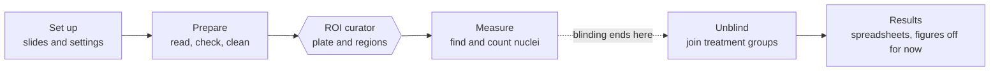

The hexagon is the one place the run stops for you: the ROI curator. The atlas plate boxes (salmon atlas only) are a second, short stop during Prepare.

### Three rules the pipeline never breaks

- **The program proposes, you decide.** Exclusions and rotations are made automatically, and you can reverse any exclusion in the ROI curator's Review. Atlas matching is always done by a person. Automatic atlas matching was tried twice on this data and failed.
- **Nothing is deleted.** A section that is set aside keeps a flag saying so and why. You can reinstate it later without re-reading any scans.
- **Blind until the end.** No stage before *Unblind* on the Results screen reads which treatment group an animal is in. Two exceptions are deliberate and do not touch a measurement: the order detection measures sections in, and the ROI curator's Shotgun slide deck.

### Where you make decisions

There are three places where the pipeline waits for you. All three are on the **Curate** screen, and for most studies only the ROI curator matters.

| Curator | What you decide | Needed for |
| --- | --- | --- |
| Atlas plate boxes | One box per brain section on each atlas figure (salmon atlas only) | Building the atlas plates |
| ROI curator | Which sections to bring back, which atlas plate each section matches, and the outline of each region | Measure |
| Import browser exports | Only if you curated in a web browser instead of the app | Measure |

> **No separate rotation curator any more.** Each section is levelled automatically, and sections with no usable tissue are set aside automatically. You undo a wrong exclusion in the ROI curator's Review. Studies that already have rotation decisions keep them unchanged. Mirroring a section is no longer possible, so in a new study a section mounted face down shows mirrored.

## 3. Opening the app and finding your way around

### Starting the app

- **Installing it (Windows):** download the newest `The-Great-IHC-Leap-Forward-Setup-<version>.exe` from the repository's Releases page and run it. It needs no administrator rights and brings everything with it, including Python, StarDist for Measure and R for the figures. Start **The Great IHC Leap Forward** from the Start menu. Installing a newer version over it upgrades in place; your studies and settings live in `%USERPROFILE%\.ls-pipeline` and survive upgrades.
- **Installing it (Mac):** Apple Silicon (M1 or later) with macOS 14 or newer. From the same Releases page get `The-Great-IHC-Leap-Forward-<version>-mac.dmg`, open it and drag the app onto Applications. The app is not signed with a paid Apple developer certificate, so the first time macOS refuses to open it: click **Done**, then **System Settings > Privacy & Security > Open Anyway**. After that it opens normally. It works as on Windows, except that R is not included (the R figures are switched off anyway) and a new version comes as a new disk image.
- **Updates.** The app checks for a newer release each time it starts (offline it just carries on), and **Help > Check for updates** checks on demand. A release that changes only code installs in place: the app closes, swaps in the new code, checks it and starts again, and **Help > Undo last update** goes back one version. A release that needs new libraries, or any update on a Mac, links the new installer or disk image instead. Studies, settings and results are never touched.
- **From the code:** double-click `run_app.bat`. The first time, run `build_app.bat` once; it sets up a Python 3.13 environment in `work/appenv`. Python 3.13 is needed because the library that reads Zeiss CZI files has no 3.14 version yet.
- **Checking a copy on another computer:** start the app with `--self-test`. It reports PASS or FAIL for each check in `lsapp-selftest.log`.

Nucleus detection needs StarDist. The installer and `work/appenv` both have it. A copy without it greys that stage out and says why.

### The main window

- **Step list (left).** The six screens, each with a numbered circle, a one-line description and a progress mark such as *5 of 6 cards* or *10 of 19 stages*. A finished step turns green with a tick; the current one is blue. Progress is read from the output folder, so it is right even for work done outside the app. Under **Advanced** at the foot are *All stages* and *Instrument characterisation*.
- **Screen header.** The screen's title and (i), a short sentence on what it is for, and a blue **Your part** box saying what you do there.
- **Notices.** An amber box above the stages warns you about something to fix first.
- **Stage rows.** Each stage shows a status dot (green done, grey to do, purple waiting for you, blue running, red failed, amber waiting or out of date), its name in plain words and one plain sentence on what it does. The six step screens leave out the stage's number and the pipeline's own name; hold the pointer over the name to see them (for example `00d  CZI self-test`), or open *All stages*, which shows both. The tables in this guide give the number and the pipeline's name. Under the status, a stage whose last complete run took a minute or more says how long, for example *Last run took 3 h 12 min*. Its buttons are:
  - **Run** runs that stage on its own; once a stage is done the button says Redo. A stage that is *Out of date* (see *Out of date*, section 10) says Run again. On a curator stage the button says **Build page**.
  - **Open** shows a curator page. Stages that make pictures or results have their own Open button instead: *Open pictures*, *Open sheets* or *Open results* opens that folder.
  - **Options** lists the stage's switches. It says *Options (2 changed)* when you have changed any.
  - **(i)** explains what the stage needs first, what it leaves behind, when it last ran, and the technical detail underneath.
- **Run all remaining.** On Prepare, Measure and Results, runs every stage on that screen that has not finished or is out of date, in order. It stops at the first failure and never runs past a curator you have not exported. On Measure it also stops before nucleus detection when the signal check finds a marker's signal *poor* (section 7). It never unblinds: that always waits for you to press it and confirm. It also leaves out the scene pictures, which you run on their own.
- **Status bar (bottom).** Shows what is running and its last log line, with a progress bar that also appears on the running stage's row. It slides until the stage reports a count, then fills, for example 12 of 454 sections (3%). Once the stage has been counting for a little while it adds the time left, for example *12 of 454 sections (3%), about 2 h 10 min left*. When a run finishes, it says if a stage could not make everything (for example *3 scenes not drawn, see log*). **Show log** opens the full log; **Stop after this stage** finishes the current stage cleanly and stops.

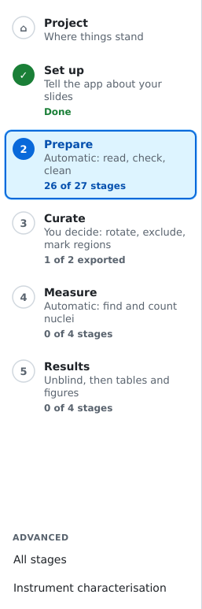

### Menus

| Menu | Item | What it does |
| --- | --- | --- |
| File | New, Open, Open Recent, Save, Save As, Revert | Work with the project file. Ctrl+N, Ctrl+O, Ctrl+S as usual. |
| File | Project history | Every stage that ran in this project, and when. |
| File | Export a copy | A copy of the project to share or archive. |
| View | One item per screen, All stages, Refresh status | Jump to a screen; see every stage in one list; re-read progress from disk. |
| Tools | Instrument characterisation | The once-per-microscope stages (section 9). |
| Tools | All settings | Every setting in one dialog. |
| Tools | Switch study | Move to another study's project. |
| Tools | Migrate browser curation | Bring in curation done earlier in a web browser (section 6). |
| Help | User guide | This guide. Running from the code it opens here in the app; an installed copy opens it on GitHub. |
| Help | Wiki | The project wiki on GitHub: short pages, one question each. |
| Help | Show the activity log | Opens the full log at the foot of the window (the same as **Show log**). |
| Help | Open the log folder | The folder holding `lsapp-crash.log`, written if the app ever stops on an error (section 10). |
| Help | Run the CZI self-test | Runs stage 00d, which checks the slide files for faults that would make every measurement wrong (section 5). |
| Help | Check for updates, Undo last update, About | Install a newer version, go back to the one before, see which version this is. |

### Projects

A **project** is one study in one file: its settings, every decision you made in a curator, and a record of each stage run. **File > Save** writes it, and the app also saves automatically before any stage runs. Curator decisions are also written to `<output folder>/curation/` as you go, so closing the app loses nothing.

To hand a study to someone else, use **File > Export a copy**. The output folder holds the images and results and is not part of the project file.

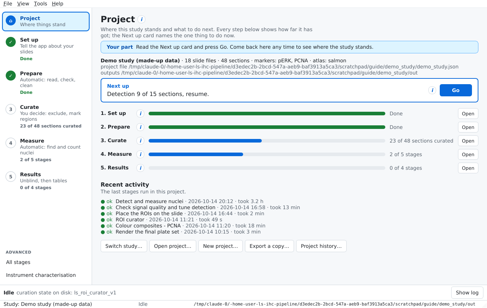

## 4. Set up: telling the app about your study

Set up is where you describe the study once: where the slides are, how their files are named, how they were imaged, which atlas to use and how nuclei are counted. Only what the slide files cannot tell the app is asked: the two folders, the section thickness, the markers and the atlas. The pixel size, the file-name rule, the channels and how the markers were scanned are read from the slide files themselves, and every other folder sits inside the output folder. All of those are still there, filled in: tick **Show advanced settings** at the top of Set up to see and change them (the Pictures and Nucleus detection cards, among others). A required setting that is still empty is always shown. Come back any time to change a setting; stages read the new value the next time they run.

Every field has a short hint, an **(i)** with the full reasoning and which stages read it, and a **↺** button that puts it back to its default. Changes are kept when you press **Apply** on that card, and saved automatically before any stage runs.

> **Starting a new study.** Use **File > New project** (or **New study…** in the study picker). It asks for two folders, the folder with the `.czi` files and an output folder, plus the section thickness and the atlas. The slides are read straight away and their pixel size, file names and channels are filled in. If the read finds something to look at (files that could not be read, no pixel size in any file, file names that do not fit the rule), **Create study** lists it and asks *Create the study anyway?*: **Yes** makes the study, and you fix those in Set up; **No** goes back to change the folders. The study's file (`study.json`), the curation, the pictures and the results all go in the output folder, so a study is one folder you can move or back up whole. Choosing an output folder that already holds a study opens it. To continue an existing study, use **File > Open project** or **Tools > Switch study**; studies made before this keep working where they are. The app reopens the study you had open last.

### Slides tab

1. Press **Choose folder…** and pick the folder with your `.czi` files, or **Choose files…** to pick some of them.
2. Read the table. It shows what the app read from each file name: animal, slide and replicate.
3. **Fix every red row before you go on.** A red row is a file whose name does not fit the naming pattern, and every stage would silently ignore it. Fix the pattern on the *Slide file names* card, or rename the file.
4. Press **Use these slides**.
5. Press **Read settings from the slides** to fill in what the slide headers say (pixel size, file-name rule, channels) for any setting not yet set. It never overwrites a setting you chose; where the files say something else, it tells you.

Everything the headers say is kept, not only what was used. A summary goes into the study file and the complete list of header fields into `slide_metadata.json` in the output folder. Press **What the slides say…** next to the button to see it: the instrument, the channels, the scenes, the optical resolution, which values set what, and where files differ. What it sets is the pixel size, the picture resolutions, the colours, the file naming and the channels. What it only checks is the exposure, the bit depth, the objective and whether the pixels are small enough to show the detail the lens can resolve; anything odd is listed under *Things to look at*. If two markers would be drawn in the same colour, or the counterstain is not a blue stain, it leaves those colours for you to pick in Set up and says why.

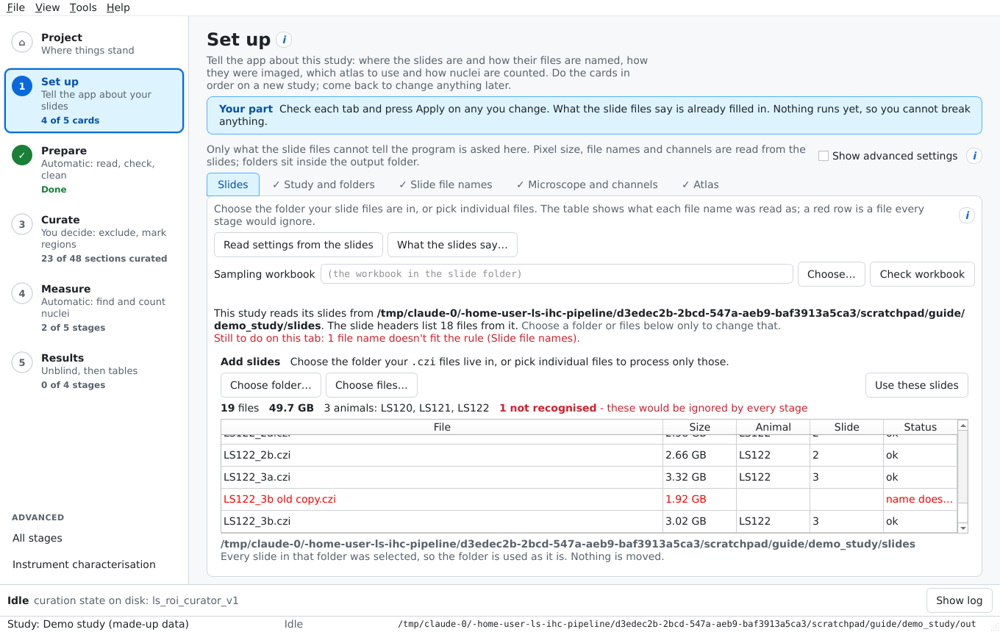

Once a folder is set, the top of the Slides tab says which folder the study reads and how many files the slide headers list. The tab gets a ✓, and counts as done on Home, only when the slides have been read, every file name fits the rule and every marker has a real name (not *Marker1* or *Channel2*). Until then it says what is left under *Still to do on this tab*, for example *2 file names don't fit the rule (Slide file names)* or *name the markers (Microscope and channels > Channels and markers...)*; the Next up card on Home says the same. For the LS study that is 444 files from `D:\SLIDES HE DEC 2025 LS`. Use the buttons only to change it.

**Sampling workbook** names the workbook Results will read to unblind (section 8); leave it empty to use the one in the slide folder. **Check workbook** tries the join now, without unblinding anything: it reads the workbook, matches it against the study's animals and slides, writes nothing and reports how many animals and slides it matched to a group, any animal with no row, and any blank group. Use it early, so a mismatch is fixed before the measuring is done.

**Load the groups for Shotgun** reads the same workbook the same way and keeps each animal's treatment group in the study (`groups.order` and `groups.by_animal`), so the ROI curator's Shotgun deck can lay favourites out by treatment while you are still curating; press **Build page** on the ROI curator afterwards to turn Shotgun on. The deck shows the groups by design. Nothing else does: the curator's sections, plates and ROIs, every count and threshold, and Set up itself (which shows only how many animals each group has) stay keyed by animal, and 05c uses the groups only for the order it measures sections in. Results are still joined to the groups at Unblind. **Remove the groups** makes the study blind again, and a copy shared as blinded never carries them.

Choosing a folder only records where the slides are; nothing is moved. Picking separate files from one folder records a list, which costs no space. If the files are spread over several folders, the app offers to link or copy them and always shows the size first.

### Study and folders

| Setting | What to put | Tip |
| --- | --- | --- |
| Study name | A short name, shown in the study picker |  |
| Slides folder | The folder holding the `.czi` files | Usually set for you by the Slides tab |
| Analysis output | Where every result is written | Needs plenty of space: the overviews alone take several GB. On the lab laptop this is `D:\LS-analysis`. |
| Curator exports | Where the ROI curator saves its exports | Leave empty to use `<output>/exports` |

### Slide file names

The app reads which animal and slide each file is from its name, and builds the section ID (`scene_uid`, for example `LS105_s10a_sc03`) that every later table joins on.

- **Filename pattern.** Usually filled in for you from the slides. To set it yourself press **Set up from an example…**. Type one of your file names (or pick one). The app splits it into pieces and shows its reading, for example *animal LS53 · slide 2 · replicate b*; to change it, press **Animal ID**, **Slide number** or **Replicate letter** and click the piece in the name (**Not in the name** if there is none). The app writes the pattern and checks it against every file. When some files do not fit, it tries the usual causes one at a time (upper/lower case, a different ending such as `-_A568`, a missing replicate letter, other separators) and lists each change it made and how many files it brought in. Files that still do not fit are listed with the likely reason. The pattern itself stays hidden unless you tick **Show the pattern**. On the card, the rule is shown as the reading of the example, for example *LS53_2.czi reads as animal LS53 · slide 2*; tick **Show advanced settings** to see the pattern there.
- **Example filename.** One real name, used for that preview.
- **Case-insensitive names.** On by default; leave it on.
- **Section order convention.** How the order of serial sections is worked out. There is one choice, scan order.

Animal is required; slide and replicate are optional. An animal ID cannot contain an underscore `_`.

In the LS study the pattern also accepts a suffix after a dash, so a name such as `LS53_2b-_A568.czi` is read like `LS53_2b.czi`.

### Microscope and channels

| Setting | What it means | LS study value |
| --- | --- | --- |
| Pixel size (µm) | Camera pixel size at the objective used | 0.65 |
| Section thickness (µm) | How thick the sections were cut. Used for the Abercrombie correction. | 14 |
| Overview resolution (µm per px) | Size of the small per-section pictures | 5.2 (default) |
| Acquisition layout | **multiplex**: one scan holds every marker. **paired**: one scan per marker, each with its own counterstain. | paired: pERK (AF568) and PCNA (AF488) were scanned separately, listed in that order under Markers |
| Counterstain colour | How DAPI is drawn in pictures | blue |
| DAPI index, Marker index | Which channel in the CZI file is which | 0 and 1 |

Without **Show advanced settings** this card shows only the section thickness, **Channels and markers…** and, in a paired study, **Find nuclei**; the rest are read from the slides.

**Channels and markers…** opens a table of channels. **Detect from a CZI file…** reads each channel's dye and colour from a real slide and fills the table in. The file knows the dye, not the antibody, so you type or pick the marker name yourself. A marker's name becomes part of folder and file names, so the app asks before you rename one.

In a paired study the table has one row per marker with two names. **Scan channel** is the name the scans give the marker's channel (AF568, AF488). Pairing matches each scan to its marker by this name, so it must be the scan's name, not the antibody; the app lists the names the slides carry and refuses any other. **What it stains** is the antibody (pERK, PCNA), which the screens show. DAPI is in every scan and is never a marker.

**Find nuclei** (paired studies only) has one row per marker. Leave it on *On the counterstain (DAPI)* unless a marker's scan has no usable DAPI. For such a marker, choose *On this marker's own channel*. The LS study needs this for PCNA (AF488), because its DAPI plane is noise at full resolution. Use it only for a marker whose signal is in the nucleus, as PCNA's is. Its fraction positive and total cell density are then not reported; positive density is. Section 7 explains why.

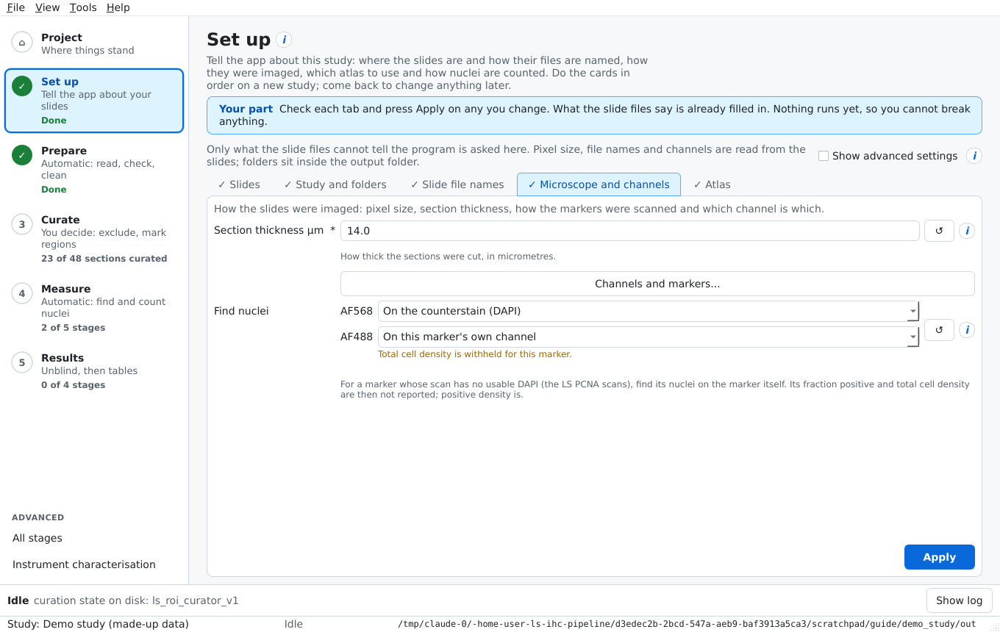

### Pictures

This card has two parts: the pictures the ROI curator shows, and the optional pictures of whole scenes.

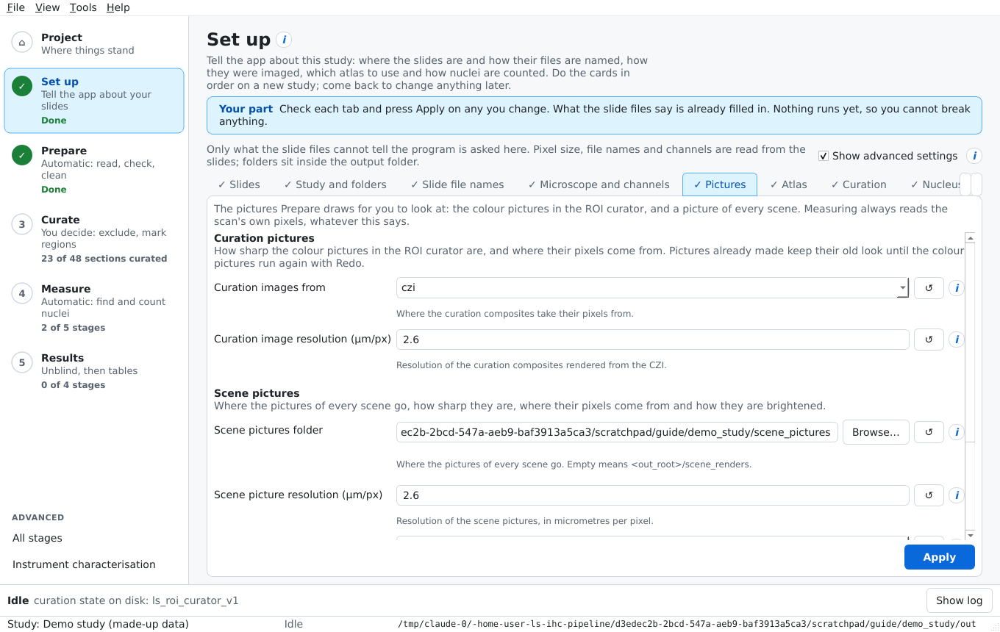

**Curation pictures.** How sharp the colour pictures in the ROI curator are, and where their pixels come from. Measuring always reads the scan's own pixels, whatever you set here.

| Setting | What it means | Default |
| --- | --- | --- |
| Curation images from | **czi**: drawn from the original 16-bit scan in one step. **overview**: the old, softer 768 px pictures made from the 5.2 µm overview. | czi |
| Curation image resolution (µm per px) | How sharp the czi pictures are. 1.3 is the finest allowed; the full 0.65 µm scan is too large to show a whole section. | 2.6 |

A change here only affects pictures made afterwards. Existing pictures stay until stage 04o is run again with Redo switched on (section 5, Part 5).

**Scene pictures.** Settings for the optional pictures of every scene (stage 01l, section 5 Part 1). They are for looking at only, so nothing here changes any measurement.

| Setting | What it means | Default |
| --- | --- | --- |
| Scene pictures folder | Where the pictures go. Pick any folder with the folder picker, even one outside the study. | Empty, which means `scene_renders` in your Analysis output folder (`D:\LS-analysis\scene_renders` on the lab laptop) |
| Scene picture resolution (µm per px) | How sharp the pictures are; larger numbers give smaller, softer pictures. The finest is 0.65, the scan's own pixels. A whole scene at 0.65 can need several GB of memory, so each scene is checked first against free memory (RAM plus the Windows page file), and one that does not fit is skipped with a message. 1.3 needs a quarter of that memory, 2.6 a sixteenth. | 2.6 |
| Scene picture brightness | **Same for all**: every picture uses the dataset's brightness range, so a brighter picture means more signal. **Per scene**: each scene is stretched to its own tissue, so every picture is well exposed but brightness no longer compares. In either mode, a scene whose bright pixels are clipped is stretched on its own, so it does not come out nearly black. | Same for all |

Changing the resolution or brightness makes the next run redraw the pictures.

### Atlas

| Setting | What it means |
| --- | --- |
| Atlas | **salmon** (default), **wullimann1996** (zebrafish), or one you added |
| Rebuild atlas plates | Advanced, off. The salmon and Wullimann plates ship ready-made with the app, so the plate-building stages are left out. Turn on only to make a plate set again from the PDF. |
| Atlas PDF | The salmon atlas file the plates and regions are taken from (only used when rebuilding) |
| Mirror outlines to both sides | For an atlas whose outlines cover only one side of the brain (Wullimann) |
| Atlas plate set | Which set of plates the ROI curator shows. Leave at `plates`. |
| Two-section figures | Salmon only: the figure numbers that show two sections each, for example `31-47` |

**Your own atlas.** Two ways to add one:

- **Add atlas from Fiji…** (on the Atlas card): put one image per plate in a folder, outline and name each region in Fiji's ROI Manager, and save the ROI Manager as a `.zip` beside each image. The dialog takes the folder, checks it and selects the new atlas. The step-by-step guide is `docs/adding-your-own-atlas.md`.
- **Import atlas…**: a folder of plate images plus a table of region outlines. The app checks the folder first, names every problem with its file and line, and copies nothing unless it passes.

### Nucleus detection

| Setting | Default | Change it when |
| --- | --- | --- |
| Nucleus diameter (µm) | 7 | Your species or cell type has clearly larger or smaller nuclei |
| Abercrombie correction | On | Leave on. It corrects for nuclei cut across two sections. |
| Use auto-tuned detection settings | On | Leave on. Off uses the model's own thresholds, as every count made before 05b did. |
| StarDist: probability threshold | Empty (the 05b value, or 0.479) | Only to override 05b. Lower finds more, dimmer objects and more noise; higher finds fewer. |
| StarDist: overlap threshold | Empty (0.3) | Not tuned. Raise it only if touching nuclei are merged in the check pictures. |
| Threshold: MAD multiplier | 3 | Only for markers counted on their own channel (not nuclei); see (i) |
| Threshold: minimum object area (µm²) | 5 | As above |

Markers whose nuclei are found on their own channel (PCNA in the LS study) are set on the **Microscope and channels** card, under **Find nuclei**. You no longer edit `config.json` by hand for this.

**Other settings** collects anything not yet sorted into a card. You rarely need it.

## 5. Prepare: the automatic part

Prepare reads the slides, checks them, builds the atlas, and turns every section into a clean, upright, masked picture ready for curation. Press **Run all remaining** and let it go. It runs straight through to the ROI curator, with one short stop for the atlas plate boxes if you use the salmon atlas.

**Goes in:** the slide files and your Set up settings. **Comes out:** one standard picture per section, the list of sections that can be measured, and the pages the curators show you. Everything is written under your Analysis output folder; the paths below are relative to it.

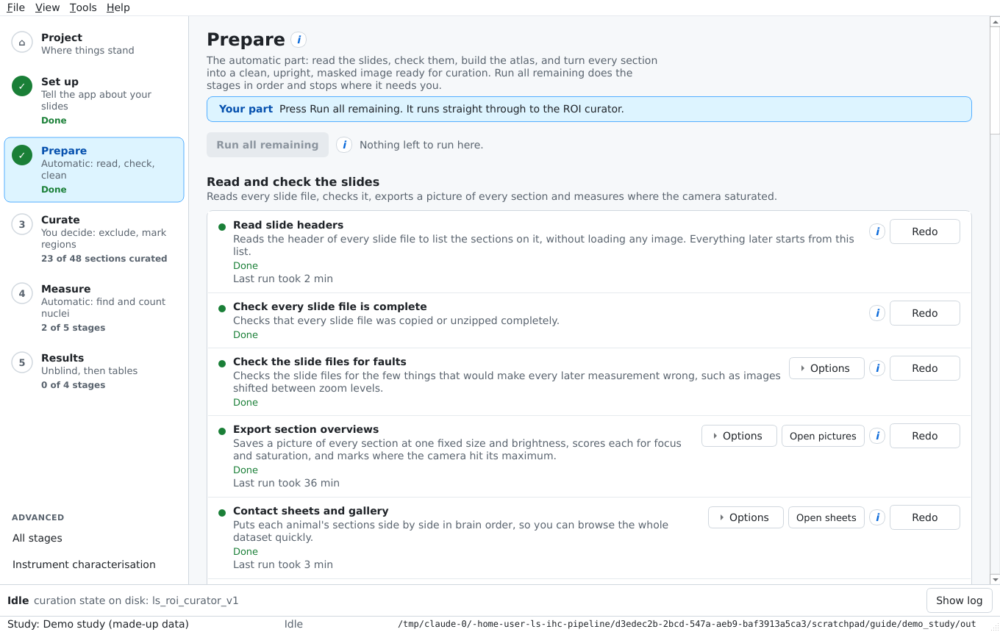

> In the LS study the first marker is pERK and the second is PCNA. Stage names in the app use your own marker names. All curation is done on the PCNA scans first and then copied onto the matching pERK scans.

### Common options

Many stages share these switches under **Options**:

- **Only the first N sections** (`--limit`): for a quick trial run. 0 means all. Use it on a new study to check the settings before the full run.
- **Redo … already done** (`--force`): normally finished work is skipped. You rarely need it: a stage made from something that has changed since shows *Out of date*, and its next run redoes everything by itself (section 10). Turn it on to redo a stage the app does not check, then turn it off again.
- **Include excluded sections**: also makes pictures or masks of excluded sections, so the curator's Review can show them.

What you change is remembered in the project and used every time that stage runs. **Reset to defaults** in the Options panel undoes it.

### Part 1: Read and check the slides

| Stage | What it does | Makes | Options |
| --- | --- | --- | --- |
| 00 Read slide headers | Lists every section on every slide from the file headers, without loading images. Everything later starts from this list. | `manifest/manifest_scenes.csv` |  |
| 00b Verify extraction | Checks every slide file was copied or unzipped completely | `qc/extraction_status.csv` |  |
| 00d CZI self-test | Checks for faults that would make every measurement wrong, such as images shifted between zoom levels | `qc/czi_selftest.csv` | Also read N files' pixels; only the first N files |
| 01 Export section overviews | Saves a picture of every section at one fixed size and brightness, scores focus, and saves a mask of pixels where the camera hit its maximum | `overviews/`, `qc/focus.csv` | Redo; first N |
| 01d Contact sheets | Each animal's sections side by side in brain order, to browse quickly | `contactsheets/` | Which picture (RGB, marker only, DAPI only); sections per row; thumbnail size |
| 01l Pictures of every scene | Draws every scene of every slide straight from the scan, at 2.6 µm per pixel by default (down to the scan's own 0.65 µm; see Set up's Scene pictures card), so you can look at the raw tissue before anything is cropped or rotated. Only the section is drawn, with the glass and the pen ring around it blacked out as in the curator. For viewing only: no later stage reads these pictures and nothing is measured from them. Rendering every scene takes a long time, so Run all remaining skips this stage and it does not count towards Prepare's progress: press its own Run button when you want the pictures. Its Open pictures button opens the folder set in Set up. If some scenes could not be drawn (for example, not enough free memory at 0.65 µm), the finished-run message says how many, and the log says why. | \<scene pictures folder>/\<marker>/stain+DAPI/ (stain over the counterstain) and stain\_only/ (stain alone, in grey) | Redo; first N scenes. Folder, resolution and brightness are on Set up's Scene pictures card. |
| 02 Pair the two marker passes | Works out which pERK scan and which PCNA scan show the same physical section (paired studies only) | `pairs.csv` |  |
| 00c Infer marker identity | Suggests which dye carries which marker from how the signal looks. Reports only; changes nothing. | `qc/channel_identity/` |  |
| 01k Clipping on the raw plane | A repair for older studies: new studies get their clipping masks from 01. This fills them in for sections exported before 01 made them, and checks them at full resolution. Skips sections that already have one. | `qc/saturation_raw.csv`, `qc/censor_raw/` | Redo; full-resolution check on N sections (default 30); first N |
| 01g Where the clipping falls | Tells harmless saturation (edges, debris) apart from saturation inside tissue | `qc/saturation/` | Number of example figures |

**What good looks like.** The self-test reports no failures. The contact sheets show whole, in-focus sections in a sensible brain order for each animal. Every scan has a pair.

**Common problems.** Fewer sections than expected usually means file names that do not fit the pattern (go back to the Slides tab). A self-test failure means a slide file itself is faulty; do not go on until you understand it. Unpaired scans in a paired study usually mean a missing or misnamed file.

### Part 2: Build the atlas

The salmon and Wullimann plates ship ready-made with the app and are copied into the study when it first needs them, so with either atlas this whole part is greyed out ("Not needed") and Prepare goes straight past it. It runs only for a plate set that does not ship (for example `plates_merged`) or when **Rebuild atlas plates** is on in Set up > Atlas, and then only the stages for the atlas you chose. The Wullimann outlines have all been checked by hand, so the ROI curator shows every named region.

| Stage | What it does | Makes | Options |
| --- | --- | --- | --- |
| 04a Extract atlas plates (salmon) | Pulls the plate pictures and region markers out of the atlas PDF | `atlas/plates/` |  |
| 04a2 Merge strips (salmon) | Joins figures the PDF stores as several strips into one picture | `atlas/plates_merged/` | Render resolution (300 dpi) |
| 04a3 Reframe figures (salmon) | A curator: one box per brain section on each figure (section 6) | `atlas/plate_reframe.html` |  |
| 04a3b Enforce section counts (salmon) | Fixes the box count where the automatic count was wrong, using *Two-section figures* in Set up | `atlas/plate_boxes.prev.csv` |  |
| 04a4 Render final plates (salmon) | The final plates at full resolution; this is what the ROI curator shows | `atlas/plates_final/` | Render resolution |
| 04w Wullimann plates | Builds the plates from the Wullimann 1996 zebrafish atlas | `atlas/plates_wullimann/` |  |
| 04x Wullimann polygons | Turns region outlines into numbered shapes and guesses their names for a person to review | `atlas/plates_wullimann/polygons.csv` | Save check pictures; keep reviewed names; do not guess names |

### Part 3: Make the section images

| Stage | What it does | Makes | Options |
| --- | --- | --- | --- |
| 04g Mask artifacts (PCNA, pERK) | Finds bubbles, clumps and fibres inside every scanned section and masks them out. Runs on excluded sections too, so Review can show them. | `artifacts/artifact_summary.csv` | First N (excluded sections are always masked too) |
| 04a Reformat (PCNA) | A first standard picture of each section: cleaned, turned so its long axis is level, centred, cropped and resized to a 256-pixel square | `reformatted/reformat_index.csv` |  |
| 04f Propose unmeasurable sections | Finds sections with no usable tissue (largest piece under 2.5 mm²) or no resolvable nuclear detail. Only clear-cut cases, each with its numbers. They are set aside automatically by the final reformat; you bring back any wrong one in the ROI curator's Review. | `reformatted/exclusion_candidates.csv` | Sections in the proposal sheet |

There is no stop here any more. Prepare carries straight on to Part 4.

### Part 4: Final images

| Stage | What it does | Makes | Options |
| --- | --- | --- | --- |
| 04j Censor clipped pixels (PCNA) | Takes the exclusions, sets aside sections with too much saturated tissue, and flags saturated pixels in the rest | The PCNA analysis set | Set-aside threshold (default 0.01 = 1%) |
| 04a Reformat final (PCNA) | Final pictures: rotations and exclusions applied, artifacts masked, saturation flagged | `reformatted/sections/` |  |
| 04i Carry curation to pERK | Copies the PCNA exclusions onto the matching pERK scans and lines each pERK section up with its PCNA twin | pERK overrides | First N |
| 04j Censor clipped pixels (pERK) | The same set-aside and flagging for pERK; writes the list of measurable sections | The pERK analysis set | Set-aside threshold |
| 04a Reformat final (pERK) | Final pERK pictures, ready for measuring, plus pictures of excluded sections for Review | pERK pictures and index |  |
| 04m Every section and its fate | A table of every pERK section and what happened to it | sections dataset |  |

**About the 1% tolerance.** A section with at least 1% of its tissue saturated is set aside. Saturated pixels in sections that stay are flagged, not removed, and nuclei under them count as positive. Changing the tolerance changes which sections are analysed, so agree it before measuring.

### Part 5: Get ready for the ROI curator

| Stage | What it does | Makes | Options |
| --- | --- | --- | --- |
| 04n Order the ROI queue | Orders sections so stopping part way still covers every animal and brain level equally | `reformatted/roi_worklist.csv` | Hold out animals with fewer than N sections (10) |
| 04o Colour pictures and thumbnails (pERK, PCNA) | Colour pictures for the curator: nuclei blue, marker in colour. One run per marker also makes the 256 px thumbnails for the curator's Review grid. Drawn from the original scan, with no 8-bit loss and with the mid-tones lifted so tissue looks about as bright as in the old previews (nothing is clipped to do it), at 2.6 µm per pixel by default (setting `curation_render.um_per_px` in `config.json`). 1.3 µm is the finest allowed, because a whole section at full resolution is too large for the curator to hold; the scan is read in strips, so memory stays bounded. Measurement always reads the full 0.65 µm scan. If some sections could not be built, the finished-run message says how many, and the log says why. | colour section pictures | Picture size (×256 px, default 3 = 768 px; only used when curation pictures come from the overviews); include excluded; thumbnail size (256 px); redo |
| 04p Trace every section | Follows every scanned section through every decision, for Review | `reformatted/section_provenance.csv` | Build tissue outlines (slow, once); redo |

**What good looks like.** In the curator, every section is upright, centred and the same size, with debris gone and no pen marks around the tissue. The colour pictures look sharp when zoomed.

> **Going back to the old previews.** If the new pictures cause trouble, set *Curation images from* to **overview** on Set up's *Pictures* card (`curation_render.source` in `config.json`). The curator then shows the old 768 px pictures made from the 5.2 µm overview, which are softer (about 8 µm per screen pixel). Both kinds use the same frame, so landmarks and regions you already placed stay where they are, and measurement is unchanged. Pictures that already exist are kept until you rebuild them: run this stage with **Redo … already done** switched on, or from a command prompt run `python scripts/04o_section_rgb.py --marker AF568 --all --thumbs --force` and then the same with `--marker AF488`.

**Common problems.** A good section missing from the curator was set aside automatically; open **Review** in the ROI curator, select it and press **Reinstate**, then export. Many sections set aside for saturation in one animal is a property of that animal's scans, not a bug; note it for the analysis.

## 6. Curate: where you decide

The Curate screen shows one curator page at a time, with a row of buttons above it. For most studies the only page you need is the **ROI curator**. Your work is saved into the project as you go, so closing the app loses nothing, but **only Export hands your decisions to the stages that come after.**

The buttons above the page are:

- **Reload** reloads the page, for example after Prepare has rebuilt its pictures.
- **Open in browser** opens the same page in your web browser.
- **Own window** moves the page into a window of its own, which you can make full screen. The button then says **Back to the app** and puts it back.
- **Done: export and go to Measure** (ROI curator only) exports for you and opens the Measure screen. Measure does not start by itself; you press **Run all remaining** there.

The Curate screen also offers **Continue Prepare** after the atlas plate boxes, and **Bring in browser exports** if you curated in a web browser.

Under the ROI curator's row, once there is an export, the screen says how far each marker's curation has got, for example *pERK curation ● 17 of 24 sections curated*. An excluded section counts as decided. In a paired study the second marker (PCNA) is curated on its own, in the same page: choose it in the curator's *Marker* menu. Its sections are separate physical sections, so nothing decided for one marker reaches the other. Curate is done when every section of both is curated or excluded.

Below that, a **coverage** table for each marker shows how many curated sections each animal (rows) has at each atlas plate (columns). A cell under the target is amber, and the line above the table counts them, for example *6 animal/level cells under the target of 1*. The target is one section per animal and plate unless you change *Target sections per animal and level* (Set up > Show advanced settings > Curation). It is a goal to curate towards; nothing is held back below it.

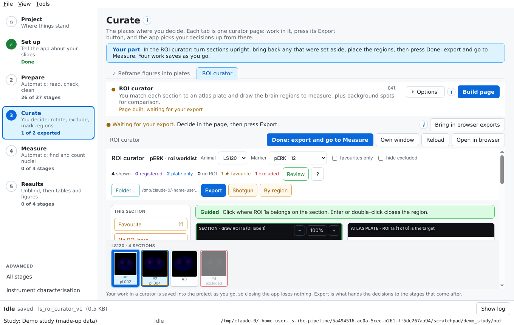

In every curator, **a dashed amber border is a proposal the program made; a solid red border is a decision a person made.**

### Atlas plate boxes (only when rebuilding the salmon plates)

This tab appears only when the salmon plates are being made again (Set up > Atlas > Rebuild atlas plates); the plates that ship with the app are already boxed.

Some atlas figures show several brain sections side by side, but the ROI curator needs one section per plate. Here you draw one box around each section on each figure. Boxes are proposed from the bands of tissue, so usually only figures with several sections need a look.

**Export** writes `atlas/plate_boxes.csv`. Then press **Continue Prepare** to render the final plates.

### ROI curator

This is the main curation job, and the only stop in a normal run. For each section you check it is the right way up and should be used, choose the matching atlas plate, and draw the brain regions to measure, plus background spots for comparison. The queue is ordered so that stopping part way still leaves every animal and brain level covered.

**The page, top to bottom.**

- **Top bar.** *Animal* and *Marker* menus and two tick boxes (*favourites only*, *hide excluded*) choose which sections are shown. On the right are counts (shown, registered, plate only, no ROI, favourites, excluded), then **Review**, **?** (all keyboard shortcuts), and the export group: **Folder…**, **Export**, **Shotgun** and **By region**.
- **Tool rail (left).** Every tool, in labelled groups, with its key in brackets: *This section* (★ Favourite **f**, No ROI here, Exclude **x**); *Atlas plate* (Assign plate **a**); *Look* (Hide DAPI, Hide the marker, Hulls **h**, Rotate, Restore tilt **r**); *Draw ROIs* (Guided **g**, ROIs… **o**, Skip ROI **s, ADD ROI n**); *Background discs* (Background **d** and a disc-size slider, keys **\[** and **\]**); *Undo* (Point **z**, Region, Undo last **u**, Clear section). Under the rail it says when your work was last saved.
- **Coach line.** One coloured line above the pictures that names the tool you are in and says what a click will do.
- **Two panes.** The section on the left, the atlas plate on the right. On a narrow screen they stack, and the page scrolls.
- **Info cards (right or below).** The section, the plate, its landmarks, the regions placed, and the background discs, each with a short count or advice.
- **Section strip (bottom).** Every section, grouped by animal, as small pictures you click to jump to.

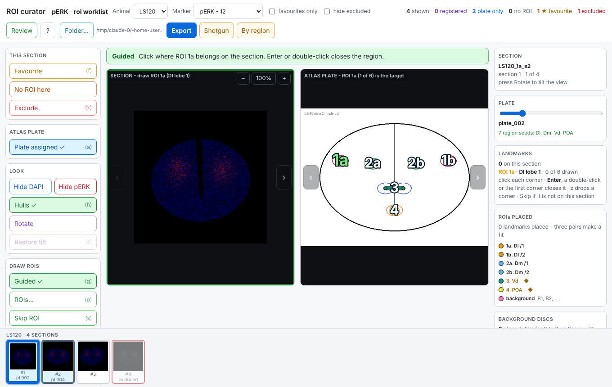

**The first time you open it**, a pop-up asks which regions you will draw. The choice applies to the whole study; press **o** or **ROIs…** to change it. Chosen regions are numbered 1, 2, 3 on the plate in the order you picked them; the rest are greyed out.

**For each section:**

1. **Find the plate.** Use ← and → (or the plate slider) until the plate matches the section, then press **a** (*Assign plate*). The plate stays put when you move to the next section with ↓, so neighbouring sections are quick.
2. **Draw each region.** With **Guided** on (**g**), the cursor walks through your chosen regions in order. Click the region's corners on the section; close the outline with **Enter**, a double-click, or a click on the first corner. The cursor then moves to the next region. Press **s** to skip a region that is not on this section. For a region the plate has no outline for, press n (ADD ROI): give it a name, and it gets the plate's next free number and becomes the next region you draw. It is exported like any other region. Clicking a region on the plate re-aims the cursor at it.
3. **Place background discs (d).** Put at least one disc on tissue with no real signal. Detection measures it the same way as a region and uses it to set the positivity cut for this section. **A section without a background disc cannot be used for positivity.**
4. **Optional: landmarks.** With Guided off, click a point on the section, then the matching point on the plate. Landmarks record how well the plate fits; the sidebar lists each with its error, so a mis-click shows up as a large number.
5. Mark the section if needed: **f** *Favourite* (a section you want in the quantified subset), **No ROI here** (the section is fine but has nothing to measure), or **x** *Exclude* (the section should not be used).

**Editing a finished region.** Drag a corner to move it, click an edge to add a corner, or press Delete over a corner to remove it. **z** undoes the last corner or region; **u** is the general undo; **Clear section** removes everything placed on the section.

**Zoom and pan.** Scroll to zoom about the cursor, drag with the middle or right button to pan, **+** and **−** zoom about the centre, **0** fits the whole section. Zooming shows the scan's real pixels, not a smoothed version.

**Rotate** turns a section that is not upright: press it, then drag the section left or right (hold Shift for fine steps). It is the only rotation step in the pipeline. It changes the view and the way your clicks are read, not the saved coordinates, so everything you place stays correct; the angle is recorded in `roi_plates.csv` for reference. **r** restores the original tilt. Mirroring a section is not possible.

**Hide DAPI** and **Hide \<marker>** (the button carries your marker's name, for example *Hide pERK*) switch one colour off, so you can see the other on its own.

**Review** shows every scanned section and what happened to it, including those the pipeline excluded. Its keys: ↑ ↓ move between sections; **d** DAPI, **k** marker, **v** artifact mask, **c** censored pixels, **m** apply mask; **f** full screen. **Reinstate** puts an excluded section back into the pipeline, including one the program set aside automatically; **Reject mask** discards an artifact mask that covered real tissue.

**Reading the strip.** Purple border: registered (three or more landmarks). Blue: plate assigned only. Gold inner edge: favourite. Red and greyed: excluded. Faded: no ROI.

**Export** writes three files to your exports folder, which Measure reads:

| File | One row per |
| --- | --- |
| `roi_plates.csv` | Section you made any decision about, with its plate and status |
| `roi_landmarks.csv` | Landmark pair, with its error |
| `roi_regions.csv` | Region or background disc you drew, with its outline |

**Shotgun** and **By region** build a PowerPoint deck of your favourites, split by treatment group, one slide per plate or per region. They are the only curator buttons that read the treatment groups, and are switched off unless the study's settings list the groups.

| Option | What it does |
| --- | --- |
| Use the ordered queue | On: the balanced order. Off: plain order. |
| Colour pictures | On: nuclei blue, marker in colour. Off: the grey DAPI picture. |
| Measurable sections only | Hides sections set aside for saturation |
| Show unreviewed atlas outlines | Wullimann only: also shows outlines whose names nobody has checked |

**Things worth knowing.** Vd, Vv and POA cannot be told apart without knowing a section's exact level, so the curator shows them as a group in gold and the export marks them `region_ambiguous`. In the salmon atlas, 31 of 64 plates carry regions; a section matched to any other plate has nothing to draw.

### Curation done in a web browser

The curator pages also work in an ordinary browser (run `serve_curators.bat`). Work done there lives in that browser only. To bring it into the app, either press **Bring in browser exports** to import its exported CSV files, or use **Tools > Migrate browser curation > Import curation state** to move the whole curation state.

## 7. Measure: counting nuclei in your regions

Measure puts your regions back onto the original slides, finds every nucleus inside them, and measures the marker in each. It is still blind: nothing here knows which animal is in which group. Press **Run all remaining**.

**Goes in:** the regions you drew in the ROI curator. **Comes out:** `results/roi_nuclei.csv`, one row per nucleus, and the per-region numbers built from it.

> **Results from before the ROI fixes of 14 October 2026.** If your regions were placed, or your nuclei measured, before the fixes to region placement (half a pixel) and to the saturated-nucleus flag (now read from the scan's own pixels), *Place the ROIs on the slide* and *Detect and measure nuclei* show **Out of date** and say why. Press **Run all remaining**: it places the regions again, measures every section again and rebuilds the per-region table. Then rebuild Results.

> **Detection part way.** Detection keeps every section it has finished, so a run you stopped part way is not done. Its row then says how far it has got, for example *Detection 9 of 15 sections, resume*, and so does the Next up card. **Run all remaining** carries on from there; finished sections are not measured again.

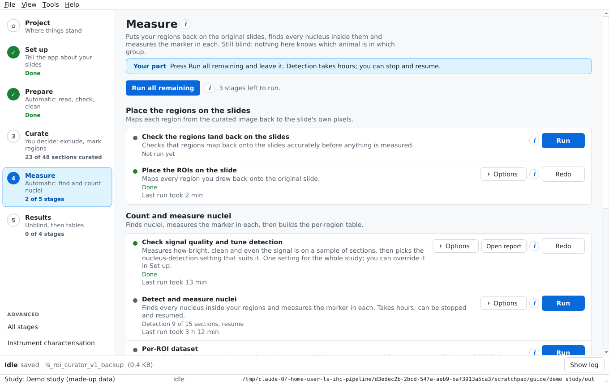

| Stage | What it does | Makes | Options |
| --- | --- | --- | --- |
| 05a Verify the inverse transform | Checks that regions map back onto the slides accurately before anything is measured | A pass or fail in the log |  |
| 05a Place the regions on the slides | Maps every region from the 256-pixel curation picture back onto the slide's own 0.65 µm pixels | Region geometry and boxes for each marker | Every section with a region (also those without a background disc); first N |
| 05b Check signal quality and tune detection | Measures how bright, clean and even the signal is on a sample of regions, gives a verdict (good, marginal or poor) with its reasons, and picks the nucleus-detection setting that suits it. One setting per marker for the whole study. | `qc/detection_tuning.md` and `.csv`; the tuned setting in the study file | Sections to sample (12 per marker); report only |
| 05c Detect and measure nuclei | Reads each region at full resolution, finds nuclei with StarDist (on DAPI; PCNA on its own channel, see below), measures the marker in each, and flags nuclei that sit on clipped pixels | `results/roi_nuclei.csv` | Order sections are measured in; save check pictures; redo; first N |
| 06a Per-region dataset | Turns nuclei into per-region numbers: how many cells, how many positive, per mm² | `results/roi_measurements.csv`, `results/detector_specificity.csv` |  |

**About 05b.** It reads three regions from each of twelve sections per marker, spread over every animal, at full resolution, on the plane detection uses (DAPI, or the marker itself for PCNA). It then counts nuclei at a range of StarDist probability cuts and keeps the cut where the count changes least, so the count reflects the nuclei rather than the cut. It never reads the treatment groups, and it never tunes per section, because a per-section setting would follow brightness and so could follow treatment. Its row shows the verdict for each marker once it has run, and its **Open report** button opens `qc/detection_tuning.md`. Read it before you start 05c: a *poor* verdict means fix the scans or the settings first. So **Run all remaining** stops after the signal check when any marker's verdict is *poor*, and a message names the marker and the reasons; the check's report and settings are kept. If you have looked and want to measure anyway, press **Run** on *Detect and measure nuclei*, which carries on with the tuned settings. 05c uses the tuned cut unless you set one yourself or switch off *Use auto-tuned detection settings* (Set up > Show advanced settings > Nucleus detection). **05c records the settings each marker was measured with and refuses to add sections measured with different ones**, so if you change them mid-study, re-measure that marker with **Redo … already done**.

### How your regions get from the curator to the slide

You draw regions on a small, standardised picture of the section, but nuclei can only be counted on the original scan. The picture in the curator is about 25 µm per pixel on the 256 grid; a nucleus is about 7 µm. So every region has to be carried back, point by point, onto the slide's own 0.65 µm pixels. This is the mapping step, and it happens in five moves.

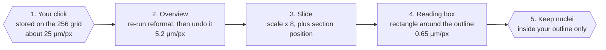

1. **Your click is stored on the 256 grid.** The curator picture may be shown at any size, and you may be zoomed in. Neither matters: when you export, every point is converted to the same 256 × 256 grid, so `roi_regions.csv` always holds grid coordinates. Zoom is only a view and never changes what is saved.
2. **The grid is turned back into the overview.** Stage 05a rebuilds how this section was standardised by re-running the exact same steps as the reformat stage: find the tissue, rotate it, flip it, crop it, pad it to a square. It checks that the rotation it gets matches the one recorded when you curated (to within 0.06°), and skips the section if not. It then undoes those steps, landing on the 5.2 µm overview picture of the section.
3. **The overview is placed on the slide.** The overview is exactly 8 times coarser than the scan, and the section's position on the slide is known from the file header. 05a checks the overview size matches the section's rectangle in the file. All of this becomes one small transformation per section, saved in the region geometry file.
4. **Each outline gets a reading box.** Every corner of your outline goes through that transformation. The rectangle around the outline is the only part of the slide file that detection reads, at full 0.65 µm resolution.
5. **Nuclei are kept only if they are inside your outline.** 05c finds nuclei in the box, then sends each nucleus centre back through the transformation and keeps it only if it falls inside the shape you drew. So your outline decides what counts, not the box.

Two details worth knowing. A region is mapped corner by corner, so it keeps its true shape even where a section was stretched more one way than the other; a round background disc becomes an oval on the slide, and its area is measured as such. And 05a's first stage, *Verify the inverse transform*, checks the whole chain on every pixel before anything is measured.

> **Half-pixel correction.** The curator counts a pixel from its edge, while the measuring stages count from its centre. Left alone, every region and background disc would land half a grid pixel (about 16 µm) down and to the right of where you drew it, moving about 3% of region nuclei across an edge. 05a now subtracts that half pixel from every point you placed before mapping it, so regions land where you drew them. A results file measured before this fix keeps the old membership until *Detect and measure nuclei* is run again.

### Nucleus detection, in plain words

- **Nuclei are found on DAPI, not on the marker (PCNA is the one exception, below).** The marker is measured afterwards inside each nucleus, and "positive" is decided later still. So you can change the positivity rule without re-reading any scans.
- **StarDist** separates touching nuclei, which matters in densely packed regions. It is used as published, without tuning.
- **It takes hours.** You can stop it with **Stop after this stage** or close the app, and run it again later. Finished sections are not redone.
- **Measurement order.** *balanced* (default) alternates treatment and control, so a part-finished run is already a fair comparison; it reads the group key only to choose the order. *uid* keeps the run fully blind. The finished file is identical either way.
- **Check pictures** (`--qc`) save one picture per region with nuclei outlined: green counted, red found but outside the region. Turn this on for a first run on a new study.

### PCNA: counted on its own channel

In the PCNA (AF488) scans, the DAPI plane is just noise at full resolution, so there are no nuclei on it to find. PCNA itself sits in the nucleus, so for PCNA the pipeline finds the PCNA-stained nuclei directly on the green channel. pERK is not affected and still uses DAPI.

**What this changes in your results:**

- **You get positive density only.** With no counterstain there is no count of all cells, so *fraction positive* and *total cell density* are left blank for PCNA. The column `denominator_withheld_reason` says why. The PCNA readout is **positive cells per mm²**.
- **Positivity is still set per section from the background discs**, as for pERK. Instead of a false-positive rate, PCNA reports **false positives per mm² of background** (`bg_false_positives_per_mm2` in `detector_specificity.csv`). The figures are captioned with it.
- **Brightness is scaled once per section.** All of a section's regions and background discs share one intensity range before StarDist sees them, so a bright proliferative zone cannot hide dim nuclei. The range used is recorded in `results/roi_normalisation.csv`.
- **The Abercrombie correction uses the size of the positive nuclei**, the ones actually counted.

**Before the full PCNA run, do a pilot.** This route has been tested on synthetic data only.

1. Turn on the study setting (see *Nucleus detection* in section 4).
2. On Measure, open **Options** on *Detect and measure nuclei*, set **Only the first N sections** to 3 and turn on **Save check pictures**, then run it for PCNA.
3. Look at the check pictures, especially in periventricular regions and background discs: are nuclei missed, or found in noise?
4. Hand-count PCNA-positive nuclei in about six regions, including two background discs, and compare with `n_positive` from 06a.
5. Check the median nucleus size of positive objects is roughly 7 to 9 µm.

Only then run all sections. The full checklist is in `docs/nuclei-detection-after-roi-curation.md`, section 4.8.

### How "positive" is decided (stage 06a)

Each section's own background discs set its cut: the background median plus three times its spread. It is worked out per section, because background brightness varies between sections. The share of background nuclei above the cut is reported as a false-positive rate in `detector_specificity.csv`.

Two densities are reported side by side: all nuclei, and positive nuclei. Both are divided by the region's area on the slide. Counts are also corrected for nuclei cut across two sections (the Abercrombie correction), using the nucleus size measured in that region. Raw and corrected numbers are both kept.

For PCNA, only the positive density is reported; see *PCNA: counted on its own channel* above.

**What good looks like.** The check pictures show nuclei outlined one by one, with few red ones. The false-positive rate is low and similar across animals.

**Common problems.** "Detection greyed out" means the app was started without StarDist; use the installed app, or `run_app.bat` with `work/appenv`. A section with no background disc is left out of positivity; go back to the ROI curator and add one. A section refused in 05a has geometry that cannot be rebuilt; check it in the curator's Review.

### Repair older outputs

Three tools fix results files written by older versions of the pipeline. They are not part of a normal run. Each backs the file up first, and **Report only** (`--dry-run`) says what would change without writing.

| Tool | Use it when |
| --- | --- |
| 06f Recompute the censored flag | A results file was written before detection flagged clipped nuclei itself |
| 06g Flag nuclei off the section | A results file was written before detection flagged nuclei found on bare glass |
| 06h Backfill segmentation provenance | A results file lacks the columns saying which channel and method found each object |

## 8. Results: unblinding, spreadsheets and figures

Results joins the measurements to the experiment's treatment groups and writes the spreadsheets. The R figures are switched off for now (see The figures, below). **The first stage unblinds the analysis.** When the measurements are in, Next up says *Measurements are in. Unblind and build the results.* **Run all remaining never unblinds**; it always waits for you.

Pressing **Run** on *Join the experiment (06b, marked ⚠ unblinds; its button reads Run…)* opens a box titled **Unblind the analysis?** It explains that this stage reads the treatment groups for the first time, and that everything before it was keyed by animal only. The **Sampling workbook (.xlsx)** field shows which workbook will be read; leave it empty to use the one in the slide folder, or press **Choose…** to pick another. Do this once the regions and detection settings are final. Press **Unblind and run** to go ahead, or **Cancel**.

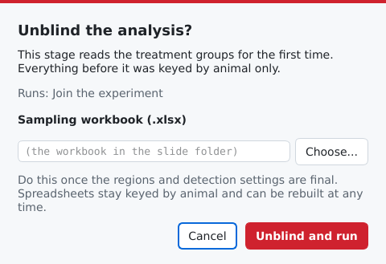

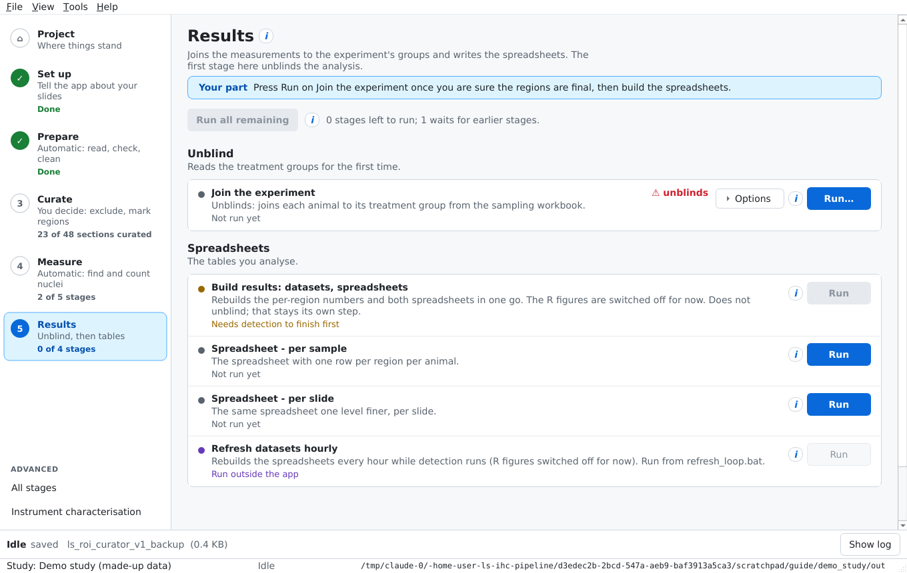

| Stage | What it does | Makes |
| --- | --- | --- |
| 06b Join the experiment (unblind) | Reads the sampling workbook and joins each animal to its treatment group. It checks the cohort against the workbook's own record of which animals were sliced, and stops loudly if they disagree. | `results/roi_dataset.csv`, `results/animal_metadata.csv` |
| 06e Build results | One pass that rebuilds the per-region numbers and both spreadsheets. It does not draw the R figures for now. | Everything below |
| 06c Spreadsheet per sample | One row per region per animal, plus per-disc, per-section and coverage sheets. **The figures and statistics read this one**, because the animal is the unit of comparison. | `results/roi_dataset.xlsx` |
| 06d Spreadsheet per slide | The same, one level finer, to show spread within an animal. Slides are not independent replicates; do not test on this sheet. | `results/roi_dataset_by_slide.xlsx` |
| 06e Refresh hourly | Rebuilds the spreadsheets every hour while detection is still running, and stops when it finishes or stalls. Run it from `refresh_loop.bat`, not the app. | `results/ROI_plots/` |

### Before you unblind

- **The sampling workbook.** Unless you choose another in the Unblind box, 06b looks for `large scale exp sampling data.xlsx` in the slides folder. Its header must match what the stage expects; if it does not, the stage names the mismatched columns.
- **Check measurement is finished**, or decide consciously to look at a partial result. The spreadsheets can be rebuilt at any time, including while detection runs.
- **Look at the coverage sheet** in `roi_dataset.xlsx`. Some animals may have few measurable sections because of saturation; note this before comparing groups.

### The figures

**The R figures are switched off for now.** Build results and the hourly refresh rebuild the numbers and spreadsheets but no longer look for R or draw figures, so `results/ROI_plots/` is not updated. The R scripts are still in the `analysis/` folder (`plot_roi_figures.R`, `plot_by_sample.R`, `plot_by_slide.R`, statistics in `roi_stats.R`) and can be run by hand with `Rscript`, and the installer still includes R. Turning the figures back on is a code change in `scripts/06e_refresh_loop.py`, where the R step is commented out rather than deleted.

**What not to claim.** There are no no-primary controls in the LS dataset, so absolute statements like "30% of cells are positive" are not supported. Comparisons between groups at matched brain levels are.

## 9. Extras: instrument characterisation and All stages

### Instrument characterisation (Tools menu)

These stages measure the microscope, not the tissue: where the camera tiles sit and how unevenly each tile is lit. **They are done once per microscope and are already done for the LS dataset**, so a new study on the same scanner can skip them. Section export uses the correction when it exists and works without it.

| Stage | What it does | Options |
| --- | --- | --- |
| 01e Tile geometry | Reads where the tiles sit on each slide |  |
| 01b Pick the sample | Chooses the sections used to measure illumination | Sections in the sample (96); at most N per slide file (4) |
| 01b Export the sample (Fiji) | Exports that sample at 2.6 µm per pixel. Needs Fiji and runs outside the app: `scripts/run_all.sh` steps 3 to 8. |  |
| 01f Build and apply the tile correction | Builds a correction for uneven brightness across each tile, then applies it to the sample for checking |  |
| 01c Measure the tile pattern, before and after | How strong the tile pattern is before and after correction |  |
| 01h Illumination from raw tiles | A second illumination measurement from raw tiles, for checking only | Slide files to sample (16); tiles per file (60) |

### View > All stages

Every stage in one list, in the order of the methods figure, with the same Run, Options and (i) buttons. Use it when you know exactly which stage you want, for example to re-run one stage with **Redo** switched on. The superseded level curator (04k) is listed only here.

### Running stages outside the app

Every stage is a script in `scripts/` and can also be run from a terminal; the (i) panel on each stage shows its exact command line. `scripts/run_all.sh` runs the whole pipeline in order. The app and the scripts read the same settings file, so you can mix the two.

## 10. Troubleshooting and safe re-runs

### Re-running safely

- **Stages skip finished work.** Pressing Run again only fills the gaps, so it is cheap and safe.
- **Out of date.** From *Place the ROIs on the slide* on, a finished stage shows an amber **Out of date** with the reason when what it was made from has changed since it ran: your ROI export, the output of an earlier stage (including re-placed regions for either marker, so re-placing only PCNA's regions also marks its detection and results out of date), or a setting it reads (named on the row). A fix to the app that changed its results does the same: regions placed or nuclei measured before the region fixes of 14 October 2026 (the half-pixel correction and native-pixel clipped-nucleus flags; see section 7) show Out of date. Everything made from an out-of-date stage shows it too. **Run all remaining** runs them again in order, and their progress no longer counts as done. Saving the same export again, or changing a setting back, changes nothing.
- **An out-of-date stage is redone in full.** Nucleus detection normally keeps finished sections; when it is out of date its next run switches Redo on for that run (the row says *Run redoes all of it*, and the log says so), because a resume would keep every section as it was. That takes hours. Your saved Options are not changed.
- **Out of date never deletes anything.** It only changes the status and what Run all remaining runs; the old outputs stay until the stage runs again. It is judged from the run history the app keeps in the project, so a stage last run outside the app, or with *Only the first N*, is judged by file dates instead, which can tell that an input is newer but not that a setting changed.
- **After changing a setting** that no Out of date row picks up (stages before *Place the ROIs on the slide*), re-run the stages that read it with **Redo … already done** switched on in Options. The setting's (i) says which stages read it. Then switch Redo off again.
- **Nothing is deleted.** Excluded sections can be reinstated in the ROI curator's Review. Repair tools back up the results file before changing it.
- **Stop cleanly** with **Stop after this stage** on the status bar, rather than closing the app mid-stage.

### Common problems

| What you see | Likely cause | What to do |
| --- | --- | --- |
| Red rows on the Slides tab | File names do not fit the naming pattern | Fix the pattern with **Set up from an example…** on *Slide file names*, or rename the files |
| Fewer sections than expected | Unmatched file names, or an incomplete copy | Check the Slides tab and the 00b result |
| Run all remaining stops at a stage | That stage failed, or it waits for a curator | Read the screen's note and **Show log**. A waiting stage names the curator to export. |
| "Finish Set up" on the Next up card | A required setting is empty, or the Slides tab is not done | The card names each Set up card and the settings it lacks, and what is left on the Slides tab (read the slides, file names that don't fit the rule, markers to name); open Set up and do those |
| A curator's decisions are ignored | You did not press **Export** | Open the curator and press Export (in the ROI curator, Done: export and go to Measure does it for you) |
| Curation made in a browser is missing | Browser work is stored in that browser only | **Tools > Migrate browser curation**, or **Bring in browser exports** |
| Nucleus detection is greyed out | No StarDist in this Python | Use the installer, or start with `run_app.bat` (uses `work/appenv`) |
| The overview stage fails on Python 3.14 | The CZI reader has no 3.14 version | Use Python 3.13 via `run_app.bat` |
| A curator pane is blank in the .exe | The packaged files are incomplete | Start the app with `--self-test` and read `lsapp-selftest.log`; reinstall if it fails |
| The app will not start | A missing library or a broken environment | Read `lsapp-crash.log`, in `%LOCALAPPDATA%\The Great IHC Leap Forward\logs` on Windows (`~/.local/state/The Great IHC Leap Forward/logs` elsewhere; the message box names it). **Help > Open the log folder** opens that folder. To keep curating meanwhile, run `serve_curators.bat` and use a browser. |
| No new figures in results/ROI\_plots | The R figure steps are switched off for now | Run the scripts in `analysis/` by hand with `Rscript` (section 8) |
| 06b says the workbook header does not match | The sampling workbook's columns differ | Fix the workbook's column names to the ones it lists |

### Where to look for more detail

- The **(i)** button on any stage or setting.
- **The project wiki** on GitHub (**Help > Wiki**): short, question-led pages (Quick Start, Setting Up a Study, Prepare, Curate, Measure, Results, Atlases, Troubleshooting, Glossary). It is written from `docs/wiki/` in the repository and kept in step with this guide.
- `docs/pipeline-guide.md`: every stage explained in depth, with the reasoning behind it.
- `docs/setting-up-a-study.md`: settings, channels and the segmentation choices in detail.
- `docs/adding-your-own-atlas.md`: drawing an atlas's regions in Fiji and adding it.
- `docs/nuclei-detection-after-roi-curation.md`: detection step by step.
- `LOGS.md`: the running record of what went wrong and how it was fixed.

## 11. Glossary

| Term | Meaning |
| --- | --- |
| Abercrombie correction | Scales a count down to allow for nuclei cut across two neighbouring sections, using section thickness and measured nucleus size |
| Analysis set | The sections that can be measured, after exclusions and saturation set-asides |
| Artifact mask | Marks bubbles, clumps and fibres inside a section so they are not measured |
| Atlas plate | One labelled page of the brain atlas. Matching a section to a plate says how far along the brain it is. |
| Background disc | A circle you place on tissue with no real signal. It sets that section's positivity cut and measures the false-positive rate. |
| Blinding | No stage reads an animal's treatment group until Results, so no decision can be biased by it |
| Censored (clipped) pixel | A pixel where the camera hit its maximum, so its true brightness is unknown. Nuclei under one count as positive. |
| Channel | One colour recorded by the scanner, such as DAPI or a marker |
| Counterstain (DAPI) | Stains every nucleus. Nuclei are found on it (except for PCNA, whose DAPI plane is unusable); it is not itself measured. |
| Curator | An interactive page where you make decisions; it saves as you go and hands decisions on with Export |
| CZI | Zeiss's slide file: one slide, several sections, every channel and tile |
| Exclusion | A decision that a section should not be used. It is a flag, not a deletion. |
| False-positive rate | The share of background-disc nuclei above the positivity cut |
| Favourite | A section you want in the quantified subset or the Shotgun deck |
| Landmark | A matching pair of points on the section and the plate, showing how well they fit |
| Marker | The stain being measured, such as pERK or PCNA |
| Multiplex, paired | Multiplex: one scan holds every marker. Paired: one scan per marker, of different sections. |
| Overview | A small picture of one section made once, so nothing reopens the large slide file to look at it |
| Plate set | A folder of atlas plates with the region outlines on them |
| Positivity cut | The marker brightness above which a nucleus counts as positive; set per section from its background discs |
| Project | One study in one file: settings, curator decisions and a record of each run |
| Reformat | The standard picture of a section: cleaned, upright, centred and resized to 256 × 256 pixels |
| ROI (region) | A brain region you outlined on a section, measured as one area |
| Scene, section | Scene: one area the scanner was told to image; in practice one brain section. Section: one thin slice of tissue (14 µm in LS). |
| scene\_uid | The ID every table uses for a section, built from animal, slide and scene, for example `LS105_s10a_sc03` |
| Stage | One step of the pipeline, with a number such as `04g` and a script in `scripts/` |
| StarDist | The published model that finds nuclei on DAPI, used without tuning |
| Tile | One camera frame; the scanner stitches many into a section |
| Unblinding | Joining animals to their treatment groups, the first stage on the Results screen |
| Worklist | The order the ROI curator shows sections in, balanced across animals |
