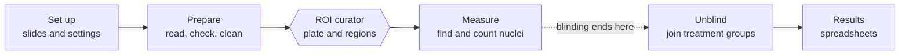

# The Great IHC Leap Forward

A desktop app that turns whole-slide fluorescence scans of brain sections (Zeiss `.czi`) into counts of marker-positive cells per brain region, per animal. It was built for the LS study (pERK and PCNA in Atlantic salmon, counterstained with DAPI) and works for any study set up the same way.

The program does the repetitive work and asks a person only where judgement is needed: you match each section to an atlas plate and draw the regions to measure. Everything else runs on its own.

## Start here

| If you want to | Read |
| --- | --- |
| Install the app and open it for the first time | [Install and first run](Install-and-First-Run) |
| See the whole job on one page | [Quick start](Quick-Start) |
| Describe a new study to the app | [Setting up a study](Setting-Up-a-Study) |
| Understand each step | [Prepare](Prepare), [Curate](Curate), [Measure](Measure), [Results](Results) |
| Use the salmon or zebrafish atlas, or your own | [Atlases](Atlases) |
| Fix something that went wrong | [Troubleshooting](Troubleshooting) |
| Run stages from a terminal | [Running from source](Running-from-Source) |
| Cite the app and the atlases | [Citing](Citing) |
| Look up a word | [Glossary](Glossary) |

## How a study goes

The hexagon is the one place a normal run stops for you.

## Three rules the pipeline never breaks

- **The program proposes, you decide.** Exclusions and rotations are made automatically and you can reverse any of them. Atlas matching is always done by a person.
- **Nothing is deleted.** A section that is set aside keeps a flag saying so and why, and can be brought back without re-reading any scans.
- **Blind until the end.** No stage before *Unblind* reads which treatment group an animal is in.

## Other documents

These wiki pages are the short version. The full references live in the repository:

- `docs/user-guide.md`: the complete user guide, with every option.
- `docs/pipeline-guide.md`: every stage in depth, with the reasoning behind it.
- `docs/setting-up-a-study.md`: settings, channels and segmentation choices in detail.
- `docs/adding-your-own-atlas.md`: drawing an atlas in Fiji.
- `LOGS.md`: the running record of what went wrong and how it was fixed.
